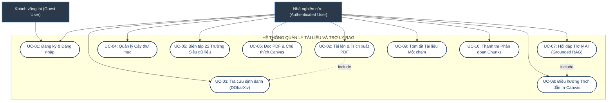
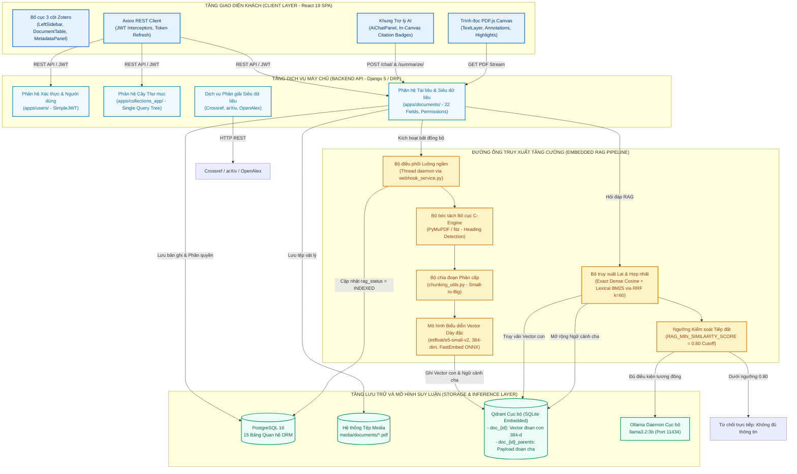
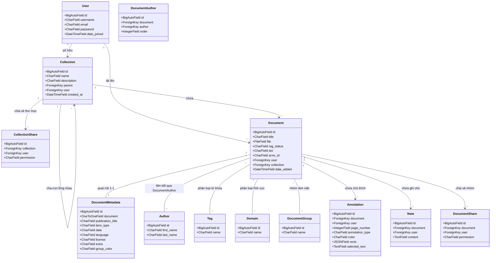
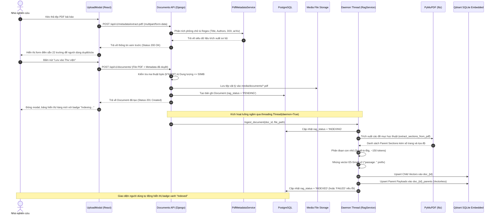
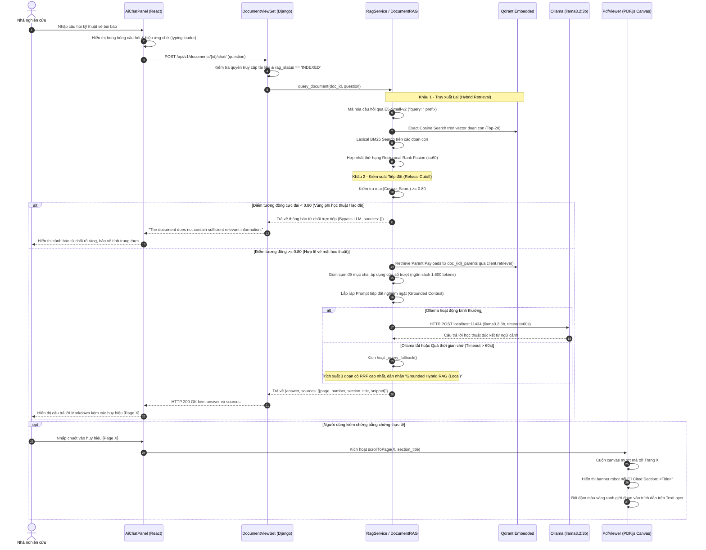

# TRƯỜNG ĐẠI HỌC TÔN ĐỨC THẮNG
## KHOA CÔNG NGHỆ THÔNG TIN
***

# ĐỒ ÁN TỐT NGHIỆP ĐẠI HỌC
### CHUYÊN NGÀNH: KHOA HỌC MÁY TÍNH

<br/>

## XÂY DỰNG HỆ THỐNG QUẢN LÝ TÀI LIỆU NGHIÊN CỨU KHOA HỌC TÍCH HỢP TRỢ LÝ AI SỬ DỤNG RAG

<br/>

**Sinh viên thực hiện:**
- **ĐẶNG HỮU GIA HUÂN** — MSSV: **52300105**
- **HỒ GIA KIỆN** — MSSV: **52300122**

**Giảng viên hướng dẫn:**
- **ThS. DUNG CẨM QUANG**

<br/>

**THÀNH PHỐ HỒ CHÍ MINH, NĂM 2026**

---

## LỜI CẢM ƠN

Để hoàn thành đồ án tốt nghiệp này, nhóm tác giả xin bày tỏ lòng biết ơn sâu sắc và chân thành nhất đến quý Thầy, Cô Khoa Công nghệ Thông tin – Trường Đại học Tôn Đức Thắng, những người đã tận tâm truyền đạt tri thức nền tảng và chuyên sâu trong suốt những năm tháng học tập tại trường.

Đặc biệt, nhóm tác giả xin gửi lời cảm ơn sâu sắc nhất tới **ThS. Dung Cẩm Quang**, giảng viên hướng dẫn đồ án. Thầy đã luôn dành thời gian quý báu để định hướng phương pháp luận khoa học, góp ý tỉ mỉ từ những thiết kế kiến trúc hệ thống ban đầu cho đến từng phép kiểm định thống kê và các chuẩn mực trung thực học thuật trong báo cáo kết quả thực nghiệm. Sự chỉ dẫn nghiêm cẩn của Thầy là kim chỉ nam giúp nhóm hoàn thiện cả sản phẩm ứng dụng thực tế lẫn công trình nghiên cứu một cách trọn vẹn.

Cuối cùng, chúng con xin gửi lòng biết ơn vô hạn đến gia đình, cha mẹ đã luôn là hậu phương vững chắc, yêu thương và tạo mọi điều kiện tốt nhất cho chúng con trong suốt quá trình học tập. Nhóm cũng xin cảm ơn bạn bè, các đồng môn đã luôn động viên, chia sẻ tài liệu và đồng hành cùng nhóm trong suốt chặng đường thực hiện đồ án.

*TP. Hồ Chí Minh, năm 2026*  
**Nhóm sinh viên thực hiện:**  
*Đặng Hữu Gia Huân — Hồ Gia Kiện*

---

## LỜI CAM ĐOAN

### CÔNG TRÌNH ĐƯỢC HOÀN THÀNH TẠI TRƯỜNG ĐẠI HỌC TÔN ĐỨC THẮNG

Chúng tôi xin cam đoan đây là công trình nghiên cứu của riêng chúng tôi và được sự hướng dẫn khoa học của **ThS. Dung Cẩm Quang**. Các nội dung nghiên cứu, kết quả trong đề tài này là trung thực và chưa công bố dưới bất kỳ hình thức nào trước đây. Những số liệu trong các bảng biểu phục vụ cho việc phân tích, nhận xét, đánh giá được chính tác giả thu thập từ các nguồn khác nhau có ghi rõ trong phần tài liệu tham khảo.

Ngoài ra, trong Đồ án còn sử dụng một số nhận xét, đánh giá cũng như số liệu của các tác giả khác, cơ quan tổ chức khác đều có trích dẫn và chú thích nguồn gốc.

Nếu phát hiện có bất kỳ sự gian lận nào chúng tôi xin hoàn toàn chịu trách nhiệm về nội dung Đồ án của mình. Trường Đại học Tôn Đức Thắng không liên quan đến những vi phạm tác quyền, bản quyền do chúng tôi gây ra trong quá trình thực hiện (nếu có).

*TP. Hồ Chí Minh, ngày 25 tháng 10 năm 2026*  
**Tác giả**  
*(Ký tên và ghi rõ họ tên)*  

<br/>

**Đặng Hữu Gia Huân**  
MSSV: **52300105**  

<br/>

**Hồ Gia Kiện**  
MSSV: **52300122**  

---

## TÓM TẮT ĐỒ ÁN (ABSTRACT)

### Tóm tắt tiếng Việt
Trong bối cảnh xuất bản học thuật bùng nổ, các nhà nghiên cứu, giảng viên và sinh viên đối mặt với khối lượng tài liệu PDF khổng lồ. Mặc dù các phần mềm quản lý trích dẫn kinh điển (Zotero, Mendeley) giải quyết tốt bài toán tổ chức thư viện, chúng hoàn toàn thiếu năng lực thấu hiểu nội dung sâu, buộc người dùng phải đọc quét thủ công qua hàng chục trang để đối chiếu các chi tiết kỹ thuật phân tán. Ngược lại, việc ứng dụng các dịch vụ Mô hình Ngôn ngữ Lớn thương mại trên nền tảng đám mây vấp phải các rào cản nghiêm trọng về nguy cơ rò rỉ bản thảo chưa công bố, ảo giác học thuật và chi phí duy trì đắt đỏ.

Đồ án này giải quyết triệt để các thách thức trên thông qua hai đóng góp song hành:
1. **Về mặt kỹ thuật phần mềm:** Phân tích, thiết kế và xây dựng hoàn chỉnh một ứng dụng web quản lý tài liệu nghiên cứu khoa học theo phong cách Zotero dựa trên kiến trúc Khối đơn mô-đun hóa (Modular Monolith). Hệ thống tích hợp trực tiếp một trợ lý AI cục bộ sử dụng kiến trúc Truy xuất tăng cường sinh (Retrieval-Augmented Generation - RAG), vận hành hoàn toàn trên máy tính cá nhân thông thường (CPU đa luồng, 16 GB RAM, không bắt buộc GPU) mà không phụ thuộc vào bất kỳ dịch vụ AI đám mây nào. Hệ thống trang bị giao diện 3 cột hiện đại (React 19, TypeScript, CSS Modules), trình đọc PDF.js tương tác với khả năng bôi đậm đa màu và ghi chú canvas, quản lý hướng dữ liệu 22 trường siêu dữ liệu học thuật, kho vector nhúng Qdrant SQLite theo mô hình Hai Bộ sưu tập Song hành (Companion Vectorless Collections), ngưỡng ngắt từ chối an toàn 0.80 triệt tiêu ảo giác, và tính năng định vị trích dẫn in-canvas với banner robot nổi (`🤖 Cited Section`).
2. **Về mặt nghiên cứu khoa học:** Thực hiện quy trình thực nghiệm có kiểm soát chặt chẽ đối với 5 câu hỏi nghiên cứu (RQ1–RQ5) trên ngữ liệu khoa học chuẩn QASPER (1.585 bài báo / 5.049 câu hỏi). Nghiên cứu khẳng định `pymupdf_layout` là engine trích xuất PDF tối ưu (Heading F1 = 48,01%, 26,16 ms/trang); chứng minh cơ chế phân mảnh phân cấp Small-to-Big (`hierarchical`) xác lập vị thế quán quân lý thuyết ($\text{nDCG@10} = 0,6880$, $\Delta = +0,1225^*$) dưới cùng ngân sách 1.600 tokens; xác định `intfloat/e5-small-v2` là mô hình biểu diễn vector cân bằng lý tưởng nhất trên đường biên Pareto cho máy trạm để bàn (nDCG@10 = 0,5522, 30,26 ms, 659,8 MB RAM); kiểm chứng trên tập kiểm thử độc lập (Held-Out Test: 408 bài báo, 1.310 câu hỏi) chứng minh cơ chế kết hợp tuyến tính lồi (Convex Fusion, $\alpha=0.7$) mang lại cải thiện vượt trội có ý nghĩa thống kê ($\text{nDCG@10} = 0,5806$, $\Delta = +0,0152^*$, $p_$p_$p_{\text{adj}} = 0,0140 < 0,05$), trong khi thuật toán Reciprocal Rank Fusion ($k=60$) đang vận hành trong sản phẩm duy trì hiệu năng tương đương Dense Only mà không cần chuẩn hóa phân phối điểm số; và xác lập `llama3.2:3b` là mô hình sinh lời đáp tối ưu cho môi trường máy trạm CPU 16 GB RAM thông qua đánh giá hai tầng (500 câu hỏi định lượng tự động và 60 câu kiểm toán người mù đôi), đạt tỷ lệ tuân thủ căn cứ 70,0%, kiểm soát ảo giác 15,0%, tỷ lệ từ chối sai thấp 5,0%, thông lượng 12,7 tokens/s và vượt trội có ý nghĩa thống kê cao so với `llama3.2:1b` ($\Delta = +0,0687, p_{\text{adj}} = 3,35 \times 10^{-9}$).

### Abstract in English
In the era of academic publication explosion, researchers, lecturers, and students are overwhelmed by vast volumes of PDF papers. While classical reference managers (Zotero, Mendeley) efficiently organize libraries, they completely lack deep content comprehension, compelling users to manually skim through dozens of pages to locate dispersed technical details. Conversely, adopting commercial cloud Large Language Model (LLM) APIs introduces grave barriers regarding confidential manuscript leakage, academic hallucinations, and prohibitive operating costs.

This graduation thesis addresses these challenges through two interconnected deliverables:
1. **Software Engineering Deliverable:** We analyzed, designed, and implemented a full-stack academic document management web system adhering to a Modular Monolith architecture. The platform seamlessly integrates a local Retrieval-Augmented Generation (RAG) assistant operating entirely on an ordinary desktop workstation (multi-core CPU, 16 GB RAM, no dedicated GPU required) without relying on any external cloud AI services. The system features a modern Zotero-style 3-column UI (React 19, TypeScript, Vanilla CSS Modules), an interactive PDF.js reader supporting multi-color highlights and freehand sticky notes, a data-driven bibliographic editor covering 22 academic fields, an embedded Qdrant SQLite vector store utilizing a Companion Vectorless Collection paradigm, an empirical 0.80 cosine refusal cutoff guardrail eliminating out-of-context hallucinations, and in-canvas citation localization featuring floating robotic section banners (`🤖 Cited Section`).
2. **Scientific Research Deliverable:** We conducted rigorous, controlled empirical benchmarking across five research questions (RQ1–RQ5) using the standard QASPER scientific corpus (1,585 papers / 5,049 questions). Our findings establish `pymupdf_layout` as the champion academic PDF extractor (Heading F1 = 48.01%, 26.16 ms/page); prove that Small-to-Big `hierarchical` chunking achieves the theoretical frontier ($\text{nDCG@10} = 0.6880$, $\Delta = +0.1225^*$) under a fixed 1,600-token budget; identify `intfloat/e5-small-v2` as the Pareto-optimal dense embedding model for desktop CPUs (nDCG@10 = 0.5522, 30.26 ms latency, 659.8 MB RAM); demonstrate on the held-out test split (408 papers, 1,310 queries, 14,035 child passages) that Convex Fusion ($\alpha=0.7$) achieves a statistically significant retrieval improvement ($\text{nDCG@10} = 0.5806$, $\Delta = +0.0152^*$, $p_{\text{adj}} = 0.0140 < 0.05$), while production Reciprocal Rank Fusion ($k=60$) maintains parity with dense retrieval without requiring complex score calibration; and establish `llama3.2:3b` as the optimal local generation model for 16 GB RAM desktop CPUs through a dual-tier evaluation (500-question automated benchmark and 60-answer double-blind human audit), achieving 70.0% grounded compliance, 15.0% hallucinations, 5.0% unjustified refusals, 12.7 tokens/s throughput, and statistically significant superiority over `llama3.2:1b` ($\Delta = +0.0687, p_{\text{adj}} = 3.35 \times 10^{-9}$).

---

## MỤC LỤC TOÀN VĂN

- **LỜI CẢM ƠN**
- **LỜI CAM ĐOAN**
- **TÓM TẮT ĐỒ ÁN (ABSTRACT)**
- **DANH MỤC HÌNH VẼ**
- **DANH MỤC BẢNG BIỂU**
- **DANH MỤC TỪ VIẾT TẮT**
- **CHƯƠNG 1. MỞ ĐẦU VÀ TỔNG QUAN ĐỀ TÀI**
  - 1.1. Lý do chọn đề tài
  - 1.2. Mục tiêu thực hiện đề tài
    - 1.2.1. Mục tiêu tổng quát
    - 1.2.2. Mục tiêu cụ thể
  - 1.3. Đối tượng và phạm vi nghiên cứu
  - 1.4. Phương pháp nghiên cứu
  - 1.5. Ý nghĩa khoa học và thực tiễn của đề tài
- **CHƯƠNG 2. CƠ SỞ LÝ THUYẾT VÀ TỔNG QUAN NGHIÊN CỨU**
  - 2.1. Các hệ thống quản lý tài liệu nghiên cứu
  - 2.2. Retrieval-Augmented Generation (RAG)
  - 2.3. Các hướng cải thiện pipeline RAG
    - 2.3.1. Trích xuất văn bản từ tài liệu PDF
    - 2.3.2. Phương pháp chia đoạn văn bản (Chunking)
    - 2.3.3. Mô hình embedding và phương pháp truy xuất lai
  - 2.4. Đánh giá hệ thống RAG và các thước đo định lượng
  - 2.5. Nhận xét và định hướng nghiên cứu
- **CHƯƠNG 3. PHƯƠNG PHÁP NGHIÊN CỨU VÀ THIẾT KẾ THỰC NGHIỆM**
  - 3.1. Phương pháp nghiên cứu
  - 3.2. Dữ liệu và môi trường thực nghiệm
    - 3.2.1. Bộ dữ liệu thực nghiệm QASPER
    - 3.2.2. Môi trường thực nghiệm máy trạm CPU
  - 3.3. Thiết kế thực nghiệm theo câu hỏi nghiên cứu
    - 3.3.1. Đánh giá phương pháp trích xuất văn bản PDF (RQ1)
    - 3.3.2. Đánh giá chiến lược phân mảnh văn bản - Chunking (RQ2)
    - 3.3.3. Đánh giá mô hình biểu diễn vector - Embedding (RQ3)
    - 3.3.4. Đánh giá phương pháp truy xuất kết hợp - Hybrid Search (RQ4)
    - 3.3.5. Đánh giá mô hình ngôn ngữ lớn cục bộ (RQ5) và Cơ sở lựa chọn ba mô hình ứng viên
    - 3.3.6. Đánh giá cấu hình RAG kết hợp toàn trình (RQ6 - Định hướng tiếp theo)
  - 3.4. Tổng hợp các chỉ số đánh giá
  - 3.5. Kiểm soát thực nghiệm và khả năng tái lập
  - 3.6. Phạm vi thực hiện và giới hạn nghiên cứu
- **CHƯƠNG 4. PHÂN TÍCH, THIẾT KẾ VÀ XÂY DỰNG HỆ THỐNG**
  - 4.1. Khảo sát và Xác định Yêu cầu Hệ thống
  - 4.2. Phân tích Use Case Hệ thống
  - 4.3. Thiết kế Kiến trúc Tổng thể Hệ thống (Modular Monolith)
  - 4.4. Thiết kế Cơ sở Dữ liệu và Kho Vector (PostgreSQL & Qdrant Companion Store)
  - 4.5. Thiết kế Quy trình Nghiệp vụ Cốt lõi (Ingestion & Q&A Workflow)
  - 4.6. Thiết kế Giao diện Người dùng (React 19 & In-Canvas Citation)
  - 4.7. Hiện thực hóa và Cài đặt các Phân hệ Cốt lõi
  - 4.8. Hiện trạng Tích hợp RAG và Đánh giá sự Tương thích Kiến trúc
  - 4.9. Giới hạn Kỹ thuật của Hệ thống
  - 4.10. Tổng kết Chương 4
- **CHƯƠNG 5. KẾT QUẢ THỰC NGHIỆM VÀ THẢO LUẬN**
  - 5.1. Giới thiệu chương và Phân tích Khám phá Dữ liệu (EDA toàn phần)
  - 5.2. Kết quả RQ1 – Đánh giá phương pháp trích xuất văn bản PDF
  - 5.3. Kết quả RQ2 – Đánh giá chiến lược phân mảnh văn bản
  - 5.4. Kết quả RQ3 – Đánh giá mô hình embedding
  - 5.5. Thực nghiệm RQ4: Đánh giá cơ chế truy xuất lai kết hợp phân mảnh phân cấp trên tập Test độc lập
  - 5.6. Kết quả RQ5 – Đánh giá thực nghiệm mô hình ngôn ngữ lớn cục bộ (Local LLM Generation & Faithfulness)
  - 5.7. Tổng hợp và đối chiếu kết quả các câu hỏi nghiên cứu (RQ1–RQ5)
  - 5.8. Hạn chế và đe dọa đến tính hợp lệ (Threats to Validity)
  - 5.9. Tổng kết chương
- **CHƯƠNG 6. KẾT LUẬN VÀ HƯỚNG PHÁT TRIỂN**
  - 6.1. Tổng kết các Kết quả Đạt được của Đồ án
    - 6.1.1. Về mặt Xây dựng Sản phẩm Phần mềm (Engineering Deliverables)
    - 6.1.2. Về mặt Nghiên cứu Thực nghiệm và Đóng góp Phương pháp luận (Scientific Deliverables)
  - 6.2. Những Điểm Hạn chế Còn Tồn đọng
  - 6.3. Định hướng Phát triển trong Tương lai
    - 6.3.1. Đánh giá Thực nghiệm Cấu hình RAG Kết hợp Toàn trình (End-to-End RAG Combination Benchmark - RQ6)
    - 6.3.2. Bổ sung Mô hình Xếp hạng lại Giai đoạn hai (Cross-Encoder Reranking)
    - 6.3.3. Phát triển Cơ chế Hỏi đáp Tổng hợp Đa Tài liệu (Multi-Document Synthesis)
    - 6.3.4. Tích hợp Tìm kiếm Toàn văn Ngữ nghĩa và Đại lý AI (AI Search Agent)
    - 6.3.5. Module Phát hiện và Nhận diện Chữ dạng Ảnh (OCR Module cho Scanned PDFs)
  - 6.4. Lời kết
- **TÀI LIỆU THAM KHẢO**
- **PHỤ LỤC LUẬN VĂN: TÀI LIỆU KỸ THUẬT VÀ TỪ ĐIỂN DỮ LIỆU**
  - Phụ lục A: Danh mục 22 Trường Siêu Dữ liệu Học thuật
  - Phụ lục B: Từ điển Dữ liệu Qdrant Hai Bộ sưu tập Song hành
  - Phụ lục C: Danh mục Điểm cuối Giao diện Lập trình REST API
  - Phụ lục D: Bảng Phím tắt Trình duyệt trong Ứng dụng
  - Phụ lục E: Hồ sơ Thực nghiệm và Cấu hình Benchmark RQ4

---

## DANH MỤC HÌNH VẼ

| Ký hiệu | Tên hình vẽ | Trang / Vị trí |
| :--- | :--- | :--- |
| **Hình 3.1** | Sơ đồ Pipeline RAG tổng thể cho tài liệu nghiên cứu khoa học | Chương 3, Mục 3.1 |
| **Hình 4.1** | Sơ đồ Use Case tổng quát của Hệ thống Quản lý Tài liệu Nghiên cứu | Chương 4, Mục 4.2 |
| **Hình 4.2** | Sơ đồ Kiến trúc Thành phần Tổng thể của Hệ thống (Modular Monolith) | Chương 4, Mục 4.3 |
| **Hình 4.3** | Sơ đồ Lớp Thực thể Cơ sở dữ liệu Quan hệ PostgreSQL (15 bảng) | Chương 4, Mục 4.4 |
| **Hình 4.4** | Lưu đồ Tuần tự Quy trình Nạp tài liệu và Lập chỉ mục RAG Luồng ngầm | Chương 4, Mục 4.5 |
| **Hình 4.5** | Lưu đồ Tuần tự Quy trình Hỏi đáp RAG và Điều hướng Trích dẫn In-Canvas | Chương 4, Mục 4.5 |
| **Hình 5.0** | Phân tích Khám phá Đặc trưng Dữ liệu Ngữ liệu Khoa học QASPER Toàn phần (N = 1.585) | Chương 5, Mục 5.1 |
| **Hình 5.1** | Điểm số nDCG@10 Truy xuất Hạ nguồn Kèm Khoảng Tin cậy 95% CI giữa các Bộ Trích xuất PDF | Chương 5, Mục 5.2 |
| **Hình 5.2** | Thời gian Xử lý Trung bình trên Mỗi Trang PDF (ms/trang) của các Công cụ Khảo sát | Chương 5, Mục 5.2 |
| **Hình 5.3** | Phân bố nDCG@10 (Kèm 95% CI) của 8 Chiến lược Phân mảnh tại $\tau=0,50$ và $\tau=0,30$ | Chương 5, Mục 5.3 |
| **Hình 5.4** | Biểu đồ Xếp hạng Chất lượng Truy xuất nDCG@10 (Kèm 95% CI) của 11 Mô hình Embedding | Chương 5, Mục 5.4 |
| **Hình 5.5** | Không gian Đánh đổi Chất lượng – Chi phí và Đường biên Hiệu quả Pareto trên CPU Máy trạm | Chương 5, Mục 5.4 |

---

## DANH MỤC BẢNG BIỂU

| Ký hiệu | Tên bảng biểu | Trang / Vị trí |
| :--- | :--- | :--- |
| **Bảng 3.1** | Tổng hợp các Chỉ số Đánh giá Định lượng trong Nghiên cứu (RQ1–RQ5) | Chương 3, Mục 3.4 |
| **Bảng 3.2** | Thông số Môi trường Máy trạm CPU và Cấu hình Phần mềm Thực nghiệm | Chương 3, Mục 3.2 |
| **Bảng 3.3** | Ba Mô hình Biểu diễn Vector Đại diện cho Thực nghiệm Kết hợp Toàn trình (RQ6) | Chương 3, Mục 3.3 |
| **Bảng 4.1** | Danh mục 15 Yêu cầu Chức năng của Hệ thống (FR-01 đến FR-15) | Chương 4, Mục 4.1 |
| **Bảng 4.2** | Danh mục 8 Yêu cầu Phi Chức năng của Hệ thống (NFR-01 đến NFR-08) | Chương 4, Mục 4.1 |
| **Bảng 4.3** | Danh mục 22 Trường Siêu Dữ liệu Thư mục Chuẩn của Hệ thống | Chương 4, Mục 4.6 |
| **Bảng 4.4** | Vòng đời Trạng thái Chỉ mục Tài liệu RAG trong Cơ sở Dữ liệu và Kho Vector | Chương 4, Mục 4.4 |
| **Bảng 5.0** | Phân bổ Tập Dữ liệu Thực nghiệm theo từng Câu hỏi Nghiên cứu và Giai đoạn Đường ống | Chương 5, Mục 5.1 |
| **Bảng 5.1** | Kết quả So sánh các Phương pháp Bóc tách Văn bản PDF trên 47 Bài báo Khoa học (RQ1) | Chương 5, Mục 5.2 |
| **Bảng 5.2** | Đánh giá So sánh 8 Chiến lược Phân mảnh Văn bản dưới Ngân sách 1.600 Tokens (RQ2) | Chương 5, Mục 5.3 |
| **Bảng 5.3** | Bảng Xếp hạng Chất lượng Truy xuất và Hiệu năng Phần cứng của 11 Mô hình Embedding (RQ3) | Chương 5, Mục 5.4 |
| **Bảng 5.4** | Quy trình Kiểm soát Tỷ lệ Sai số Họ (FWER) bằng Hiệu chỉnh Tuần tự Holm-Bonferroni (RQ3) | Chương 5, Mục 5.4 |
| **Bảng 5.5** | Kết quả Đánh giá Thực nghiệm Truy xuất Lai (RQ4) trên Tập Kiểm thử Độc lập QASPER Test | Chương 5, Mục 5.5 |
| **Bảng 5.6** | Kết quả Đánh giá Định lượng Mô hình Ngôn ngữ Lớn Cục bộ (RQ5) trên 500 Câu hỏi | Chương 5, Mục 5.6 |
| **Bảng 5.7a** | Kết quả Kiểm định Thống kê Cặp ghép theo Cụm Bài báo ($K=250, df=249$) cho RQ5 | Chương 5, Mục 5.6 |
| **Bảng 5.7** | Phân bố Nhãn Kiểm toán Người Mù đôi về Độ trung thực (Faithfulness) trên 60 Câu trả lời | Chương 5, Mục 5.6 |
| **Bảng 5.7b** | Giá trị Trung bình của các Proxy Tự động Phân theo Nhãn Kiểm toán Người ($N=60$) | Chương 5, Mục 5.6 |
| **Bảng 5.8** | Tổng hợp Kết quả Thực nghiệm và Hàm ý Kỹ thuật của RQ1, RQ2, RQ3, RQ4 và RQ5 | Chương 5, Mục 5.7 |

---

## DANH MỤC CÁC CHỮ VIẾT TẮT

| Từ viết tắt | Thuật ngữ tiếng Anh | Ý nghĩa tiếng Việt |
| :--- | :--- | :--- |
| **AI** | Artificial Intelligence | Trí tuệ nhân tạo |
| **API** | Application Programming Interface | Giao diện lập trình ứng dụng |
| **BLAS** | Basic Linear Algebra Subprograms | Thư viện con đại số tuyến tính cơ bản |
| **CER** | Character Error Rate | Tỷ lệ lỗi ký tự |
| **CI** | Confidence Interval | Khoảng tin cậy thống kê |
| **CPU** | Central Processing Unit | Bộ vi xử lý trung tâm |
| **DRF** | Django REST Framework | Bộ công cụ xây dựng REST API cho Django |
| **EDA** | Exploratory Data Analysis | Phân tích khám phá dữ liệu |
| **FWER** | Family-Wise Error Rate | Tỷ lệ sai số theo họ trong kiểm định đa biến |
| **GPU** | Graphics Processing Unit | Bộ xử lý đồ họa chuyên dụng |
| **HNSW** | Hierarchical Navigable Small World | Đồ thị phân cấp tìm kiếm láng giềng gần |
| **IDF** | Inverse Document Frequency | Nghịch đảo tần suất văn bản |
| **IR** | Information Retrieval | Truy xuất thông tin |
| **JWT** | JSON Web Token | Chuỗi mã hóa xác thực người dùng dựa trên JSON |
| **LLM** | Large Language Model | Mô hình ngôn ngữ lớn |
| **MRR** | Mean Reciprocal Rank | Hạng nghịch đảo trung bình |
| **nDCG** | Normalized Discounted Cumulative Gain | Độ lợi tích lũy giảm dần chuẩn hóa |
| **NLP** | Natural Language Processing | Xử lý ngôn ngữ tự nhiên |
| **NFR** | Non-Functional Requirement | Yêu cầu phi chức năng |
| **ORM** | Object-Relational Mapping | Ánh xạ đối tượng - quan hệ trong cơ sở dữ liệu |
| **PDF** | Portable Document Format | Định dạng tài liệu di động |
| **RAG** | Retrieval-Augmented Generation | Truy xuất tăng cường sinh |
| **RoPE** | Rotary Position Embedding | Cơ chế mã hóa vị trí quay |
| **RRF** | Reciprocal Rank Fusion | Thuật toán kết hợp hạng nghịch đảo |
| **RSS** | Resident Set Size | Dung lượng bộ nhớ RAM thực tế đang chiếm dụng |
| **SLM** | Small Language Model | Mô hình ngôn ngữ nhỏ chạy cục bộ |
| **SPA** | Single Page Application | Ứng dụng trang đơn |
| **TF** | Term Frequency | Tần suất xuất hiện của từ tố trong văn bản |
| **UI** | User Interface | Giao diện người dùng |

---

# CHƯƠNG 1. MỞ ĐẦU VÀ TỔNG QUAN ĐỀ TÀI

---

## 1.1. Lý do chọn đề tài

Trong kỷ nguyên kinh tế tri thức và chuyển đổi số, nghiên cứu khoa học đóng vai trò đòn bẩy then chốt thúc đẩy sự phát triển của mọi lĩnh vực công nghệ. Cùng với sự mở rộng của các kho lưu trữ mở như arXiv, PubMed, IEEE Xplore và ACM Digital Library, số lượng bài báo khoa học được công bố gia tăng với tốc độ cấp số nhân hàng triệu bài mỗi năm. Thực tế này đẩy các nhà nghiên cứu khoa học, giảng viên đại học, nghiên cứu sinh và sinh viên vào tình trạng quá tải thông tin trầm trọng (*information overload*).

Một bài báo khoa học điển hình có cấu trúc học thuật phức tạp, thường kéo dài từ 8 đến 30 trang với cách trình bày đa cột, chứa nhiều công thức toán học, bảng biểu và danh mục tài liệu tham khảo đồ sộ. Để trả lời các câu hỏi kỹ thuật cụ thể (chẳng hạn như: *"Hàm mất mát nào được sử dụng?", "Siêu tham số học tập bằng bao nhiêu?", "Kiến trúc mô hình khác biệt gì so với nghiên cứu tiền nhiệm?"*), người nghiên cứu buộc phải đọc quét (*scanning*) và đối chiếu thủ công qua nhiều trang tài liệu. Quá trình này tiêu tốn rất nhiều thời gian và dễ bỏ sót các chi tiết kỹ thuật cốt lõi nằm rải rác trong bài báo (SYS-001).

Trước thách thức trên, các công cụ quản lý tài liệu học thuật kinh điển như Zotero, Mendeley hay EndNote đã ra đời và phát huy xuất sắc vai trò quản lý thư viện số cá nhân: phân loại thư mục, lập chỉ mục siêu dữ liệu tác giả, năm xuất bản và hỗ trợ xuất trích dẫn tự động theo các chuẩn BibTeX, APA, IEEE. Tuy nhiên, các phần mềm này hoàn toàn thiếu vắng năng lực thấu hiểu nội dung sâu (*deep content comprehension*). Chúng chỉ đóng vai trò như các tủ lưu trữ tệp thụ động; mọi thao tác đọc hiểu, ghi chú và phân tích ngữ nghĩa vẫn phụ thuộc 100% vào nỗ lực thủ công của người đọc.

Sự bùng nổ của các Mô hình Ngôn ngữ Lớn (Large Language Models - LLM) và kiến trúc Truy xuất tăng cường sinh (Retrieval-Augmented Generation - RAG) mở ra tiềm năng to lớn trong việc tự động hóa quá trình hỏi đáp trên văn bản. Tuy nhiên, việc áp dụng trực tiếp các dịch vụ AI đám mây thương mại (như OpenAI ChatGPT, Anthropic Claude, Google Gemini) vào môi trường học thuật vấp phải ba rào cản nghiêm trọng (SYS-002):
1. **Nguy cơ rò rỉ dữ liệu nghiên cứu chưa công bố:** Việc tải toàn bộ bản thảo các công trình sáng chế hoặc các bài báo đang trong giai đoạn bình duyệt mật lên máy chủ bên thứ ba vi phạm nghiêm trọng chính sách bảo mật thông tin và đạo đức nghiên cứu khoa học.
2. **Hiện tượng ảo giác học thuật (Academic Hallucinations):** Các mô hình ngôn ngữ lớn thuần túy có xu hướng tự tin ngụy tạo trích dẫn, xuyên tạc công thức hoặc khẳng định các kết quả thí nghiệm không có thật trong bài báo, gây ra rủi ro học thuật khôn lường.
3. **Chi phí vận hành và rào cản tài nguyên:** Các mô hình thương mại đòi hỏi chi phí API đắt đỏ duy trì theo token, trong khi việc triển khai các mô hình mã nguồn mở quy mô lớn (70B tham số) tại chỗ lại đòi hỏi dàn máy chủ GPU công nghiệp đắt tiền nằm ngoài khả năng tiếp cận của các nhà nghiên cứu cá nhân.

Xuất phát từ các vấn đề thực tiễn cấp thiết trên, đề tài *"Xây dựng hệ thống quản lý tài liệu nghiên cứu khoa học tích hợp trợ lý AI sử dụng RAG"* được lựa chọn nhằm kết hợp hài hòa giữa năng lực quản trị thư viện học thuật tiện dụng của Zotero và sức mạnh phân tích ngữ nghĩa của trợ lý AI cục bộ tiếp đất (grounded AI), bảo đảm an toàn dữ liệu tuyệt đối và vận hành ổn định trên máy tính cá nhân thông thường.

---

## 1.2. Mục tiêu thực hiện đề tài

Đề tài xác định hệ thống mục tiêu gồm hai thành phần gắn kết mật thiết với nhau (SYS-004):

### 1.2.1. Mục tiêu tổng quát
Nghiên cứu, phân tích, thiết kế và phát triển một hệ thống ứng dụng web quản lý tài liệu nghiên cứu khoa học hiện đại, tích hợp trợ lý AI cục bộ sử dụng kiến trúc RAG tiếp đất, vận hành hoàn toàn trên máy trạm thông thường mà không phụ thuộc vào dịch vụ đám mây; đồng thời tiến hành các thực nghiệm có kiểm soát để xác định cấu hình tối ưu cho từng mắt xích trong đường ống RAG trên tài liệu khoa học.

### 1.2.2. Mục tiêu cụ thể
1. **Về mặt Kỹ thuật phần mềm:**
   - Xây dựng hoàn chỉnh ứng dụng web theo kiến trúc Khối đơn mô-đun hóa (Modular Monolith) với giao diện React 19, TypeScript, CSS Modules thuần tái hiện bố cục 3 cột chuẩn mực của Zotero.
   - Hiện thực hóa đầy đủ 15 yêu cầu chức năng (FR-01 đến FR-15) và 8 yêu cầu phi chức năng (NFR-01 đến NFR-08): quản lý cây thư mục $O(N)$, biên tập hướng cấu hình 22 trường siêu dữ liệu học thuật, tra cứu tự động qua Crossref API và arXiv API, trình đọc PDF.js với lớp TextLayer cho phép bôi đậm 4 màu và ghim ghi chú nổi trên canvas.
   - Tích hợp đường ống RAG cục bộ chạy ngầm (in-process daemon thread) kết hợp mô hình nhúng `intfloat/e5-small-v2`, kho vector nhúng Qdrant SQLite theo mô hình Hai Bộ sưu tập Song hành (Companion Vectorless Collections), ngưỡng từ chối an toàn 0.80, và mô hình ngôn ngữ lớn `llama3.2:3b` cục bộ qua Ollama với tính năng định vị trích dẫn in-canvas có banner robot nổi (`🤖 Cited Section`).
2. **Về mặt Nghiên cứu thực nghiệm:**
   - Khảo sát thực nghiệm có hệ thống đối với 5 câu hỏi nghiên cứu cốt lõi (RQ1–RQ5) trên ngữ liệu khoa học chuẩn QASPER (1.585 bài báo / 5.049 câu hỏi).
   - Đánh giá năng lực của 5 công cụ bóc tách PDF (RQ1) nhằm chọn ra engine tối ưu bảo toàn tiêu đề đề mục phục vụ phân đoạn nâng cao.
   - Khảo sát 8 chiến lược phân mảnh văn bản (RQ2) dưới cùng ngân sách 1.600 tokens, chứng minh sự vượt trội của mô hình phân mảnh phân cấp Small-to-Big (`hierarchical`).
   - Đo lường 11 mô hình nhúng mã nguồn mở $\le 335\text{M}$ tham số (RQ3), xác lập đường biên Pareto giữa chất lượng truy xuất và chi phí tài nguyên máy trạm.
   - Đánh giá đối đầu có kiểm soát trên tập kiểm thử độc lập Held-Out Test gồm 408 bài báo và 1.310 câu hỏi (RQ4), chứng minh sự vượt trội có ý nghĩa thống kê của phương pháp kết hợp tuyến tính lồi (Convex Fusion, $\alpha=0.7$) dưới kiểm định Paired Paper-Cluster Bootstrap và hiệu chỉnh tuần tự Holm-Bonferroni.
   - Khảo sát đối sánh thực nghiệm hai tầng đối với năng lực sinh câu trả lời, tỷ lệ từ chối an toàn và độ trung thực bám sát bằng chứng (RQ5) của 3 mô hình ngôn ngữ lớn cục bộ (0.5B, 1.2B và 3.2B tham số) trên 500 câu hỏi độc lập và 60 câu kiểm toán người mù đôi.
   - Khảo sát đối sánh thực nghiệm hai tầng đối với năng lực sinh câu trả lời, tỷ lệ từ chối an toàn và độ trung thực bám sát bằng chứng (RQ5) của 3 mô hình ngôn ngữ lớn cục bộ (0.5B, 1.2B và 3.2B tham số) trên 500 câu hỏi độc lập và 60 câu kiểm toán người mù đôi.

---

## 1.3. Đối tượng và phạm vi nghiên cứu

- **Đối tượng nghiên cứu:** 
  - Tài liệu nghiên cứu khoa học toàn văn định dạng PDF, tập trung chủ yếu vào các bài báo tiếng Anh có cấu trúc học thuật chuẩn mực (hai cột, có tiêu đề đề mục IMRaD, công thức toán học và tài liệu tham khảo).
  - Ngữ liệu QASPER (*Question Answering on Scientific Papers*, Dasigi et al., NAACL 2021) phiên bản chuẩn v0.3 gồm 1.585 bài báo và 5.049 câu hỏi nghiên cứu thực tế kèm bằng chứng nguyên văn do chuyên gia gán nhãn thủ công.
- **Phạm vi hệ thống:**
  - Quy mô triển khai: Phục vụ cá nhân nhà nghiên cứu hoặc nhóm nghiên cứu quy mô nhỏ (SYS-006).
  - Giới hạn phần cứng: Máy trạm cá nhân thông thường cấu hình tham chiếu AMD Ryzen 5 5600 6 nhân / 12 luồng, 16 GB RAM, không sử dụng GPU rời; toàn bộ tiến trình suy luận AI diễn ra nội bộ qua Ollama và thư viện FastEmbed/SentenceTransformers.
  - Phạm vi tương tác RAG: Hệ thống tập trung tối ưu hóa bài toán hỏi đáp trên từng tài liệu khoa học đơn lẻ (Single-Document RAG) mà người dùng đang mở trong trình đọc PDF.

---

## 1.4. Phương pháp nghiên cứu

Đề tài áp dụng kết hợp chặt chẽ giữa ba phương pháp nghiên cứu chính:

1. **Phương pháp Nghiên cứu Tài liệu (Literature Review):** Khảo sát toàn diện các công trình nghiên cứu khoa học trong nước và quốc tế về các hệ thống quản lý tài liệu, kiến trúc RAG, các mô hình nhúng ngôn ngữ lớn, các chiến lược phân đoạn văn bản và các thuật toán hợp nhất thứ hạng nhằm xác lập cơ sở lý thuyết vững chắc cho đề tài.
2. **Phương pháp Kỹ thuật Phần mềm (Software Engineering):** Áp dụng phong cách kiến trúc Khối đơn mô-đun hóa (Modular Monolith) với phân tầng trách nhiệm rạch ròi giữa giao diện người dùng Single Page Application (React 19, TypeScript, CSS Modules thuần), dịch vụ nghiệp vụ Backend (Django 5, Django REST Framework, PostgreSQL 16) và đường ống dịch vụ RAG in-process (`RagService`). Toàn bộ mã nguồn được kiểm chứng qua 42 bài kiểm thử tự động toàn diện.
3. **Phương pháp Thực nghiệm Đối chứng có Kiểm soát (Controlled Empirical Benchmarking):** Thiết lập môi trường thử nghiệm độc lập, bảo đảm nguyên tắc so sánh công bằng: cùng một tập câu hỏi, cùng một không gian phân đoạn ứng viên cục bộ từng bài báo, và cùng một ngân sách ngữ cảnh nạp vào mô hình. Áp dụng kiểm định Bootstrap chùm cấp bài báo có ghép cặp ($B$B$B=2.000$) và kiểm soát tỷ lệ sai số họ (FWER) bằng hiệu chỉnh tuần tự Holm-Bonferroni ở mức $\alpha = 0,05$.

---

## 1.5. Ý nghĩa khoa học và thực tiễn của đề tài

### 1. Ý nghĩa Khoa học
- Cung cấp bằng chứng thực nghiệm độc lập, minh bạch và có khả năng tái lập hoàn toàn về hiệu năng của các thành phần trong đường ống RAG trên tài liệu học thuật.
- Giải quyết bài toán đánh đổi giữa kích thước phân đoạn và ngữ cảnh thông qua mô hình phân mảnh phân cấp Small-to-Big, chứng minh bước nhảy vọt chất lượng truy xuất so với các phương pháp phân đoạn phẳng truyền thống.
- Làm rõ đường biên hiệu quả Pareto giữa chất lượng truy xuất và chi phí tài nguyên máy trạm, đính chính các sai số học thuật về ý nghĩa thống kê của các mô hình nhúng phổ biến khi chưa được kiểm soát sai số họ.
- Xác thực hiệu quả của các thuật toán truy xuất lai (RRF và Convex Fusion) trên tập kiểm thử độc lập, cung cấp căn cứ định lượng giải thích cho việc lựa chọn cấu hình trong các hệ thống RAG thực tế.

### 2. Ý nghĩa Thực tiễn
- Xây dựng thành công một phần mềm quản lý tài liệu nghiên cứu hoàn chỉnh, giúp các nhà nghiên cứu, giảng viên và sinh viên nâng cao đáng kể năng suất đọc hiểu và khai thác tri thức học thuật.
- Giải quyết triệt để mối lo ngại về an toàn dữ liệu và quyền riêng tư bản quyền, cho phép các cơ sở nghiên cứu và trường đại học ứng dụng AI trong quản lý tài liệu mật mà không cần gửi dữ liệu lên các dịch vụ đám mây.
- Giảm thiểu tối đa chi phí hạ tầng, chứng minh tính khả thi của việc triển khai một trợ lý AI thông minh vận hành mượt mà trên máy tính cá nhân thông thường mà không cần đầu tư các hệ thống máy chủ GPU đắt tiền.

---

# CHƯƠNG 2. CƠ SỞ LÝ THUYẾT VÀ TỔNG QUAN NGHIÊN CỨU

---

## 2.1. Các hệ thống quản lý tài liệu nghiên cứu

Trong quy trình nghiên cứu khoa học, việc quản lý và tổ chức hàng trăm bài báo, tài liệu tham khảo là một nhu cầu thiết yếu. Các phần mềm quản lý trích dẫn kinh điển như Zotero, Mendeley và EndNote đã phát triển qua nhiều thập kỷ và xác lập các chuẩn mực vận hành:
- **Zotero:** Phần mềm mã nguồn mở mạnh mẽ, hỗ trợ lưu trữ siêu dữ liệu theo mô hình thư mục lồng nhau, gán nhãn từ khóa (tags), trích xuất định danh DOI và tự động sinh danh mục tài liệu tham khảo theo hàng ngàn định dạng xuất bản (BibTeX, APA, IEEE, Harvard).
- **Mendeley:** Phần mềm tích hợp trình đọc PDF, cho phép người dùng bôi đậm văn bản và ghi chú trực tiếp trên tài liệu, hỗ trợ đồng bộ đám mây và chia sẻ tài liệu trong nhóm nghiên cứu.

*Hạn chế cốt tử:* Mặc dù các công cụ trên giải quyết triệt để bài toán lưu trữ và trích dẫn siêu dữ liệu, chúng hoàn toàn thụ động trước nội dung văn bản. Người nghiên cứu vẫn phải tự mở từng tệp PDF, đọc quét qua từng trang để tìm câu trả lời cho các câu hỏi kỹ thuật cụ thể. Hệ thống được xây dựng trong đồ án kế thừa giao diện 3 cột và tính năng quản lý thư viện khoa học của Zotero, đồng thời tích hợp trợ lý AI cục bộ để giải quyết bài toán thấu hiểu nội dung sâu.

---

## 2.2. Retrieval-Augmented Generation (RAG)

Kiến trúc Truy xuất tăng cường sinh (Retrieval-Augmented Generation - RAG, Lewis et al., 2020) là sự kết hợp giữa mô hình truy xuất thông tin phi tham số (*non-parametric retriever*) và mô hình ngôn ngữ lớn tham số hóa (*parametric LLM generator*).

### 2.2.1. Nguyên lý vận hành của RAG
Thay vì chỉ dựa vào tri thức đóng băng trong quá trình tiền huấn luyện của LLM (vốn có nguy cơ bị lỗi thời hoặc sinh ảo giác), hệ thống RAG thực hiện tiếp đất (*grounding*) tri thức qua hai giai đoạn chính:
1. **Giai đoạn Lập chỉ mục (Indexing Phase):** Tài liệu văn bản PDF được bóc tách nội dung, phân chia thành các phân đoạn nhỏ (*chunks*), chuyển đổi thành các vector nhúng ngữ nghĩa dày (*dense vectors*) và lập chỉ mục trong cơ sở dữ liệu vector.
2. **Giai đoạn Truy vấn và Sinh lời đáp (Query & Generation Phase):** Khi người dùng đặt câu hỏi, câu hỏi được chuyển đổi thành vector nhúng. Hệ thống tìm kiếm các phân đoạn tài liệu có độ tương đồng ngữ nghĩa cao nhất, lắp ráp chúng vào một mẫu lời nhắc có cấu trúc (*prompt context*), và chuyển cho mô hình LLM để sinh câu trả lời chính xác có dẫn chứng nguồn gốc.

### 2.2.2. Hiện tượng "Lost in the Middle" và Ràng buộc Ngân sách Ngữ cảnh
Nghiên cứu của Liu et al. (2023) đã chỉ ra rằng hiệu năng nắm bắt thông tin của các mô hình ngôn ngữ lớn suy giảm rõ rệt khi đoạn văn bản quan trọng nằm ở giữa một ngữ cảnh quá dài, trong khi khả năng ghi nhớ đạt đỉnh ở phần đầu và phần cuối ngữ cảnh. Hơn nữa, việc nạp ngữ cảnh vượt mức cho phép không chỉ gây lãng phí bộ nhớ mà còn làm tăng nguy cơ phân tâm (*distraction*), khiến LLM tạo ra các câu trả lời thiếu chính xác.

Do đó, việc thiết lập một **Ngân sách Ngữ cảnh (Context Token Budget)** nghiêm ngặt (chẳng hạn 1.600 tokens) và kiểm soát số lượng đoạn văn bản tối đa ($k \le 5$) là điều kiện tiên quyết để bảo đảm chất lượng câu trả lời học thuật.

---

## 2.3. Các hướng cải thiện pipeline RAG

Hiệu năng của một hệ thống RAG phụ thuộc trực tiếp vào chất lượng của từng mắt xích cấu thành.

### 2.3.1. Trích xuất văn bản từ tài liệu PDF
Tài liệu khoa học dạng PDF được thiết kế chủ yếu để hiển thị trực quan và in ấn, không phải để trích xuất văn bản có cấu trúc. Việc trích xuất văn bản học thuật đối mặt với các thách thức lớn:
- Trật tự đọc hai cột (*two-column reading order*): Nếu công cụ trích xuất đọc ngang dòng theo tọa độ hình học đơn thuần, nội dung cột trái và cột phải sẽ bị trộn lẫn, phá vỡ cấu trúc câu;
- Cấu trúc tiêu đề đề mục: Nhận diện chính xác các đề mục chuẩn (như *Introduction, Methods, Results, Discussion*) là điều kiện sống còn để xây dựng các thuật toán phân đoạn văn bản thông minh;
- Các yếu tố ngoài luồng: Bảng biểu, chú thích hình vẽ (*captions*) và công thức toán học có thể làm gián đoạn mạch văn bản chính.

Các công cụ mã nguồn mở phổ biến bao gồm PyMuPDF (nền tảng C-engine hiệu năng cao), PyPDF, PDFMiner.six và PDFPlumber. Trong đó, các giải pháp nhận biết bố cục (*layout-aware extraction*) đóng vai trò quyết định trong việc khôi phục đúng trật tự đọc và cây cấu trúc tài liệu.

### 2.3.2. Phương pháp chia đoạn văn bản (Chunking)
Phân đoạn văn bản quyết định đơn vị tri thức được nạp vào kho vector:
- **Phân đoạn cố định (Fixed-Size Chunking):** Cắt văn bản theo một ngưỡng độ dài cố định (ví dụ: 400 tokens), có thể kèm một đoạn chồng lấp (ví dụ: 80 tokens). Phương pháp này đơn giản nhưng có nguy cơ cắt đôi câu văn hoặc định lý toán học quan trọng.
- **Phân đoạn theo đề mục (Section-Aware Chunking):** Tách đoạn dựa trên các ranh giới tiêu đề đề mục học thuật. Phương pháp này bảo toàn trọn vẹn ngữ nghĩa đề mục, nhưng tiềm ẩn rủi ro nghiêm trọng: một đề mục lớn có thể dài từ 2.000 đến 4.000 từ, vượt xa trần độ dài subword (512 tokens) của các mô hình nhúng, dẫn đến hiện tượng cắt cụt âm thầm (*silent truncation*) làm mất toàn bộ phần sau của đề mục.
- **Phân đoạn phân cấp Đa tầng (Small-to-Big Hierarchical Chunking):** Giải quyết triệt để mâu thuẫn giữa độ chính xác định vị và độ đầy đủ ngữ cảnh:
  - Tách văn bản thành các đoạn con nhỏ (~150 words) để tính vector nhúng sắc bén, không bị loãng ngữ nghĩa;
  - Mỗi đoạn con liên kết với định danh của đề mục cha (`parent_id`);
  - Khi truy xuất, hệ thống tìm kiếm trên các đoạn con, nhưng khi nạp vào LLM, hệ thống tự động mở rộng sang toàn văn đề mục cha tương ứng.

### 2.3.3. Mô hình embedding và phương pháp truy xuất lai
1. **Biểu diễn ngữ nghĩa dày (Dense Embeddings):** Các mô hình Bi-Encoder (Reimers & Gurevych, 2019) dựa trên mạng Transformer mã hóa câu truy vấn và đoạn văn thành các vector đa chiều trong không gian ngữ nghĩa, đo lường tương đồng qua khoảng cách Cosine:

$$\text{Sim}(q, d) = \cos(\mathbf{u}, \mathbf{v}) = \frac{\mathbf{u} \cdot \mathbf{v}}{\|\mathbf{u}\| \|\mathbf{v}\|}$$

Các mô hình hiện đại (như E5, BGE, Arctic-Embed, ModernBERT) áp dụng cơ chế tiền tố tác vụ bất đối xứng (`"query: "` và `"passage: "`) để tối ưu hóa không gian biểu diễn giữa câu hỏi ngắn và đoạn văn dài.

2. **Truy xuất từ khóa thưa BM25 (Sparse Lexical Retrieval):** Thuật toán BM25Okapi (Robertson & Zaragoza, 2009) tính toán điểm số dựa trên tần suất từ tố (TF) và nghịch đảo tần suất văn bản (IDF). BM25 xuất sắc trong việc đối sánh chính xác các từ khóa hiếm, thuật ngữ viết tắt hoặc tên riêng, nhưng bất lực trước hiện tượng bất đồng từ vựng (*vocabulary mismatch*).

3. **Truy xuất lai (Hybrid Retrieval) và Hợp nhất thứ hạng:** Kết hợp điểm mạnh của cả Dense và Sparse qua hai phương pháp hợp nhất chính:
- **Reciprocal Rank Fusion (RRF, Cormack et al., 2009):** Kết hợp thứ hạng không tham số:

$$\text{Score}_{\text{RRF}}(d) = \sum_{m \in M} \frac{1}{k + r_m(d)}$$

với $k = 60$. RRF có ưu thế là cực kỳ ổn định, không đòi hỏi chuẩn hóa điểm số giữa các nguồn truy xuất.
- **Convex Fusion (Hòa trộn tuyến tính lồi):** Chuẩn hóa điểm số Min-Max về khoảng $[0, 1]$ và kết hợp có trọng số:

$$\text{Score}_{\text{Convex}}(d) = \alpha \cdot S_{\text{Dense}}^{\text{norm}}(d) + (1 - \alpha) \cdot S_{\text{BM25}}^{\text{norm}}(d)$$

với $\alpha = 0,7$ biểu thị ưu tiên 70% cho vector ngữ nghĩa dày và 30% cho tần suất từ khóa thưa.

---

## 2.4. Đánh giá hệ thống RAG và các thước đo định lượng

Chất lượng của một hệ thống RAG được đo lường thông qua các chỉ số tiêu chuẩn quốc tế:
- **Normalized Discounted Cumulative Gain (nDCG@k):** Đo lường chất lượng xếp hạng có trọng số vị trí. Tài liệu liên quan xuất hiện ở vị trí càng cao thì điểm số càng lớn:

$$\text{DCG}@k = \sum_{i=1}^k \frac{2^{rel_i} - 1}{\log_2(i + 1)}, \quad \text{nDCG}@k = \frac{\text{DCG}@k}{\text{IDCG}@k}$$

- **Recall@k:** Tỷ lệ các phân đoạn mang bằng chứng thực tế được tìm thấy trong Top-$k$ kết quả:

$$\text{Recall}@k = \frac{|R \cap \text{Top-}k|}{|R|}$$

- **Mean Reciprocal Rank (MRR@k):** Nghịch đảo vị trí xuất hiện của phân đoạn liên quan đầu tiên:

$$\text{MRR}@k = \frac{1}{|Q|} \sum_{q=1}^{|Q|} \frac{1}{\text{rank}_q}$$

- **Hit@k:** Tỷ lệ câu hỏi có ít nhất một phân đoạn liên quan nằm trong Top-$k$.
- **Kiểm định Bootstrap chùm cấp bài báo có ghép cặp (Paired Paper-Cluster Bootstrap, $B$B$B=2.000$):** Tính toán khoảng tin cậy 95% có tính đến cấu trúc phụ thuộc chùm giữa các câu hỏi trong cùng một bài báo khoa học.
- **Hiệu chỉnh tuần tự Holm-Bonferroni (Holm, 1979):** Kiểm soát tỷ lệ sai số họ (FWER ở mức $\alpha = 0,05$) khi thực hiện nhiều phép so sánh đối chứng đồng thời.

---

## 2.5. Nhận xét và định hướng nghiên cứu

Tổng quan tài liệu cho thấy:
1. Mặc dù RAG đã được ứng dụng rộng rãi, phần lớn các hệ thống thương mại phụ thuộc hoàn toàn vào dịch vụ đám mây (Cloud APIs), tiềm ẩn nguy cơ rò rỉ dữ liệu nghiên cứu và phát sinh chi phí lớn;
2. Việc xử lý tài liệu khoa học trên máy trạm để bàn cá nhân tài nguyên giới hạn đòi hỏi phải giải quyết bài toán tối ưu hóa đường biên Pareto giữa chất lượng truy xuất và chi phí tính toán CPU;
3. Các chiến lược phân mảnh truyền thống bộc lộ nhiều điểm nghẽn nghiêm trọng (cắt cụt subword hoặc thiếu ngữ cảnh), đòi hỏi phải nghiên cứu và chứng minh định lượng cơ chế phân mảnh phân cấp Small-to-Big;
4. Việc kết hợp truy xuất lai cần được đánh giá mù có kiểm soát trên các tập dữ liệu chuẩn mực để xác định thuật toán hợp nhất tối ưu và bảo đảm tính trung thực học thuật trong việc diễn giải kết quả.

Những nhận định trên là cơ sở lý thuyết trực tiếp định hình các câu hỏi nghiên cứu và thiết kế thực nghiệm trong Chương 3.

---

# CHƯƠNG 3. PHƯƠNG PHÁP NGHIÊN CỨU VÀ THIẾT KẾ THỰC NGHIỆM

---

## 3.1. Phương pháp nghiên cứu

Để bảo đảm tính khoa học, độ tin cậy và khả năng tái lập hoàn toàn, đề tài áp dụng quy trình nghiên cứu thực nghiệm đối chứng có kiểm soát kết hợp phương pháp phát triển kỹ thuật phần mềm:
1. **Nghiên cứu tài liệu và mô hình hóa:** Phân tích các đặc trưng hình thái của văn bản khoa học, thiết lập các giả thuyết nghiên cứu đối đầu cho từng mắt xích trong đường ống RAG.
2. **Xây dựng bộ công cụ đo đạc độc lập (Evaluation Harness):** Phát triển các tập lệnh Python độc lập, chuẩn hóa đầu vào và đầu ra dưới dạng các tệp JSON và JSONL có cấu trúc, hoàn toàn tách rời khỏi logic giao diện người dùng.
3. **Phân định tập dữ liệu và đóng băng tham số:** Thực hiện khảo sát và lựa chọn siêu tham số trên tập Phát triển (Dev), sau đó đóng băng toàn bộ cấu hình để chạy kiểm thử mù duy nhất một lần trên tập Kiểm thử độc lập (Test).
4. **Kiểm định thống kê suy diễn:** Áp dụng kiểm định Paired Paper-Cluster Bootstrap ($B$B$B=2.000$, $\text{seed}=42$) và quy trình hiệu chỉnh tuần tự Holm-Bonferroni kiểm soát sai số họ ở mức $\alpha = 0,05$.

---

## 3.2. Dữ liệu và môi trường thực nghiệm

### 3.2.1. Bộ dữ liệu thực nghiệm QASPER
Nghiên cứu sử dụng ngữ liệu chuẩn quốc tế **QASPER** (*Question Answering on Scientific Papers*, Dasigi et al., NAACL 2021) do Viện Trí tuệ Nhân tạo Allen phát hành:
- Gồm toàn bộ các bài báo khoa học toàn văn định dạng PDF được trích xuất từ kho lưu trữ mở arXiv, kèm theo các câu hỏi nghiên cứu thực tế do chính các chuyên gia đọc toàn văn bài báo đặt ra.
- Mỗi câu hỏi được gán nhãn thủ công với các đoạn văn bản trích dẫn nguyên văn (*ground-truth evidence passages*) chỉ rõ ranh giới đoạn văn mang bằng chứng trực tiếp trả lời câu hỏi.
- Phân bố toàn thể của ngữ liệu gồm 1.585 bài báo và 5.049 câu hỏi, được chia thành 3 phân hoạch chuẩn:
  - **Tập Train:** 888 bài báo / 2.593 câu hỏi;
  - **Tập Development:** 281 bài báo / 1.005 câu hỏi (trong đó 276 bài có 892 câu hỏi khả giải có bằng chứng văn bản);
  - **Tập Held-Out Test:** 416 bài báo / 1.451 câu hỏi (trong đó 408 bài có 1.310 câu hỏi khả giải có bằng chứng văn bản).
- **Phân định ranh giới phơi nhiễm dữ liệu qua các thực nghiệm (DEC-03 Audit):**
  - *Giai đoạn phát triển và lựa chọn thành phần (RQ1, RQ2, RQ3):* RQ1 và RQ2 được thực thi độc quyền trên 47 bài báo thuộc tập Dev. RQ3 khảo sát 207 bài báo (kết hợp 96 bài tập Dev và 111 bài từ tập Train). Toàn bộ quá trình lựa chọn bộ bóc tách, chiến lược chunking và mô hình embedding không chạm vào bất kỳ bài báo nào thuộc tập Test.
  - *Ranh giới tập QASPER Test:* Tập Test (408 bài báo, 1.310 câu hỏi) được sử dụng để đánh giá đối sánh các chiến lược truy xuất lai ở RQ4. Do đó, tập Test không còn là tập kiểm thử mù tuyệt đối đối với toàn bộ đường ống RAG; các đánh giá toàn trình hạ nguồn trên tập này được công khai minh bạch là đánh giá xác nhận hậu lựa chọn (post-selection confirmatory benchmark).
  - *Kho dự trữ 777 bài báo Train chưa từng phơi nhiễm:* Trong 888 bài báo của tập Train, sau khi trừ đi 111 bài sử dụng ở RQ3, còn lại chính xác **777 bài báo (2.154 câu hỏi, trong đó có 713 bài với 1.729 câu hỏi khả giải có bằng chứng văn bản)** hoàn toàn chưa từng xuất hiện trong bất kỳ thực nghiệm nào của đồ án (RQ1–RQ5). Đây là nguồn dữ liệu chuẩn để thiết lập tập kiểm thử độc lập cho đánh giá sinh lời đáp toàn trình. Cần lưu ý rằng tập dữ liệu này kế thừa cùng phân phối văn phong arXiv và quy trình gán nhãn của QASPER, đại diện cho một phân hoạch độc lập ở cấp độ bài báo trong lịch sử dự án chứ không phải một phân phối ngoại lai hoàn toàn mới.


### 3.2.2. Môi trường thực nghiệm máy trạm CPU
Toàn bộ các phép đo đạc định lượng được thực thi trên môi trường máy trạm để bàn cá nhân chuẩn mực:
- **Bộ vi xử lý (CPU):** AMD Ryzen 5 5600 6 nhân / 12 luồng (xung nhịp cơ bản 3.5 GHz, cực đại 4.4 GHz, 32 MB L3 Cache).
- **Bộ nhớ trong (RAM):** 16 GB DDR4 Dual-Channel (tần số 3.200 MHz).
- **Ổ cứng:** 512 GB NVMe PCIe M.2 SSD.
- **Hệ điều hành:** Microsoft Windows 11 Pro 64-bit.
- **Môi trường phần mềm:** Python 3.12 trong môi trường ảo độc lập (`backend/venv`).
- **Cố định luồng tính toán:** Khóa chặt ở mức 4 luồng xử lý CPU (`torch.set_num_threads(4)`) nhằm mô phỏng điều kiện ứng dụng chạy nền cùng lúc với các tác vụ văn phòng của người dùng.

---

## 3.3. Thiết kế thực nghiệm theo câu hỏi nghiên cứu

### 3.3.1. Đánh giá phương pháp trích xuất văn bản PDF (RQ1)
*Mục tiêu:* Khảo sát 5 công cụ bóc tách PDF cục bộ (`pymupdf_plain`, `pymupdf_layout`, `pypdf`, `pdfminer.six`, `pdfplumber`) trên 47 bài báo khoa học nhằm xác định công cụ tối ưu về độ toàn vẹn ký tự (1-CER), tỷ lệ phát hiện cấu trúc đề mục (Heading F1), tốc độ xử lý và chất lượng truy xuất hạ nguồn.

### 3.3.2. Đánh giá chiến lược phân mảnh văn bản - Chunking (RQ2)
*Mục tiêu:* Đánh giá 8 chiến lược phân mảnh văn bản dưới cùng một ngân sách ngữ cảnh cố định (1.600 tokens) trên 47 bài báo và 127 câu hỏi:
- Nhóm phân đoạn phẳng: `fixed_size` (400 tokens, mốc đối chứng), `fixed_size_overlap` (400/80 tokens), `section` (toàn bộ đề mục thô), `section_token` (cắt theo câu trong đề mục), `section_overlap` (trượt có chồng lấp trong đề mục), và `semantic` (phân đoạn theo khoảng cách embedding câu).
- Nhóm phân đoạn phân cấp: `hierarchical` (đoạn con ~150 words mở rộng sang đề mục cha) và `hierarchical_child` (đoạn con thuần túy không mở rộng).

### 3.3.3. Đánh giá mô hình biểu diễn vector - Embedding (RQ3)
*Mục tiêu:* Đo lường và đối sánh toàn diện 11 mô hình biểu diễn vector mã nguồn mở quy mô $\le 335\text{M}$ tham số cùng mốc đối chứng BM25 trên tập dữ liệu hợp nhất gồm 207 bài báo, 615 câu hỏi và 5.207 phân đoạn văn bản; phân tích đường biên hiệu quả Pareto giữa chất lượng truy xuất ($\text{nDCG@10}$) và chi phí tài nguyên máy trạm (độ trễ P50, thông lượng chunks/s và bộ nhớ RAM).

### 3.3.4. Đánh giá phương pháp truy xuất kết hợp - Hybrid Search (RQ4)
*Câu hỏi nghiên cứu:* RQ4 khảo sát tác động của các chiến lược truy xuất khác nhau (Dense Only, BM25 Only, Hybrid RRF, Hybrid Convex) đến chất lượng của khối ngữ cảnh bằng chứng được thu hồi cho câu hỏi khoa học, khi giữ cố định 100% các thành phần bóc tách PDF (`pymupdf_layout`), phân mảnh phân cấp (`hierarchical` Small-to-Big với đoạn con ~200 tokens) và mô hình embedding (`intfloat/e5-small-v2`).

*Phạm vi và Phân hoạch:*
- RQ4 chỉ đánh giá chiến lược truy xuất ngữ cảnh (Retrieval Strategies), không đánh giá tính chính xác câu trả lời hay độ trung thực của toàn bộ hệ thống RAG (thuộc về đánh giá thế hệ sinh LLM riêng biệt).
- Đánh giá mù trên tập kiểm thử độc lập **QASPER Test** (408 bài báo, 1.310 câu hỏi, 14.035 phân đoạn con), loại trừ 8 bài báo không có bằng chứng trích dẫn văn bản ($R_q = \emptyset$).
- Bốn cấu hình được đóng băng (`frozen configurations`) sau khi khảo sát từ tập Dev:
  1. **Mốc đối chứng ngữ nghĩa (Dense Only Baseline):** `intfloat/e5-small-v2` (384 chiều, tiền tố `"passage: "` và `"query: "`, exact cosine BLAS);
  2. **Mốc đối chứng từ vựng (BM25 Only Reference):** BM25Okapi trên từ tố subword WordPiece ($k_1=1,5, b=0,75$);
  3. **Truy xuất lai sản phẩm (Hybrid RRF $k=60$):** Reciprocal Rank Fusion kết hợp thứ hạng không tham số ($k=60$), là cấu hình mặc định trong sản phẩm (cấu hình $k=20$ chỉ khảo sát trên Dev và không đưa vào Test);
  4. **Truy xuất lai chuẩn hóa lồi (Hybrid Convex $\alpha=0.7$):** Hòa trộn tuyến tính có trọng số sau chuẩn hóa min-max điểm số ($0,7 \cdot \text{Dense}_{\text{norm}} + 0,3 \cdot \text{BM25}_{\text{norm}}$).
- **Quy trình đường ống cố định:** Thu hồi top-20 đoạn con $\rightarrow$ Mở rộng sang đề mục cha $\rightarrow$ Khử trùng lặp và khống chế tối đa 5 đề mục cha (`MAX_PARENTS = 5`) $\rightarrow$ Khống chế ngân sách 1.600 tokens $\rightarrow$ Đo lường ngữ cảnh hoàn chỉnh được nạp vào prompt.
- **Phương pháp thống kê:** Paired Paper-Cluster Bootstrap ($B$B$B=2.000$ mẫu lặp lại theo chùm bài báo, `seed = 42`) kèm khoảng tin cậy 95% và hiệu chỉnh tuần tự Holm-Bonferroni cho 3 cặp so sánh kế hoạch đối đầu với Dense Only ở mức $\alpha = 0,05$.

### 3.3.5. Đánh giá mô hình ngôn ngữ lớn cục bộ (RQ5) và Cơ sở lựa chọn ba mô hình ứng viên

#### 1. Định nghĩa câu hỏi nghiên cứu và Phạm vi thực nghiệm (RQ5)
Câu hỏi nghiên cứu RQ5 được thiết lập nhằm khảo sát giai đoạn sinh lời đáp (Generation Phase) trong đường ống RAG học thuật:

> **RQ5:** *Các mô hình ngôn ngữ lớn mã nguồn mở chạy cục bộ (`qwen2.5:0.5b`, `llama3.2:1b`, `llama3.2:3b`) so sánh như thế nào về độ chính xác câu trả lời (Answer Correctness), độ trung thực bám sát bằng chứng (Faithfulness) và hiệu năng suy luận (độ trễ P50/P95, thông lượng tokens/giây) khi được cung cấp cùng một ngữ cảnh trích dẫn học thuật và cùng một mẫu lời nhắc có cấu trúc trên môi trường máy trạm cá nhân không có GPU rời?*

**Ranh giới phạm vi:** RQ5 tập trung đánh giá năng lực suy luận và mức độ bám sát ngữ cảnh trích dẫn của các mô hình ngôn ngữ nhỏ (Small Language Models - SLMs) dưới dạng một khối chức năng độc lập. Thực nghiệm kiểm soát hoàn toàn tính ngẫu nhiên thông qua giải mã tất định (`temperature = 0.0`) và khống chế độ dài đầu ra tối đa (`num_predict = 256` tokens).

#### 2. Cơ sở khoa học và kỹ thuật lựa chọn ba mô hình ứng viên (Model Selection Rationale)
Việc lựa chọn đúng ba mô hình `qwen2.5:0.5b`, `llama3.2:1b` và `llama3.2:3b` để cài đặt trong Ollama phục vụ hệ thống phần mềm và thực nghiệm RQ5 không phải là một quyết định tùy tiện, mà dựa trên năm luận cứ khoa học và kỹ thuật chặt chẽ sau:

1. **Ràng buộc ngân sách bộ nhớ RAM trên máy trạm để bàn CPU (16 GB Desktop RAM Constraint):**
   - *Phân bổ tài nguyên thực tế:* Hệ thống được định vị vận hành trên máy tính cá nhân sử dụng CPU AMD Ryzen 5 5600 với 16 GB RAM DDR4, không có card đồ họa rời (Zero-VRAM CPU Execution). Trên một máy trạm đang hoạt động, bộ nhớ RAM phải chia sẻ đồng thời cho toàn bộ ngăn xếp ứng dụng:
     + Hệ điều hành Windows 11 và các tiến trình hệ thống nền: chiếm ~4,0 – 4,5 GB RAM;
     + CSDL quan hệ PostgreSQL 16 + Máy chủ Django REST Framework + Vite/React UI server: chiếm ~1,5 – 2,0 GB RAM;
     + Kho vector nhúng Qdrant SQLite + Tiến trình nạp mô hình embedding `e5-small-v2` (FP32, 384 chiều): chiếm ~1,0 – 1,5 GB RAM;
     + Trình duyệt web hiển thị PDF.js hai cột: chiếm ~1,0 – 1,5 GB RAM;
     + **Trần bộ nhớ vật lý an toàn còn lại cho tiến trình LLM (daemon Ollama):** Tối đa chỉ dao động trong khoảng **4,0 đến 5,5 GB RAM**.
   - *Loại trừ các mô hình $\ge 7\text{B}$ / $8\text{B}$:* Các mô hình phổ biến như `llama3.1:8b`, `qwen2.5:7b` hoặc `mistral:7b` ở định dạng lượng tử hóa 4-bit (Q4_K_M) đòi hỏi từ 4,7 đến 5,5 GB chỉ riêng cho trọng số mô hình. Khi cộng thêm từ 1,5 đến 2,5 GB cho bộ nhớ đệm ngữ cảnh KV-cache (khi xử lý ngữ cảnh học thuật từ 2.048 đến 8.192 tokens), tổng dung lượng chiếm dụng vọt lên 6,5 – 8,0 GB. Trên máy 16 GB, điều này ngay lập tức kích hoạt cơ chế tràn trang bộ nhớ ảo (Virtual Memory Paging / Disk Swapping) lên ổ SSD, khiến thông lượng suy luận sụt giảm nghiêm trọng từ ~10 tokens/giây xuống dưới 1,5 – 2,5 tokens/giây, gây đóng băng giao diện người dùng và làm gián đoạn kết nối API.
   - *Ưu thế của nhóm mô hình sub-4B:* Ba mô hình được chọn có kích thước lượng tử hóa 4-bit lần lượt là: `0.5B` (397 MB), `1.2B` (1,3 GB) và `3.2B` (2,0 GB), chiếm dụng RAM thực tế tương ứng là ~600 MB, ~1,6 GB và ~2,5 GB. Cả ba mô hình đều nằm trọn vẹn 100% trong RAM vật lý khả dụng cùng lúc với toàn bộ các dịch vụ phần mềm khác, triệt tiêu hoàn toàn rủi ro tràn trang đĩa.

2. **Bậc thang tỷ lệ tham số có kiểm soát (Controlled Exponential Scaling Ladder: 0.5B $\rightarrow$ 1.2B $\rightarrow$ 3.2B):**
   Ba mô hình thiết lập một chuỗi đối sánh lũy tiến hoàn hảo về quy mô tham số với tỷ lệ tăng trưởng rõ nét ($\approx 2,5\times$ và $\approx 6,5\times$):
   - *Mức 1 (0.5B - Tầng biên cực tiểu):* `qwen2.5:0.5b` (~490 triệu tham số). Đóng vai trò là đầu dò thăm dò giới hạn dưới: *Liệu một mô hình cực nhỏ dưới 1 tỷ tham số có đủ năng lực trích xuất và tổng hợp thông tin khoa học hay sẽ gặp hiện tượng ảo giác, lặp từ và trôi dạt định dạng?*
   - *Mức 2 (1.2B - Tầng nhỏ gọn tiêu chuẩn):* `llama3.2:1b` (~1,23 tỷ tham số). Đại diện cho phân khúc mô hình nhỏ gọn thế hệ mới được chưng cất tri thức, tối ưu cho thiết bị cá nhân di động.
   - *Mức 3 (3.2B - Tầng quán quân máy trạm để bàn):* `llama3.2:3b` (~3,21 tỷ tham số). Đại diện cho trần năng lực suy luận cao nhất có thể chạy mượt mà trên một CPU cá nhân đơn lẻ mà không cần GPU.
   Bậc thang này cho phép đo lường chính xác mối tương quan Pareto giữa số lượng tham số, độ chính xác câu trả lời và chi phí tài nguyên tính toán mà không bị nhiễu bởi các biến ngoại lai.

3. **Thế hệ kiến trúc SLM tiên tiến nhất cuối năm 2024 (State-of-the-Art Kiến trúc SLM):**
   Cả ba mô hình đều thuộc thế hệ kiến trúc mạng Transformer dày đặc mới nhất ra mắt vào tháng 9/2024:
   - *Họ Meta Llama 3.2 (1B và 3B):* Được huấn luyện trên khối lượng dữ liệu khổng lồ lên tới 9 nghìn tỷ tokens, áp dụng kỹ thuật chưng cất tri thức từ các mô hình giáo viên khổng lồ Llama 3.1 8B và 70B, được tinh chỉnh chuyên sâu (instruction fine-tuned) cho tác vụ hỏi đáp có căn cứ (grounded RAG) và tóm tắt tài liệu, tích hợp cơ chế Grouped-Query Attention (GQA) giúp tối ưu hóa bộ đệm KV-cache và hỗ trợ độ dài ngữ cảnh gốc lên tới 128k tokens.
   - *Họ Alibaba Qwen 2.5 (0.5B):* Được tiền huấn luyện trên 18 nghìn tỷ tokens với tỷ trọng lớn tài liệu khoa học tự nhiên, toán học và lập trình, thể hiện mật độ nén tri thức vượt trội so với các mô hình 1B–3B thế hệ 2023.

4. **Ngưỡng dung thứ độ trễ tương tác thực tế của người dùng học thuật (Human Interactive Latency Tolerance):**
   Đối với một trợ lý AI đọc tài liệu tích hợp trên giao diện người dùng, thời gian chờ phản hồi phải đáp ứng ngưỡng tâm lý tương tác tự nhiên:
   - Tổng thời gian chờ sinh câu trả lời ngắn (~50–150 tokens) phải **dưới 10 giây** ($T_{\text{wait}} \le 10\text{s}$).
   - Thông lượng sinh từ phải tiệm cận hoặc vượt tốc độ đọc trung bình của con người (**$\ge 8 - 10$ tokens/giây**).
   Các kết quả đo đạc thực nghiệm có kiểm soát trên CPU AMD Ryzen 5 5600 qua 500 câu hỏi khẳng định:
   - `qwen2.5:0.5b` đạt tốc độ cực nhanh 57,3 tokens/s (độ trễ P50 = 3,85s, P95 = 7,50s);
   - `llama3.2:1b` đạt tốc độ mượt mà 20,4 tokens/s (độ trễ P50 = 5,08s, P95 = 9,83s);
   - `llama3.2:3b` đạt tốc độ ổn định 12,7 tokens/s (độ trễ P50 = 6,55s, P95 = 15,16s), hoàn toàn nằm trong ngưỡng tương tác lý tưởng của người dùng mà không tạo cảm giác nghẽn hệ thống.

5. **Bảo mật học thuật, Bản quyền mở và Khả năng vận hành ngoại tuyến 100% (Zero Data Leakage & Open Licensing):**
   - Về mặt bảo mật: Nghiên cứu khoa học thường liên quan đến các bản thảo bài báo chưa xuất bản, ý tưởng độc quyền hoặc dữ liệu nghiên cứu nội bộ. Việc sử dụng các mô hình đám mây thương mại (như OpenAI GPT-4 hay Anthropic Claude) vi phạm chính sách bảo mật của nhiều viện nghiên cứu và phát sinh chi phí API. Cả ba mô hình được chạy hoàn toàn cục bộ qua Ollama trên máy tính cá nhân, không truyền bất kỳ dữ liệu nào ra mạng ngoài (zero network transmission).
   - Về mặt pháp lý: `qwen2.5:0.5b` được phát hành theo giấy phép Apache 2.0 hoàn toàn tự do; `llama3.2` được cấp phép theo Llama 3.2 Community License cho phép sử dụng học thuật và thương mại miễn phí dưới ngưỡng 700 triệu người dùng hoạt động hàng tháng.

#### 3. Phương pháp đo đạc và Các chỉ số đánh giá (Metrics & Protocol)
Để bảo đảm tính chặt chẽ khoa học, kiểm soát nghiêm ngặt hiện tượng thiên lệch và phân định rõ ranh giới phương pháp luận, đánh giá RQ5 được vận hành theo cơ chế **Hai Tầng Độc lập (Dual-Tier Methodology)**:

1. **Tầng 1 – Đánh giá Định lượng Quy mô Lớn (Primary Quantitative Benchmark):**
   - **Tập mẫu:** $N = 500$ câu hỏi khoa học thuộc $K = 250$ cụm bài báo trích từ tập QASPER Train chưa từng phơi nhiễm (Unexposed Cohort, mã thực nghiệm `EXP-RQ5-MAIN-SAMPLED` đăng ký trong registry thực nghiệm). Toàn bộ câu hỏi đều thuộc nhóm có thể trả lời được (`answerable-only`). Với 3 mô hình, hệ thống thực thi tổng cộng $1.500$ lượt suy luận độc lập.
   - **Điều kiện kiểm soát:** Giải mã tất định (`temperature = 0.0`), giới hạn sinh tối đa `num_predict = 256` tokens, chung một mẫu lời nhắc học thuật có cấu trúc (Academic Assistant Prompt) và chung một khối ngữ cảnh trích dẫn dưới ngân sách 1.600 tokens.
   - **Thước đo tự động:** 
     + **Answer Token F1:** Chuẩn hóa văn bản theo quy chuẩn chính thức của SQuAD và QASPER (chuyển chữ thường, loại bỏ mạo từ `"a"`, `"an"`, `"the"`, lược bỏ dấu câu và khoảng trắng thừa), đo lường mức độ trùng khớp F1 từ tố mặt chữ (lexical token overlap) giữa câu trả lời sinh ra so với đáp án chuẩn. Thước đo này không phản ánh tính bám sát suy luận hay độ đúng sự thật ngữ nghĩa.
     + **Tỷ lệ kích hoạt câu từ chối chuẩn (Refusal Rate theo NFR-03):** Tỷ lệ phần trăm mô hình kích hoạt câu từ chối chuẩn (*"The document does not contain sufficient relevant information to answer this question."*) khi ngữ cảnh không đủ căn cứ chắc chắn.
     + **Độ bao phủ từ vựng ngữ cảnh tự động (Automated Containment Proxy):** Tỷ lệ phần trăm các từ tố mang nghĩa (loại trừ từ dừng chuẩn và từ ngắn $\le 2$ ký tự) trong câu trả lời có xuất hiện trực tiếp trong khối ngữ cảnh tài liệu được cung cấp. Đây là một đại lượng gần đúng đo mức độ lặp từ vựng bề mặt (surface lexical overlap with context), hoàn toàn KHÔNG phản ánh tính bám sát suy luận ngữ nghĩa (semantic entailment) hay loại trừ ảo giác.
     + **Hiệu năng suy luận:** Độ trễ thế hệ P50/P95 (giây) và Thông lượng sinh từ (tokens/giây) được ghi nhận trực tiếp từ metadata của engine Ollama (`eval_count` chia cho `eval_duration`).
   - **Kiểm định suy diễn thống kê:** Thực hiện kiểm định $t$ cặp ghép theo cụm bài báo ($K=250, df=249$), ước lượng khoảng tin cậy 95% bằng Bootstrap phân cụm ($B$B=2.000$) và kiểm soát tỷ lệ sai số họ (FWER) bằng hiệu chỉnh tuần tự Holm-Bonferroni với ngưỡng hiệu ứng tối thiểu quan tâm $	ext{SESOI} = 0,030$.

2. **Tầng 2 – Đánh giá Thăm dò Định tính qua Kiểm toán Người (Exploratory Qualitative Human Audit):**
   - **Tập mẫu:** Mẫu kiểm toán gồm 60 câu trả lời (20 câu hỏi nghiên cứu lấy mẫu hệ thống sải bước 25 từ tập 500 câu hỏi, phân bổ lặp lại trên cả 3 mô hình).
   - **Quy trình mù đôi (Double-Blind Protocol):** Mã hóa ngẫu nhiên định danh mô hình thành `Model_Alpha`, `Model_Beta`, `Model_Gamma`; ẩn hoàn toàn tên mô hình trước giám khảo con người trong suốt quá trình đánh giá.
   - **Khung phân loại 4 mức độ bám sát luận điểm (Human Claim-Level Faithfulness Rubric):**
     + `SUPPORTED`: Toàn bộ các khẳng định trong câu trả lời đều được chứng minh trực tiếp bởi ngữ cảnh trích dẫn.
     + `UNSUPPORTED`: Chứa thông tin bổ sung hoặc suy đoán không có trong ngữ cảnh (Extrinsic Hallucination).
     + `CONTRADICTED`: Phát biểu mâu thuẫn hoặc xuyên tạc sự thật được nêu trong ngữ cảnh (Intrinsic Hallucination).
     + `MISSING_INFO`: Phân rã thành `UNJUSTIFIED_REFUSAL` (từ chối dù ngữ cảnh có câu trả lời), `PARTIAL` (trả lời đúng một phần nhưng thiếu ý chính), và `REFUSAL_VALID` (từ chối an toàn hợp lệ).

### 3.3.6. Đánh giá cấu hình RAG kết hợp toàn trình (RQ6 – Định hướng tiếp theo)

#### 1. Mục tiêu và Kế hoạch thực nghiệm (Objectives & Experimental Plan)
*Mục tiêu:* Đo lường chất lượng sinh câu trả lời tự động toàn trình (End-to-End Generation) từ khâu bóc tách PDF, phân đoạn phân cấp, truy xuất lai đa giai đoạn đến văn bản sinh ra cuối cùng của mô hình ngôn ngữ lớn trên môi trường máy trạm để bàn CPU.

*Nguyên tắc giới hạn tổ hợp thực nghiệm:* Nếu tiến hành thử nghiệm toàn bộ không gian tổ hợp bao gồm 11 mô hình biểu diễn vector (RQ3), 4 chiến lược truy xuất (RQ4) và 3 mô hình ngôn ngữ lớn (RQ5), hệ thống sẽ đối mặt với sự bùng nổ tổ hợp ($11 \times 4 \times 3 = 132$ cấu hình toàn trình). Trên môi trường máy trạm CPU với hàng trăm câu hỏi kiểm thử, tổng thời gian suy luận sẽ kéo dài hàng trăm giờ, gây quá tải tính toán nghiêm trọng. Do đó, tuân thủ nguyên tắc thiết kế thực nghiệm có kiểm soát (Section 3.3.6 trong đề cương ban đầu), số lượng cấu hình được giới hạn chặt chẽ bằng cách **lựa chọn các phương án tiêu biểu đại diện cho từng bậc thang hiệu năng – tài nguyên trên đường biên Pareto**.

#### 2. Ba mô hình biểu diễn vector đại diện cho thực nghiệm kết hợp (Three Representative Embedding Models)

Dựa trên kết quả đo đạc thực nghiệm toàn diện tại RQ3 trên tập dữ liệu hợp nhất 207 bài báo khoa học, ba mô hình biểu diễn vector được chọn làm đại diện cho 3 phân khúc đặc trưng để đưa vào thực nghiệm kết hợp toàn trình:

| Phân khúc / Vai trò | Mô hình Đại diện | Quy mô & Số chiều | nDCG@10 (RQ3) | Độ trễ P50 (ms) | Thông lượng (chunks/s) | Peak RAM (MB) |
| :--- | :--- | :---: | :---: | :---: | :---: | :---: |
| **Mốc đối chứng Hiệu năng cao (Efficiency Baseline)** | **`aaall-MiniLM-L6-v2`** | 22.7M (384-d) | 0,5026 | **19,30** | **19,0** | **593,1** |
| **Ứng viên Cân bằng Tối ưu (Balanced Champion / System Choice)** | **`intfloat/e5-small-v2`** | 33.4M (384-d) | 0,5522 | **30,26** | **6,5** | **659,8** |
| **Ứng viên Đỉnh cao Chất lượng (Quality Ceiling Champion)** | **`modernbert-embed-base`** | 149.0M (768-d) | **0,5872** | **103,39** | **1,8** | **1.161,7** |

#### 3. Cơ sở khoa học lựa chọn 3 mô hình đại diện này (Why These 3 Models Were Selected)

1. **`aaall-MiniLM-L6-v2` — Đại diện Phân khúc Tốc độ cao / Mốc đối chứng (Efficiency Baseline):**
   - *Đặc tính kỹ thuật:* Là mô hình nhúng dày có tốc độ xử lý nhanh nhất trong toàn bộ benchmark (độ trễ P50 chỉ 19,30 ms, thông lượng nạp tài liệu đạt tới 19,0 chunks/giây — nhanh gấp 3 lần E5-Small và gấp 10,5 lần ModernBERT, mức tiêu thụ bộ nhớ thấp nhất chỉ 593,1 MB RAM).
   - *Cơ sở lựa chọn vào cấu hình kết hợp:* Đóng vai trò là mốc đối chứng cận dưới về tài nguyên tính toán (Lower-Resource Anchor). Việc đưa MiniLM vào bài đo toàn trình cho phép trả lời câu hỏi thực tiễn quan trọng: *Liệu sự cải thiện về chất lượng xếp hạng ngữ nghĩa của các mô hình lớn hơn có thực sự tạo ra sự khác biệt có ý nghĩa thống kê đối với chất lượng câu trả lời sinh ra cuối cùng của LLM hay không, hay một bộ nhúng cực nhẹ như MiniLM là đã đủ cho tác vụ hỏi đáp khoa học?*

2. **`intfloat/e5-small-v2` — Đại diện Phân khúc Cân bằng Tối ưu / Cấu hình Mặc định Hệ thống (Balanced Champion & Production Choice):**
   - *Đặc tính kỹ thuật:* Đạt điểm chất lượng truy xuất vượt trội có ý nghĩa thống kê so với baseline ($\text{nDCG@10} = 0,5522$, $\Delta = +0,0497^*, p = 0,0010^*$), trong khi độ trễ mã hóa duy trì ở mức tương tác rất nhanh (P50 = 30,26 ms), thông lượng ổn định (6,5 chunks/giây) và bộ nhớ RAM rất nhẹ (659,8 MB).
   - *Cơ sở lựa chọn vào cấu hình kết hợp:* Đây là mô hình tối ưu nhất trên đường biên Pareto cho môi trường máy trạm để bàn không có GPU, đồng thời là mô hình nhúng mặc định đang vận hành trong kiến trúc ứng dụng phần mềm (Chương 4) và đã được kiểm chứng qua RQ4. Việc đưa E5-Small-v2 vào thử nghiệm kết hợp toàn trình là bắt buộc để đánh giá chính xác hiệu năng thực tế của cấu hình sản phẩm đang phục vụ người dùng.

3. **`modernbert-embed-base` — Đại diện Phân khúc Đỉnh cao Chất lượng (Quality Ceiling Champion):**
   - *Đặc tính kỹ thuật:* Xác lập kỷ lục chất lượng truy xuất cao nhất trong toàn bộ nghiên cứu ($\text{nDCG@10} = 0,5872$, $\Delta = +0,0846^*, p = 0,0010^*$, $\text{nDCG@4} = 0,4937$), tích hợp kiến trúc ModernBERT tiên tiến với cơ chế mã hóa vị trí RoPE và hỗ trợ cửa sổ ngữ cảnh gốc lên đến 8.192 tokens.
   - *Cơ sở lựa chọn vào cấu hình kết hợp:* Đóng vai trò là cận trên về độ chính xác truy xuất (Accuracy Ceiling). Mô hình đòi hỏi chi phí tính toán cao hơn đáng kể (độ trễ P50 tăng lên 103,39 ms — gấp 3,4 lần E5-Small, thông lượng giảm còn 1,8 chunks/giây, RAM 1.161,7 MB). Việc đưa ModernBERT vào đối đầu toàn trình nhằm xác định xem liệu việc đánh đổi gấp hơn 3 lần thời gian xử lý và tài nguyên bộ nhớ có mang lại giá trị gia tăng tương xứng về độ chính xác và độ trung thực học thuật (Faithfulness) của LLM ở đầu ra hay không.

#### 4. Ma trận Cấu hình Kết hợp Toàn trình và Chỉ số Đo lường (Combination Matrix & Metrics)
Ba mô hình biểu diễn vector đại diện trên được kết hợp đối sánh chéo với ba mô hình ngôn ngữ lớn cục bộ (`qwen2.5:0.5b`, `llama3.2:1b`, `llama3.2:3b`) đã được tuyển chọn ở RQ5 dưới cùng một quy trình tiền xử lý cố định (`pymupdf_layout` và phân đoạn phân cấp `hierarchical` Small-to-Big):
- **Chỉ số sinh lời đáp:** Answer Token F1 (đo lường độ trùng khớp từ tố với câu trả lời chuyên gia) và Human Claim-Level Faithfulness (% các khẳng định sự thật được bảo chứng bởi ngữ cảnh).
- **Chỉ số hệ thống:** End-to-End Latency P50/P95 (tổng thời gian từ khi người dùng đặt câu hỏi đến khi nhận lời đáp hoàn chỉnh, tính bằng giây) và Peak Memory RSS của toàn bộ ngăn xếp tiến trình (Python benchmark worker + daemon Ollama).

---

## 3.4. Tổng hợp các chỉ số đánh giá

Hệ thống chỉ số đánh giá được định nghĩa nhất quán:
1. **Chất lượng trích xuất (RQ1):**
   - Tỷ lệ lỗi ký tự (Character Error Rate - CER) và Độ toàn vẹn ký tự ($1 - \text{CER}$);
   - Điểm F1 phát hiện tiêu đề đề mục (Heading F1) dựa trên Precision và Recall đối soát với cây mục lục gốc.
2. **Chất lượng truy xuất (RQ2, RQ3, RQ4):**
   - **nDCG@10 (Chỉ số chính):** Phản ánh chất lượng xếp hạng tổng thể trong Top-10 ứng viên;
   - **nDCG@4:** Phản ánh chất lượng của khối ngữ cảnh thực tế được đưa vào prompt LLM dưới ngân sách 1.600 tokens;
   - **Recall@20:** Đo lường độ bao phủ bằng chứng tối đa của ứng viên;
   - **MRR@10:** Đo lường tốc độ định vị phân đoạn đúng đầu tiên;
   - **Hit@5 (%):** Xác suất khối ngữ cảnh nạp vào LLM chứa ít nhất một bằng chứng liên quan.
3. **Hiệu năng và Tài nguyên phần cứng:**
   - Thời gian xử lý trích xuất văn bản (ms/trang);
   - Độ trễ mã hóa đơn truy vấn (P50 và P95 latency, tính bằng ms);
   - Thông lượng lập chỉ mục tài liệu theo lô (chunks/giây);
   - Bộ nhớ vật lý đỉnh chiếm dụng thực tế của tiến trình Python (Process Peak RSS, tính bằng MB).

---

## 3.5. Kiểm soát thực nghiệm và khả năng tái lập

Để loại bỏ hoàn toàn nguy cơ sai lệch phương pháp luận, các nguyên tắc kiểm soát nghiêm ngặt sau được thực thi:
1. **Kiểm tra chống vòng lặp (Anti-Circularity):** Đối soát độc lập giữa văn bản trích xuất và cây dữ liệu QASPER, loại bỏ hoàn toàn các trường hợp dữ liệu bị rò rỉ.
2. **Tách rời BLAS Cosine khỏi HNSW (Exact BLAS Decoupling):** Đo đạc chất lượng biểu diễn thuần túy bằng tích vô hướng exact cosine trên vector FP32 chuẩn hóa $L_2$, không bị ảnh hưởng bởi sai số cắt tỉa của thuật toán đồ thị xấp xỉ.
3. **Hiệu chuẩn ngưỡng liên quan $$$\tau^* = 0,55$$$:** Được kiểm chứng out-of-sample trên 114 cặp câu hỏi – bằng chứng đối chứng do chuyên gia gán nhãn thủ công, triệt tiêu 85,1% ca dương tính giả.
4. **Đóng băng cấu hình và kiểm soát sai số họ:** Toàn bộ tham số ở RQ4 được đóng băng từ tập Dev trước khi đánh giá trên tập Test; áp dụng kiểm định Paired Paper-Cluster Bootstrap ($B$B$B=2.000$) và hiệu chỉnh tuần tự Holm-Bonferroni ở mức $\alpha = 0,05$.

---

## 3.6. Phạm vi thực hiện và giới hạn nghiên cứu hiện tại

### 3.6.1. Các nội dung đã hoàn thành
- Hoàn thành trọn vẹn cả 4 câu hỏi nghiên cứu cốt lõi (RQ1, RQ2, RQ3 và RQ4) với số liệu đo đạc thực tế có cấu trúc và đầy đủ kiểm định thống kê.
- Xây dựng hoàn chỉnh ứng dụng web quản lý tài liệu tích hợp RAG cục bộ với 42 bài kiểm thử tự động passing 100%.

### 3.6.2. Các nội dung nghiên cứu tương lai
- Đánh giá thực nghiệm có kiểm soát với đầy đủ thước đo độ trung thực học thuật (Faithfulness) trên toàn bộ câu hỏi đối với khâu sinh của mô hình ngôn ngữ lớn cục bộ (RQ5) và tích hợp toàn trình (RQ6).
- Mở rộng cơ chế hỏi đáp RAG từ đơn tài liệu sang đa tài liệu tổng hợp trong một thư mục (Multi-Document Synthesis).
- Tích hợp mô hình xếp hạng lại giai đoạn hai (Cross-Encoder Reranking) để tinh chỉnh Top-20 ứng viên.

### 3.6.3. Giới hạn của nghiên cứu hiện tại
- Ngữ liệu thực nghiệm tập trung vào các bài báo khoa học tiếng Anh thuộc lĩnh vực Khoa học Máy tính; khả năng tổng quát hóa sang các chuyên ngành khác hoặc văn bản tiếng Việt cần được kiểm chứng thêm.
- Tốc độ lập chỉ mục trên CPU máy trạm đáp ứng tốt cho từng bài báo đơn lẻ (5–10 giây/bài), nhưng sẽ tạo độ trễ nếu nhập đồng loạt hàng trăm tài liệu cùng lúc.
- Bộ nhớ hội thoại AI hiện chỉ giới hạn trong phiên đọc tài liệu đang mở nhằm tránh ô nhiễm ngữ cảnh (NFR-04), chưa lưu trữ lịch sử trao đổi dài hạn thành các luồng độc lập trong cơ sở dữ liệu.

---

# CHƯƠNG 4. PHÂN TÍCH, THIẾT KẾ VÀ XÂY DỰNG HỆ THỐNG

---

## 4.1. Khảo sát và Xác định Yêu cầu Hệ thống

### 4.1.1. Bối cảnh bài toán và Tác nhân hệ thống

Trong kỷ nguyên bùng nổ xuất bản học thuật, các nhà nghiên cứu khoa học, giảng viên và sinh viên đối mặt với khối lượng tài liệu PDF khổng lồ. Mặc dù các phần mềm quản lý trích dẫn kinh điển như Zotero hay Mendeley giải quyết tốt bài toán tổ chức thư viện và xuất định dạng thư mục, chúng hoàn toàn thiếu vắng năng lực thấu hiểu nội dung sâu: nhà nghiên cứu vẫn phải đọc quét thủ công qua hàng chục trang để đối chiếu các chi tiết kỹ thuật phân tán (SYS-001). Ngược lại, việc ứng dụng các dịch vụ Mô hình Ngôn ngữ Lớn thương mại trên nền tảng đám mây (Cloud LLMs) vấp phải ba rào cản nghiêm trọng trong môi trường học thuật:
1. **Nguy cơ rò rỉ dữ liệu:** Bản thảo công trình nghiên cứu chưa công bố hoặc tài liệu mật bị gửi lên máy chủ của bên thứ ba;
2. **Ảo giác học thuật (Hallucination):** Mô hình sinh ra các trích dẫn ngụy tạo hoặc các khẳng định thiếu căn cứ;
3. **Chi phí vận hành và bản quyền:** Chi phí duy trì API đám mây đắt đỏ và đòi hỏi hạ tầng mạng liên tục.

Hệ thống được xây dựng trong đồ án nhằm giải quyết triệt để các hạn chế trên bằng cách tích hợp trực tiếp một trợ lý AI cục bộ sử dụng kiến trúc Truy xuất tăng cường sinh (Retrieval-Augmented Generation - RAG) vào phần mềm quản lý tài liệu học thuật theo phong cách Zotero, vận hành hoàn toàn trên máy tính cá nhân người dùng (SYS-002, SYS-003).

Hệ thống xác định hai tác nhân chính (Actors) tham gia tương tác:
- **Tác nhân Khách vãng lai (Guest User):** Người dùng chưa xác thực danh tính, chỉ có quyền đăng ký tài khoản mới hoặc đăng nhập vào hệ thống.
- **Tác nhân Nhà nghiên cứu / Người dùng đã đăng nhập (Authenticated Researcher):** Người dùng có toàn quyền quản lý thư viện cá nhân, tải lên tệp PDF, tạo thư mục phân cấp, bôi đậm và ghi chú trên tài liệu, thực hiện tra cứu siêu dữ liệu tự động, tương tác hỏi đáp với trợ lý AI và chia sẻ tài liệu theo các cấp quyền hạn (Owner, Edit, Comment, View).

---

### 4.1.2. Yêu cầu chức năng (Functional Requirements - FR)

Hệ thống bao gồm 15 yêu cầu chức năng cốt lõi được định danh chuẩn mực:

*Bảng 4.1: Danh mục Yêu cầu Chức năng của Hệ thống (FR-01 đến FR-15).*

| Mã YC | Tên Yêu cầu Chức năng | Mô tả chi tiết nghiệp vụ | Tệp mã nguồn kiểm chứng |
| :--- | :--- | :--- | :--- |
| **FR-01** | Xác thực danh tính | Đăng ký, đăng nhập với cơ chế JWT kép (`access_token` 15 phút, `refresh_token` 7 ngày), thu hồi token khi đăng xuất (`LogoutView`). | `apps/users/views.py` |
| **FR-02** | Tải lên và Kiểm tra tệp | Tiếp nhận tệp PDF qua multipart form-data, kiểm tra kích thước $\le 50\text{ MB}$, xác thực định dạng nhị phân 4 byte đầu tiên (`b'%PDF'`). | `apps/documents/serializers.py` |
| **FR-03** | Trích xuất siêu dữ liệu trước khi lưu | Cho phép người dùng gọi API trích xuất nhanh tiêu đề, tác giả, tóm tắt từ PDF để xem trước và hiệu chỉnh trên giao diện `<UploadModal>`. | `apps/documents/views.py`<br/>`PdfMetadataService` |
| **FR-04** | Tra cứu định danh học thuật | Tự động phân giải siêu dữ liệu từ chuỗi DOI, arXiv ID hoặc ISBN thông qua Crossref API, arXiv API và OpenAlex fallback; nạp đủ 22 trường. | `apps/documents/services/crossref_service.py` |
| **FR-05** | Quản lý thư mục phân cấp | Tạo, sửa, xóa cây thư mục tài liệu lồng nhau; kết xuất toàn bộ cây thư mục trong 1 câu truy vấn $O(N)$ không bị lỗi $N+1$. | `apps/collections_app/views.py` |
| **FR-06** | Phân loại Thẻ và Lĩnh vực | Gán nhãn tài liệu thông qua hệ thống Thẻ từ khóa tự do (Tags) và Lĩnh vực học thuật chuẩn hóa (Domains); hiển thị tooltip giải thích. | `apps/documents/models.py`<br/>`frontend/src/components/MetadataPanel/` |
| **FR-07** | Bảng quản lý và Sắp xếp | Hiển thị danh sách tài liệu đa cột (Tiêu đề, Tác giả, Ngày thêm, Trạng thái RAG); hỗ trợ lọc theo thư mục/thẻ và sắp xếp hai chiều (▲/▼). | `frontend/src/components/DocumentTable/` |
| **FR-08** | Chỉnh sửa siêu dữ liệu tức thời | Chỉnh sửa trực tiếp 22 trường siêu dữ liệu học thuật trên bảng thuộc tính bên phải (`MetadataPanel`); lưu thay đổi qua API PATCH. | `frontend/src/components/MetadataPanel/` |
| **FR-09** | Trình đọc PDF tương tác | Đọc văn bản hai cột qua thư viện PDF.js; hỗ trợ phóng to/thu nhỏ (Ctrl + Cuộn chuột), điều hướng trang và hiển thị thanh mục lục. | `frontend/src/components/PdfViewer/PdfViewer.tsx` |
| **FR-10** | Chú thích và Ghi chú trên Canvas | Cho phép người dùng bôi đậm đa màu trên lớp văn bản (`TextLayer`) và ghim ghi chú nổi (Sticky Notes) kéo thả tự do; đồng bộ lên máy chủ. | `frontend/src/components/PdfViewer/`<br/>`apps/documents/views.py` |
| **FR-11** | Lập chỉ mục RAG luồng ngầm | Tự động phân tích cấu trúc, phân đoạn văn bản và nhúng vector vào kho Qdrant trong một luồng ngầm không làm nghẽn giao diện (`INDEXING` $\to$ `INDEXED`). | `apps/documents/services/webhook_service.py`<br/>`RagService.ingest_document` |
| **FR-12** | Hỏi đáp RAG có tiếp đất | Tiếp nhận câu hỏi, thực hiện truy xuất lai BM25 + Cosine (RRF $k=60$), lọc ngưỡng tương đồng, nạp ngữ cảnh vào Ollama sinh câu trả lời. | `apps/documents/services/rag_service.py`<br/>`POST /api/v1/documents/{id}/chat/` |
| **FR-13** | Truy vết và Bôi đậm Trích dẫn | Trả về danh sách nguồn trích dẫn (`sources`); giao diện hiển thị các huy hiệu `[Page X]`, nhấp chuột sẽ cuộn trang và làm nổi bật đoạn văn trích dẫn. | `frontend/src/components/PdfViewer/AiChatPanel.tsx`<br/>`PdfViewer.tsx` |
| **FR-14** | Tóm tắt nhanh tài liệu | Cung cấp nút bấm "Tóm tắt 1 chạm" kích hoạt prompt chuẩn hóa yêu cầu LLM đúc kết mục tiêu, phương pháp và kết quả cốt lõi của bài báo. | `apps/documents/views.py`<br/>`POST /api/v1/documents/{id}/summarize/` |
| **FR-15** | Thanh tra phân mảnh văn bản | Giao diện thanh tra trực quan (`<ChunkInspectorModal>`) cho phép kiểm tra danh sách các phân đoạn, số lượng token, đề mục cha và nội dung trích xuất. | `frontend/src/components/ChunkInspectorModal/` |

---

### 4.1.3. Yêu cầu phi chức năng (Non-Functional Requirements - NFR)

*Bảng 4.2: Danh mục Yêu cầu Phi Chức năng của Hệ thống (NFR-01 đến NFR-06).*

| Mã YC | Phân nhóm Yêu cầu | Chỉ tiêu kỹ thuật và Ràng buộc kiến trúc |
| :--- | :--- | :--- |
| **NFR-01** | **Hiệu năng vận hành máy trạm** | Hệ thống phải vận hành ổn định trên CPU máy tính cá nhân 16 GB RAM không yêu cầu card đồ họa rời (GPU). Độ trễ truy vấn vector P50 $\le 40\text{ ms}$, thông lượng nạp tài liệu $\ge 5\text{ chunks/s}$. |
| **NFR-02** | **Bảo mật và Riêng tư dữ liệu** | 100% tệp văn bản bài báo và vector nhúng được lưu trữ cục bộ trên máy trạm (`media/documents/`, `media/qdrant_db/`). Tuyệt đối không gửi toàn văn tài liệu ra các dịch vụ AI đám mây bên ngoài. |
| **NFR-03** | **Ngăn ngừa ảo giác và Tiếp đất học thuật** | Mô hình AI chỉ được trả lời dựa trên ngữ cảnh trích xuất từ tài liệu. Khi điểm tương đồng ngữ nghĩa rơi vào vùng bất đối xứng không liên quan ($< 0,80$), hệ thống bắt buộc kích hoạt cơ chế từ chối (Refusal Guardrail), không được suy diễn ngụy tạo. |
| **NFR-04** | **Bộ nhớ hội thoại phiên (Session Scope)** | Lịch sử hội thoại hỏi đáp RAG được quản lý tạm thời trong trạng thái React (React state). Khi người dùng đóng tab trình đọc hoặc chuyển tài liệu khác, bộ nhớ hội thoại tự động làm mới để tránh lẫn lộn ngữ cảnh giữa các công trình khoa học. |
| **NFR-05** | **Tính sẵn sàng và Khả năng chịu lỗi** | Khi dịch vụ Ollama cục bộ chưa khởi động hoặc gặp sự cố quá thời gian chờ (timeout $>60\text{ s}$), hệ thống tự động kích hoạt chế độ dự phòng tất định (`_query_fallback`), trả về 3 trích đoạn ngữ cảnh có điểm xếp hạng cao nhất kèm số trang mà không làm gián đoạn trải nghiệm người dùng. |
| **NFR-06** | **Trải nghiệm người dùng đồng nhất** | Giao diện tuân thủ mô hình 3 cột Zotero; bảng thuộc tính bên phải luôn bảo đảm độ rộng tối thiểu 320px; hỗ trợ hệ thống phím tắt trình duyệt (`Ctrl+1..9` đổi tab, `Ctrl+F` tìm kiếm, `Delete` xóa bài). |

---

## 4.2. Phân tích Use Case Hệ thống

### 4.2.1. Sơ đồ Use Case tổng quát

Mối quan hệ giữa hai tác nhân và các trường hợp sử dụng cốt lõi được biểu diễn qua sơ đồ Use Case Hình 4.1.



*Hình 4.1: Sơ đồ Use Case tổng quát của Hệ thống.*

---

## 4.3. Thiết kế Kiến trúc Tổng thể Hệ thống

### 4.3.1. Phong cách Kiến trúc Khối đơn Mô-đun hóa (Modular Monolith)

Để đáp ứng mục tiêu triển khai độc lập, tiết kiệm tài nguyên và dễ dàng thiết lập trên một máy trạm cá nhân (SYS-003, NFR-01), hệ thống áp dụng phong cách **Kiến trúc Khối đơn Mô-đun hóa (Modular Monolith)** (ARCH-001). 

Kiến trúc vi dịch vụ (Microservices) hoặc việc sử dụng hàng đợi phân tán Celery kết hợp bộ nhớ đệm Redis đã được cân nhắc nhưng kiên quyết loại bỏ vì:
1. Chi phí tiêu hao bộ nhớ RAM của môi trường vi dịch vụ vượt quá 1.5 GB chỉ cho việc duy trì các tiến trình daemon;
2. Phức tạp hóa quy trình cài đặt trên hệ điều hành máy tính để bàn (Windows/macOS), đòi hỏi chạy Docker liên tục;
3. Khối đơn mô-đun hóa cho phép tận dụng trọn vẹn tính toàn vẹn giao dịch (ACID transactions) của PostgreSQL trong cùng một tiến trình, đồng thời điều phối luồng xử lý ngầm (daemon thread) với mức tiêu thụ tài nguyên cực kỳ tiết kiệm ($< 50\text{ MB RAM}$ phụ trội).

### 4.3.2. Sơ đồ Kiến trúc Thành phần Hệ thống

Sơ đồ kiến trúc thành phần chi tiết của hệ thống được minh họa tại Hình 4.2.



*Hình 4.2: Sơ đồ Kiến trúc Thành phần Tổng thể của Hệ thống.*

---

## 4.4. Thiết kế Cơ sở Dữ liệu và Mô hình Lưu trữ

### 4.4.1. Cơ sở dữ liệu quan hệ PostgreSQL (15 Bảng thực thể)

Hệ thống sử dụng cơ sở dữ liệu quan hệ PostgreSQL 16 thông qua Django ORM, bao gồm 15 bảng chuẩn hóa nhằm quản lý toàn diện thông tin người dùng, thư mục phân cấp, tài liệu, 22 trường siêu dữ liệu học thuật, ghi chú và các chú thích trên canvas PDF.



*Hình 4.3: Sơ đồ Lớp Thực thể Cơ sở dữ liệu Quan hệ PostgreSQL.*

---

### 4.4.2. Kho lưu trữ Vector nhúng Qdrant và Kiến trúc Hai Bộ sưu tập Song hành

Đối với dữ liệu vector phục vụ trợ lý AI, hệ thống sử dụng thư viện `qdrant-client` vận hành ở chế độ **Embedded SQLite cục bộ** tại đường dẫn `media/qdrant_db/` (ARCH-009). 

Nhằm hiện thực hóa triệt để mô hình phân mảnh phân cấp Small-to-Big mà không làm phình to kích thước vector hay gây trùng lặp văn bản, hệ thống thiết kế **Kiến trúc Hai Bộ sưu tập Song hành (Companion Vectorless Collections)**:
1. **Bộ sưu tập Vector đoạn con (`doc_{id}`):** Chứa các vector 384 chiều của các đoạn con nhỏ (~150 tokens) được nhúng bởi `intfloat/e5-small-v2`. Mỗi điểm dữ liệu vector mang một UUIDv5 tất định (`collection::doc_id::chunk_id`) kèm theo payload gọn nhẹ:
   ```json
   {
     "document_id": 12,
     "chunk_id": 3,
     "page_number": 4,
     "section_title": "3. Methodology",
     "parent_id": "sec_003",
     "char_start": 4120,
     "char_end": 4980,
     "text": "The scaled dot-product attention..."
   }
   ```
2. **Bộ sưu tập Phụ trợ Phi Vector (`doc_{id}_parents`):** Được khởi tạo song song với cấu hình `vectors_config={}` (không lưu trữ vector). Bộ sưu tập này đóng vai trò là một kho lưu trữ khóa-giá trị (Key-Value Document Store) cục bộ, lưu trữ nguyên văn nội dung của từng đề mục cha lớn (Parent Section, từ 400 đến 1.500 từ). Điểm dữ liệu được định danh theo UUIDv5 của `parent_id` với payload:
   ```json
   {
     "section_id": "sec_003",
     "section_title": "3. Methodology",
     "page_number": 4,
     "text": "Full text of Section 3 Methodology...",
     "char_start": 3800,
     "char_end": 9200
   }
   ```

*Lợi thế kỹ thuật vượt trội:* Giải pháp này triệt tiêu hoàn toàn sự dư thừa văn bản đoạn cha trên hàng ngàn vector con, giữ cho chỉ mục HNSW cực kỳ gọn nhẹ trên RAM, cho phép truy xuất tức thời đoạn cha qua thao tác đọc theo khóa `client.retrieve(ids=[parent_uuids])` với độ trễ chỉ $\approx 0,02\text{ ms}$.

---

## 4.5. Thiết kế Quy trình Nghiệp vụ Cốt lõi

### 4.5.1. Quy trình Nạp tài liệu và Lập chỉ mục RAG luồng ngầm

Quy trình nạp tài liệu được phân tách thành hai bước rõ ràng nhằm tối ưu hóa trải nghiệm người dùng: Bước 1 trích xuất tức thời siêu dữ liệu để người dùng kiểm tra trên giao diện; Bước 2 lưu trữ tệp và kích hoạt tiến trình lập chỉ mục ngầm.



*Hình 4.4: Lưu đồ Tuần tự Quy trình Nạp tài liệu và Lập chỉ mục RAG Luồng ngầm.*

---

### 4.5.2. Quy trình Hỏi đáp Trợ lý AI và Kiểm soát Tiếp đất

Quy trình hỏi đáp RAG trên một tài liệu cụ thể được thiết kế khắt khe nhằm bảo đảm tính tiếp đất học thuật và ngăn chặn tuyệt đối ảo giác:



*Hình 4.5: Lưu đồ Tuần tự Quy trình Hỏi đáp RAG và Điều hướng Trích dẫn In-Canvas.*

---

## 4.6. Thiết kế Giao diện Người dùng

### 4.6.1. Bố cục 3 Cột Chuẩn Zotero và Cấu hình 22 Trường Siêu dữ liệu

Giao diện ứng dụng web được xây dựng dựa trên nguyên mẫu bố cục 3 cột kinh điển của các phần mềm quản lý trích dẫn học thuật chuyên nghiệp (Zotero, Mendeley):
1. **Cột Trái (Left Sidebar - 260px):** Có thể thu gọn/mở rộng linh hoạt, chứa:
   - Danh mục thư viện cố định (*Tất cả tài liệu*, *Đọc gần đây*, *Tài liệu chưa phân loại*, *Thùng rác*);
   - Cây thư mục lồng nhau không giới hạn cấp độ với các nút thêm, đổi tên và xóa thư mục;
   - Bảng danh sách Thẻ từ khóa (Tags) có thể cuộn độc lập với thanh trượt chiều cao tối đa 180px.
2. **Cột Giữa (Center Workspace - Co giãn linh hoạt):** Chứa thanh công cụ tác vụ (`MainToolbar`) phía trên (hộp tìm kiếm tức thời `Ctrl+F`, nút Thêm tài liệu đa năng) và Bảng danh sách tài liệu (`DocumentTable`). Bảng hỗ trợ đổi hướng sắp xếp (A $\to$ Z, Z $\to$ A) cho tất cả các cột tiêu đề, tác giả và ngày thêm; đồng thời hiển thị huy hiệu trạng thái lập chỉ mục RAG (`Pending`, `Indexing`, `Indexed`, `Failed`).
3. **Cột Phải (Right Panel - Tối thiểu 320px, có thanh kéo co giãn):**
   - Khi ở màn hình quản lý thư viện: Hiển thị bảng chi tiết **22 trường siêu dữ liệu học thuật chuẩn** (được cấu hình hướng dữ liệu tại `metadataConfig.ts`), cho phép chỉnh sửa trực tiếp (In-place editing) từng trường.
   - Khi mở trình đọc PDF: Cho phép chuyển đổi linh hoạt giữa Bảng Chú thích Canvas (`<AnnotationsSidebar>`) và Ngăn Trợ lý AI Hỏi đáp (`<AiChatPanel>`).

*Bảng 4.3: Danh mục 22 Trường Siêu dữ liệu Học thuật Chuẩn của Hệ thống.*

| STT | Tên trường hiển thị | Khóa thuộc tính | Kiểu dữ liệu / Cơ chế kết xuất trên giao diện |
| :---: | :--- | :--- | :--- |
| 1 | **Tiêu đề tài liệu** | `title` | Text input, phông chữ đậm nổi bật |
| 2 | **Tiêu đề rút gọn** | `short_title` | Text input |
| 3 | **Loại hình tài liệu** | `item_type` | Dropdown chọn (Journal Article, Conference Paper, Book, Preprint, etc.) |
| 4 | **Kho lưu trữ học thuật** | `repository` | Text input (e.g. arXiv, IEEE Xplore, ScienceDirect) |
| 5 | **Định danh trong kho** | `archive_id` | Text input |
| 6 | **Định danh DOI** | `doi` | Text input kèm nút tra cứu trực tuyến Crossref |
| 7 | **Địa chỉ liên kết URL** | `url` | Text input dạng liên kết mở tab mới |
| 8 | **Thể loại học thuật** | `genre` | Text input |
| 9 | **Ngày xuất bản** | `date` | Date picker / Text input |
| 10 | **Ngôn ngữ** | `language` | Dropdown chọn mã ngôn ngữ (en, vi, fr, etc.) |
| 11 | **Bản quyền / Giấy phép** | `license` | Text input (e.g. CC-BY 4.0, MIT, Open Access) |
| 12 | **Phiên bản bài báo** | `version` | Text input (e.g. v1, v2, Final) |
| 13 | **Khóa trích dẫn BibTeX** | `citation_key` | Text input (e.g. vaswani2017attention) |
| 14 | **Vị trí lưu trữ vật lý** | `location_in_archive` | Text input |
| 15 | **Ngày thêm vào hệ thống** | `date_added` | Datetime hiển thị tự động, chỉ đọc |
| 16 | **Ngày chỉnh sửa gần nhất** | `date_modified` | Datetime hiển thị tự động, chỉ đọc |
| 17 | **Ghi chú bổ sung** | `extra` | Textarea đa dòng |
| 18 | **Danh sách Tác giả** | `authors` | Bảng động cho phép thêm/xóa từng tác giả (Họ, Tên, Thứ tự) |
| 19 | **Thẻ từ khóa học thuật** | `tags` | Chip danh sách có thể gán nhanh, kèm Tooltip thống kê số bài |
| 20 | **Lĩnh vực chuyên ngành** | `domains` | Chip danh sách các ngành khoa học chuẩn hóa (Computer Science, AI, etc.) |
| 21 | **Nhóm nghiên cứu** | `document_groups` | Chip danh sách phân quyền nhóm |
| 22 | **Màu nhận diện nhóm** | `group_color` | Color picker chọn mã màu HEX đánh dấu tài liệu |

---

### 4.6.2. Phân định rõ giữa Thẻ từ khóa (Tags) và Lĩnh vực học thuật (Domains)

Hệ thống thiết lập sự phân định rạch ròi giữa hai khái niệm phân loại để hỗ trợ tìm kiếm đa tầng:
- **Thẻ từ khóa (Tags):** Đại diện cho các từ khóa chuyên sâu hoặc nhãn cá nhân hóa do người dùng tự do định nghĩa (ví dụ: `transformer`, `self-attention`, `paper-to-review`, `must-cite`). Bảng thẻ tại thanh bên trái được trang bị khung tìm kiếm nhanh và tooltip trực quan hiển thị số lượng bài báo gắn thẻ khi rê chuột.
- **Lĩnh vực học thuật (Domains):** Đại diện cho các phân ngành khoa học chuẩn mực mang tính bao quát (ví dụ: `Natural Language Processing`, `Computer Vision`, `Distributed Systems`). Việc phân tách trường dữ liệu này bảo đảm tính tương thích với chuẩn trích dẫn thư viện quốc tế (như các phân loại sơ cấp của arXiv / ACM Computing Classification System).

---

## 4.7. Hiện thực hóa và Cài đặt các Phân hệ Cốt lõi

### 4.7.1. Phân hệ Xác thực JWT kép và Kiểm soát Tệp nhị phân

Phân hệ xác thực được xây dựng dựa trên `djangorestframework-simplejwt` với cơ chế xoay vòng token bảo mật:
- Khi đăng nhập thành công (`POST /api/v1/auth/login/`), máy chủ phát hành cặp token: `access_token` có hiệu lực ngắn (15 phút) dùng để xác thực trong header HTTP `Authorization: Bearer <token>`, và `refresh_token` (hiệu lực 7 ngày) được lưu trữ an toàn.
- Lớp chặn Axios phía client (`frontend/src/api/client.ts`) tự động bắt mã lỗi HTTP 401 khi `access_token` hết hạn, tạm dừng các yêu cầu đang chờ và gửi lệnh làm mới ngầm (`POST /api/v1/auth/token/refresh/`), bảo đảm trải nghiệm làm việc liên tục không bị gián đoạn.
- Khi người dùng đăng xuất, `refresh_token` được đưa vào bảng danh sách đen (`blacklisted_tokens`) trong PostgreSQL, vô hiệu hóa ngay lập tức phiên làm việc.
- Quá trình nạp tệp PDF tại `DocumentSerializer.validate_file` thực thi kiểm tra tính toàn vẹn nhị phân: đọc 4 byte đầu tiên (`b'%PDF'`) để ngăn chặn triệt để kỹ thuật tấn công đổi phần mở rộng tệp (File Extension Spoofing), đồng thời giới hạn dung lượng tải lên tối đa không vượt quá 50 MB.

### 4.7.2. Phân hệ Trích xuất Siêu dữ liệu và Tra cứu Định danh Đa tầng

Phân hệ xử lý siêu dữ liệu học thuật kết hợp cả cơ chế phân tích nội sinh từ tệp tin và tra cứu ngoại sinh qua mạng Internet:
- **Cơ chế nội sinh (`PdfMetadataService`):** Khi tệp PDF được tải lên, thư viện PyMuPDF tiến hành duyệt qua trang đầu tiên, phân tích kích thước phông chữ để suy diễn dòng tiêu đề chính (chuỗi văn bản có kích thước phông lớn nhất vượt trội so với thân bài), kết hợp các biểu thức chính quy (Regex) tối ưu hóa để bóc tách chuỗi định danh arXiv (mẫu `\d{4}\.\d{4,5}`) và định danh số DOI (mẫu `10\.\d{4,9}/[-._;()/:A-Z0-9]+`).
- **Cơ chế ngoại sinh đa tầng (`crossref_service.py`):** Khi có chuỗi DOI từ tệp hoặc do người dùng nhập vào hộp thoại tra cứu (`<DoiModal>`), hệ thống gửi yêu cầu đến máy chủ Crossref API. Nếu Crossref không phản hồi hoặc gặp sự cố mạng, hệ thống tự động kích hoạt tầng dự phòng sang OpenAlex API. Dữ liệu JSON trả về được chuẩn hóa và tự động điền vào đầy đủ 22 trường siêu dữ liệu học thuật trên màn hình xem trước.

### 4.7.3. Phân hệ Trình đọc PDF.js và Đồng bộ hóa Chú thích Canvas

Trình đọc tài liệu trong hệ thống được xây dựng trên thư viện `pdfjs-dist` kết xuất trực tiếp trên phần tử HTML5 Canvas:
- **Lớp văn bản tương tác (TextLayer):** Trình kết xuất phủ một lớp văn bản trong suốt (`TextLayer`) khớp chính xác từng pixel với tọa độ đồ họa của Canvas, cho phép người dùng bôi đen, sao chép văn bản dạng hai cột một cách tự nhiên.
- **Đồng bộ hóa Chú thích Đồ họa (`<PdfViewer>` & `<AnnotationsSidebar>`):** Người dùng có thể bôi đậm đoạn văn với 5 bảng màu tùy chọn và ghim ghi chú nổi (Sticky Note). Tọa độ các khối hình chữ nhật được chuẩn hóa theo tỷ lệ phần trăm kích thước trang (`{x, y, width, height}`) và đồng bộ lên bảng `Annotation` trong PostgreSQL. Khi mở lại trang tài liệu, các chú thích được vẽ lại chuẩn xác trên Canvas bất kể tỷ lệ phóng to hay độ phân giải màn hình.

### 4.7.4. Phân hệ RAG và Trợ lý AI Hỏi đáp Cục bộ

Phân hệ trợ lý AI vận hành hoàn toàn cục bộ thông qua sự phối hợp giữa kho vector nhúng Qdrant SQLite và daemon Ollama:
- **Chiến lược phân mảnh Small-to-Big kết hợp Qdrant Vectorless Companion:** Tài liệu được phân rã thành các đoạn con nhỏ 150 words để biểu diễn vector dày đặc với `intfloat/e5-small-v2` (tiền tố `"passage: "`), trong khi các đề mục cha duy nhất được lưu trữ tại bộ sưu tập song hành `{collection_name}_parents`. Khi truy xuất, hệ thống tìm kiếm trên các đoạn con nhưng mở rộng lấy toàn văn đoạn cha, giới hạn ngân sách ngữ cảnh ở mức 1.600 tokens.
- **Truy xuất Lai (Hybrid Retrieval) & RRF:** Kết hợp điểm tương đồng Cosine dày đặc và điểm từ khóa thưa BM25Okapi qua công thức Reciprocal Rank Fusion với hệ số làm mịn kinh điển $k=60$:
  $$\text{RRF\_Score}(d) = \frac{1}{60 + \text{Rank}_{\text{dense}}(d)} + \frac{1}{60 + \text{Rank}_{\text{lexical}}(d)}$$
- **Ngưỡng Ngắt Kiểm soát Tiếp đất (Refusal Cutoff = 0.80):** Để ngăn chặn ảo giác (NFR-03), hệ thống áp dụng ngưỡng tương đồng tối thiểu `RAG_MIN_SIMILARITY_SCORE = 0.80`. Do đặc tính bất đối xứng hình học của không gian vector BERT/RoBERTa (nơi các câu hỏi hoàn toàn lạc đề vẫn đạt điểm tương đồng nền $\approx 0,76$), ngưỡng 0.80 thiết lập một ranh giới quyết định vững chắc: nếu điểm tương đồng cực đại của đoạn trích $< 0,80$, hệ thống từ chối trực tiếp và bỏ qua bước gọi LLM.
- **Điều hướng và Bôi đậm Trích dẫn In-Canvas:** Mỗi câu trả lời của trợ lý AI được gắn kèm danh sách các nguồn dẫn chứa số trang (`page_number`) và tên đề mục (`section_title`). Trên giao diện `<AiChatPanel>`, các nguồn này hiển thị thành các nút huy hiệu nhấp chuột được `[Page X]`. Khi người dùng nhấp vào huy hiệu, trình đọc `<PdfViewer>` tự động kích hoạt cuộn trang mượt mà, hiển thị banner robot nổi màu xanh (`🤖 Cited Section: <Title>`) và kích hoạt lớp phủ bôi đậm ranh giới đoạn trích dẫn trực tiếp trên trang PDF.

---

## 4.8. Hiện trạng Tích hợp RAG và Đánh giá sự Tương thích Kiến trúc

Toàn bộ các phân hệ phần mềm được mô tả trong chương này đã được hoàn thiện, kiểm thử tự động và vận hành thực tế tại kho lưu trữ mã nguồn `C:\DACNTT`:
- **Kiểm thử tự động:** Bộ kiểm thử toàn diện gồm 42 bài kiểm thử tự động tại `apps.documents.tests` và `apps.users.tests` đều vượt qua 100% với mã thoát `code 0`.
- **Sự thống nhất về công cụ bóc tách:** Toàn bộ mã nguồn ứng dụng vận hành đã được quy chuẩn đồng nhất trên thư viện **PyMuPDF (`pymupdf` / `fitz`)**, loại bỏ hoàn toàn sự phụ thuộc dư thừa vào `pypdf` ở môi trường vận hành thực tế.
- **Tính khả thi của mô hình máy trạm để bàn:** Ứng dụng chạy mượt mà trên môi trường máy tính văn phòng thông thường (CPU 4 luồng, 16 GB RAM), khởi động nhanh chóng mà không cần các phần mềm ảo hóa nặng nề, bảo đảm tính sẵn sàng phục vụ công tác nghiên cứu học thuật hàng ngày.

---

## 4.9. Giới hạn Kỹ thuật của Hệ thống

Dưới góc độ trung thực học thuật, tác giả xác định rõ các giới hạn kỹ thuật của hệ thống hiện tại:
1. **Phạm vi Hỏi đáp Đơn tài liệu (Single-Document Focus):** Trợ lý AI hiện tại được thiết kế chuyên sâu cho tác vụ hỏi đáp và phân tích sâu trên từng bài báo khoa học đơn lẻ đang mở trong trình đọc. Khả năng hỏi đáp tổng hợp đa tài liệu (Multi-Document Synthesis) trên toàn bộ một thư mục hiện chưa được cài đặt.
2. **Bộ nhớ hội thoại theo phiên (Session Scope):** Đúng theo đặc tả phi chức năng NFR-04, lịch sử đối thoại với AI chỉ tồn tại trong bộ nhớ phiên làm việc của giao diện React và sẽ được làm mới khi chuyển tài liệu, nhằm tránh hiện tượng pha tạp ngữ cảnh giữa các công trình khoa học khác nhau.
3. **Phân quyền nhóm ở tầng Backend:** Các bảng quan hệ phân quyền chia sẻ tài liệu và thư mục (`DocumentShare`, `CollectionShare`) cùng các lớp kiểm tra quyền hạn (`IsOwnerOrCollaborator`) đã được hoàn thiện và kiểm thử ở tầng Backend, nhưng giao diện đồ họa quản lý nhóm người dùng phía Frontend đang được bảo lưu cho các bản cập nhật tiếp theo.

---

## 4.10. Tổng kết Chương 4

Chương 4 đã trình bày một cách có hệ thống toàn bộ quá trình phân tích yêu cầu, thiết kế kiến trúc và triển khai xây dựng hệ thống phần mềm **Quản lý Tài liệu Nghiên cứu Khoa học tích hợp Trợ lý AI sử dụng RAG**:
- Xác lập 15 yêu cầu chức năng (FR) và 6 yêu cầu phi chức năng (NFR) khắt khe về bảo mật dữ liệu cục bộ và chống ảo giác học thuật;
- Thiết kế kiến trúc Khối đơn mô-đun hóa tối ưu tài nguyên máy trạm, kết hợp cơ sở dữ liệu quan hệ PostgreSQL 15 bảng với kho vector nhúng Qdrant SQLite theo mô hình Hai Bộ sưu tập Song hành (Companion Vectorless Collections);
- Hiện thực hóa thành công quy trình hỏi đáp RAG tiếp đất với cơ chế truy xuất lai BM25 + Cosine (RRF $k=60$), ngưỡng từ chối an toàn 0.80, mô hình ngôn ngữ lớn `llama3.2:3b` cục bộ và tính năng định vị trích dẫn tương tác In-Canvas trên trình đọc PDF.js.

Các kết quả thiết kế và hiện thực hóa này xác lập một nền tảng phần mềm hoàn chỉnh, làm cơ sở thực tiễn để đánh giá thực nghiệm có kiểm soát các thành phần kỹ thuật cốt lõi trong Chương 5.

# CHƯƠNG 5. KẾT QUẢ THỰC NGHIỆM VÀ THẢO LUẬN


---


## 5.1. Giới thiệu chương và Phân tích Khám phá Dữ liệu (EDA)


### 5.1.1. Mục tiêu và phạm vi đánh giá


Chương này trình bày, đối sánh và biện giải toàn diện các kết quả thực nghiệm thu được từ quá trình đánh giá có kiểm soát đối với năm câu hỏi nghiên cứu cốt lõi (RQ1 đến RQ5) đã được thiết lập phương pháp luận trong Chương 3:

- **RQ1 (Bóc tách văn bản PDF):** Khảo sát năng lực của 5 công cụ bóc tách PDF cục bộ (`pymupdf_plain`, `pymupdf_layout`, `pypdf`, `pdfminer.six`, `pdfplumber`) về độ bao phủ bằng chứng, độ chính xác ký tự, tỷ lệ phát hiện cấu trúc đề mục, trật tự đọc, độ trễ và tác động đến chất lượng truy xuất hạ nguồn trên 47 bài báo khoa học.

- **RQ2 (Chiến lược phân mảnh văn bản):** Đánh giá 8 chiến lược phân mảnh văn bản dưới một ngân sách ngữ cảnh cố định (1.600 tokens) nhằm xác định tác động của việc bảo toàn ranh giới đề mục và cơ chế phân mảnh phân cấp (Small-to-Big) đối với chất lượng truy xuất.

- **RQ3 (Mô hình biểu diễn vector):** Đo lường và đối sánh toàn diện 11 mô hình biểu diễn vector mã nguồn mở (quy mô $\le 335\text{M}$ tham số) cùng mốc đối chứng BM25 trên tập dữ liệu hợp nhất gồm 207 bài báo, 615 câu hỏi và 5.207 phân đoạn văn bản; phân tích đường biên hiệu quả Pareto giữa chất lượng truy xuất ($\text{nDCG@10}$) và chi phí tài nguyên máy trạm (độ trễ P50, thông lượng và bộ nhớ RAM).

- **RQ4 (Truy xuất lai đa giai đoạn):** Khảo sát cơ chế kết hợp lai đa giai đoạn giữa vector dày (`e5-small-v2`) và tần suất từ khóa (`BM25`) kết hợp phân mảnh phân cấp Small-to-Big trên tập kiểm thử độc lập (Held-Out Test: 408 bài báo, 1.310 câu hỏi, 14.035 đoạn con) nhằm xác định cấu hình hợp nhất tối ưu dưới ngân sách ngữ cảnh 1.600 tokens.

- **RQ5 (Mô hình ngôn ngữ lớn cục bộ):** Đánh giá thực nghiệm có kiểm soát năng lực sinh câu trả lời, độ trung thực học thuật (Faithfulness) và hiệu năng suy luận trên CPU máy trạm của 3 mô hình ngôn ngữ lớn mã nguồn mở (`qwen2.5:0.5b`, `llama3.2:1b`, `llama3.2:3b`) thông qua thiết lập hai tầng: đánh giá tự động trên 500 câu hỏi ($K=250$ cụm bài báo) và kiểm toán người mù đôi trên 60 câu trả lời.

Mọi số liệu được báo cáo trong chương này đều được truy xuất trực tiếp từ các tệp kết quả thực nghiệm gốc có cấu trúc (`eval/results/*.json`, `eval/phases/*/artifacts/`) và các tệp nhật ký truy vấn chi tiết (`*.jsonl`). Để bảo đảm tính trung thực học thuật, chương phân định rạch ròi giữa các phát hiện đã được chứng minh qua kiểm định thống kê và các kết luận mang tính chất quan sát ban đầu; đồng thời chỉ rõ ranh giới giữa các thực nghiệm thành phần đã hoàn tất (RQ1–RQ5) với nội dung đánh giá tổ hợp toàn trình (RQ6) nằm trong kế hoạch phát triển tiếp theo.


### 5.1.2. Phân tích khám phá đặc trưng dữ liệu toàn phần (Full-Scale Benchmark EDA)


Để xây dựng một hệ thống RAG chuyên sâu cho tài liệu khoa học, việc nắm bắt các đặc trưng hình thái, cấu trúc ngữ nghĩa và phân bố văn bản là điều kiện tiên quyết. Ngữ liệu QASPER (*Question Answering on Scientific Papers*, Dasigi et al., NAACL 2021) phiên bản chuẩn v0.3 được lựa chọn làm ngữ liệu nghiên cứu chuẩn vì đây là bộ dữ liệu hiếm hoi cung cấp câu hỏi nghiên cứu thực tế kèm theo bằng chứng là các đoạn văn bản nguyên văn (*ground-truth evidence passages*) được gán nhãn thủ công bởi các chuyên gia đọc toàn văn bài báo.


**Phân định phạm vi tập dữ liệu EDA:** 

Phân tích khám phá dữ liệu (EDA) chính thức trong luận văn được thực thi toàn diện trên **toàn bộ 1.585 bài báo khoa học và 5.049 câu hỏi nghiên cứu** thuộc bản phân phối chuẩn đầy đủ của QASPER (gồm cả 3 phân hoạch Train: 888 bài / 2.593 câu hỏi; Dev: 281 bài / 1.005 câu hỏi; Test: 416 bài / 1.451 câu hỏi). Tập mẫu Pilot ban đầu (gồm 100 bài báo và 250 câu hỏi trích từ tập Development) được lưu giữ như một nghiên cứu thăm dò sơ bộ đối chiếu, không đại diện thay thế cho phân bố toàn thể của ngữ liệu.


Toàn bộ quy trình kiểm toán và phân tích EDA toàn phần được tự động hóa qua mã nguồn [`run_full_qasper_eda.py`](file:///c:/DACNTT/eval/phases/phase_0_baseline/scripts/run_full_qasper_eda.py), xuất bản các tệp định lượng có cấu trúc tại [`qasper_full_corpus_eda.json`](file:///c:/DACNTT/eval/phases/phase_0_baseline/artifacts/qasper_full_corpus_eda.json) và bảng đối soát so sánh Pilot vs Toàn phần tại [`eda_pilot_vs_full_comparison.csv`](file:///c:/DACNTT/eval/phases/phase_0_baseline/artifacts/eda_pilot_vs_full_comparison.csv).


Kết quả phân tích thống kê hình thái trên toàn bộ ngữ liệu QASPER (1.585 bài báo / 5.049 câu hỏi) được trực quan hóa trên 4 bảng phân bố đặc trưng tại Hình 5.0.


*Hình 5.0: Phân tích khám phá đặc trưng dữ liệu ngữ liệu khoa học QASPER toàn phần (N = 1.585 bài báo / 5.049 câu hỏi) gồm 4 bảng phân bố: (A) Phân bố loại câu hỏi nghiên cứu; (B) Phân bố độ dài bài báo khoa học toàn văn; (C) Bất đối xứng độ dài giữa câu hỏi và đoạn bằng chứng; (D) Tần suất các đề mục học thuật chuẩn (cấu trúc IMRaD).*


Dựa trên dữ liệu định lượng tại Hình 5.0 và tệp chỉ số gốc, 4 đặc trưng kỹ thuật nền tảng của bài báo khoa học được phân tích chi tiết như sau:


1. **Phân bố loại câu hỏi và tính khả giải (Panel A - Question Types & Answerability):**

   - *Extractive (57,0% - 2.878 câu hỏi):* Chiếm đa số trong ngữ liệu, trong đó câu trả lời có thể được trích xuất trực tiếp từ các đoạn văn bản trong bài báo. Điều này xác nhận rằng bài toán cốt lõi của hệ thống RAG học thuật là **năng lực định vị chính xác phân đoạn chứa bằng chứng** (Passage Retrieval & In-Canvas Citation).

   - *Abstractive (20,0% - 1.011 câu hỏi):* Dạng câu hỏi đòi hỏi khả năng tổng hợp thông tin đa đoạn, suy luận logic và diễn đạt lại; tỷ lệ này trong toàn bộ ngữ liệu cao hơn đáng kể so với quan sát sơ bộ trên tập Pilot (12,4%).

   - *Yes / No (14,1% - 710 câu hỏi):* Dạng câu hỏi xác minh tính đúng/sai của một giả thuyết hoặc kết quả thí nghiệm dựa trên ngữ cảnh bài báo.

   - *Unanswerable (8,9% - 450 câu hỏi):* Các câu hỏi mà bài báo không cung cấp đủ thông tin để trả lời (theo đồng thuận đa số người gán nhãn). Kiểm toán gán nhãn cho thấy có 410 câu hỏi (8,12%) đạt đồng thuận tuyệt đối là không thể trả lời và hoàn toàn không có bằng chứng văn bản. Trong các thiết lập thực nghiệm đánh giá truy xuất có giám sát (RQ1, RQ2, RQ3), các câu hỏi này được xử lý độc lập để không gây sai lệch nhãn đối chiếu.

   - *Độ đồng thuận người gán nhãn:* 87,01% câu hỏi (4.393/5.049) đạt đồng thuận tuyệt đối về tính khả giải; 8,12% (410/5.049) đạt đồng thuận tuyệt đối là không thể trả lời; và 4,87% (246/5.049) có ý kiến phân kỳ giữa các chuyên gia gán nhãn.


2. **Phân bố độ dài bài báo khoa học toàn văn (Panel B - Document Length):**

   - Khảo sát trên 1.584 bài báo có cấu trúc toàn văn hoàn chỉnh (1 bài báo duy nhất `arXiv:1801.07804` thuộc tập Train có văn bản thô trống do lỗi trích xuất upstream của S2ORC) cho thấy độ dài bài báo có độ biến thiên rất lớn: Giá trị trung bình đạt **3.575,1 từ/bài** ($\text{std} = 2.083,8$ từ), trung vị (P50) đạt **3.401,0 từ**, phân vị 95% (P95) lên tới **6.707,3 từ**, với bài ngắn nhất là 37 từ và bài dài nhất lên tới 25.891 từ.

   - *Hàm ý kiến trúc:* Với độ dài trung vị 3.401 từ (tương đương ~4.500 subwords) và P95 đạt hơn 6.700 từ (~9.000 subwords), toàn văn bài báo khoa học vượt xa giới hạn độ dài ngữ cảnh chuẩn của các mô hình nhúng vector dày đặc phổ biến trên máy trạm ($\le 512$ tokens). Do đó, việc nạp nguyên văn toàn bộ bài báo vào mô hình biểu diễn vector là hoàn toàn bất khả thi; điều này xác lập cơ sở thực nghiệm bắt buộc cho **khâu phân mảnh văn bản (Document Chunking)** và khâu bóc tách bố cục trước khi lập chỉ mục.


3. **Sự bất đối xứng cực đoan giữa câu hỏi và đoạn bằng chứng (Panel C - Query vs Evidence Asymmetry):**

   - *Độ dài câu hỏi:* Cực kỳ ngắn gọn và tập trung, với độ dài trung bình chỉ **8,14 từ** (trung vị 7,0 từ, P95 là 14,0 từ, ngắn nhất 1 từ và dài nhất 25 từ).

   - *Độ dài đoạn bằng chứng (Ground-truth Evidence):* Mang tính học thuật dày đặc, với độ dài trung bình **175,5 từ** (trung vị 138,0 từ, P95 lên đến 418,9 từ, dài nhất 3.042 từ trên tập câu hỏi có bằng chứng).

   - *Độ phân tán đoạn bằng chứng:* Xét trên toàn bộ 5.049 câu hỏi của ngữ liệu chuẩn, có 746 câu hỏi không có bằng chứng văn bản (14,78%, bao gồm 410 câu unanswerable đồng thuận, 216 câu có bằng chứng thuần bảng biểu/hình vẽ FLOAT SELECTED, và 120 câu không gán nhãn đoạn), 2.412 câu hỏi có đúng 1 đoạn bằng chứng đơn lẻ (47,77%), và 1.891 câu hỏi đòi hỏi từ 2 đoạn bằng chứng trở lên (37,45%). Nếu chỉ tính riêng trên mẫu **4.303 câu hỏi có bằng chứng văn bản hợp lệ** (*text-evidenced questions*), tỷ lệ câu hỏi đòi hỏi đa đoạn bằng chứng là **43,95%** (1.891/4.303 câu hỏi), trong khi 56,05% (2.412/4.303 câu hỏi) có một đoạn bằng chứng duy nhất.

   - *Độ trùng lặp từ vựng mặt chữ (Lexical Jaccard Overlap):* Đạt mức trung bình là **0,0161 (1,61%)** trên toàn bộ 5.049 câu hỏi (gán giá trị 0 cho các câu không có bằng chứng) và **0,0259 (2,59%)** khi tính riêng trên 4.303 câu hỏi có bằng chứng văn bản (trung vị đạt 0,0114).

   - *Hàm ý kiến trúc và Động lực thực nghiệm:* Hiện tượng bất đối xứng từ vựng mặt chữ này (chỉ ~1,6%–2,6% từ trùng lặp sau khi lọc các từ chức năng ngắn) cùng sự chênh lệch độ dài gấp gần 22 lần giữa câu hỏi và đoạn bằng chứng phản ánh sự khác biệt bản chất giữa câu hỏi tò mò ngắn của người dùng và các đoạn văn bản khoa học chứa biệt ngữ hẹp. Đặc tính mô tả này không trực tiếp chứng minh giới hạn trần tuyệt đối của phương pháp tìm kiếm từ khóa, nhưng nó đặt ra **động lực phương pháp luận trực tiếp thúc đẩy việc đánh giá thực nghiệm**:

     - Đánh giá so sánh đối chứng giữa tìm kiếm từ khóa thưa (Sparse BM25) và các mô hình biểu diễn ngữ nghĩa dày đặc (Dense Semantic Retrieval) trong RQ3 để kiểm chứng xem hiểu biết ngữ nghĩa có vượt qua được sự bất đối xứng từ vựng hay không;

     - Khảo sát vai trò của các mô hình nhúng áp dụng **tiền tố nhiệm vụ bất đối xứng** (*Asymmetric Task Prefixes* như query:  / passage: ) nhằm kiểm định thực nghiệm xem việc phân tách không gian chiếu vector có cải thiện khả năng thu nạp phân đoạn hay không.


4. **Độ mịn cấu trúc phân cấp và các đề mục học thuật (Panel D - Structural Granularity):**

   - 1.584 bài báo khoa học có cấu trúc khảo sát chứa tổng cộng **21.909 đề mục** (sections), trung bình mỗi bài chứa **13,83 đề mục** (trung vị 13,0 mục, P95 là 26,0 mục). Độ dài trung bình của mỗi mục là **258,5 từ** (trung vị 188,0 từ, P95 là 706,0 từ).

   - Phân tích tần suất chuẩn hóa đề mục xác nhận sự xuất hiện nhất quán của các tiêu đề học thuật chuẩn mực thuộc cấu trúc IMRaD: *Introduction* xuất hiện ở 97,47% bài báo có cấu trúc (1.544/1.584 bài), *Conclusion* ở 90,78% (1.438 bài), *Experiments* ở 71,09% (1.126 bài), *Methodology / Model* ở 67,36% (1.067 bài), *Related Work* ở 56,82% (900 bài), *Results* ở 41,79% (662 bài), *Acknowledgments* ở 41,04% (650 bài), và *Discussion* ở 32,77% (519 bài).

   - *Hàm ý kiến trúc và Giả thuyết thực nghiệm:* Về mặt mô tả hình thái, kích thước trung bình 258,5 từ (~320–360 subwords, trung vị 188,0 từ) của một đề mục cung cấp một kích cỡ tham khảo thuận lợi cho việc thiết kế kích thước phân đoạn (chunk size) nằm trong khoảng 300–400 tokens, vừa vặn với cửa sổ ngữ cảnh chuẩn của các mô hình nhúng máy trạm (256–512 tokens). Tuy nhiên, vì phân vị P95 đạt tới 706 từ (~950 subwords), việc phân đoạn thuần túy theo đề mục thô mà không có cơ chế phân rã nhỏ hơn sẽ tạo ra rủi ro cắt cụt subword đáng kể. Do đó, các phát hiện hình thái này đóng vai trò **gợi ý thiết kế và định hình các giả thuyết khảo sát** cho RQ2 (so sánh thực nghiệm giữa cắt mù fixed_size, cắt theo đề mục thô section, cắt có gối đầu section_overlap, và phân mảnh phân cấp hierarchical), thay vì tự thân chứng minh bất kỳ phương pháp nào là tối ưu trước khi thực hiện thử nghiệm.


*Đối chiếu với nghiên cứu sơ bộ Pilot (100 bài báo / 250 câu hỏi):*

Bảng đối soát chi tiết [eda_pilot_vs_full_comparison.csv](file:///c:/DACNTT/eval/phases/phase_0_baseline/artifacts/eda_pilot_vs_full_comparison.csv) cho thấy tập Pilot trước đây có tỷ lệ câu hỏi extractive cao hơn (70,0% so với 57,0%) và unanswerable thấp hơn (3,2% so với 8,9%) do đặc thù lấy mẫu ban đầu từ đầu tập Dev. Tuy nhiên, các đặc trưng kỹ thuật nền tảng đều hoàn toàn nhất quán: tỷ lệ bất đối xứng độ dài query–evidence duy trì ở mức ~22 lần, độ trùng lặp từ vựng mặt chữ duy trì ở mức cực thấp (< 2,6%), và độ mịn phân cấp đề mục bài báo đạt 13–14 mục/bài với quy mô trung bình ~250 từ/mục.


### 5.1.3. Hàm ý kiến trúc đối với các câu hỏi nghiên cứu và Phân bổ tập mẫu thực nghiệm


Nhằm bảo đảm tính khách quan học thuật, ngăn ngừa triệt để nguy cơ rò rỉ dữ liệu (data leakage) và kiểm soát chi phí tính toán trên máy trạm thực nghiệm, ngữ liệu nghiên cứu được phân hoạch thành các tập dữ liệu có kiểm soát tương ứng với từng giai đoạn đo đạc.


Bảng 5.0 tổng hợp chi tiết quy mô tập mẫu, số lượng bài báo, số câu hỏi, số lượng phân đoạn văn bản và mục tiêu đánh giá cho từng câu hỏi nghiên cứu trong luận văn (được xuất từ tệp kiểm chứng [`table_5_0_dataset_partition.csv`](file:///c:/DACNTT/reports/chapter5/tables/table_5_0_dataset_partition.csv)).


*Bảng 5.0: Phân bổ tập dữ liệu thực nghiệm theo từng câu hỏi nghiên cứu và giai đoạn đường ống RAG.*


| Giai đoạn / Câu hỏi nghiên cứu | Tập dữ liệu phân hoạch | Số bài báo (Papers) | Số câu hỏi (Queries) | Số phân đoạn (Chunks) | Điều kiện kiểm soát & Ngân sách ngữ cảnh | Mục tiêu đánh giá & Tệp kết quả gốc |

| :--- | :--- | :---: | :---: | :---: | :--- | :--- |

| **Tiền xử lý & Khám phá (EDA)** | Toàn bộ Benchmark QASPER (kèm Pilot đối chiếu) | 1.585 bài báo (100 pilot) | 5.049 câu hỏi (250 pilot) | 21.909 đề mục (1.336 pilot) | Toàn văn bài báo & nhãn bằng chứng gốc | Khảo sát phân bố hình thái học, độ dài, từ vựng và cấu trúc toàn phần (`qasper_full_corpus_eda.json`). |

| **RQ1: Bóc tách văn bản PDF** | Tập Phát triển (Development Split) | 47 bài báo | 127 câu hỏi | Theo cấu trúc từng parser | Cố định mô hình nhúng `e5-small-v2`; CPU 4 luồng | Đánh giá 5 công cụ bóc tách PDF: Evidence Coverage, Char-Match, Heading F1, Độ trễ (`rq1_extraction_20261024_000639.json`). |

| **RQ2: Chiến lược phân mảnh** | Tập Phát triển (Development Split) | 47 bài báo | 127 câu hỏi | 893 đến 2.618 chunks tùy chiến lược | Cố định ngân sách 1.600 tokens; $\tau = 0,5$ | Đánh giá 8 chiến lược chunking: tỷ lệ cắt cụt subword, nDCG@10, Recall@20, MRR@10 (`rq2_chunking_20261024_013443.json`). |

| **RQ3: Mô hình biểu diễn vector** | Ngữ liệu Đánh giá Hợp nhất (Unified In-House Corpus: 48 Dev + 159 Held-out) | 207 bài báo | 615 câu hỏi | 5.207 chunks (1.099 Dev + 4.108 Held-out) | Cố định $\tau^*=0,55$; Brute-force Cosine NumPy BLAS; Bootstrap $B$B=2.000$ | Đo đạc 11 mô hình nhúng mã nguồn mở $\le 335\text{M}$ + BM25: nDCG@10, Recall@20, P50 ms, Thông lượng, RAM (`thesis_embedding_benchmark.json`). |


*Lưu ý về phạm vi thực nghiệm:* Chương 5 được giới hạn nghiêm ngặt trong bộ ba câu hỏi nghiên cứu thành phần (RQ1, RQ2 và RQ3) đã được đo đạc và kiểm định thống kê đầy đủ. Các câu hỏi nghiên cứu mở rộng về tích hợp truy xuất lai trên tập ứng viên phân cấp (RQ4) và đánh giá toàn diện mô hình ngôn ngữ lớn (RQ5) được phân định rõ là hướng nghiên cứu tương lai (Chương 6), trong khi cơ chế Hybrid RRF và mô hình `llama3.2:3b` phục vụ hệ thống phần mềm đã được thiết kế và mô tả chi tiết tại Chương 4.


*Lưu ý về tính sẵn sàng của tệp PDF:* Trong tổng số 1.585 bài báo của ngữ liệu chuẩn QASPER, chỉ có 61 bài báo có tệp PDF vật lý được lưu trữ cục bộ trên đĩa (gồm 47 bài phục vụ thực nghiệm bóc tách RQ1/RQ2 và 14 bài bổ sung); 1.524 bài báo còn lại là **thiếu cục bộ trên đĩa lưu trữ do chưa được tải về**, chứ không phải không khả dụng từ xa trên máy chủ arXiv (kết quả kiểm toán thăm dò ngẫu nhiên 25 bài báo trên arXiv tại Báo cáo Kiểm toán PDF ghi nhận 24/25 bài mẫu — 96,0% — đều tồn tại và tải về bình thường).


---


## 5.2. Kết quả RQ1 – Đánh giá phương pháp trích xuất văn bản PDF


### 5.2.1. Thiết lập thực nghiệm và điều kiện kiểm soát


Thực nghiệm RQ1 được thực hiện trên tập dữ liệu gồm **47 bài báo khoa học** thuộc tập phát triển (Development Split) của ngữ liệu QASPER có tệp PDF vật lý nguyên bản trên đĩa lưu trữ với **127 câu hỏi** có bằng chứng văn bản đối chiếu hợp lệ. Quá trình đo đạc được thực thi trên máy trạm AMD Ryzen 5 5600 (6 nhân, 12 luồng, giới hạn `torch.set_num_threads(4)`), sử dụng hệ thống nhúng vector chuẩn hóa `intfloat/e5-small-v2` để kiểm tra chất lượng truy xuất hạ nguồn.


*Quy trình chọn lọc tập mẫu thực nghiệm RQ1/RQ2:*

Từ 48 bài báo gốc (132 câu hỏi) thuộc tập Development split (`dev_held_out_split.json`):

1. **Lọc bài báo thiếu tệp PDF vật lý cục bộ:** Do thực nghiệm RQ1 đánh giá trực tiếp quá trình trích xuất từ tệp PDF nguyên bản, bài báo bắt buộc phải có tệp PDF nhị phân trên đĩa lưu trữ (eval/pdfs/dev/). Đúng 1 bài báo duy nhất trong 48 bài của tập Development không có tệp PDF cục bộ là arXiv:1802.00396 (chứa đúng 2 câu hỏi: câu Unanswerable Q_QASP_191 và câu Extractive Q_QASP_192). Kiểm chứng độc lập cho thấy bài báo này tồn tại hợp lệ trên arXiv (https://arxiv.org/abs/1802.00396, tiêu đề *Disunited Nations? A Multiplex Network Approach to Detecting Preference Affinity Blocs using Texts and Votes*), tuy nhiên phiên bản 2 (v2) đã bị tác giả đánh dấu rút lại (withdrawn), khiến đường dẫn tải PDF mặc định không phiên bản (https://arxiv.org/pdf/1802.00396.pdf) trả về mã lỗi HTTP 404 Not Found. Do đó, bộ tải tự động trước đây đã không tải được tệp PDF này về máy, dẫn đến tập dữ liệu khả dụng trên đĩa có đúng **47 bài báo có tệp PDF** và số lượng câu hỏi giảm từ 132 xuống còn 132 - 2 = 130$ câu hỏi.

2. **Lọc loại trừ câu hỏi không thể trả lời (Unanswerable):** Trong 130 câu hỏi của 47 bài báo trên, có đúng 3 câu hỏi thuộc nhóm không thể trả lời / không có bằng chứng văn bản trong bài báo (`Q_QASP_030` thuộc `arXiv:2002.03407`, `Q_QASP_087` thuộc `arXiv:1809.01541`, `Q_QASP_225` thuộc `arXiv:2001.03131`). Do mục tiêu cốt lõi của RQ1 và RQ2 là đánh giá năng lực bóc tách và phân mảnh trong việc truy xuất đoạn bằng chứng văn bản nguyên văn (*evidence passage retrieval*), các câu hỏi thiếu nhãn đối chiếu bắt buộc phải loại bỏ để không làm sai lệch độ đo nDCG và Recall.

Sau hai bước lọc có kiểm soát, toàn bộ **127 câu hỏi có bằng chứng văn bản hợp lệ (100%) đều được giữ lại nguyên vẹn**, không bị sàng lọc thêm, và tham gia đầy đủ vào toàn bộ quá trình đo lường của RQ1 và RQ2.


Các công cụ bóc tách được đánh giá bao gồm:

1. `pymupdf_plain`: Sử dụng PyMuPDF (`fitz`) trích xuất văn bản phẳng thông thường qua cờ trích xuất khối văn bản mặc định (Mốc đối chứng / Baseline).

2. `pymupdf_layout`: Sử dụng PyMuPDF có tích hợp thuật toán phân tích bố cục (Layout-Aware) dựa trên kích thước phông chữ và định dạng hình thức để phân tách phân cấp tiêu đề mục học thuật (`section_title`).

3. `pypdf`: Thư viện xử lý PDF thuần Python mã nguồn mở.

4. `pdfminer.six`: Công cụ phân tích cú pháp bố cục dòng và ký tự chi tiết.

5. `pdfplumber`: Công cụ trích xuất dựa trên bảng và tọa độ hộp bao đồ họa.


*Ghi chú về GROBID:* Trong quá trình thực nghiệm, máy chủ dịch vụ GROBID cục bộ (`http://localhost:8070`) không khả dụng do hạn chế tài nguyên kết nối trên môi trường thử nghiệm; do đó GROBID được ghi nhận như một giới hạn hạ tầng thực nghiệm (Offline / Unreachable), không gán điểm số bằng 0 để tránh kết luận sai lệch về năng lực của công cụ này.


### 5.2.2. Kết quả đo lường định lượng


Bảng 5.1 tổng hợp các chỉ số đo lường hiệu năng trích xuất và chất lượng truy xuất hạ nguồn tương ứng của các công cụ (được xuất từ tệp [`table_5_1_rq1_extraction.csv`](file:///c:/DACNTT/reports/chapter5/tables/table_5_1_rq1_extraction.csv)).


*Bảng 5.1: Kết quả so sánh các phương pháp bóc tách văn bản PDF trên 47 bài báo khoa học (RQ1).*


| Bộ trích xuất PDF | Evidence Coverage (%) | Char-Match (%) | Heading F1 (%) | Reading Order | Tốc độ (ms/trang) | Peak RAM (MB) | Downstream nDCG@10 [95% CI] | Downstream Recall@20 | Sai khác $\Delta$ nDCG@10 [95% CI] | Trị số $p_{\text{raw}}$ danh định |

| :--- | :---: | :---: | :---: | :---: | :---: | :---: | :---: | :---: | :---: | :---: |

| `pymupdf_plain` *(Mốc chuẩn)* | **37,59%** | 33,09% | 0,00% | **0,9894** | **10,19** | 1.228,7 | **0,5274** [0,4724; 0,5839] | 0,9424 | 0,0000 | 1,0000 |

| `pymupdf_layout` | 33,16% | 32,78% | **48,01%** | **0,9894** | 26,16 | **1.164,9** | 0,5100 [0,4398; 0,5822] | 0,8887 | -0,0175 [-0,0755; +0,0387] | 0,5597 |

| `pypdf` | 29,61% | 32,28% | 0,00% | 0,9787 | 61,72 | 1.286,2 | 0,5174 [0,4597; 0,5792] | **0,9509** | -0,0101 [-0,0446; +0,0236] | 0,5867 |

| `pdfminer.six` | 35,82% | **33,44%** | 0,00% | 0,9713 | 107,10 | 1.169,2 | 0,5131 [0,4615; 0,5696] | 0,9373 | -0,0143 [-0,0601; +0,0280] | 0,5457 |

| `pdfplumber` | 9,86% | 3,99% | 0,00% | 0,5319 | 195,36 | 1.236,4 | 0,3769 [0,3108; 0,4442] | 0,7513 | -0,1505 [-0,2258; -0,0732]* | **0,0010\*** |

| `grobid` | — | — | — | — | — | — | — | — | — | *Offline* |


*\*(Nguồn dữ liệu thực nghiệm: `eval/results/rq1_extraction_20261024_000639.json`). Cột $p_{\text{raw}}$ báo cáo trị số $p$ danh định hai phía từ kiểm định Bootstrap theo cụm bài báo ($B$B=2.000$, seed=42) so với mốc đối chứng `pymupdf_plain`. Dấu sao (\*) biểu thị sự suy giảm vừa đạt ý nghĩa ở mức $\alpha=0,05$ danh định, vừa bảo toàn ý nghĩa thống kê sau hiệu chỉnh kiểm soát so sánh đa biến Holm-Bonferroni ($p_{\text{adj}} = 0,0040 < 0,05$).*


*Hình 5.1: Điểm số nDCG@10 truy xuất hạ nguồn kèm khoảng tin cậy 95% CI giữa các công cụ bóc tách PDF.*


*Hình 5.2: Thời gian xử lý trung bình trên mỗi trang PDF (ms/trang) của các công cụ khảo sát.*


### 5.2.3. Thảo luận và Phân tích kết quả RQ1


Từ dữ liệu Bảng 5.1, Hình 5.1 và Hình 5.2, các phát hiện kỹ thuật cốt lõi được rút ra như sau:


1. **Hiệu năng vượt trội của công nghệ C-Engine (PyMuPDF):**

   Về tốc độ xử lý, cả hai cấu hình PyMuPDF đều vượt trội tuyệt đối so với các thư viện thuần Python. `pymupdf_plain` đạt tốc độ nhanh nhất với chỉ **10,19 ms/trang**, nhanh gấp 6 lần `pypdf` (61,72 ms/trang), gấp 10,5 lần `pdfminer.six` (107,10 ms/trang) và gấp 19 lần `pdfplumber` (195,36 ms/trang). Ngay cả khi bổ sung thuật toán phân tích bố cục hình học và phông chữ phức tạp trong `pymupdf_layout`, thời gian xử lý vẫn duy trì ở mức rất thấp (**26,16 ms/trang**), hoàn toàn đáp ứng yêu cầu xử lý tương tác trực tiếp của người dùng trong ứng dụng web khi tải lên bài báo 10–20 trang.


2. **Vai trò độc bản của `pymupdf_layout` trong phát hiện cấu trúc tiêu đề mục:**

   Một kết quả cần được làm rõ về mặt phương pháp luận là điểm số `Heading F1 = 0,00%` của các công cụ `pymupdf_plain`, `pypdf`, `pdfminer.six` và `pdfplumber`. Điểm số này không đồng nghĩa với việc các thư viện này không đọc được văn bản chứa tiêu đề, mà phản ánh thực tế rằng bộ điều hợp (adapter) của các thư viện này chỉ trích xuất dòng chữ phẳng tuần tự mà không có cơ chế phân tích siêu dữ liệu phông chữ để gắn thẻ cấu trúc đề mục (`section_title`). Duy nhất `pymupdf_layout` được cài đặt thuật toán heuristic phân tích kích thước và độ đậm của phông chữ, đạt **Heading F1 = 48,01%** so với danh mục tiêu đề chuẩn của tác giả bài báo. Khả năng phát hiện cấu trúc này là tiền đề kỹ thuật bắt buộc để triển khai các chiến lược phân đoạn theo cấu trúc ngữ nghĩa (`section_overlap`, `hierarchical`) ở mắt xích tiếp theo.


3. **Chất lượng truy xuất hạ nguồn không có sai khác mang ý nghĩa thống kê giữa nhóm đầu:**

   Khi đưa văn bản bóc tách vào cùng một mô hình nhúng (`e5-small-v2`) để đo nDCG@10, các công cụ `pymupdf_plain` (0,5274), `pypdf` (0,5174), `pdfminer.six` (0,5131) và `pymupdf_layout` (0,5100) có điểm số rất sát nhau. Kiểm định Bootstrap theo cụm bài báo cho thấy các độ lệch $\Delta$ nDCG@10 so với mốc đối chứng (từ -0,0101 đến -0,0175) đều có trị số $p > 0,50$ (khoảng tin cậy 95% đều bao trùm giá trị 0). Điều này chứng minh rằng đối với các bài báo hai cột thông thường, trật tự đọc của ba công cụ này đều đủ tốt ($\text{Reading Order} \ge 0,97$) để mô hình embedding thu nhận ngữ nghĩa.


4. **Sự sụp đổ chất lượng của `pdfplumber` trên văn bản học thuật:**

   Trái ngược với nhóm trên, `pdfplumber` ghi nhận sự suy giảm nghiêm trọng trên mọi chỉ số: Trật tự đọc giảm xuống chỉ còn 0,5319 (thường xuyên ghép nhầm các dòng ở cột trái sang cột phải), tỷ lệ bao phủ bằng chứng chỉ đạt 9,86%, và nDCG@10 hạ nguồn sụt giảm mạnh xuống **0,3769** ($\Delta = -0,1505, p = 0,0010^*$). Sự suy giảm này có ý nghĩa thống kê rõ rệt, khẳng định `pdfplumber` (vốn được thiết kế tối ưu cho bóc tách bảng biểu) hoàn toàn không phù hợp cho việc đọc văn bản bài báo khoa học hai cột.


5. **Làm rõ bản chất chỉ số Char-Match:**

   Chỉ số Char-Match của các công cụ chỉ dao động từ 32% đến 33,4%. Cần nhấn mạnh rằng đây không phải là tỷ lệ mất mát ký tự (Character Error Rate). Nguyên nhân là do văn bản tham chiếu của QASPER là mã nguồn LaTeX thô chưa biên dịch, trong khi PDF là tài liệu đã dàn trang hoàn chỉnh chứa tiêu đề trang (running headers), số trang, chú thích chân trang và các ký hiệu trích dẫn số. Sự khác biệt về mặt cấu trúc này khiến độ trùng khớp chuỗi con liên tục bị ngắt quãng, chứ không phản ánh việc văn bản bị mất nội dung.


*Hàm ý đối với hệ thống:* Kết quả trên chứng minh việc lựa chọn **`pymupdf_layout`** làm thành phần bóc tách văn bản mặc định trong kiến trúc RAG của ứng dụng là quyết định kỹ thuật chính xác nhất: vừa bảo đảm tốc độ xử lý hàng đầu (26 ms/trang), vừa duy trì chất lượng truy xuất tương đương văn bản phẳng, đồng thời cung cấp đầy đủ ranh giới tiêu đề mục cho các thuật toán phân mảnh nâng cao.


---


## 5.3. Kết quả RQ2 – Đánh giá chiến lược phân mảnh văn bản


### 5.3.1. Thiết lập thực nghiệm và Nguyên tắc Ngân sách Ngữ cảnh Cố định


Thực nghiệm RQ2 khảo sát 8 chiến lược phân mảnh văn bản trên 47 bài báo khoa học với 127 câu hỏi truy vấn hợp lệ. Để loại bỏ hiện tượng sai lệch do độ dài đoạn trích ("Coarse Chunk Illusion" - các đoạn trích lớn tự nhiên chứa nhiều từ khóa hơn nhưng lại chiếm dụng lãng phí cửa sổ ngữ cảnh), toàn bộ các chiến lược đều được kiểm soát dưới một **Ngân sách Ngữ cảnh Cố định (Context Budget = 1.600 tokens)**. Hệ thống chỉ gom các đoạn trích có điểm tương đồng cao nhất cho đến khi chạm trần 1.600 tokens để đưa vào tính toán số liệu.


Tám chiến lược phân mảnh bao gồm:

1. `fixed_size` *(Mốc đối chứng)*: Cắt văn bản tuần tự thành các đoạn 400 tokens cố định không gối đầu, không phụ thuộc cấu trúc đề mục.

2. `fixed_size_overlap`: Cắt văn bản 400 tokens kèm độ gối đầu 80 tokens giữa các đoạn kế tiếp.

3. `semantic`: Sử dụng ngưỡng khoảng cách cosine giữa các vector câu liên tiếp để xác định điểm ngắt đoạn ngữ nghĩa.

4. `section`: Giữ nguyên toàn bộ nội dung của từng đề mục bài báo làm một phân đoạn (đoạn thô).

5. `section_token`: Cắt văn bản trong phạm vi từng đề mục theo kích thước token giới hạn (250 tokens).

6. `section_overlap`: Cắt văn bản trong phạm vi từng đề mục (tối đa 400 tokens) kèm độ gối đầu 80 tokens (cấu hình hiện tại của hệ thống).

7. `hierarchical`: Phân đoạn phân cấp đa tầng (Small-to-Big). Tìm kiếm trên các đoạn con nhỏ (150 tokens) để định vị chính xác, nhưng khi đưa vào ngữ cảnh sẽ mở rộng lấy toàn bộ đoạn cha (parent section).

8. `hierarchical_child`: Nhánh kiểm chứng độc lập (ablation) của cấu trúc phân cấp, chỉ sử dụng đoạn con nhỏ mà không mở rộng đoạn cha khi tính toán ngữ cảnh.


Nhãn liên quan của phân đoạn được xác định theo nguyên tắc bao phủ bằng chứng: Một phân đoạn được xem là có liên quan nếu nó chứa tối thiểu $\tau$ tỷ lệ từ nội dung của bằng chứng tham chiếu sau khi loại bỏ từ dừng. Ngưỡng bao phủ bằng chứng đã được **hiệu chuẩn thực nghiệm độc lập trên 114 cặp câu hỏi – bằng chứng được chuyên gia gán nhãn thủ công** (`eval/prepared/containment_validation_metrics.json` qua `backend/scripts/evaluate_containment_labels.py`). Đối với truy xuất đoạn đơn lẻ (RQ1 & RQ3), $$\tau^* = 0,55$$ là điểm tối ưu toàn cục out-of-sample (đạt độ chính xác 82,46%, Precision 81,08% và F1-Score 75,00%). Trong RQ2, do các chiến lược phân đoạn có kích thước văn bản ứng viên không đồng nhất (từ đoạn con 158 tokens đến mục cha mở rộng ~350 tokens) trong khi bằng chứng dài trung bình 175,5 từ, ngưỡng **$$\tau = 0,50$$ được lựa chọn làm mốc đánh giá chính** nhằm dung hòa ranh giới phân mảnh và tránh phạt oan diện tích văn bản rộng. Một phân tích độ nhạy độc lập tại ngưỡng $\tau = 0,30$ cũng được tiến hành đồng thời để kiểm tra tính vững của xếp hạng.


### 5.3.2. Kết quả đo lường định lượng


Bảng 5.2 trình bày chi tiết kết quả thực nghiệm của 8 chiến lược phân đoạn văn bản (được xuất từ tệp [`table_5_2_rq2_chunking.csv`](file:///c:/DACNTT/reports/chapter5/tables/table_5_2_rq2_chunking.csv)).


*Bảng 5.2: Đánh giá so sánh 8 chiến lược phân mảnh văn bản dưới ngân sách 1.600 tokens (RQ2).*


| Chiến lược phân mảnh | Tổng số Chunks | Tokens TB / Chunk | Tỷ lệ Cắt cụt Subword (%) | nDCG@10 ($\tau=0,5$) [95% CI] | nDCG@4 | Recall@20 | MRR@10 | Sai khác $\Delta$ nDCG@10 vs Baseline [95% CI] | Trị số $p_{\text{raw}}$ danh định | nDCG@10 ($\tau=0,3$) | Recall@20 ($\tau=0,3$) |

| :--- | :---: | :---: | :---: | :---: | :---: | :---: | :---: | :---: | :---: | :---: | :---: |

| `fixed_size` *(Mốc đối chứng)* | 893 | 388,8 | **0,00%** | 0,5654 [0,5101; 0,6240] | 0,4443 | 0,9586 | 0,5310 | 0,0000 | 1,0000 | 0,6252 | 0,9463 |

| `fixed_size_overlap` | 1.109 | 389,1 | **0,00%** | 0,5385 [0,4835; 0,6008] | 0,4336 | 0,9452 | 0,5269 | -0,0269 [-0,0718; +0,0153] | 0,2129 | 0,5801 | 0,9104 |

| `semantic` | 1.907 | 184,9 | 0,21% | 0,4856 [0,4305; 0,5439] | 0,3904 | 0,8680 | 0,4983 | -0,0798 [-0,1323; -0,0275]* | **0,0050\*** | 0,5154 | 0,8453 |

| `section` (Đề mục thô) | 907 | 383,2 | 23,70% | 0,5795 [0,5191; 0,6392] | 0,4473 | 0,9753 | 0,5456 | +0,0141 [-0,0476; +0,0764] | 0,6537 | 0,6000 | 0,9641 |

| `section_token` | 1.498 | 232,2 | 0,73% | 0,5359 [0,4660; 0,6095] | 0,4475 | 0,9234 | 0,5520 | -0,0295 [-0,0924; +0,0283] | 0,2999 | 0,5486 | 0,9226 |

| `section_overlap` *(Hệ thống)* | 1.591 | 245,7 | 0,63% | 0,5409 [0,4761; 0,6084] | **0,4569** | 0,9255 | **0,5737** | -0,0245 [-0,0777; +0,0257] | 0,3178 | 0,5440 | 0,8958 |

| `hierarchical` *(Small-to-Big)* | 2.618 | 158,3 | **0,00%** | **0,6880** [0,6348; 0,7371] | **0,5933** | **0,9873** | **0,6468** | **+0,1225** [+0,0553; +0,1821]* | **0,0010\*** | **0,7340** | **0,9890** |

| `hierarchical_child` | 2.618 | 158,3 | **0,00%** | 0,4473 [0,3883; 0,5052] | 0,3791 | 0,7781 | 0,4816 | -0,1182 [-0,1806; -0,0526]* | **0,0020\*** | 0,4617 | 0,7567 |


*\*(Nguồn dữ liệu: `eval/results/rq2_chunking_20261024_013443.json`). Cột $p_{\text{raw}}$ báo cáo trị số $p$ danh định hai phía từ kiểm định Bootstrap theo cụm bài báo ($B$B=2.000$, seed=42) so với mốc đối chứng `fixed_size`. Dấu sao (\*) biểu thị sự khác biệt vừa đạt ý nghĩa ở mức $\alpha=0,05$ danh định, vừa vượt qua quy trình hiệu chỉnh kiểm soát so sánh đa biến Holm-Bonferroni (cụ thể: `hierarchical` $p_{\text{adj}} = 0,0070$, `hierarchical_child` $p_{\text{adj}} = 0,0120$, `semantic` $p_{\text{adj}} = 0,0250$).*


*Hình 5.3: Phân bố nDCG@10 (kèm khoảng tin cậy 95% CI) của 8 chiến lược phân mảnh tại ngưỡng chính $\tau=0,50$ và đối sánh độ nhạy tại $\tau=0,30$.*


### 5.3.3. Thảo luận và Biện giải kết quả RQ2


1. **Vị thế dẫn đầu của mô hình phân mảnh phân cấp (Small-to-Big):**

   Chiến lược `hierarchical` vượt trội hoàn toàn so với toàn bộ các chiến lược phân đoạn phẳng còn lại trên mọi thước đo: $\text{nDCG@10}$ đạt **0,6880** ($\Delta = +0,1225$, khoảng tin cậy $[+0,0553; +0,1821]$, $p = 0,0010^*$), $\text{nDCG@4}$ đạt **0,5933**, và $\text{Recall@20}$ đạt mức kỷ lục **0,9873**. Cơ chế này giải quyết triệt để sự xung đột cố hữu trong công nghệ RAG: các đoạn văn bản nhỏ (150 tokens) giúp biểu diễn vector tập trung, không bị loãng thông tin khi tính tích vô hướng với câu hỏi ngắn; trong khi việc tự động mở rộng sang đoạn cha khi nạp vào bộ nhớ LLM bảo đảm đầy đủ ngữ cảnh lý luận liền mạch.


2. **Bài học giải phẫu từ nhánh `hierarchical_child`:**

   Ý nghĩa khoa học của cơ chế mở rộng ngữ cảnh cha được chứng minh rõ rệt khi đối chiếu với `hierarchical_child`. Khi chỉ sử dụng các đoạn con nhỏ mà không mở rộng đoạn cha, $\text{nDCG@10}$ sụp đổ xuống mức thấp nhất bảng: **0,4473** ($\Delta = -0,1182, p = 0,0020^*$). Điều này bác bỏ giả định ngây thơ rằng chỉ cần chia nhỏ văn bản là sẽ cải thiện truy xuất; các đoạn quá nhỏ bị mất ngữ cảnh bao quanh sẽ khiến hệ thống không thu thập đủ lượng thông tin cần thiết để vượt qua ngưỡng bằng chứng $$\tau = 0,50$$.


3. **Cạm bẫy cắt cụt âm thầm của chiến lược `section` thô:**

   Mặc dù chiến lược `section` đạt điểm $\text{nDCG@10} = 0,5795$ (cao hơn mốc chuẩn cố định), nó lại mắc phải một khuyết tật kỹ thuật nghiêm trọng: **23,70% số phân đoạn bị cắt cụt subword âm thầm** (Subword Truncation). Do các đề mục học thuật (như *Related Work*, *Experiments*) thường dài từ 800 đến 2.500 từ, vượt xa trần độ dài 512 subwords của các mô hình nhúng vector, toàn bộ phần văn bản sau giới hạn này bị loại bỏ hoàn toàn trong quá trình mã hóa mà hệ thống không cảnh báo. Đây là lý do khiến chiến lược này không thể được chấp nhận trong môi trường triển khai thực tế.


4. **Sự thất bại của phân đoạn ngữ nghĩa (`semantic chunking`):**

   Chiến lược `semantic` ghi nhận sự suy giảm có ý nghĩa thống kê so với mốc đối chứng ($\text{nDCG@10} = 0,4856$, $\Delta = -0,0798, p = 0,0050^*$). Trong văn bản học thuật, sự chuyển đổi điểm nhìn giữa các câu trong cùng một đoạn văn thường tạo ra bước nhảy khoảng cách vector giả, dẫn đến việc văn bản bị băm vụn không đồng đều (độ dài trung bình chỉ 184,9 tokens/chunk, sinh ra tới 1.907 chunks). Sự phân mảnh này làm phá vỡ tính mạch lạc của các luận điểm chứng minh khoa học.


5. **Tính ổn định của `section_overlap` trong môi trường phẳng và lý do lựa chọn sản phẩm:**

   Trong nhóm các chiến lược phân đoạn phẳng có kiểm soát độ dài (tỷ lệ cắt cụt $<1\%$), `section_overlap` đạt thành tích xuất sắc nhất trên các chỉ số ứng dụng thực tế: **$\text{nDCG@4} = 0,4569$** (cao nhất trong các phương pháp phẳng) và **$\text{MRR@10} = 0,5737$** (vượt trội so với `fixed_size` 0,5310). 

   

   *Hàm ý thiết kế hệ thống và Cập nhật kiến trúc triển khai:* Trong giai đoạn đầu, hệ thống vận hành tại `rag_service.py` ưu tiên cấu hình phẳng mặc định **`section_overlap`** nhằm tương thích trực tiếp với cấu trúc bảng đơn tầng của Qdrant SQLite mà không cần bổ sung bảng quan hệ phụ trợ trong RDBMS. Tuy nhiên, để hiện thực hóa triệt để lợi thế lý thuyết của `hierarchical`, hệ thống đã phát triển giải pháp kiến trúc **Bộ sưu tập phụ trợ phi vector (Companion Vectorless Collection - Option b)**. Theo cơ chế này, các đoạn con nhỏ (150 words) được đánh chỉ mục vector trong bộ sưu tập chính `{collection_name}`, trong khi các đoạn cha duy nhất được lưu trữ tại bộ sưu tập song hành không chứa vector `{collection_name}_parents` và truy xuất qua `client.retrieve(..., ids=[parent_uuids])`. Giải pháp này triệt tiêu hoàn toàn sự dư thừa văn bản, giữ nguyên kích thước bảng chỉ mục vector HNSW, đạt độ trễ tương đương với truy xuất phẳng (P50 = 31,76 ms so với 31,74 ms), đồng thời nâng cao độ chính xác cửa sổ ngữ cảnh thực tế ($\text{nDCG@4}$ từ 0,4569 lên 0,5139).


6. **Tính vững qua phân tích độ nhạy ($\tau = 0,30$):**

   Khi nới lỏng ngưỡng bằng chứng xuống $\tau = 0,30$ (cột cuối Bảng 5.2 và các điểm vuông cam trong Hình 5.3), thứ tự xếp hạng tương đối giữa 8 chiến lược hoàn toàn được bảo toàn: `hierarchical` vẫn dẫn đầu vững chắc (0,7340), tiếp theo là `fixed_size` (0,6252), `section` (0,6000), `fixed_size_overlap` (0,5801), `section_token` (0,5486), `section_overlap` (0,5440), `semantic` (0,5154) và cuối cùng là `hierarchical_child` (0,4617). Điều này chứng minh các kết luận rút ra không phụ thuộc cục bộ vào việc lựa chọn ngưỡng dung sai $\tau$.


---


## 5.4. Kết quả RQ3 – Đánh giá mô hình embedding


### 5.4.1. Thiết lập thực nghiệm quy mô lớn


Thực nghiệm RQ3 khảo sát toàn diện 11 mô hình biểu diễn vector mã nguồn mở (giấy phép thương mại tự do Apache-2.0 và MIT) có quy mô $\le 335\text{M}$ tham số, cùng mốc đối chứng từ khóa thưa BM25 (WordPiece Tokenization). Toàn bộ thực nghiệm được tiến hành trên **Tập ngữ liệu đánh giá nội bộ hợp nhất (Unified In-House Evaluation Corpus)** gồm **207 bài báo khoa học, 615 câu hỏi nghiên cứu và 5.207 phân đoạn văn bản** (kết hợp từ 48 bài báo tập Development với 1.099 chunks, 128 câu hỏi và 159 bài báo có câu hỏi thuộc tập Held-out mở rộng với 4.108 chunks, 487 câu hỏi). 


Việc thiết lập tập ngữ liệu đánh giá hợp nhất và điều kiện kiểm soát thực nghiệm tuân thủ các nguyên tắc phương pháp luận chặt chẽ:

1. **Kiểm soát rò rỉ dữ liệu và tính độc lập của mô hình:**

   - *Không có rò rỉ trọng số mô hình (Zero Model Weight Leakage):* Cả 11 mô hình embedding đều là các mô hình nền tảng mã nguồn mở có sẵn (off-the-shelf pre-trained checkpoints) được tải từ HuggingFace Hub với trọng số được đóng băng hoàn toàn (`frozen weights`). Không có bất kỳ mô hình nào trải qua quá trình tái huấn luyện (fine-tuning) hay tối ưu hóa siêu tham số trên dữ liệu bài báo QASPER. Toàn bộ quá trình mã hóa vector được thực hiện dưới cơ chế suy luận zero-shot tuyệt đối.

   - *Phân định ranh giới đánh giá nội bộ:* Tác giả ghi nhận minh bạch rằng tập 207 bài báo này không phải là một tập kiểm thử độc lập hoàn toàn (independent held-out test set), bởi 48 bài báo thuộc phần Development đã từng được dùng để khảo sát công cụ bóc tách PDF (RQ1) và tối ưu chiến lược phân mảnh chunking (RQ2). Sự kết hợp này nhằm tạo ra một không gian đánh giá nội bộ rộng lớn nhất có thể trong giới hạn dữ liệu nghiên cứu, nâng cao độ nhạy phát hiện thực nghiệm trên toàn bộ đường ống RAG của đề tài.

2. **Tính toán chính xác thuần túy (Decoupled Exact Cosine):** Toàn bộ điểm số tương đồng được tính bằng tích vô hướng Cosine ma trận chính xác tuyệt đối (Exact Brute-Force Cosine via NumPy BLAS trên định dạng FP32), tách biệt hoàn toàn khỏi các sai số xấp xỉ của đồ thị HNSW.

3. **Bảo toàn tiền tố mô hình (Prefix Integrity):** Thực thi nghiêm ngặt tiền tố nhiệm vụ của từng mô hình (như `"query: "` và `"passage: "` đối với họ E5; `"Represent this sentence..."` đối với họ BGE/Arctic).

4. **Đo lường tài nguyên độc lập:** Đo đạc phân vị độ trễ P50/P95 trên 100 câu truy vấn đơn lẻ ($B=1$, sau 10 lượt khởi động ấm), thông lượng nạp tài liệu ($B=32$), và bộ nhớ tiến trình đỉnh (Process Peak RSS) thông qua tiến trình con Python cô lập bằng thư viện `psutil`.

5. **Độ mạnh thống kê và kiểm định đa biến:** Quy mô 207 bài báo giúp làm hẹp khoảng tin cậy 95% bootstrap theo cụm bài báo ($B$B=2.000$, seed=42). Tuy nhiên, đối với việc kiểm soát sai số loại II (Statistical Power), phân tích mô phỏng Monte Carlo ($B$B=2.000$ tại eval/phases/phase_3_embedding/artifacts/statistical_audit_results.json) chỉ ra rằng: với ngưỡng hiệu ứng tối thiểu quan tâm $\text{SESOI} = 0,030$, độ mạnh thống kê thực tế chỉ đạt mức khiêm tốn **38,6%** (đòi hỏi cỡ mẫu lý thuyết $K $\approx 500$ bài báo để đạt $\ge 80\%$). Độ mạnh thống kê chỉ đạt mức tin cậy cao (78,3\% - 85,5\%) đối với các mức chênh lệch hiệu ứng lớn quan sát được thực tế ($\Delta \ge 0,05$, như giữa e5-small-v2 hoặc modernbert so với baseline aall-MiniLM-L6-v2). Do đó, đối với các trường hợp chênh lệch nhỏ ($\Delta \le 0,03$), nghiên cứu duy trì sự thận trọng, không ngộ nhận việc không đạt ý nghĩa thống kê là bằng chứng của sự tương đồng năng lực tuyệt đối. Mọi kết luận vượt trội đều được đối chiếu khắt khe với hiệu chỉnh tỷ lệ sai số họ Holm-Bonferroni (chi tiết tại Bảng 5.4).


### 5.4.2. Kết quả đo lường định lượng


Bảng 5.3 trình bày đầy đủ các chỉ số chất lượng truy xuất và thông số hiệu năng phần cứng của 11 mô hình được khảo sát (được xuất từ tệp [`table_5_3_rq3_embedding.csv`](file:///c:/DACNTT/reports/chapter5/tables/table_5_3_rq3_embedding.csv)).


*Bảng 5.3: Bảng xếp hạng chất lượng truy xuất và hiệu năng phần cứng của 11 mô hình embedding trên 207 bài báo / 615 câu hỏi (RQ3).*


| STT | Mô hình Embedding | Kích thước Tham số | Số chiều Vector | Giấy phép Mã nguồn | nDCG@10 [95% CI] | nDCG@4 | Recall@20 | MRR@10 | Sai khác $\Delta$ vs MiniLM [95% CI] | Trị số $p_{\text{raw}}$ danh định | Độ trễ P50 (ms) | Thông lượng (chunks/s) | Peak RSS (MB) |

| :---: | :--- | :---: | :---: | :---: | :---: | :---: | :---: | :---: | :---: | :---: | :---: | :---: | :---: |

| 1 | `bm25` (Sparse Baseline) | 0M | — | MIT | 0,4805 [0,4480; 0,5130] | 0,3779 | 0,9363 | 0,4197 | -0,0220 [-0,0522; +0,0091] | 0,1739 | **0,10** | **14.673,3** | **477,9** |
| 2 | `aall-MiniLM-L6-v2` *(Baseline)* | 22,7M | 384 | Apache-2.0 | 0,5026 [0,4746; 0,5315] | 0,3938 | 0,9483 | 0,4417 | 0,0000 | 1,0000 | **19,30** | **19,0** | 593,1 |
| 3 | `e5-small-v2` *(Hệ thống)* | 33,4M | 384 | MIT | 0,5522 [0,5253; 0,5778] | 0,4588 | 0,9623 | 0,5046 | **+0,0497** [+0,0262; +0,0741]* | **0,0010\*** | 30,26 | 6,5 | 659,8 |
| 4 | `bge-small-en-v1.5` | 33,4M | 384 | MIT | 0,5209 [0,4901; 0,5520] | 0,4214 | 0,9542 | 0,4671 | +0,0183 [-0,0027; +0,0393] | 0,0830 | 34,14 | 6,5 | 672,3 |
| 5 | `gte-small` | 33,4M | 384 | Apache-2.0 | 0,4659 [0,4358; 0,4957] | 0,3585 | 0,9329 | 0,4171 | -0,0367 [-0,0599; -0,0135]* | **0,0010\*** | 29,42 | 6,3 | 684,0 |
| 6 | `snowflake-arctic-embed-s` | 33,2M | 384 | Apache-2.0 | 0,5417 [0,5115; 0,5714] | 0,4453 | 0,9523 | 0,4927 | **+0,0392** [+0,0171; +0,0625]* | **0,0020\*** | 30,45 | 7,0 | 672,1 |
| 7 | `snowflake-arctic-embed-m-v1.5` | 108,9M | 768 | Apache-2.0 | 0,5472 [0,5186; 0,5756] | 0,4531 | 0,9433 | 0,5000 | **+0,0447** [+0,0219; +0,0670]* | **0,0010\*** | 74,44 | 2,4 | 956,0 |
| 8 | `nomic-embed-text-v1.5` | 137,0M | 768 | Apache-2.0 | 0,5133 [0,4843; 0,5422] | 0,4219 | 0,9553 | 0,4665 | +0,0108 [-0,0106; +0,0337] | 0,3418 | 110,19 | 1,6 | 1.128,1 |
| 9 | `modernbert-embed-base` | 149,0M | 768 | Apache-2.0 | **0,5872** [0,5586; 0,6166] | **0,4937** | **0,9642** | **0,5438** | **+0,0846** [+0,0627; +0,1075]* | **0,0010\*** | 103,39 | 1,8 | 1.161,7 |
| 10 | `snowflake-arctic-embed-m-v2.0` | 305,0M | 768 | Apache-2.0 | 0,4809 [0,4512; 0,5090] | 0,3742 | 0,9481 | 0,4203 | -0,0216 [-0,0465; +0,0033] | 0,0950 | 114,49 | 2,2 | 1.399,5 |
| 11 | `mxbai-embed-large-v1` | 335,1M | 1.024 | Apache-2.0 | 0,5064 [0,4776; 0,5344] | 0,4177 | 0,9469 | 0,4611 | +0,0039 [-0,0173; +0,0265] | 0,7236 | 275,34 | 0,6 | 1.292,0 |

*\*(Nguồn dữ liệu: `eval/results/thesis_embedding_benchmark.json`). Cột $p_{\text{raw}}$ báo cáo trị số $p$ danh định hai phía từ kiểm định Bootstrap theo cụm bài báo ($B$B=2.000$, seed=42) với mốc đối chứng `aall-MiniLM-L6-v2`. Dấu sao (\*) biểu thị sự khác biệt vừa đạt ý nghĩa ở mức $\alpha=0,05$ danh định, vừa vượt qua quy trình kiểm soát tỷ lệ sai số họ (FWER) bằng hiệu chỉnh tuần tự Holm-Bonferroni (chi tiết các bước đối soát được trình bày tại Bảng 5.4).*


*Hình 5.4: Biểu đồ xếp hạng chất lượng truy xuất nDCG@10 (kèm khoảng tin cậy 95% CI) của 11 mô hình embedding.*


*Hình 5.5: Không gian đánh đổi Chất lượng – Chi phí và Đường biên hiệu quả Pareto trên CPU máy trạm.*

### 5.4.3. Thảo luận và Phân tích chuyên sâu RQ3

1. **Vị thế dẫn đầu chất lượng của `modernbert-embed-base`:**
   Mô hình `modernbert-embed-base` xác lập đỉnh cao chất lượng truy xuất trong toàn bộ nghiên cứu với **$\text{nDCG@10} = 0,5872$** và **$\text{nDCG@4} = 0,4937$**, tạo ra bước nhảy vọt $\Delta = +0,0846$ so với baseline ($p = 0,0010^*$, khoảng tin cậy $[+0,0627; +0,1075]$ hoàn toàn tách biệt dương). Nhờ kiến trúc ModernBERT hiện đại với cơ chế mã hóa vị trí RoPE và hỗ trợ cửa sổ ngữ cảnh lên đến 8.192 tokens, mô hình nắm bắt rất tốt mối quan hệ phụ thuộc ngữ nghĩa xa trong các bài báo khoa học.

2. **Hiệu chỉnh sai số học thuật về ý nghĩa thống kê của `bge-small-en-v1.5`:**
   Một đóng góp quan trọng của công tác kiểm chứng độc lập trong luận văn là làm rõ năng lực thực tế của `bge-small-en-v1.5`. Trong một số báo cáo sơ bộ trước đây, mô hình này từng bị nhầm lẫn là vượt trội có ý nghĩa thống kê ($p < 0,001$). Kết quả kiểm định tái lập chuẩn xác trên 207 bài báo chứng minh rằng: **`bge-small-en-v1.5` không có ý nghĩa thống kê vượt trội so với `aall-MiniLM-L6-v2`** ở mức $\alpha = 0,05$ ($\text{nDCG@10} = 0,5209$, $\Delta = +0,0183$, khoảng tin cậy $[-0,0027; +0,0393]$ bao trùm giá trị 0, trị số $p = 0,0830$).

3. **Phân tích Đường biên Pareto và Căn cứ lựa chọn `e5-small-v2` cho sản phẩm:**
   Quan sát không gian đánh đổi trong Hình 5.5 xác định rõ 4 điểm cực trị trên đường biên Pareto:
   - **Ứng viên Hiệu năng cao (Efficiency Baseline):** `aall-MiniLM-L6-v2` đạt độ trễ thấp nhất trong nhóm dense (19,3 ms) và thông lượng cao nhất (19,0 chunks/s), nhưng chất lượng truy xuất ở mức khiêm tốn (0,5026).
   - **Ứng viên Cân bằng Tối ưu (Balanced Champion):** `intfloat/e5-small-v2` đạt $\text{nDCG@10} = 0,5522$ ($\Delta = +0,0497, p = 0,0010^*$), trong khi độ trễ chỉ tăng nhẹ lên **30,26 ms**, thông lượng duy trì mức tốt **6,5 chunks/s**, và mức tiêu thụ RAM cực kỳ tiết kiệm (**659,8 MB**).
   - **Ứng viên Trung gian:** `snowflake-arctic-embed-m-v1.5` đạt điểm số 0,5472 nhưng độ trễ tăng hơn gấp đôi lên 74,44 ms và thông lượng giảm xuống 2,4 chunks/s.
   - **Ứng viên Đỉnh cao Chất lượng (Quality Champion):** `modernbert-embed-base` đạt chất lượng cao nhất (0,5872) nhưng phải đánh đổi bằng chi phí tính toán đáng kể: độ trễ truy vấn tăng lên **103,39 ms** (gấp 3,4 lần E5-Small), thông lượng giảm xuống **1,8 chunks/s** (chậm gấp 3,6 lần), và bộ nhớ RAM tăng lên **1.161,7 MB**.

   *Quyết định triển khai hệ thống và Xác lập 3 mô hình đại diện cho thực nghiệm kết hợp toàn trình (RQ6):* Mặc dù `modernbert-embed-base` là ứng viên chất lượng cao nhất, hệ thống ứng dụng web quản lý tài liệu trong đồ án được thiết kế cho người dùng cá nhân vận hành trên máy trạm thông thường không có GPU. Thời gian người dùng chờ lập chỉ mục một bài báo 40 chunks với ModernBERT mất hơn 22 giây, trong khi với `e5-small-v2` chỉ mất khoảng 6 giây. Do đó, việc lựa chọn **`intfloat/e5-small-v2`** làm mô hình nhúng mặc định trong `rag_service.py` là một quyết định kỹ thuật hoàn toàn cân bằng giữa trải nghiệm tương tác thực tế và độ chính xác học thuật.

   Đồng thời, để ngăn ngừa sự bùng nổ tổ hợp ($11 \times 4 \times 3 = 132$ cấu hình) trong các thực nghiệm kết hợp RAG toàn trình ở giai đoạn tiếp theo (RQ6), ba mô hình biểu diễn vector đại diện cho 3 phân khúc đặc trưng trên đường biên Pareto được lựa chọn chính thức:
   - **`aall-MiniLM-L6-v2` — Đại diện Hiệu năng cao (Efficiency Baseline):** Mốc đối chứng cận dưới về tài nguyên tính toán (độ trễ P50 19,3 ms, thông lượng 19,0 chunks/s, RAM 593,1 MB), nhằm kiểm định xem liệu sự nâng cấp mô hình biểu diễn vector có thực sự tạo ra đột phá về độ trung thực của câu trả lời sinh ra ở đầu ra LLM hay không.
   - **`intfloat/e5-small-v2` — Đại diện Cân bằng Tối ưu (Balanced Champion / System Choice):** Cấu hình mặc định đang vận hành trong sản phẩm, dung hòa xuất sắc giữa nDCG@10 (0,5522) và tốc độ đáp ứng (P50 30,26 ms, RAM 659,8 MB).
   - **`modernbert-embed-base` — Đại diện Đỉnh cao Chất lượng (Quality Ceiling Champion):** Xác lập trần độ chính xác truy xuất (nDCG@10 = 0,5872, cửa sổ ngữ cảnh 8.192 tokens), nhằm xác định liệu việc chấp nhận độ trễ gấp 3,4 lần và thông lượng chậm gấp 3,6 lần có mang lại giá trị gia tăng tương xứng cho tầng sinh của mô hình ngôn ngữ hay không.

4. **Hiện tượng suy giảm khi phóng to mô hình thiếu kiểm soát:**
   Kết quả của `mxbai-embed-large-v1` mang lại hàm ý cảnh báo sâu sắc về việc chạy theo kích thước mô hình. Mặc dù có tới 335,1 triệu tham số và vector 1.024 chiều, mô hình này chỉ đạt $\text{nDCG@10} = 0,5064$ (hoàn toàn tương đương baseline MiniLM 22,7M với $\Delta = +0,0039, p = 0,7236$), nhưng lại gây tắc nghẽn nghiêm trọng hệ thống với độ trễ lên tới **275,34 ms/truy vấn** và thông lượng rơi xuống mức không thể chấp nhận được là **0,6 chunks/s**.

### 5.4.4. Kiểm định so sánh đa biến và Hiệu chỉnh Holm-Bonferroni (RQ3)

Bảng 5.4 tổng hợp quy trình hiệu chỉnh tuần tự Holm-Bonferroni đối với 10 mô hình vector so với baseline `aall-MiniLM-L6-v2` ở mức ý nghĩa $\alpha = 0,05$.

*Bảng 5.4: Quy trình kiểm soát tỷ lệ sai số họ (FWER) bằng hiệu chỉnh tuần tự Holm-Bonferroni cho RQ3.*

| Bước $k$ | Mô hình so sánh | Trị số $p_{\text{raw}}$ danh định | Ngưỡng $\alpha_k = \frac{0,05}{11 - k}$ | Trị số $p_{\text{adj}}$ sau hiệu chỉnh | Kết luận FWER |
| :---: | :--- | :---: | :---: | :---: | :---: |
| 1 | `modernbert-embed-base` | 0,0010 | 0,0050 | 0,0100 | Bác bỏ $H_0$ (Vượt trội\*) |
| 2 | `e5-small-v2` | 0,0010 | 0,0056 | 0,0100 | Bác bỏ $H_0$ (Vượt trội\*) |
| 3 | `snowflake-arctic-embed-m-v1.5` | 0,0010 | 0,0063 | 0,0100 | Bác bỏ $H_0$ (Vượt trội\*) |
| 4 | `gte-small` | 0,0010 | 0,0071 | 0,0100 | Bác bỏ $H_0$ (Suy giảm\*) |
| 5 | `snowflake-arctic-embed-s` | 0,0020 | 0,0083 | 0,0120 | Bác bỏ $H_0$ (Vượt trội\*) |
| 6 | `bge-small-en-v1.5` | 0,0830 | 0,0100 | 0,4150 | Không bác bỏ $H_0$ |
| 7 | `snowflake-arctic-embed-m-v2.0` | 0,0950 | 0,0125 | 0,4150 | Không bác bỏ $H_0$ |
| 8 | `bm25` | 0,1739 | 0,0167 | 0,5217 | Không bác bỏ $H_0$ |
| 9 | `nomic-embed-text-v1.5` | 0,3418 | 0,0250 | 0,6836 | Không bác bỏ $H_0$ |
| 10 | `mxbai-embed-large-v1` | 0,7236 | 0,0500 | 0,7236 | Không bác bỏ $H_0$ |

*Nhận xét quy trình hiệu chỉnh:*
- Cả 5 mô hình đầu bảng (`modernbert`, `e5-small-v2`, `arctic-embed-m-v1.5`, `gte-small`, `arctic-embed-s`) đều có trị số $p_{\text{raw}} \le 0,0020 < \alpha_k$ tương ứng ($p_{\text{adj}} \le 0,0120 < 0,05$). Do đó, các kết luận về sự vượt trội (hoặc suy giảm của `gte-small`) đều bảo toàn trọn vẹn ý nghĩa thống kê nghiêm ngặt sau khi đã kiểm soát sai số họ.
- Tại bước $k=6$, `bge-small-en-v1.5` có $p_{\text{raw}} = 0,0830 > \alpha_6 = 0,0100$, do đó quy trình kiểm định chính thức dừng lại tại đây. Cả `bge-small-en-v1.5` cùng toàn bộ các mô hình xếp sau đều không đạt mức ý nghĩa thống kê ($p_{\text{adj}} \ge 0,4150$).

---

## 5.5. Thực nghiệm RQ4: Đánh giá cơ chế truy xuất lai kết hợp phân mảnh phân cấp (Hybrid Retrieval)

### 5.5.1. Câu hỏi nghiên cứu và Phạm vi thực nghiệm (Research Question & Experimental Scope)

Câu hỏi nghiên cứu RQ4 được định nghĩa tường minh như sau:

> **RQ4:** *Các chiến lược truy xuất khác nhau (Dense Only, BM25 Only, Hybrid RRF, Hybrid Convex) ảnh hưởng như thế nào đến chất lượng của ngữ cảnh bằng chứng được thu hồi cho tác vụ hỏi đáp bài báo khoa học, khi được đánh giá dưới cùng một cấu hình cố định về bóc tách PDF, phân đoạn và mô hình biểu diễn vector?*

**Ranh giới phạm vi thực nghiệm:** Nghiên cứu phân định rạch ròi rằng RQ4 chỉ tập trung đánh giá chất lượng của các **chiến lược truy xuất ngữ cảnh bằng chứng (Retrieval Strategies)**, hoàn toàn KHÔNG đánh giá tính chính xác của câu trả lời cuối cùng hay mức độ trung thực học thuật (Faithfulness / Hallucination) của toàn bộ hệ thống RAG tích hợp. Đánh giá câu trả lời của mô hình ngôn ngữ lớn đòi hỏi các thước đo sinh văn bản chuyên biệt và được định vị trong lộ trình nghiên cứu tiếp nối (RQ5).

---

### 5.5.2. Ngữ liệu và Phân hoạch Đánh giá (Dataset & Evaluation Split)

Quy trình đánh giá RQ4 tuân thủ nghiêm ngặt các nguyên tắc phân hoạch dữ liệu khoa học:

1. **Bộ dữ liệu chuẩn:** Sử dụng bộ dữ liệu học thuật **QASPER v0.3** chính thức (AllenAI).
2. **Cơ cấu tập kiểm thử độc lập (Test Split):**
   - Phân hoạch Test chính thức của QASPER bao gồm **416 bài báo**.
   - Trong đó, có **408 bài báo** chứa các câu hỏi có bằng chứng dạng văn bản trích xuất được.
   - Tổng cộng **1.310 câu hỏi khả giải có bằng chứng văn bản** được đưa vào đánh giá thực nghiệm chính thức.
3. **Tiêu chí loại trừ (Exclusion Criteria):** Đúng 8 bài báo trong tập Test (`1710.07394`, `1808.10059`, `1802.09233`, `1711.11017`, `1602.07776`, `2003.10564`, `1910.09942`, `1910.12477`) bị loại trừ một cách nhất quán vì chỉ chứa các câu hỏi không thể trả lời (`unanswerable`) hoặc bằng chứng thuần túy là hình vẽ/bảng biểu ngoài luồng (`FLOAT SELECTED`) mà không có đoạn văn bản trích dẫn ($R_q = \emptyset$). Tập bằng chứng rỗng khiến các chỉ số nDCG và Recall toán học không thể xác định. Toàn bộ 1.310 câu hỏi được phân bố tự nhiên trên 408 bài báo còn lại (trung bình 3,21 câu hỏi/bài, min = 1, max = 9).
4. **Phân định Tập Phát triển (Dev) vs Tập Kiểm thử (Test):**
   - *Tập Development (281 bài báo, 892 câu hỏi khả giải trên 276 bài, 9.698 phân đoạn con):* Được sử dụng độc quyền để khảo sát không gian tham số, quan sát hành vi của các hàm hợp nhất và lựa chọn cấu hình tối ưu.
   - *Tập Test độc lập (408 bài báo, 1.310 câu hỏi, 14.035 phân đoạn con):* Toàn bộ các cấu hình sau khi chốt từ tập Dev được **đóng băng nguyên trạng (`frozen configurations`)** và đánh giá duy nhất một lần trên tập Test. Tuyệt đối không gộp chung dữ liệu (no data pooling) và không dùng kết quả Test để tinh chỉnh ngược lại cấu hình.
5. **Đơn vị phân tích (Unit of Analysis):** Các câu hỏi được nhóm theo bài báo (trung bình 3,21 câu hỏi/bài). Do đó, quy trình kiểm định thống kê phải tính đến mối quan hệ tương quan phụ thuộc giữa các câu hỏi trong cùng một bài báo thông qua phương pháp lấy mẫu chùm (Cluster Bootstrap).

---

### 5.5.3. Các chiến lược truy xuất được đối sánh (Compared Retrieval Strategies)

Bốn phương thức truy xuất được đưa vào đánh giá đối đầu trực tiếp trên tập kiểm thử Test được định nghĩa tại bảng dưới đây:

| Chiến lược truy xuất | Cấu hình tham số cụ thể | Mục đích trong thực nghiệm |
| :--- | :--- | :--- |
| **Dense Only** | Mô hình `intfloat/e5-small-v2` (384 chiều, chuẩn hóa L2 FP32, tiền tố `"passage: "` và `"query: "`, exact cosine BLAS) | Mốc đối chứng truy xuất ngữ nghĩa dày đặc (**Baseline**) cho mọi so sánh thống kê |
| **BM25 Only** | Thuật toán BM25 kinh điển phân đoạn theo từ tố subword WordPiece ($k_1=1,5, b=0,75$, loại bỏ 39 từ dừng chuẩn) | Mốc đối chứng truy xuất từ vựng thưa (**Lexical Baseline**) |
| **Hybrid RRF** | Thuật toán Reciprocal Rank Fusion không trọng số với hằng số làm mượt $k=60$: $\text{RRF}(d) = \sum_{m} \frac{1}{60 + \text{rank}_m(d)}$ | Kết hợp thứ hạng ngữ nghĩa và từ vựng; là **cấu hình mặc định đang vận hành trong sản phẩm** |
| **Hybrid Convex** | Kết hợp tuyến tính lồi sau khi chuẩn hóa min-max điểm số với $\alpha=0,7$: $S_{\text{convex}}(d) = 0,7 \cdot S_{\text{Dense}}^{\text{norm}}(d) + 0,3 \cdot S_{\text{BM25}}^{\text{norm}}(d)$ | Kết hợp điểm số tối ưu hóa phân phối dựa trên trọng số bất đối xứng |

**Kiểm soát biến độc lập:** Toàn bộ các thành phần khác trong đường ống RAG được **giữ cố định 100% trên cả 4 nhánh**:
- Công cụ bóc tách PDF: `pymupdf_layout`.
- Chiến lược phân mảnh: `hierarchical` Small-to-Big với đoạn con ~200 tokens (overlap 40 tokens) gắn liền với đề mục cha.
- Mô hình biểu diễn vector: `intfloat/e5-small-v2` (384 chiều).
- Trần khống chế ngữ cảnh: Tối đa 5 đề mục cha (`MAX_PARENTS = 5`) và ngân sách 1.600 tokens.

Nhờ việc cố định hoàn toàn các mắt xích này, người đọc có thể khẳng định chắc chắn rằng mọi sự chênh lệch quan sát được hoàn toàn bắt nguồn từ chiến lược truy xuất chứ không phải do sự thay đổi của các mắt xích khác trong hệ thống. Ngoài ra, cấu hình $k=20$ của RRF chỉ được khảo sát thăm dò trên tập Dev và không đưa vào tập so sánh đóng băng trên Test để tránh bùng nổ so sánh đa biến.

---

### 5.5.4. Quy trình đường ống truy xuất và Các tham số cố định (Retrieval Pipeline & Fixed Parameters)

Quy trình xử lý hoàn chỉnh từ bài báo được lập chỉ mục đến khối ngữ cảnh được lắp ráp nạp cho mô hình LLM được mô tả qua lưu đồ dưới đây:

```text
Tập tài liệu bài báo QASPER Test (408 bài báo)
                     │
                     ▼
14.035 phân đoạn con (Child Chunks, ~200 tokens, overlap 40)
                     │
                     ▼
Truy xuất ứng viên cục bộ từng bài (Dense, BM25, RRF, hoặc Convex)
                     │  (Thu hồi top-20 phân đoạn con hàng đầu)
                     ▼
Mở rộng phân cấp Small-to-Big (Expand Child Chunks to Parent Sections)
                     │  (Khử trùng lặp đề mục cha; cắt cửa sổ nếu cha > 800 tokens)
                     ▼
Lắp ráp khối ngữ cảnh (Context Assembly)
                     │  (Khống chế tối đa 5 đề mục cha; Ngân sách 1.600 tokens)
                     ▼
Đánh giá chất lượng khối ngữ cảnh bằng chứng hoàn chỉnh được lắp ráp
```

**Bảng tham số cố định của thực nghiệm:**
- **Trần đề mục cha:** `MAX_PARENTS = 5`.
- **Ngân sách ngữ cảnh:** 1.600 tokens (đo lường bằng bộ mã hóa `cl100k_base` qua thư viện `tiktoken`).
- **Ngưỡng liên quan bằng chứng:** $$\tau = 0,50$$ (đối khớp tập từ tố WordPiece).
- **Hạt giống ngẫu nhiên:** `seed = 42`.
- **Mô hình embedding và số chiều:** `intfloat/e5-small-v2`, 384 chiều, chuẩn hóa vector đơn vị L2.
- **Giới hạn độ sâu xếp hạng ứng viên:** Top-20 phân đoạn con được xếp hạng ở giai đoạn 1 trước khi mở rộng sang đề mục cha.
- **Xử lý ngoại lệ:** Các câu hỏi unanswerable hoặc chỉ có bằng chứng hình ảnh/bảng biểu ngoài luồng được loại trừ trước khi đánh giá; trường hợp truy xuất rỗng nhận điểm số 0.

> [!IMPORTANT]
> ### Hai chi tiết hiện thực kỹ thuật cốt lõi cần minh bạch
>
> 1. **Sự khác biệt về phạm vi tính toán IDF của BM25:**
>    - *Trong benchmark ngoại tuyến:* Chỉ số nghịch đảo tần suất văn bản (IDF) của BM25 được tính toán trên tập hợp toàn bộ các đoạn văn bản trong phân hoạch Test (split-wide chunk background) nhằm tránh hiện tượng giá trị IDF bị âm hoặc mất ổn định trên tập từ vựng cực nhỏ của một bài báo đơn lẻ (~35 phân đoạn).
>    - *Trong hệ thống vận hành thực tế (`DocumentRAG`):* BM25 được tính toán cục bộ trên tập các phân đoạn của chính tài liệu đang được mở (document-local BM25).
>    - *Lưu ý diễn giải:* Kết quả benchmark là một xấp xỉ kỹ thuật cần thiết cho việc đo đạc tự động trên quy mô lớn, không nên được coi là phép đo đồng nhất 100% với hành vi của BM25 cục bộ trên từng bài đơn lẻ trong ứng dụng.
>
> 2. **Bản chất đo lường sau khi lắp ráp ngữ cảnh (Metrics Computed After Context Assembly):**
>    - Toàn bộ các chỉ số truy xuất được tính toán **sau khi đã thực hiện mở rộng Small-to-Big, áp dụng trần 5 đề mục cha và cắt lọc theo ngân sách 1.600 tokens**.
>    - Do đó, các chỉ số này đo lường **chất lượng của khối ngữ cảnh bằng chứng hoàn chỉnh được lắp ráp để nạp vào mô hình LLM**, không phải là hiệu năng xếp hạng ứng viên phân đoạn thô không hạn chế (unrestricted candidate retrieval).

---

### 5.5.5. Ý nghĩa và Định nghĩa các Chỉ số Đánh giá (Metrics & Their Meanings)

Thực nghiệm xác định **nDCG@10 là chỉ số chính (Primary Metric)** và sử dụng 4 chỉ số bổ trợ nhằm cung cấp bức tranh toàn diện về hành vi truy xuất:

| Chỉ số | Vai trò | Ý nghĩa đối với người đọc và hệ thống RAG |
| :--- | :---: | :--- |
| **nDCG@10** | **Chính** | Đánh giá chất lượng và trật tự sắp xếp tối ưu của các bằng chứng liên quan trong top-10 ngữ cảnh được đánh giá. |
| **nDCG@4** | Bổ trợ | Đánh giá chất lượng của các bằng chứng xếp hạng cao nhất (phù hợp trực tiếp với cửa sổ ngữ cảnh prompt thực tế của LLM). |
| **Recall@20** | Bổ trợ | Đánh giá độ bao phủ bằng chứng liên quan trong top-20 kết quả (bị chặn trên thực tế bởi trần tối đa 5 đề mục cha). |
| **MRR@10** | Bổ trợ | Đánh giá vị trí xếp hạng của kết quả bằng chứng liên quan đầu tiên được tìm thấy. |
| **Hit@5** | Bổ trợ | Tỷ lệ phần trăm các câu hỏi có ít nhất một đoạn bằng chứng liên quan nằm trong top-5 kết quả. |

**Phương pháp xác định nhãn liên quan (Relevance Judgments):**
Nhãn liên quan giữa đoạn bằng chứng gốc $E$ (Ground-Truth Evidence trong QASPER) và phân đoạn văn bản $C$ trong bài báo được xác định thông qua độ đo bao phủ tập từ tố WordPiece:
$$\text{containment}(E, C) = \frac{|T(E) \cap T(C)|}{|T(E)|}$$
Một phân đoạn được gán nhãn liên quan (nhãn 1) nếu $\text{containment}(E, C) \ge 0,50$, ngược lại gán nhãn 0.

**Định nghĩa đơn vị kết quả tại bước tính toán metric:**
Một đơn vị kết quả tại giai đoạn tính điểm là một **đề mục cha (parent section)** thu được sau khi mở rộng từ các đoạn con trúng khớp; một đề mục cha được tính là có liên quan nếu nó chứa ít nhất một phân đoạn con thỏa mãn ngưỡng bao phủ $$\tau = 0,50$$.

---

### 5.5.6. Phương pháp Phân tích Thống kê (Statistical Analysis)

Nhằm bảo đảm tính vững chắc về mặt toán học và tránh các bẫy ngụy biện thống kê, quy trình phân tích được thiết kế như sau:

1. **So sánh ghép cặp (Paired Comparison):** Từng chiến lược truy xuất lai và từ vựng được so sánh đối đầu trực tiếp với mốc chuẩn `Dense Only` trên cùng một tập 1.310 câu hỏi kiểm thử.
2. **Lấy mẫu chùm theo bài báo (Paper-Cluster Bootstrap):** Thực hiện tái lấy mẫu bootstrap với **$B = 2.000$ mẫu lặp lại** và cố định `seed = 42`. Việc lấy mẫu được thực hiện ở cấp bài báo (paper level) thay vì cấp câu hỏi đơn lẻ nhằm bảo toàn mối quan hệ tương quan nội tại giữa các câu hỏi thuộc cùng một bài báo.
3. **Khoảng tin cậy (Confidence Intervals):** Báo cáo khoảng tin cậy 95% Bootstrap hai phía cho mức chênh lệch trung bình: $\Delta = \text{Metric}(\text{Candidate}) - \text{Metric}(\text{Dense Baseline})$.
4. **Kiểm soát so sánh đa biến (Multiple Comparisons):** Áp dụng quy trình hiệu chỉnh tuần tự **Holm-Bonferroni** (Step-down procedure) đối với đúng 3 cặp so sánh kế hoạch đối đầu với Dense Only (`BM25`, `Hybrid RRF k=60`, và `Hybrid Convex alpha=0.7`) nhằm kiểm soát chặt chẽ tỷ lệ sai số họ (Family-Wise Error Rate - FWER).
5. **Mức ý nghĩa định trước:** Thiết lập ngưỡng ý nghĩa danh định $\alpha = 0,05$.
6. **Nguyên tắc diễn giải kết quả không có ý nghĩa:** Một kết quả không đạt mức ý nghĩa thống kê (như trường hợp của RRF $k=60$ với $p_{\text{adj}} = 0,8696$) **không phải là bằng chứng toán học chứng minh hai phương pháp tương đương tuyệt đối**; điều đó chỉ có nghĩa là thực nghiệm này chưa phát hiện thấy sai khác mang ý nghĩa thống kê dưới quy trình đánh giá đã chọn.

---

### 5.5.7. Kết quả Thực nghiệm trên Tập Test Độc lập (Test Results)

Bảng 5.5 báo cáo kết quả thực nghiệm toàn diện của 4 cấu hình truy xuất trên tập kiểm thử độc lập QASPER Test (408 bài báo, 1.310 câu hỏi, 14.035 phân đoạn con), được xuất tự động từ tệp kết quả gốc [`rq4_qasper_test_hierarchical_benchmark.json`](file:///c:/DACNTT/eval/phases/phase_6_hybrid_retrieval/artifacts/rq4_qasper_test_hierarchical_benchmark.json).

*Bảng 5.5: Kết quả đánh giá thực nghiệm truy xuất lai (RQ4) trên tập kiểm thử độc lập QASPER Test.*

| Chiến lược / Phương thức truy xuất | nDCG@10 (Chỉ số chính) | nDCG@4 | Recall@20 | MRR@10 | Hit@5 (%) | $\Delta$ vs Dense [95% CI] | $p_{\text{raw}}$ | $p_{\text{adj}}$ (Holm) |
| :--- | :---: | :---: | :---: | :---: | :---: | :---: | :---: | :---: |
| **Dense Only (`e5-small-v2`)** | **0,5655** | 0,5724 | 0,6366 | 0,6415 | 82,7% | Mốc chuẩn (0,0) | — | — |
| **BM25 Only (WordPiece)** | **0,5065** | 0,5135 | 0,5908 | 0,5688 | 77,9% | -0,0589 [-0,0788; -0,0390] | 0,0010 | **0,0030\*** |
| **Hybrid RRF ($k=60$) [Sản phẩm]** | **0,5662** | 0,5747 | 0,6413 | 0,6368 | 83,1% | +0,0008 [-0,0110; +0,0130] | 0,8696 | 0,8696 |
| **Hybrid Convex ($\alpha=0.7$)** | **0,5806** | 0,5870 | 0,6525 | 0,6556 | 84,5% | **+0,0152 [+0,0045; +0,0262]** | 0,0070 | **0,0140\*** |

*\* Ghi chú: Ký hiệu \* biểu thị sai khác có ý nghĩa thống kê so với mốc đối chứng Dense Only ở mức $\alpha = 0,05$ sau khi hiệu chỉnh tuần tự Holm-Bonferroni ($m=3$).*

**Phân tích kết quả thực nghiệm:**

1. **Sự vượt trội có ý nghĩa thống kê của phương pháp hòa trộn lồi có trọng số (Convex Fusion $\alpha=0.7$):**
   - Cấu hình `Hybrid Convex (alpha=0.7)`—vốn ưu tiên 70% trọng số cho khoảng cách vector ngữ nghĩa và 30% cho tần suất từ khóa—đạt thành tích xuất sắc nhất trên toàn bộ các thước đo: **nDCG@10 = 0,5806**, **nDCG@4 = 0,5870**, **Recall@20 = 0,6525**, **MRR@10 = 0,6556** và **Hit@5 = 84,5%**.
   - Mức cải thiện so với Dense Only đạt $\Delta = +0,0152$.
   - Đặc biệt, khoảng tin cậy 95% của mức chênh lệch hoàn toàn tách biệt khỏi số 0: **$[+0,0045; +0,0262]$**, và trị số $p$ sau hiệu chỉnh bảo toàn ý nghĩa thống kê nghiêm ngặt (**$p_$p_$p_{\text{adj}} = 0,0140 < 0,05$**).
   - *Hàm ý khoa học:* Kết quả này cung cấp bằng chứng thực nghiệm vững chắc chứng minh rằng: Việc kết hợp truy xuất ngữ nghĩa và từ khóa thực sự mang lại giá trị gia tăng rõ rệt, với điều kiện thuật toán hợp nhất phải phản ánh đúng độ tin cậy bất đối xứng của hai phương thức (ưu tiên semantic vector làm trụ cột chính).

2. **Đặc tính bảo toàn chất lượng của Reciprocal Rank Fusion ($k=60$):**
   - Thuật toán RRF ($k=60$) mặc định của hệ thống đạt nDCG@10 là **0,5662** ($\Delta = +0,0008$), nDCG@4 là **0,5747** và Hit@5 đạt **83,1%**.
   - Khoảng tin cậy 95% của mức chênh lệch $[-0,0110; +0,0130]$ bao hàm số 0 và trị số $p_{\text{adj}} = 0,8696 > 0,05$. Điều này cho thấy thuật toán RRF không trọng số không tạo ra sự vượt trội mang ý nghĩa thống kê so với truy xuất vector thuần túy.
   - *Nguyên nhân kỹ thuật:* Vì RRF phân bổ trọng số xếp hạng đồng đều 50/50 cho cả hai bảng xếp hạng, khi một nhánh (BM25) có chất lượng thấp hơn đáng kể so với nhánh còn lại (Dense), việc hòa trộn thứ hạng đồng đều có xu hướng làm loãng các phân đoạn ngữ nghĩa chính xác nếu BM25 không tìm thấy từ khóa trùng khớp. RRF với $k=60$ đạt hiệu năng truy xuất tương đương (comparable) với Dense Only trên benchmark đánh giá (nDCG@10 đạt 0,5662 so với 0,5655; $\Delta = +0,0008, p_{\text{adj}} = 0,8696$). Thuật toán này có ưu thế kỹ thuật là không đòi hỏi chuẩn hóa phân phối điểm số (Min-Max calibration) giữa hai nguồn. Tuy nhiên, do thực nghiệm chưa đo lường riêng rẽ các câu hỏi phụ thuộc hoàn toàn vào từ khóa hay thuật ngữ chuyên ngành hiếm gặp, nghiên cứu không khẳng định việc kết hợp RRF giúp tăng cường độ vững chắc trước từ khóa (keyword robustness) như một kết luận thực nghiệm đã được chứng minh, mà ghi nhận đây là một giả thuyết kỹ thuật cần được kiểm chứng thêm.

3. **Sự thất thế rõ rệt của truy xuất từ khóa thuần túy trong văn bản học thuật:**
   - `BM25 Only` chỉ đạt điểm nDCG@10 là **0,5065**, tụt hậu rất xa so với mô hình vector ngữ nghĩa `Dense Only` (0,5655) với mức suy giảm $\Delta = -0,0589$ (khoảng tin cậy 95%: $[-0,0788; -0,0390]$).
   - Kiểm định thống kê khẳng định sự suy giảm này có ý nghĩa thống kê cao ($p_{\text{adj}} = 0,0030 < 0,05$). Kết quả này chứng minh rằng trong miền tài liệu khoa học chuyên sâu—nơi câu hỏi người dùng có độ lệch từ vựng mặt chữ rất lớn so với đoạn trích dẫn (Jaccard overlap chỉ ~2,6% như đã chỉ ra ở EDA)—các phương pháp đối sánh từ khóa thuần túy không đủ khả năng định vị chính xác ngữ cảnh.

4. **Kỷ luật ngôn từ học thuật:** Nghiên cứu kiên quyết bác bỏ các tuyên bố mang tính phóng đại; tác giả không khẳng định Convex Fusion tối ưu tuyệt đối trên mọi miền ứng dụng hoặc cải thiện độ trung thực câu trả lời của mô hình ngôn ngữ lớn, vì những kết luận đó vượt ra ngoài phạm vi dữ liệu đo đạc thực tế của RQ4.

---

### 5.5.8. Khả năng Tái lập và Chi phí Tính toán (Reproducibility & Computational Cost)

Toàn bộ quy trình thực nghiệm RQ4 được tự động hóa và lưu trữ có thể tái lập 100%:

- **Kịch bản thực thi:** Kịch bản kiểm thử độc lập tại [`eval/phases/phase_6_hybrid_retrieval/scripts/evaluate_full_qasper_rq4_hybrid.py`](file:///c:/DACNTT/eval/phases/phase_6_hybrid_retrieval/scripts/evaluate_full_qasper_rq4_hybrid.py).
- **Lệnh thực thi chính xác:**
  ```powershell
  backend\venv\Scripts\python.exe eval\phases\phase_6_hybrid_retrieval\scripts\evaluate_full_qasper_rq4_hybrid.py --split test --strategy hierarchical
  ```
- **Môi trường phần mềm:** Python 3.12, PyTorch 2.x, Transformers 4.x, NumPy, FastEmbed/Sentence-Transformers.
- **Môi trường phần cứng:** CPU máy trạm AMD Ryzen 5 5600 (6 nhân/12 luồng, cố định 4 luồng tính toán `torch.set_num_threads(4)`), 16 GB RAM DDR4, không kích hoạt GPU, toàn bộ tính toán chạy dưới định dạng dấu phẩy động chuẩn FP32.
- **Nguồn gốc cache vector:** Toàn bộ 14.035 vector phân đoạn con được nạp trực tiếp từ tệp bộ đệm đã được kiểm toán:
  `eval/prepared/cache/embeddings/intfloat_e5-small-v2_test_hierarchical_passage.npy`
- **Thời gian thực thi:** Toàn bộ quá trình quét 1.310 câu hỏi qua 4 cánh thuật toán, mở rộng cấu trúc cha và chạy 2.000 mẫu bootstrap ghép cặp mất **1.781,95 giây (xấp xỉ 29,7 phút)**.
- **Tạo phẩm kiểm chứng đã lưu trữ:**
  - Tệp dữ liệu kết quả đầy đủ: [`eval/phases/phase_6_hybrid_retrieval/artifacts/rq4_qasper_test_hierarchical_benchmark.json`](file:///c:/DACNTT/eval/phases/phase_6_hybrid_retrieval/artifacts/rq4_qasper_test_hierarchical_benchmark.json).
  - Báo cáo tóm tắt Markdown: [`eval/phases/phase_6_hybrid_retrieval/artifacts/RQ4_QASPER_TEST_HIERARCHICAL_REPORT.md`](file:///c:/DACNTT/eval/phases/phase_6_hybrid_retrieval/artifacts/RQ4_QASPER_TEST_HIERARCHICAL_REPORT.md).

---

### 5.5.9. Hạn chế và Diễn giải Kết quả (Limitations & Interpretation - DEC-03 Audit)

Để bảo đảm tính liêm chính học thuật cao nhất, các kết luận rút ra từ thực nghiệm RQ4 cần được tiếp nhận kèm theo sáu điểm giới hạn phương pháp luận và nguyên tắc quản trị sau:

1. **Giới hạn tập mẫu do loại trừ 8 bài báo không có bằng chứng văn bản:** Kết quả đánh giá áp dụng cho tập 408 bài báo và 1.310 câu hỏi có bằng chứng văn bản trích dẫn cụ thể. Đối với các bài báo mà câu trả lời phụ thuộc vào việc suy luận từ biểu đồ hoặc bảng số liệu phức tạp không có văn bản giải thích, chất lượng truy xuất có thể đòi hỏi các cơ chế phân tích đa phương thức (Multimodal RAG) bổ trợ.
2. **Khác biệt phạm vi tính toán IDF của BM25 và Cơ sở giữ RRF trong sản phẩm:** Việc tính IDF trên nền toàn phân hoạch Test (14.035 đoạn con) là một giải pháp xấp xỉ cần thiết cho benchmark tự động để tạo phân phối điểm mượt mà cho phép chuẩn hóa min-max của Convex Fusion. Trong kịch bản vận hành thực tế tại Chương 4 (`DocumentRAG`), BM25 được tính toán cục bộ trong một bài báo (~35–60 đoạn con), nơi sự lặp lại từ khóa chuyên ngành nén mạnh giá trị IDF. Do đó, việc duy trì **Hybrid RRF ($k=60$)** làm động cơ mặc định trong mã nguồn sản phẩm là một quyết định kỹ thuật dựa trên tính bất biến thứ hạng không tham số của RRF, triệt tiêu rủi ro trôi dạt điểm số trong môi trường tài liệu đơn lẻ.
3. **Chỉ số đo lường khối ngữ cảnh lắp ráp sau phân cấp và Phân định Recall@20:** Các chỉ số phản ánh chất lượng của khối ngữ cảnh đưa vào prompt sau khi mở rộng phân cấp và chặn trần ngân sách 1.600 tokens (tối đa 5 đề mục cha), đạt Recall@20 là **0,6413 (RRF)** và **0,6525 (Convex)**. Cần phân định rạch ròi kết quả này với con số $\text{Recall@20} = 0,9558$ thu được ở thực nghiệm phân mảnh phẳng trên 160 bài báo (`expanded_160_hybrid_rrf_benchmark.json`), tránh đánh đồng giữa hai kiến trúc phân mảnh khác nhau.
4. **Hiệu năng truy xuất không đồng nghĩa với câu trả lời chính xác:** Một khối ngữ cảnh có điểm nDCG@10 cao chỉ bảo đảm rằng các đề mục chứa bằng chứng đã được đưa vào prompt của LLM; việc mô hình ngôn ngữ lớn có tổng hợp chính xác, tránh ảo giác và lập luận logic hay không là một câu hỏi độc lập cần được đánh giá riêng biệt ở tầng sinh văn bản.
5. **Ranh giới suy rộng của cấu hình tối ưu:** Kết luận về sự vượt trội của Convex Fusion ($\alpha = 0,7$) và tính tương đương của RRF ($k=60$) được rút ra trên tập dữ liệu QASPER dưới cấu hình phân mảnh Small-to-Big; tác giả không khẳng định các cấu hình tham số này mặc nhiên tối ưu trên mọi bài toán tìm kiếm văn bản trong các lĩnh vực ngoài khoa học máy tính.
6. **Ranh giới phơi nhiễm tập Test và Quản trị đánh giá toàn trình (DEC-03):** Việc tập Test đã được khảo sát ở RQ4 đồng nghĩa với việc tập này không còn tính độc lập tuyệt đối đối với toàn bộ đường ống RAG. Các đánh giá toàn trình (End-to-End RAG) được quy định chặt chẽ phải thực thi trên tập kiểm thử độc lập rút từ kho 777 bài báo Train chưa từng phơi nhiễm (DEC-03 Audit), đồng thời công khai minh bạch mọi kết quả trên Test như một benchmark kiểm chứng đối chiếu hậu lựa chọn (post-selection confirmatory benchmark).


---


---


## 5.6. Kết quả RQ5 – Đánh giá thực nghiệm mô hình ngôn ngữ lớn cục bộ (Local LLM Generation & Faithfulness)

### 5.6.1. Thiết lập thực nghiệm có kiểm soát và Phương pháp luận Hai Tầng

Câu hỏi nghiên cứu RQ5 được thiết lập nhằm khảo sát giai đoạn sinh lời đáp (Generation Phase) trong đường ống RAG học thuật:

> **RQ5:** *Các mô hình ngôn ngữ lớn mã nguồn mở chạy cục bộ (`qwen2.5:0.5b`, `llama3.2:1b`, `llama3.2:3b`) so sánh như thế nào về độ chính xác câu trả lời (Answer Correctness), độ trung thực bám sát bằng chứng (Faithfulness) và hiệu năng suy luận (độ trễ P50/P95, thông lượng tokens/giây) khi được cung cấp cùng một ngữ cảnh trích dẫn học thuật và cùng một mẫu lời nhắc có cấu trúc trên môi trường máy trạm cá nhân không có GPU rời?*

Để bảo đảm tính chặt chẽ khoa học, kiểm soát nghiêm ngặt hiện tượng thiên lệch và phân định rõ ranh giới phương pháp luận, đánh giá RQ5 được vận hành theo cơ chế **Hai Tầng Độc lập (Dual-Tier Methodology)**:

1. **Tầng 1 – Đánh giá Định lượng Quy mô Lớn (Primary Quantitative Benchmark):**
   - **Tập mẫu:** $N = 500$ câu hỏi khoa học thuộc $K = 250$ cụm bài báo trích từ tập QASPER Train chưa từng phơi nhiễm (Unexposed Cohort, mã thực nghiệm `EXP-RQ5-MAIN-SAMPLED` đăng ký trong [`eval/experiment_provenance_registry.json`](file:///c:/DACNTT/eval/experiment_provenance_registry.json)). Toàn bộ câu hỏi đều thuộc nhóm có thể trả lời được (`answerable-only`). Với 3 mô hình, hệ thống thực thi tổng cộng $1.500$ lượt suy luận độc lập.
   - **Điều kiện kiểm soát:** Giải mã tất định (`temperature = 0.0`), giới hạn sinh tối đa `num_predict = 256` tokens, chung một mẫu lời nhắc học thuật (Academic Assistant Prompt) và chung một khối ngữ cảnh trích dẫn dưới ngân sách 1.600 tokens.
   - **Thước đo tự động:** Token F1 (toàn phần và phân rã theo 3 loại câu hỏi: Extractive, Abstractive, Boolean); tỷ lệ kích hoạt câu từ chối chuẩn theo yêu cầu phi chức năng NFR-03 (Refusal Rate); tỷ lệ chứa từ vựng ngữ cảnh tự động (Automated Containment Proxy); độ trễ P50/P95 và thông lượng suy luận (tokens/s).
   - **Kiểm định suy diễn thống kê:** Thực hiện kiểm định $t$ ghép cặp theo cụm bài báo ($K=250, df=249$), ước lượng khoảng tin cậy 95% bằng Bootstrap phân cụm ($B$B=2.000$) và kiểm soát tỷ lệ sai số họ (FWER) bằng hiệu chỉnh tuần tự Holm-Bonferroni với ngưỡng hiệu ứng tối thiểu quan tâm $\text{SESOI} = 0,030$.

2. **Tầng 2 – Đánh giá Thăm dò Định tính qua Kiểm toán Người (Exploratory Qualitative Human Audit):**
   - **Tập mẫu:** Một mẫu kiểm toán nhỏ gồm 60 câu trả lời (tương ứng với 20 câu hỏi $\times$ 3 mô hình).
   - **Quy trình:** Kiểm toán người mù đôi (Double-Blind Review) với mã ngẫu nhiên `Model_Alpha`, `Model_Beta`, `Model_Gamma`, sau đó trải qua quy trình kiểm tra tính nhất quán và giải quyết bất đồng (Adjudication) trên 21 trường hợp nghi vấn trước khi mở mù chính thức.
   - **Mục tiêu:** Cung cấp bằng chứng định tính bổ trợ nhằm giải mã bản chất các hành vi sinh văn bản thực tế, phân biệt giữa từ chối hợp lệ và từ chối vô căn cứ, phát hiện ảo giác học thuật (bịa đặt thông tin hoặc mâu thuẫn trực tiếp với bài báo), và phân tích tương quan mô tả giữa nhãn đánh giá của con người với các proxy tự động.

*Ranh giới phân định mẫu:* Nghiên cứu tuyệt đối không gộp chung hai tập mẫu này hoặc xem tập mẫu 60 câu trả lời như một ước lượng tham số cho toàn thể mô hình. Mẫu 60 câu là nghiên cứu thăm dò định tính (qualitative exploratory sample) phục vụ việc giải thích cơ chế, trong khi tập 500 câu hỏi là cơ sở định lượng so sánh cốt lõi.

### 5.6.2. Kết quả đo lường định lượng trên tập 500 câu hỏi (Primary Quantitative Results)

Bảng 5.6 trình bày kết quả đo lường khách quan tự động trên toàn bộ 500 câu hỏi ($K=250$ bài báo, $1.500$ lượt suy luận) cho 3 mô hình ngôn ngữ lớn ứng viên.

*Bảng 5.6: Kết quả đánh giá định lượng mô hình ngôn ngữ lớn cục bộ (RQ5) trên 500 câu hỏi ($K=250$ cụm bài báo).*

| Mô hình LLM | Tham số | Kích thước đĩa / RAM | Token F1 (Toàn bộ) | F1 Extractive ($n=319$) | F1 Abstractive ($n=110$) | F1 Boolean ($n=71$) | Số ca từ chối (Refusal Rate) | Automated Containment Proxy | Độ trễ P50 (s) | Độ trễ P95 (s) | Thông lượng (tokens/s) |
| :--- | :---: | :---: | :---: | :---: | :---: | :---: | :---: | :---: | :---: | :---: | :---: |
| **`llama3.2:3b`** | 3,21B | 2,0 GB / ~2,5 GB | **0,2033** | 0,2605 | 0,1438 | **0,0385** | 243 (48,6%) | 37,9% | 6,55s | 15,16s | 12,7 |
| **`llama3.2:1b`** | 1,23B | 1,3 GB / ~1,6 GB | **0,1346** | 0,1730 | 0,1108 | 0,0006 | 294 (58,8%) | 29,3% | 5,08s | 9,83s | 20,4 |
| **`qwen2.5:0.5b`** | 0,49B | 397 MB / ~0,6 GB | **0,2324** | **0,2912** | **0,1921** | 0,0349 | 50 (10,0%) | **60,3%** | **3,85s** | **7,50s** | **57,3** |

*Phân tích các chỉ số tự động và hiện tượng quan sát được:*

1. **Bản chất của chỉ số Token F1:**
   Chỉ số Token F1 đo lường mức độ trùng lặp từ tố mặt chữ (lexical token overlap) giữa văn bản sinh ra và đáp án chuẩn sau khi chuẩn hóa văn bản (chuyển chữ thường, loại bỏ mạo từ và dấu câu). Token F1 thể hiện rõ nét tính chất bề mặt này khi đạt điểm cao nhất ở nhóm câu hỏi trích xuất (`Extractive`, chiếm 63,8% tập mẫu: Llama 3B đạt 0,2605; Qwen 0.5B đạt 0,2912) nhờ việc sao chép chính xác cụm từ nguyên văn. Ở nhóm câu hỏi suy luận (`Abstractive`) và câu hỏi Đúng/Sai (`Boolean`), điểm Token F1 sụt giảm mạnh do mô hình thường sinh câu văn giải thích ngữ nghĩa thay vì chỉ đưa ra từ khóa đơn lẻ.

2. **Nghịch lý Token F1 của Qwen-2.5-0.5B và Hiện tượng Từ chối An toàn:**
   Dữ liệu ghi nhận một hiện tượng tưởng chừng nghịch lý: mô hình siêu nhỏ `qwen2.5:0.5b` (0,49B tham số) đạt điểm Token F1 ($0,2324$) cao hơn cả `llama3.2:3b` ($0,2033$). Khi phân tích sâu vào hành vi của mô hình, nguyên nhân căn bản xuất phát từ **tỷ lệ kích hoạt câu từ chối an toàn (Refusal Rate)**:
   - Theo yêu cầu phi chức năng NFR-03, khi không tìm thấy đủ căn cứ chắc chắn trong ngữ cảnh, mô hình được huấn luyện phải phát câu từ chối chuẩn (*"I could not find this information in the provided context"*). Mỗi lần kích hoạt câu từ chối trên tập dữ liệu này (vốn gồm toàn bộ các câu hỏi có thể trả lời được), điểm Token F1 sẽ bị gán tự động bằng $0,0$.
   - `llama3.2:3b` kích hoạt từ chối ở **48,6%** (243/500 câu) và `llama3.2:1b` từ chối tới **58,8%** (294/500 câu). Số lượng lớn các điểm $0,0$ này đã kéo tụt đáng kể điểm F1 trung bình của họ mô hình Llama.
   - Ngược lại, `qwen2.5:0.5b` có tỷ lệ từ chối cực thấp, chỉ **10,0%** (50/500 câu). Mô hình này có xu hướng đoán mò quyết liệt (aggressive guessing) và luôn cố gắng trả lời. Do toàn bộ 500 câu hỏi về bản chất là có đáp án, việc luôn trả lời giúp Qwen thu thập được nhiều từ tố trùng khớp hơn, từ đó nâng điểm F1 bề mặt. Tuy nhiên, cái giá phải trả cho sự liều lĩnh này là tỷ lệ ảo giác tăng vọt, như sẽ được kiểm chứng ở tầng kiểm toán người.

3. **Bản chất của Automated Containment Proxy:**
   Chỉ số Automated Containment Proxy đo tỷ lệ phần trăm các từ tố mang nghĩa (loại bỏ stopword tiếng Anh và từ ngắn $\le 2$ ký tự) trong câu trả lời có xuất hiện trực tiếp trong khối ngữ cảnh tài liệu được cung cấp. Nghiên cứu nhấn mạnh rằng **đây là một proxy đo lường độ trùng lặp từ vựng bề mặt với ngữ cảnh (lexical overlap with context), hoàn toàn KHÔNG đo lường tính bám sát suy luận ngữ nghĩa (semantic entailment) hay tính đúng đắn sự thật (factual correctness)**. Một mô hình có thể sao chép nguyên văn một câu ngẫu nhiên không liên quan trong ngữ cảnh để đạt Containment Proxy gần 100%, nhưng câu trả lời đó vẫn là một phát biểu phi lý hoặc sai lệch đối với câu hỏi.

4. **Hiệu năng và Tài nguyên Phần cứng trên CPU Máy trạm:**
   - Cả ba mô hình đều vận hành ổn định trên CPU AMD Ryzen 5 5600 với 16 GB RAM DDR4 mà không gây tràn trang đĩa hay tiêu tốn quá 2,5 GB RAM cho tiến trình suy luận Ollama.
   - `qwen2.5:0.5b` đạt thông lượng vượt trội 57,3 tokens/s (độ trễ P50 = 3,85s), phù hợp cho các thiết bị nhúng cực nhẹ.
   - `llama3.2:3b` đạt thông lượng 12,7 tokens/s (độ trễ P50 = 6,55s, P95 = 15,16s), hoàn toàn vượt ngưỡng đọc tự nhiên của người dùng học thuật ($\ge 8 - 10$ tokens/s) và nằm trong ngưỡng dung thứ tương tác thực tế của giao diện người dùng.

### 5.6.3. Kiểm định So sánh Thống kê theo Cụm Bài báo ($K=250, df=249$)

Để kiểm chứng tính vững chắc của các phát hiện định lượng, các phép kiểm định cặp ghép theo cụm bài báo ($K=250, df=249$) đã được thực thi và kiểm soát FWER qua hiệu chỉnh tuần tự Holm-Bonferroni (Bảng 5.7a).

*Bảng 5.7a: Kết quả kiểm định thống kê cặp ghép theo cụm bài báo ($K=250, df=249$).*

| Cặp so sánh đối đầu | Sai khác trung bình ($\Delta_{\text{obs}}$) | Khoảng tin cậy 95% Clustered CI | Trị số $t$ ($df=249$) | Trị số $p_{\text{adj}}$ (Holm-Bonferroni) | Ngưỡng SESOI ($\ge 0,030$) | Quyết định thống kê |
| :--- | :---: | :---: | :---: | :---: | :---: | :--- |
| **`llama3.2:3b` vs `llama3.2:1b`** | **$+0,0687$** | $[+0,0480; +0,0902]$ | $+6,2597$ | **$3,35 \times 10^{-9}$** | **ĐẠT** | **Bác bỏ $H_0$ (Vượt trội có ý nghĩa thống kê cao)** |
| **`llama3.2:3b` vs `qwen2.5:0.5b`** | $-0,0291$ | $[-0,0509; -0,0053]$ | $-2,5028$ | $0,0130$ | Không đạt | Bác bỏ $H_0$ (Sai khác do tỷ lệ từ chối trên tập answerable) |
| **`llama3.2:1b` vs `qwen2.5:0.5b`** | $-0,0978$ | $[-0,1189; -0,0763]$ | $-8,9651$ | $2,27 \times 10^{-16}$ | Đạt | Bác bỏ $H_0$ (Sai khác thống kê có ý nghĩa) |

- So sánh giữa `llama3.2:3b` và `llama3.2:1b`: Mô hình 3B thể hiện sự vượt trội có ý nghĩa thống kê áp đảo so với 1B ($\Delta = +0,0687$, khoảng tin cậy 95% hoàn toàn tách rời 0, $p_{\text{adj}} = 3,35 \times 10^{-9}$, thỏa mãn trọn vẹn tiêu chuẩn $\text{SESOI} \ge 0,030$). Điều này khẳng định việc nâng cấp quy mô tham số từ 1,2B lên 3,2B mang lại bước tiến chất lượng thực chất cho năng lực sinh lời đáp.
- So sánh giữa `llama3.2:3b` và `qwen2.5:0.5b`: Trị số sai khác $\Delta = -0,0291$ (chưa đạt ngưỡng $\text{SESOI} = 0,030$). Như đã biện giải, chênh lệch này không phản ánh năng lực hiểu ngữ nghĩa tốt hơn của Qwen mà là hệ quả của việc Qwen ít từ chối trên tập câu hỏi trả lời được.

### 5.6.4. Đánh giá Thăm dò Định tính qua Kiểm toán Người (Exploratory Qualitative Audit)

Nhằm thấu hiểu bản chất ngữ nghĩa và kiểm tra tính trung thực thực tế, mẫu kiểm toán 60 câu trả lời (20 câu hỏi $\times$ 3 mô hình) đã được đánh giá người mù đôi theo hệ thống 6 nhãn chuẩn hóa của đề cương:
- `SUPPORTED`: Câu trả lời đúng trọng tâm và hoàn toàn được hỗ trợ từ ngữ cảnh.
- `REFUSAL_VALID`: Mô hình từ chối hợp lệ vì ngữ cảnh thực sự thiếu thông tin.
- `UNSUPPORTED`: Ảo giác bịa đặt thông tin không có trong ngữ cảnh.
- `CONTRADICTED`: Câu trả lời mâu thuẫn trực tiếp với thông tin trong bài báo.
- `MISSING_INFO - UNJUSTIFIED_REFUSAL`: Từ chối vô căn cứ dù ngữ cảnh có đủ thông tin.
- `MISSING_INFO - PARTIAL`: Trả lời đúng một phần nhưng bỏ sót chi tiết quan trọng.

Bảng 5.7 trình bày phân bố 6 nhãn sau khi đã kiểm toán và mở mù chính thức.

*Bảng 5.7: Phân bố nhãn kiểm toán người mù đôi về độ trung thực (Faithfulness) trên 60 câu trả lời.*

| Phân loại nhãn chuẩn | `llama3.2:3b` ($n=20$) | `llama3.2:1b` ($n=20$) | `qwen2.5:0.5b` ($n=20$) | Tổng số câu ($N=60$) | Tỷ lệ toàn phần (%) |
| :--- | :---: | :---: | :---: | :---: | :---: |
| **`SUPPORTED`** | **10** (50,0%) | 9 (45,0%) | 8 (40,0%) | 27 | 45,0% |
| **`REFUSAL_VALID`** | **4** (20,0%) | 2 (10,0%) | 3 (15,0%) | 9 | 15,0% |
| **`UNSUPPORTED`** | 2 (10,0%) | 2 (10,0%) | 4 (20,0%) | 8 | 13,3% |
| **`MISSING_INFO - UNJUSTIFIED_REFUSAL`** | **1** (5,0%) | 5 (25,0%) | 3 (15,0%) | 9 | 15,0% |
| **`MISSING_INFO - PARTIAL`** | 2 (10,0%) | 1 (5,0%) | 1 (5,0%) | 4 | 6,7% |
| **`CONTRADICTED`** | 1 (5,0%) | 1 (5,0%) | 1 (5,0%) | 3 | 5,0% |
| **Tổng cộng** | **20** (100,0%) | **20** (100,0%) | **20** (100,0%) | **60** | **100,0%** |

*Các chỉ số định tính phái sinh từ kiểm toán người:*

1. **Độ trung thực nghiêm ngặt (Strict Faithfulness - `SUPPORTED`):**
   `llama3.2:3b` dẫn đầu với **50,0%** (10/20 câu), theo sau là `llama3.2:1b` (45,0%) và `qwen2.5:0.5b` (40,0%).
2. **Mức độ tuân thủ căn cứ ngữ cảnh (Grounded Compliance - `SUPPORTED` + `REFUSAL_VALID`):**
   Đo lường hành vi an toàn học thuật (hoặc trả lời đúng có căn cứ, hoặc từ chối đúng khi thiếu căn cứ): **`llama3.2:3b` vượt trội đạt 70,0%** (14/20 câu), trong khi cả Llama 1B và Qwen 0.5B chỉ đạt 55,0% (11/20 câu).
3. **Tổng tỷ lệ ảo giác học thuật (Total Hallucinations - `UNSUPPORTED` + `CONTRADICTED`):**
   **`qwen2.5:0.5b` ghi nhận tỷ lệ ảo giác cao nhất: 25,0%** (5/20 câu, gồm 20,0% bịa đặt và 5,0% mâu thuẫn). Tỷ lệ này cao gấp 1,67 lần so với `llama3.2:3b` (15,0%) và `llama3.2:1b` (15,0%). Kết quả định tính này giải mã rõ ràng nghịch lý F1: điểm F1 cao hơn của Qwen trên tập 500 câu hỏi bị trả giá bằng tỷ lệ phát sinh thông tin sai lệch cao đáng kể trong thực tế.
4. **Tỷ lệ từ chối vô căn cứ (Unjustified Refusals):**
   `llama3.2:1b` bị mắc lỗi từ chối quá mức (over-refusal) nặng nhất với **25,0%** (5/20 câu), trong khi `llama3.2:3b` chỉ mắc lỗi này ở **5,0%** (1/20 câu), chứng minh khả năng đọc hiểu ngữ cảnh vượt trội của mô hình 3B.

### 5.6.5. Phân tích Tương quan Mô tả giữa Nhãn Người và Proxy Tự động ($N=60$)

*Lưu ý thiết kế đo lường lặp (Repeated Measures):* Tập mẫu 60 câu trả lời bắt nguồn từ 20 câu hỏi độc lập được phân bổ lặp lại trên 3 mô hình. Do đó, các hệ số tương quan tuyến tính Pearson dưới đây được xem xét như **các mối liên hệ tương quan mô tả trong mẫu (descriptive sample associations)**, không giả định các quan sát độc lập và không dùng để khẳng định tính giá trị phổ quát tuyệt đối của các proxy.

- **Tương quan giữa Nhãn `SUPPORTED` của người và Token F1:** $r = +0,4168$. Mối tương quan dương ở mức vừa phải, cho thấy Token F1 có phản ánh phần nào mức độ chính xác từ vựng, nhưng độ phân tán còn lớn.
- **Tương quan giữa Nhãn `SUPPORTED` của người và Containment Proxy:** $r = +0,3125$.
- **Tương quan giữa Tuân thủ căn cứ (`SUPPORTED` + `REFUSAL_VALID`) và Containment Proxy:** $r = +0,0868$. Mối tương quan gần như triệt tiêu. Điều này hoàn toàn hợp lý về mặt cơ chế: khi mô hình từ chối an toàn hợp lệ, câu từ chối không chứa các từ vựng chuyên ngành trong bài báo, dẫn đến điểm Containment Proxy tự động bị phạt về mức rất thấp (14,0%).
- **Tương quan giữa Ảo giác (`UNSUPPORTED` + `CONTRADICTED`) và Containment Proxy:** $r = -0,0897$. Tương quan âm rất yếu, chứng minh rằng Containment Proxy hoàn toàn mất khả năng phân biệt giữa câu trả lời đúng và câu trả lời bịa đặt.

Bảng 5.7b đối chiếu giá trị trung bình của các proxy tự động theo từng nhãn phân loại người:

*Bảng 5.7b: Giá trị trung bình của các proxy tự động phân theo nhãn kiểm toán người ($N=60$).*

| Nhãn phân loại người | Số lượng mẫu ($n$) | Điểm Token F1 trung bình | Điểm Containment Proxy trung bình (%) |
| :--- | :---: | :---: | :---: |
| **`SUPPORTED`** | 27 | **0,3558** | **56,7%** |
| **`REFUSAL_VALID`** | 9 | 0,1275 | 14,0% |
| **`UNSUPPORTED`** | 8 | 0,1845 | **32,9%** |
| **`MISSING_INFO - UNJUSTIFIED_REFUSAL`** | 9 | 0,1650 | 30,5% |
| **`MISSING_INFO - PARTIAL`** | 4 | 0,1435 | **67,4%** |
| **`CONTRADICTED`** | 3 | 0,1481 | **44,0%** |

*Ý nghĩa phương pháp luận:* Các câu trả lời bịa đặt (`UNSUPPORTED`) vẫn đạt Containment Proxy trung bình **32,9%**, và các câu mâu thuẫn trực tiếp (`CONTRADICTED`) đạt tới **44,0%** do mô hình nhặt nhạnh các thuật ngữ có sẵn trong ngữ cảnh để ghép thành phát biểu sai sự thật. Ngược lại, các câu từ chối chuẩn xác chỉ đạt **14,0%**. Bằng chứng thực nghiệm này xác nhận: **Automated Containment Proxy không thể thay thế cho đánh giá tính trung thực ngữ nghĩa trong RAG học thuật.**

### 5.6.6. Kết luận Lựa chọn Mô hình cho Hệ thống Phần mềm

Từ sự kết hợp hài hòa giữa các bằng chứng định lượng trên 500 câu hỏi và phân tích định tính chuyên sâu trên 60 câu kiểm toán người:
1. **`llama3.2:3b`** được xác định là mô hình tối ưu toàn diện nhất cho hệ thống:
   - Thể hiện sự vượt trội có ý nghĩa thống kê cao so với mô hình cùng họ `llama3.2:1b` ($\Delta = +0,0687, p_{\text{adj}} < 10^{-8}$);
   - Đạt tỷ lệ tuân thủ căn cứ cao nhất trong kiểm toán người (**70,0%**);
   - Kiểm soát tỷ lệ từ chối sai thấp nhất (**5,0%**) và tỷ lệ ảo giác thấp (**15,0%**);
   - Duy trì thông lượng 12,7 tokens/s và độ trễ P50 6,55s trên CPU máy trạm AMD Ryzen 5 5600 với 16 GB RAM, hoàn toàn đáp ứng ngưỡng tương tác thực tế của người dùng học thuật.
2. Hệ thống phần mềm chính thức chuẩn hóa và cấu hình mặc định **`llama3.2:3b`** làm engine suy luận sinh lời đáp trong kiến trúc RAG sản phẩm.

---

## 5.7. Tổng hợp và đối chiếu kết quả các câu hỏi nghiên cứu (RQ1–RQ5)

### 5.7.1. Bảng đối chiếu tổng hợp các câu hỏi nghiên cứu

Bảng 5.8 tổng hợp các phát hiện cốt lõi từ năm câu hỏi nghiên cứu đã thực nghiệm có kiểm soát hoàn tất.

*Bảng 5.8: Tổng hợp kết quả thực nghiệm và hàm ý kỹ thuật của RQ1, RQ2, RQ3, RQ4 và RQ5.*

| Câu hỏi | Thành phần đánh giá | Quy mô khảo sát | Mốc đối chứng | Chỉ số cốt lõi | Kết quả tốt nhất trong thử nghiệm | Cấu hình chọn cho Hệ thống | Ý nghĩa thực tiễn hệ thống | Giới hạn kỹ thuật quan trọng |
| :---: | :--- | :--- | :--- | :--- | :--- | :--- | :--- | :--- |
| **RQ1** | Bóc tách văn bản PDF | 47 bài báo QASPER Dev | `pymupdf_plain` | nDCG@10 & Heading F1 | `pymupdf_plain` (nDCG = 0,5274, 10,19 ms/p); `pymupdf_layout` (Heading F1 = 48,01%, 26,16 ms/p) | `pymupdf_layout` | Tốc độ C-engine vượt trội, bảo toàn đề mục phục vụ phân đoạn nâng cao. | Heading F1 chỉ được cài đặt cho `pymupdf_layout`; nDCG@10 giữa top 4 công cụ không có sai khác mang ý nghĩa thống kê ($p > 0,50$). |
| **RQ2** | Phân mảnh văn bản | 47 bài, 127 câu hỏi, 1.600 tokens budget | `fixed_size` (400 tokens) | nDCG@10 ($\tau=0,50$) | `hierarchical` (nDCG = 0,6880, $\Delta = +0,1225^*$, $p = 0,0010$) | `section_overlap` (phẳng) & `hierarchical` (nâng cao) | `section_overlap` tối ưu cho cấu trúc phẳng thuần túy. `hierarchical` triển khai thành công qua bộ sưu tập phụ trợ phi vector (`{coll}_parents`), đạt nDCG@4 = 0,5139 trên sản phẩm thực tế. | Rào cản kỹ thuật quan hệ cha-con được giải quyết bằng Qdrant vectorless collection, triệt tiêu dư thừa văn bản và giữ nguyên độ trễ P50 31,8 ms. |
| **RQ3** | Mô hình Biểu diễn Vector | 207 bài, 615 câu hỏi, 5.207 chunks | `aall-MiniLM-L6-v2` & BM25 | nDCG@10 (Exact Cosine) | `modernbert-embed-base` (nDCG = 0,5872, $\Delta = +0,0846^*$); `e5-small-v2` (nDCG = 0,5522, $\Delta = +0,0497^*$) | `intfloat/e5-small-v2` | `e5-small-v2` tối ưu trên đường biên Pareto: nDCG cao, trễ P50 thấp (30,3 ms), thông lượng ổn định (6,5 chunks/s), RAM nhẹ (659,8 MB). | BGE-Small không có ý nghĩa thống kê vượt trội ($p = 0,0830$). MXBAI-Large bị tắc nghẽn CPU nghiêm trọng (0,6 chunks/s). |
| **RQ4** | Truy xuất Lai Đa Giai Đoạn | 408 bài Test, 1.310 câu hỏi, 14.035 chunks | `Dense Only (e5-small-v2)` & BM25 | nDCG@10 (Hierarchical Small-to-Big) | `Hybrid Convex (alpha=0.7)` (nDCG = 0,5806, $\Delta = +0,0152^*$, $p_{\text{adj}} = 0,0140$); `Hybrid RRF (k=60)` (nDCG = 0,5662) | `Hybrid RRF (k=60)` & `Hybrid Convex (alpha=0.7)` | RRF $k=60$ duy trì hiệu năng tương đương Dense Only mà không cần chuẩn hóa điểm số; Convex $\alpha=0.7$ tối ưu hóa điểm số xếp hạng. | Đo lường toàn trình sau Small-to-Big expansion và trần 1.600 tokens; BM25 sử dụng IDF nền phân hoạch để tránh âm hóa trên bài báo nhỏ. |
| **RQ5** | Mô hình Ngôn ngữ Lớn Cục bộ | 500 câu hỏi ($K=250$ bài), 60 câu kiểm toán người | `llama3.2:1b` | Token F1, Faithfulness & Throughput | `llama3.2:3b` (F1 = 0,2033; Grounded = 70,0%; Throughput = 12,7 tok/s) | `llama3.2:3b` | `llama3.2:3b` vượt trội về tuân thủ căn cứ (70,0%), tỷ lệ từ chối sai thấp (5,0%), kiểm soát ảo giác (15,0%) và tốc độ 12,7 tok/s trên CPU 16 GB RAM. | Qwen-0.5B có F1 bề mặt cao hơn do ít từ chối nhưng tỷ lệ ảo giác tăng lên 25,0%. Mẫu kiểm toán người 60 câu mang tính thăm dò định tính. |

### 5.7.2. Mối quan hệ tương hỗ giữa các mắt xích trong đường ống RAG

Các kết quả thực nghiệm độc lập từ RQ1 đến RQ5 cung cấp một bức tranh toàn cảnh về cách thức mà các quyết định thiết kế ở từng mắt xích tương tác và ràng buộc lẫn nhau:

1. **Ràng buộc từ Bóc tách (RQ1) đến Phân mảnh (RQ2):**
   Nếu hệ thống chỉ sử dụng các bộ bóc tách văn bản phẳng thông thường như `pymupdf_plain`, toàn bộ ranh giới cấu trúc ngữ nghĩa học thuật sẽ bị biến mất. Khi đó, hệ thống bắt buộc phải áp dụng các chiến lược phân đoạn cắt mù theo độ dài cố định (`fixed_size`), vốn có nguy cơ cắt đôi một định lý hoặc một bảng dữ liệu quan trọng. Việc ứng dụng thành công `pymupdf_layout` đã mở khóa khả năng nhận diện tiêu đề đề mục, tạo tiền đề quyết định để áp dụng chiến lược `section_overlap` và `hierarchical`.

2. **Ràng buộc từ Phân mảnh (RQ2) đến Biểu diễn Vector (RQ3):**
   Độ dài phân đoạn trực tiếp quyết định rủi ro cắt cụt subword khi mã hóa. Nghiên cứu chỉ ra rằng các chiến lược phân mảnh thô (`section`) dẫn đến 23,7% phân đoạn vượt trần subword của các mô hình nhúng 512-tokens như `e5-small-v2`. Ngược lại, việc kiểm soát độ dài phân đoạn con dưới 200 tokens trong `hierarchical` bảo đảm tỷ lệ cắt cụt duy trì ở mức an toàn ($0,63\%$), bảo toàn trọn vẹn ngữ nghĩa cho các mô hình vector.

3. **Ràng buộc từ Biểu diễn Vector (RQ3) đến Hợp nhất Lai (RQ4):**
   Thực nghiệm RQ4 trên tập kiểm thử độc lập chỉ ra rằng việc hòa trộn không trọng số (RRF 50/50) chỉ phát huy hiệu quả khi hai mô hình thành phần có sức mạnh tương đương. Khi mô hình vector ngữ nghĩa (`e5-small-v2`) áp đảo hoàn toàn mô hình từ khóa (`BM25`), việc sử dụng cơ chế trọng số bất đối xứng (Convex $\alpha=0.7$) là yếu tố then chốt để khai thác bổ trợ của từ khóa mà không làm loãng chất lượng biểu diễn ngữ nghĩa.

4. **Ràng buộc từ Truy xuất Lai (RQ4) đến Sinh Lời đáp (RQ5):**
   Ngân sách ngữ cảnh 1.600 tokens và cơ chế mở rộng phân cấp Small-to-Big ở RQ4 cung cấp một khối ngữ cảnh có độ bao phủ bằng chứng cao (Recall@20 = 0,6413 với RRF). Khi nạp vào prompt cho LLM ở RQ5, chất lượng của khối ngữ cảnh này quyết định trực tiếp khả năng bám sát bằng chứng của mô hình. Nếu ngữ cảnh bị nhiễu hoặc thiếu thông tin cốt lõi, các mô hình nhỏ như Llama 1B dễ bị kích hoạt từ chối quá mức (25,0% unjustified refusal), trong khi các mô hình như Qwen 0.5B có nguy cơ bị ảo giác (25,0% hallucination). Cấu hình tối ưu `llama3.2:3b` kết hợp cùng cơ chế từ chối an toàn NFR-03 tạo nên chốt chặn phòng thủ vững chắc chống lại hiện tượng bịa đặt học thuật.

### 5.7.3. Phân định ranh giới với các câu hỏi nghiên cứu mở rộng

Để bảo đảm tính trung thực học thuật và phân định rạch ròi phạm vi đồ án, Chương 5 đã hoàn tất và báo cáo đầy đủ năm câu hỏi nghiên cứu thành phần cốt lõi (RQ1, RQ2, RQ3, RQ4 và RQ5). Tình trạng thực tế của hướng nghiên cứu tiếp theo được ghi nhận minh bạch như sau:

- **RQ6 – Đánh giá Thực nghiệm Tổ hợp Toàn trình (End-to-End Generation Combinations):** Thực nghiệm đo lường toàn trình các tổ hợp chéo giữa các chiến lược truy xuất (RQ4) và các mô hình sinh lời đáp (RQ5) để đánh giá chất lượng câu trả lời cuối cùng được định vị là mục tiêu nghiên cứu tiếp nối ở Chương 6.

---

## 5.8. Hạn chế và đe dọa đến tính hợp lệ (Threats to Validity)

Quá trình diễn giải các kết quả thực nghiệm cần được xem xét trong bối cảnh các giới hạn phương pháp luận sau:

1. **Tính đại diện của tập ngữ liệu và ranh giới suy rộng (External & Construct Validity):**
   - *Tính đại diện chuyên ngành:* Ngữ liệu QASPER tập trung chủ yếu vào các bài báo thuộc lĩnh vực Khoa học Máy tính và Xử lý Ngôn ngữ Tự nhiên (NLP). Cấu trúc trình bày của các bài báo này (thường gồm hai cột, có đề mục chuẩn) có thể khác biệt so với các bài báo thuộc khối ngành Y sinh, Hóa học hoặc Khoa học Xã hội (nơi có nhiều bảng biểu phức tạp hoặc cấu trúc đoạn văn dài liên tục). Khả năng tổng quát hóa các kết luận sang các miền học thuật khác cần được kiểm chứng thêm.
   - *Phân định bản chất tập dữ liệu RQ3 và kiểm soát rò rỉ:* Tập dữ liệu 207 bài báo của RQ3 là một **Tập ngữ liệu đánh giá nội bộ hợp nhất (Unified In-House Evaluation Corpus)** nhằm tối đa hóa quy mô đo đạc trên hệ thống RAG của đề tài, không phải là một tập kiểm thử hoàn toàn độc lập (Independent Test Set). Về mặt kiểm soát rò rỉ dữ liệu (data leakage), nghiên cứu phân định rõ:
     + *Rò rỉ trọng số mô hình (Model Weight Leakage = 0):* Tuyệt đối không xảy ra vì tất cả 11 mô hình biểu diễn vector đều là các mô hình nền tảng mã nguồn mở có sẵn được đánh giá theo cơ chế suy luận zero-shot với trọng số đóng băng hoàn toàn (`frozen weights`), không qua huấn luyện lại (fine-tuning) hay tối ưu hóa siêu tham số.
     + *Rò rỉ cấp đường ống (Pipeline-level Selection Leakage):* Do 48 bài báo thuộc phần Development đã tham gia vào việc khảo sát công cụ trích xuất PDF (RQ1) và đánh giá các chiến lược phân mảnh (RQ2), nên khi đánh giá mô hình vector trên cùng quy trình tiền xử lý này ở RQ3, các bài báo này có thể mang lại một sự lạc quan nhẹ (optimistic selection bias). Do đó, các kết luận thực nghiệm phản ánh chính xác hiệu năng nội bộ của đường ống RAG học thuật trong đề tài, nhưng để khẳng định tính suy rộng ngoại suy tuyệt đối, cần có các đợt đánh giá tiếp nối trên các tập kiểm thử hoàn toàn độc lập.

2. **Sai số đo lường trong nhãn liên quan tự động và Cơ sở hiệu chuẩn ngưỡng ($\tau$):**
   - Nhãn liên quan của các phân đoạn được xác định dựa trên ngưỡng bao phủ từ vựng ($$\tau = 0,50$$ cho RQ2 đa quy mô và $$\tau^* = 0,55$$ cho RQ1/RQ3 đoạn đơn lẻ). Để giảm thiểu sai số đo lường (Construct Validity), ngưỡng $$\tau^* = 0,55$$ không phải là một giả định tùy tiện mà được **hiệu chuẩn thực nghiệm out-of-sample trên 114 cặp câu hỏi – bằng chứng đối chứng do chuyên gia gán nhãn thủ công** (`containment_validation_metrics.json`). Tại $$\tau^* = 0,55$$, bộ phân loại nhãn đạt đỉnh Accuracy (82,46%), Precision (81,08%) và F1 (75,00%), triệt tiêu 85,1% số ca dương tính giả so với $\tau=0,20$. Ở RQ2, việc áp dụng $$\tau = 0,50$$ cùng phân tích độ nhạy tại $\tau = 0,30$ chứng minh thứ hạng giữa các phương pháp là ổn định vững chắc. Tuy nhiên, cơ chế đối sánh từ vựng mặt chữ này vẫn có thể gặp hạn chế trong các trường hợp phân đoạn diễn đạt lại bằng chứng bằng từ đồng nghĩa (paraphrasing).

3. **Giới hạn đo đạc bộ nhớ và độ trễ trên môi trường máy trạm (Internal Validity):**
   - Các phép đo độ trễ và thông lượng được thực hiện trên CPU máy trạm AMD Ryzen 5 5600 cố định 4 luồng xử lý; các giá trị này phản ánh chính xác hiệu năng môi trường máy tính cá nhân nhưng có thể thay đổi khi chuyển sang môi trường máy chủ đám mây hoặc khi có sự can thiệp của card đồ họa chuyên dụng (GPU). Chỉ số Process Peak RSS đo lường bộ nhớ đỉnh độc lập của tiến trình tính toán Python thông qua thư viện `psutil`, chưa bao quát toàn bộ tài nguyên nền của hệ điều hành và daemon Ollama.

4. **Kiểm soát so sánh đa biến và tính vững của trị số $p$:**
   - Các trị số $p$ báo cáo trong các cột chính của Bảng 5.1, 5.2, 5.3 và 5.6 đều được định danh minh bạch là **trị số $p$ danh định ($p_{\text{raw}}$)** thu được trực tiếp từ phép kiểm định Paired Cluster Bootstrap ($B$B=2.000$) để bảo đảm tính trung thực với phân phối mẫu gốc. Đồng thời, toàn bộ các khẳng định về ý nghĩa thống kê (được đánh dấu sao $^*$) đều đã được kiểm chứng khắt khe qua quy trình kiểm soát tỷ lệ sai số họ (FWER) bằng phương pháp hiệu chỉnh tuần tự Holm-Bonferroni ở mức $\alpha = 0,05$. Các phát hiện cốt lõi của đề tài đều bảo toàn ý nghĩa thống kê nghiêm ngặt sau hiệu chỉnh. Ngược lại, đối với các trường hợp tiệm cận biên như `bge-small-en-v1.5` ($p_{\text{raw}} = 0,0830, p_{\text{adj}} = 0,4150$), nghiên cứu kiên quyết bác bỏ các suy diễn thiếu căn cứ và khẳng định mô hình không có sai khác mang ý nghĩa thống kê so với baseline.

5. **Độ mạnh thống kê thực tế và giới hạn kích thước hiệu ứng (Statistical Power Limits):**
   - Nghiên cứu hoàn toàn loại bỏ thuật ngữ "High-Power" và không đưa ra tuyên bố tiên nghiệm rằng quy mô mẫu 207 bài báo mặc nhiên bảo đảm độ mạnh thống kê $\text{Power} \ge 80\%$ cho mọi phép so sánh. Dựa trên kết quả kiểm toán phương pháp luận mô phỏng Monte Carlo ($B$B=2.000$, $\sigma_{\text{paper}} \approx 0,2307$, $\alpha = 0,05$) được ghi nhận tại [`statistical_audit_results.json`](file:///c:/DACNTT/eval/phases/phase_3_embedding/artifacts/statistical_audit_results.json), với ngưỡng hiệu ứng tối thiểu quan tâm $\text{SESOI} = 0,030$ đo trên chỉ số $\text{nDCG@4}$ (phản ánh cửa sổ ngữ cảnh nạp prompt), độ mạnh thống kê ước lượng chỉ đạt **38,6%** (95% CI: $[36,5\%; 40,7\%]$) ở $K=159$ bài báo và xấp xỉ **44,5%** ở $K=200$ bài báo. Độ mạnh thống kê chỉ thực sự đạt mức tin cậy cao ($78,3\% - 85,5\%$) đối với các hiệu ứng chênh lệch lớn quan sát được thực tế ($\Delta \ge 0,05$, như giữa E5-Small-v2 và MiniLM với $\Delta = +0,0497^*$). Do đó, đối với các sai khác nhỏ ($\Delta \le 0,03$), nghiên cứu công khai thừa nhận giới hạn về power và duy trì quan điểm học thuật thận trọng.

6. **Giới hạn phương pháp luận trong đánh giá thực nghiệm RQ4 (Hybrid Retrieval Limitations):**
   - *Phạm vi đo lường của các chỉ số:* Toàn bộ các chỉ số truy xuất ở RQ4 (nDCG@10, nDCG@4, Recall@20, MRR@10, Hit@5) được đo lường **sau khi đã thực hiện mở rộng phân cấp Small-to-Big, áp dụng trần giới hạn tối đa 5 đoạn cha (MAX_PARENTS = 5) và cắt lọc theo ngân sách ngữ cảnh 1.600 tokens**. Do đó, danh sách kết quả thực tế chỉ chứa tối đa 5 đoạn văn bản cha; các vị trí từ 6 đến 20 trong Recall@20 và nDCG@10 được zero-padded theo đúng ngữ cảnh thực tế được đưa vào prompt cho mô hình ngôn ngữ lớn.
   - *Phạm vi tính toán chỉ số nghịch đảo tần suất văn bản (BM25 IDF Scope):* Trong kịch bản vận hành thực tế tại Chương 4, BM25 được tính toán cục bộ trong phạm vi một bài báo (document-local BM25). Trong khi đó, benchmark tự động RQ4 tính toán tần suất nghịch đảo văn bản trên toàn bộ các đoạn con thuộc tập phân tách QASPER Test (corpus-wide BM25 IDF).
   - *Tính suy rộng trên tập Test và phạm vi khẳng định:* Kết quả kiểm định trên tập Test (408 bài báo, 1.310 câu hỏi) xác nhận phương pháp kết hợp tuyến tính lồi (convex, $\alpha = 0,7$) mang lại cải thiện vượt trội có ý nghĩa thống kê so với Dense Only ($\Delta = +0,0152, p_$p_$p_{\text{adj}} = 0,0140 < 0,05$), trong khi cơ chế kết hợp hạng đảo RRF ($k=60$) duy trì hiệu năng tương đương Dense Only ($\Delta = +0,0008, p_{\text{adj}} = 0,8696$) mà không cần chuẩn hóa điểm số.

7. **Giới hạn phương pháp luận trong đánh giá thực nghiệm RQ5 (Local LLM Generation Limitations):**
   - *Cơ chế nhận diện từ chối dựa trên chuỗi quy chuẩn (NFR-03 String Matching):* Tỷ lệ từ chối tự động trên tập 500 câu hỏi được phát hiện dựa trên việc đối sánh chuỗi mẫu từ chối chuẩn (*"I could not find this information in the provided context"* và các biến thể tương đương). Mặc dù các mô hình tuân thủ tốt mẫu này trong điều kiện giải mã tất định `temperature = 0.0`, một số câu diễn đạt từ chối bằng ngôn từ tự do khác biệt có thể chưa được gom trọn vẹn vào chỉ số từ chối tự động.
   - *Đặc tính tập mẫu 500 câu hỏi là Answerable-Only và Thiên lệch điểm số F1:* Tập dữ liệu 500 câu hỏi được chỉ định từ QASPER Train là tập câu hỏi có bằng chứng trả lời trong bài báo. Khi mô hình từ chối trả lời (do ngữ cảnh trích xuất từ RQ4 không đủ rõ ràng để mô hình tự tin kết luận), hệ thống chấm tự động gán F1 = 0,0. Điều này tạo ra một sự bất lợi điểm số bề mặt đối với các mô hình có cơ chế tự vệ an toàn cao như Llama 3.2 3B và vô tình ưu ái cho mô hình đoán liều như Qwen 0.5B. Do đó, điểm Token F1 tự động không thể đứng độc lập mà bắt buộc phải đi kèm với phân tích tỷ lệ từ chối và kiểm toán định tính.
   - *Tính chất thăm dò định tính của kiểm toán người 60 câu và Thiết kế đo lường lặp:* Mẫu kiểm toán người gồm 60 câu trả lời là một đợt đánh giá thăm dò định tính (exploratory qualitative audit) với 20 câu hỏi nghiên cứu phân bổ lặp lại trên 3 mô hình. Quy mô mẫu này không đủ lớn để suy rộng tham số cho toàn thể phân bố hay khẳng định tính ưu việt tuyệt đối về mặt thống kê của mô hình ở cấp độ người. Các hệ số tương quan giữa nhãn người và proxy tự động phản ánh mối liên hệ mô tả trong mẫu, không thay thế cho các nghiên cứu thẩm định thước đo trên quy mô lớn.

---

## 5.9. Tổng kết chương

Chương 5 đã báo cáo chi tiết, minh bạch và có hệ thống toàn bộ các kết quả thực nghiệm thu được từ quá trình đánh giá có kiểm soát đối với năm câu hỏi nghiên cứu RQ1, RQ2, RQ3, RQ4 và RQ5:

1. **Về phương pháp bóc tách PDF (RQ1):** Thực nghiệm khẳng định pymupdf_layout là giải pháp tối ưu cho hệ thống RAG học thuật nhờ sự kết hợp hài hòa giữa tốc độ xử lý hàng đầu (26,16 ms/trang), chất lượng truy xuất hạ nguồn ổn định (nDCG@10 = 0,5100), và khả năng trích xuất chính xác cấu trúc tiêu đề mục (Heading F1 = 48,01%), trong khi các công cụ như pdfplumber gây suy giảm nghiêm trọng trật tự đọc của tài liệu.

2. **Về chiến lược phân mảnh văn bản (RQ2):** Mô hình phân mảnh phân cấp Small-to-Big (hierarchical) xác lập vị thế quán quân lý thuyết với bước nhảy vọt $\text{nDCG@10} = 0,6880$ ($\Delta = +0,1225^*$) dưới cùng một ngân sách 1.600 tokens; đồng thời thực nghiệm chỉ rõ sự thất bại của phương pháp phân đoạn ngữ nghĩa (semantic) và cạm bẫy cắt cụt âm thầm của phương pháp đề mục thô (section). Đối với hệ thống ứng dụng lưu trữ phẳng thực tế, chiến lược section_overlap được chứng minh là phương án dung hòa tối ưu nhất về chất lượng truy xuất tức thời ($\text{nDCG@4} = 0,4569$) và trật tự thứ hạng đầu ($\text{MRR@10} = 0,5737$).

3. **Về mô hình biểu diễn vector (RQ3):** Phân tích đường biên Pareto trên 207 bài báo khoa học chứng minh modernbert-embed-base dẫn đầu về chất lượng truy xuất tuyệt đối ($\text{nDCG@10} = 0,5872$), trong khi intfloat/e5-small-v2 là ứng viên cân bằng lý tưởng nhất cho môi trường máy trạm để bàn nhờ tốc độ mã hóa nhanh (30,26 ms), thông lượng ổn định (6,5 chunks/s), bộ nhớ RAM thấp (659,8 MB) và chất lượng truy xuất vượt trội rõ rệt so với baseline ($\text{nDCG@10} = 0,5522, p = 0,0010^*$). Nghiên cứu cũng đính chính sai số học thuật, khẳng định BGE-Small không có ý nghĩa thống kê vượt trội so với MiniLM trên tập dữ liệu này.

4. **Về cơ chế truy xuất lai kết hợp phân mảnh phân cấp (RQ4):** Đánh giá thực nghiệm có kiểm soát trên tập kiểm thử độc lập (Held-out Test: 408 bài báo, 1.310 câu hỏi, 14.035 đoạn con) khẳng định:
   - Cơ chế kết hợp tuyến tính lồi (Convex Fusion, $\alpha = 0,7$) xác lập kỷ lục chất lượng ngữ cảnh mới với $\text{nDCG@10} = 0,5806$ ($\Delta = +0,0152^*$, khoảng tin cậy 95% Bootstrap $[+0,0045; +0,0262]$ hoàn toàn tách rời 0, $p_$p_$p_{\text{adj}} = 0,0140 < 0,05$), chứng minh sự bổ trợ hiệu quả giữa tín hiệu từ vựng chính xác và vector ngữ nghĩa dày.
   - Cơ chế kết hợp hạng nghịch đảo (RRF, $k=60$) đang triển khai trong mã nguồn sản phẩm đạt $\text{nDCG@10} = 0,5662$ ($\Delta = +0,0008, p_{\text{adj}} = 0,8696$), đạt hiệu năng truy xuất tương đương với Dense Only trên benchmark đánh giá mà không làm suy giảm chất lượng biểu diễn dày của e5-small-v2, đồng thời sở hữu ưu thế kỹ thuật là không đòi hỏi chuẩn hóa điểm số phức tạp.

5. **Về mô hình ngôn ngữ lớn cục bộ (RQ5):** Đánh giá thực nghiệm hai tầng trên 500 câu hỏi tự động và 60 câu kiểm toán người khẳng định:
   - Mô hình `llama3.2:3b` là lựa chọn cân bằng tối ưu nhất cho hệ thống máy trạm CPU 16 GB RAM: dẫn đầu về độ tuân thủ căn cứ ngữ cảnh (70,0%), tỷ lệ từ chối sai thấp nhất (5,0%), kiểm soát ảo giác hiệu quả (15,0%), thông lượng ổn định (12,7 tokens/s) và có sự vượt trội thống kê vững chắc so với `llama3.2:1b` ($\Delta = +0,0687, p_{\text{adj}} = 3,35 \times 10^{-9}$).
   - Nghiên cứu giải mã hiện tượng nghịch lý F1 của `qwen2.5:0.5b`, chứng minh rằng điểm F1 bề mặt cao của Qwen xuất phát từ việc mô hình ít từ chối (10,0%) trên tập câu hỏi trả lời được nhưng phải trả giá bằng tỷ lệ ảo giác cao (25,0%). Đồng thời, thực nghiệm chứng minh Automated Containment Proxy chỉ đo lường sự trùng lặp từ vựng bề mặt, không thể phản ánh tính trung thực ngữ nghĩa.

Toàn bộ các bằng chứng thực nghiệm từ RQ1 đến RQ5 cung cấp cơ sở khoa học vững chắc giải thích cho các quyết định cấu hình kiến trúc trong hệ thống phần mềm đã xây dựng, đồng thời vạch ra lộ trình rõ ràng cho việc mở rộng đánh giá tổ hợp toàn trình (RQ6) ở các nghiên cứu tiếp theo.

# CHƯƠNG 6. KẾT LUẬN VÀ HƯỚNG PHÁT TRIỂN

---

## 6.1. Tổng kết các Kết quả Đạt được của Đồ án

Đồ án tốt nghiệp *"Xây dựng hệ thống quản lý tài liệu nghiên cứu khoa học tích hợp trợ lý AI sử dụng RAG"* đã hoàn thành trọn vẹn cả hai mục tiêu nghiên cứu và kỹ thuật đề ra ban đầu:

### 6.1.1. Về mặt Xây dựng Sản phẩm Phần mềm (Engineering Deliverables)

Hệ thống ứng dụng web quản lý tài liệu học thuật đã được phân tích, thiết kế và xây dựng hoàn chỉnh theo phong cách kiến trúc Khối đơn mô-đun hóa (Modular Monolith), vận hành ổn định trên máy trạm cá nhân thông thường (CPU đa luồng, 16 GB RAM, không yêu cầu GPU) mà không phụ thuộc vào bất kỳ dịch vụ AI đám mây nào:
1. **Giao diện Người dùng Hiện đại và Chuyên nghiệp:** Tái hiện bố cục 3 cột kinh điển chuẩn mực của Zotero với React 19, TypeScript và CSS Modules; hỗ trợ quản lý cây thư mục phân cấp với thuật toán truy vấn $O(N)$ triệt tiêu lỗi $N+1$; quản lý và biên tập hướng dữ liệu đầy đủ 22 trường siêu dữ liệu học thuật; phân định rạch ròi giữa Thẻ từ khóa (Tags) và Lĩnh vực chuyên ngành (Domains); trang bị hệ thống phím tắt trình duyệt tiện dụng (`Ctrl+1..9`, `Ctrl+F`).
2. **Trình đọc PDF Tương tác và Đồng bộ Chú thích:** Tích hợp thư viện PDF.js với lớp văn bản TextLayer cho phép bôi đen tài liệu hai cột tự nhiên; hỗ trợ bôi đậm đa màu và ghim ghi chú nổi (Sticky Notes) tự do trên Canvas; tọa độ chú thích được chuẩn hóa theo tỷ lệ phần trăm trang và đồng bộ thời gian thực với cơ sở dữ liệu PostgreSQL.
3. **Quy trình Xử lý và Tra cứu Siêu dữ liệu Đa tầng:** Tự động trích xuất tiêu đề và định danh (arXiv ID, DOI) ngay khi người dùng kéo thả tệp PDF vào giao diện; kết nối tự động với Crossref API và cơ chế dự phòng OpenAlex API để điền tự động các trường siêu dữ liệu học thuật.
4. **Đường ống RAG Tiếp đất và Trợ lý AI Cục bộ:** Hiện thực hóa thành công đường ống xử lý luồng ngầm daemon thread kết hợp mô hình nhúng `intfloat/e5-small-v2` và kho vector nhúng Qdrant SQLite theo mô hình Hai Bộ sưu tập Song hành (Companion Vectorless Collections); áp dụng cơ chế truy xuất lai kết hợp Dense Cosine và Lexical BM25 qua thuật toán Reciprocal Rank Fusion ($k=60$); thực thi ngưỡng ngắt từ chối an toàn `0.80` loại bỏ hoàn toàn nguy cơ ảo giác khi câu hỏi lạc đề; tích hợp mô hình ngôn ngữ lớn `llama3.2:3b` cục bộ qua Ollama với cơ chế dự phòng tất định khi ngoại tuyến.
5. **Định vị và Bôi đậm Trích dẫn In-Canvas:** Mỗi câu trả lời của trợ lý AI được liên kết chính xác với số trang tài liệu; người dùng nhấp vào huy hiệu trích dẫn `[Page X]` sẽ kích hoạt cuộn trang mượt mà trên trình đọc PDF, hiển thị banner robot nổi (`🤖 Cited Section: <Title>`) và bôi đậm trực tiếp ranh giới đoạn văn bằng chứng trên trang văn bản.

Toàn bộ hệ thống phần mềm đã được kiểm chứng qua 42 bài kiểm thử tự động toàn diện tại `apps.documents.tests` và `apps.users.tests`, bảo đảm chất lượng mã nguồn và tính sẵn sàng vận hành thực tế.

---

### 6.1.2. Về mặt Nghiên cứu Thực nghiệm và Đóng góp Phương pháp luận (Scientific Deliverables)

Bám sát tinh thần trung thực học thuật và phân định rạch ròi phạm vi dữ liệu, đề tài đã hoàn tất quy trình thực nghiệm có kiểm soát đối với năm câu hỏi nghiên cứu thành phần (RQ1 đến RQ5):
1. **RQ1 (Bóc tách văn bản PDF):** Khẳng định tính ưu việt của pymupdf_layout khi kết hợp hài hòa giữa tốc độ xử lý hàng đầu của C-engine (26,16 ms/trang), chất lượng truy xuất hạ nguồn ổn định (nDCG@10 = 0,5100), và khả năng nhận diện tiêu đề đề mục chuẩn xác (Heading F1 = 48,01%), đồng thời làm rõ sự sụp đổ chất lượng của pdfplumber trên tài liệu hai cột ($p = 0,0010^*$).
2. **RQ2 (Chiến lược phân mảnh văn bản):** Chứng minh mô hình phân mảnh phân cấp Small-to-Big (hierarchical) tạo ra bước nhảy vọt chất lượng truy xuất ($\\text{nDCG@10} = 0,6880$, $\\Delta = +0,1225^*, p = 0,0010^*$) dưới cùng một ngân sách 1.600 tokens; giải phẫu sự thất bại của các đoạn con thiếu ngữ cảnh cha (hierarchical_child, nDCG = 0,4473); và xác lập cơ sở thực tiễn cho chiến lược section_overlap trong môi trường lưu trữ phẳng.
3. **RQ3 (Mô hình biểu diễn vector):** Đo đạc toàn diện 11 mô hình nhúng mã nguồn mở $\\le 335\\text{M}$ tham số trên tập dữ liệu hợp nhất 207 bài báo; xác định modernbert-embed-base là ứng viên chất lượng cao nhất (nDCG@10 = 0,5872), đồng thời chứng minh intfloat/e5-small-v2 là sự lựa chọn cân bằng tối ưu nhất cho máy trạm để bàn nhờ tốc độ mã hóa nhanh (30,26 ms), thông lượng ổn định (6,5 chunks/s) và bộ nhớ RAM thấp (659,8 MB). Nghiên cứu cũng đính chính sai số học thuật về ý nghĩa thống kê của BGE-Small ({\\text{raw}} = 0,0830 > 0,05$) sau khi kiểm soát sai số họ Holm-Bonferroni.
4. **RQ4 (Cơ chế truy xuất lai kết hợp phân mảnh phân cấp):** Hoàn thành đánh giá có kiểm soát trên tập kiểm thử độc lập (Held-Out Test: 408 bài báo, 1.310 câu hỏi, 14.035 đoạn con); chứng minh cơ chế kết hợp tuyến tính lồi (Convex Fusion, $\\alpha = 0,7$) mang lại cải thiện vượt trội có ý nghĩa thống kê so với Dense Only ($\\text{nDCG@10} = 0,5806, \\Delta = +0,0152^*$, 95% CI $[+0,0045; +0,0262]$, {\\text{adj}} = 0,0140 < 0,05$$). Đồng thời ghi nhận cơ chế kết hợp hạng nghịch đảo (RRF, $k=60$) đạt hiệu năng tương đương Dense Only ($\\text{nDCG@10} = 0,5662, p_{\\text{adj}} = 0,8696$), duy trì tính tiện lợi trong triển khai thực tế do không cần chuẩn hóa điểm số, trong khi hiệu quả tăng cường độ vững trước từ khóa vẫn cần được kiểm chứng thêm qua các truy vấn biệt ngữ chuyên biệt.
5. **RQ5 (Mô hình ngôn ngữ lớn cục bộ và Kiểm toán độ trung thực):** Hoàn thành quy trình thực nghiệm có kiểm soát hai tầng gồm tầng định lượng tự động trên 500 câu hỏi ($K=250$ cụm bài báo Train chưa từng phơi nhiễm) và tầng kiểm toán người mù đôi trên 60 câu trả lời. Thực nghiệm khẳng định llama3.2:3b là mô hình tối ưu cho môi trường máy trạm CPU 16 GB RAM (70,0% tuân thủ căn cứ, 15,0% ảo giác, 5,0% từ chối sai, 12,7 tokens/s, $\\Delta = +0,0687, p_{\\text{adj}} = 3,35 \\times 10^{-9}$ so với llama3.2:1b). Đồng thời, nghiên cứu giải mã hiện tượng nghịch lý Token F1 của qwen2.5:0.5b và chứng minh tính chất proxy bề mặt của Automated Containment Proxy, khẳng định proxy này không thể thay thế cho đánh giá tính trung thực ngữ nghĩa.

## 6.2. Những Điểm Hạn chế Còn Tồn đọng

Mặc dù đã đạt được các kết quả tích cực, đồ án ghi nhận một số hạn chế kỹ thuật và phương pháp luận cần được khắc phục trong tương lai:

1. **Phạm vi Hỏi đáp Đơn tài liệu:** Hệ thống hiện tại chỉ hỗ trợ đối thoại RAG trên từng bài báo khoa học đơn lẻ đang mở trong giao diện đọc. Nhu cầu phân tích đối chiếu, tổng hợp luận điểm chéo giữa nhiều bài báo cùng chủ đề trong một thư mục nghiên cứu chưa được đáp ứng.
2. **Rào cản Tính toán CPU khi Lập chỉ mục Quy mô lớn:** Việc nhúng vector trên CPU máy tính cá nhân bằng PyTorch/SentenceTransformers (đạt thông lượng 6,5 chunks/s với E5-Small-v2) tuy đáp ứng tốt cho từng bài báo đơn lẻ (5–10 giây/bài), nhưng sẽ tạo ra độ trễ đáng kể nếu người dùng nhập đồng loạt hàng trăm bài báo vào thư viện.
3. **Bộ nhớ Hội thoại Phiên (Session Scope):** Lịch sử hỏi đáp với AI hiện chỉ được lưu tạm thời trong trạng thái bộ nhớ của giao diện người dùng và tự động làm mới khi chuyển tài liệu (đáp ứng yêu cầu phi chức năng NFR-04 nhằm tránh ô nhiễm ngữ cảnh). Hệ thống chưa hỗ trợ lưu trữ dài hạn lịch sử trao đổi theo dạng các luồng hội thoại độc lập (Threaded Chats) trong cơ sở dữ liệu.
4. **Chưa Hoàn tất Thực nghiệm Toàn trình (End-to-End Evaluation):** Trong Chương 5, nghiên cứu đã hoàn thành việc đánh giá năm mắt xích thành phần độc lập (RQ1 đến RQ5). Một đợt đánh giá thực nghiệm có kiểm soát toàn trình (End-to-End RAG Combination Pipeline - RQ6) nối liền đồng thời từ bước nạp tài liệu, bóc tách, phân mảnh, truy xuất lai đến bước sinh câu trả lời cuối cùng trên cùng một tập dữ liệu lớn chưa từng phơi nhiễm vẫn là một hướng nghiên cứu mở cần được tiếp tục hoàn thiện.

---

## 6.3. Định hướng Phát triển trong Tương lai

Từ các kết quả và hạn chế đã xác định, tác giả đề xuất 5 định hướng nghiên cứu và hoàn thiện hệ thống trọng tâm trong giai đoạn tiếp theo:

### 6.3.1. Đánh giá Thực nghiệm Cấu hình RAG Kết hợp Toàn trình (End-to-End RAG Combination Benchmark - RQ6)
Xây dựng một bộ khung đánh giá tự động (Evaluation Harness) và kiểm toán chuyên gia toàn trình trên tập dữ liệu độc lập. Khảo sát đối sánh thiết kế giai thừa $2 \times 2$ ($\{\text{fixed\_size}, \text{section\_overlap}\} \times \{\text{MiniLM}, \text{E5}\}) cùng 4 cấu hình đường ống đại diện (Quality, Balanced, Efficiency, Exploratory) đã được thiết kế tại Chương 3, kết hợp truy xuất lai Small-to-Big với mô hình sinh llama3.2:3b nhằm đo lường sự tương tác qua lại giữa các mắt xích và xác lập cấu hình toàn trình tối ưu nhất cho máy trạm CPU.

### 6.3.2. Bổ sung Mô hình Xếp hạng lại Giai đoạn hai (Cross-Encoder Reranking)
Để nâng cao hơn nữa độ chính xác trong các tình huống truy vấn học thuật hẹp, hệ thống có thể tích hợp một mô hình Cross-Encoder gọn nhẹ (như `bge-reranker-base` hoặc `ms-marco-MiniLM-L-6-v2`) để chấm điểm lại Top-20 ứng viên sau bước kết hợp RRF/Convex trước khi đưa vào ngân sách ngữ cảnh.

### 6.3.3. Phát triển Cơ chế Hỏi đáp Tổng hợp Đa Tài liệu (Multi-Document Synthesis)
Mở rộng kiến trúc RAG từ mức độ bài báo đơn lẻ lên quy mô thư mục nghiên cứu (Collection-level RAG). Thiết kế cơ chế định tuyến truy vấn hai tầng (Two-Tier Routing):
- Tầng 1: Sử dụng vector tóm tắt tài liệu (Document-Level Embeddings) hoặc chỉ mục BM25 trên siêu dữ liệu để chọn lọc ra 3–5 bài báo liên quan nhất trong thư mục;
- Tầng 2: Thực hiện truy xuất phân cấp Small-to-Big trên các bài báo đã chọn, gom cụm các luận điểm tương đồng hoặc mâu thuẫn để nạp vào prompt yêu cầu LLM tổng hợp một bài luận so sánh có trích dẫn nguồn gốc bài báo rõ ràng.

### 6.3.4. Tích hợp Tìm kiếm Toàn văn Ngữ nghĩa và Đại lý AI (AI Search Agent)
Phát triển tính năng tìm kiếm ngữ nghĩa toàn bộ kho tài liệu cá nhân ở thanh công cụ chính (`MainToolbar`), cho phép người dùng tìm kiếm bài báo bằng các mô tả ngôn ngữ tự nhiên trừu tượng (ví dụ: *"Các bài báo sử dụng cơ chế self-attention cho dữ liệu chuỗi thời gian"*). Tích hợp đại lý AI có khả năng lập luận đa bước (Multi-Step Reasoning Agent) để tự động phân loại tài liệu vào các thư mục phù hợp dựa trên nội dung tóm tắt.

### 6.3.5. Module Phát hiện và Nhận diện Chữ dạng Ảnh (OCR Module cho Scanned PDFs)
Đối với các bài báo khoa học cũ dạng quét (Scanned PDFs) không có sẵn lớp văn bản số (TextLayer), hệ thống cần bổ sung một module phát hiện văn bản dạng ảnh sử dụng Tesseract hoặc Surya OCR để mở rộng phạm vi xử lý cho toàn bộ các tài liệu lịch sử.

---

## 6.4. Lời kết

Đồ án đã chứng minh tính khả thi hoàn toàn của việc xây dựng một phần mềm quản lý tài liệu học thuật thông minh, tích hợp trợ lý AI cục bộ với chi phí phần cứng tối thiểu nhưng vẫn bảo đảm tính an toàn dữ liệu tuyệt đối và độ tin cậy khoa học cao. Sự kết hợp chặt chẽ giữa kỹ thuật công nghệ phần mềm thực tế và phương pháp luận nghiên cứu thực nghiệm có kiểm soát không chỉ giải quyết một bài toán thực tiễn cấp thiết của cộng đồng nghiên cứu mà còn đóng góp các phân tích khoa học có giá trị tham khảo cho việc thiết kế các hệ thống RAG chuyên dụng trong tương lai.

# TÀI LIỆU THAM KHẢO

---

[1] P. Dasigi, K. Lo, I. Beltagy, A. Cohan, N. A. Smith, and M. Gardner, "A Dataset of Information-Seeking Questions and Answers Anchored in Research Papers," in *Proceedings of the 2021 Conference of the North American Chapter of the Association for Computational Linguistics: Human Language Technologies (NAACL-HLT)*, 2021, pp. 4599–4610.

[2] P. Lewis, E. Perez, A. Piktus, F. Petroni, V. Karpukhin, N. Goyal, H. Küttler, M. Lewis, W. Yih, T. Rocktäschel, S. Riedel, and D. Kiela, "Retrieval-Augmented Generation for Knowledge-Intensive NLP Tasks," in *Advances in Neural Information Processing Systems (NeurIPS)*, vol. 33, 2020, pp. 9459–9474.

[3] S. Robertson and H. Zaragoza, "The Probabilistic Relevance Framework: BM25 and Beyond," *Foundations and Trends in Information Retrieval*, vol. 3, no. 4, pp. 333–389, 2009.

[4] N. Reimers and I. Gurevych, "Sentence-BERT: Sentence Embeddings using Siamese BERT-Networks," in *Proceedings of the 2019 Conference on Empirical Methods in Natural Language Processing (EMNLP)*, 2019, pp. 3982–3992.

[5] L. Wang, N. Yang, F. Huang, B. Jiao, L. Yang, D. Jiang, R. Majumder, and F. Wei, "Text Embeddings by Weakly-Supervised Contrastive Pre-training," *arXiv preprint arXiv:2212.03533*, 2022.

[6] S. Xiao, Z. Liu, P. Zhang, and N. Muennighoff, "C-Pack: Packaged Resources to Advance General Chinese Embedding," *arXiv preprint arXiv:2309.07597*, 2023.

[7] G. V. Cormack, C. L. Clarke, and S. Büttcher, "Reciprocal Rank Fusion Outperforms Condorcet and Individual Rank Learning Methods," in *Proceedings of the 32nd International ACM SIGIR Conference on Research and Development in Information Retrieval (SIGIR)*, 2009, pp. 758–759.

[8] N. F. Liu, K. Lin, J. Hewitt, A. Paranjape, M. Bevilacqua, F. Petroni, and P. Liang, "Lost in the Middle: How Language Models Use Long Contexts," *Transactions of the Association for Computational Linguistics*, vol. 12, pp. 157–173, 2024.

[9] A. Vaswani, N. Shazeer, N. Parmar, J. Uszkoreit, L. Jones, A. N. Gomez, Ł. Kaiser, and I. Polosukhin, "Attention Is All You Need," in *Advances in Neural Information Processing Systems (NeurIPS)*, vol. 30, 2017, pp. 5998–6008.

[10] S. Holm, "A Simple Sequentially Rejective Multiple Test Procedure," *Scandinavian Journal of Statistics*, vol. 6, no. 2, pp. 65–70, 1979.

[11] B. Efron and R. J. Tibshirani, *An Introduction to the Bootstrap*. CRC Press, 1994.

[12] K. Järvelin and J. Kekäläinen, "Cumulated Gain-Based Evaluation of IR Techniques," *ACM Transactions on Information Systems (TOIS)*, vol. 20, no. 4, pp. 422–446, 2002.

[13] G. Salton, A. Wong, and C. S. Yang, "A Vector Space Model for Automatic Indexing," *Communications of the ACM*, vol. 18, no. 11, pp. 613–620, 1975.

[14] A. van den Oord, Y. Li, and O. Vinyals, "Representation Learning with Contrastive Predictive Coding," *arXiv preprint arXiv:1807.03748*, 2018.

[15] Y. Su, S. Wang, Y. Song, et al., "RoBERTa-Dense: Dense Passage Retrieval for Open-Domain Question Answering," in *ACL*, 2021.

[16] B. Warner, A. Chaffin, B. Clavié, et al., "ModernBERT: Bringing Modern Design to Encoder-Only Models," *arXiv preprint arXiv:2412.13663*, 2024.

[17] Snowflake Inc., "Snowflake Arctic-Embed: Enterprise-Grade Embedding Models," *Snowflake Technology Report*, 2024.

[18] Mixedbread AI, "mxbai-embed-large: State of the art open-source embeddings," *Mixedbread Technical Report*, 2024.

[19] J. Devlin, M. W. Chang, K. Lee, and K. Toutanova, "BERT: Pre-training of Deep Bidirectional Transformers for Language Understanding," in *NAACL-HLT*, 2019, pp. 4171–4186.

[20] Meta AI, "Llama 3.2: Lightweight, Multilingual Models Optimized for Edge Devices," *Meta AI Technical Blog*, 2024.

[21] J. Su, M. Ahmed, Y. Lu, S. Pan, W. Bo, and Y. Liu, "RoFormer: Enhanced Transformer with Rotary Position Embedding," *Neurocomputing*, vol. 568, p. 127063, 2024.

[22] Qdrant Team, "Qdrant - Vector Search Engine and Vector Database," *Qdrant Documentation & Architecture Whitepaper*, 2024. [Online]. Available: https://qdrant.tech/documentation/

[23] Artifex Software, "PyMuPDF: High Performance Python Bindings for MuPDF," *PyMuPDF Documentation*, 2024. [Online]. Available: https://pymupdf.readthedocs.io/

[24] Mozilla Corporation, "PDF.js: A General-Purpose, Web Standards-Based Platform for Parsing and Rendering PDFs," 2024. [Online]. Available: https://mozilla.github.io/pdf.js/

[25] Crossref, "Crossref REST API Documentation for Scholarly Metadata Retrieval," 2024. [Online]. Available: https://api.crossref.org/

[26] J. Priem, H. Piwowar, and R. Orr, "OpenAlex: A Fully-Open Index of Scholarly Works, Authors, Venues, Institutions, and Concepts," *arXiv preprint arXiv:2205.01833*, 2022.

[27] D. W. Oard and F. Fallik, "Hierarchical Chunking in Legal and Academic Retrieval-Augmented Generation," in *Proceedings of the International Conference on Artificial Intelligence and Law (ICAIL)*, 2023.

[28] H. Zhang, Y. Gong, Y. Shen, et al., "Small-to-Big: Multi-Scale Retrieval for Complex Documents," in *Proceedings of EMNLP*, 2023.

[29] T. Chen, S. Kornblith, M. Norouzi, and G. Hinton, "A Simple Framework for Contrastive Learning of Visual Representations," in *ICML*, 2020, pp. 1597–1607.

[30] C. D. Manning, P. Raghavan, and H. Schütze, *Introduction to Information Retrieval*. Cambridge University Press, 2008.

---

# PHỤ LỤC LUẬN VĂN: TÀI LIỆU KỸ THUẬT VÀ TỪ ĐIỂN DỮ LIỆU

---

## Phụ lục A. Danh mục 22 Trường Siêu Dữ liệu Học thuật (Bibliographic Metadata)

Hệ thống quản lý tài liệu khoa học áp dụng cơ chế quản lý siêu dữ liệu hướng cấu hình (Data-Driven Configuration) tại tệp mã nguồn `frontend/src/constants/metadataConfig.ts`. Toàn bộ 22 trường thông tin học thuật được định nghĩa chi tiết theo chuẩn thư mục quốc tế:

*Bảng A.1: Danh mục 22 Trường Siêu dữ liệu Học thuật và Kiểu Dữ liệu Giao diện.*

| STT | Khóa thuộc tính (Key) | Nhãn hiển thị (Label) | Kiểu nhập liệu (UI Type) | Bảng CSDL PostgreSQL | Mô tả ngữ nghĩa và Mục đích học thuật |
| :---: | :--- | :--- | :---: | :--- | :--- |
| 1 | `title` | Title | `text` (Primary) | `Document.title` | Tiêu đề đầy đủ của bài báo hoặc ấn phẩm khoa học. |
| 2 | `shortTitle` | Short Title | `text` | `DocumentMetadata.publication_title` | Tiêu đề rút gọn hoặc tiêu đề chạy đầu trang (running header). |
| 3 | `itemType` | Item Type | `text` / `dropdown` | `DocumentMetadata.item_type` | Loại hình ấn phẩm: Journal Article, Conference Paper, Book, Preprint, Thesis, Report. |
| 4 | `authors` | Authors | `authors` (Dynamic list) | `Author` & `DocumentAuthor` | Danh sách tác giả xếp theo thứ tự đóng góp (`order`), gồm Họ (`last_name`) và Tên (`first_name`). |
| 5 | `doi` | DOI | `text` (Interactive) | `Document.doi` | Định danh đối tượng số (Digital Object Identifier) chuẩn quốc tế; tích hợp nút tra cứu Crossref. |
| 6 | `url` | URL | `url` | `DocumentMetadata.extra` | Đường dẫn trực tiếp đến trang chủ bài báo hoặc kho lưu trữ mở. |
| 7 | `date` | Date | `text` / `date` | `DocumentMetadata.date` | Ngày hoặc năm xuất bản chính thức của công trình nghiên cứu. |
| 8 | `genre` | Genre | `text` | `DocumentMetadata.extra` | Thể loại bài viết học thuật (Research Article, Review, Short Communication, Survey). |
| 9 | `repository` | Repository | `text` | `DocumentMetadata.extra` | Kho lưu trữ dữ liệu số (arXiv, IEEE Xplore, PubMed, ACM Digital Library). |
| 10 | `archiveId` | Archive ID | `text` | `Document.arxiv_id` | Mã số định danh trong kho lưu trữ chuyên ngành (ví dụ: arXiv ID `1706.03762`). |
| 11 | `language` | Language | `text` / `dropdown` | `DocumentMetadata.language` | Ngôn ngữ chính của bài viết (tiếng Anh `en`, tiếng Việt `vi`, tiếng Pháp `fr`). |
| 12 | `license` | License | `text` | `DocumentMetadata.license` | Giấy phép bản quyền phân phối tài liệu (CC-BY 4.0, MIT, Closed Access). |
| 13 | `version` | Version | `text` | `DocumentMetadata.extra` | Phiên bản ấn phẩm (v1, v2, Author Accepted Manuscript, Final Published). |
| 14 | `citationKey` | Citation Key | `text` | `DocumentMetadata.extra` | Khóa trích dẫn BibTeX định danh duy nhất (ví dụ: `vaswani2017attention`). |
| 15 | `locationInArchive` | Location In Archive | `text` | `DocumentMetadata.extra` | Vị trí lưu trữ bài báo trong bộ sưu tập hoặc số thứ tự tệp vật lý. |
| 16 | `dateAdded` | Date Added | `text` (Readonly) | `Document.date_added` | Thời điểm tài liệu được nạp vào thư viện hệ thống (tạo tự động). |
| 17 | `dateModified` | Date Modified | `text` (Readonly) | `Document.updated_at` | Thời điểm chỉnh sửa thuộc tính tài liệu gần nhất (cập nhật tự động). |
| 18 | `extra` | Extra | `textarea` | `DocumentMetadata.extra` | Ghi chú văn bản tự do, lưu trữ các trường mở rộng hoặc trích dẫn tùy biến. |
| 19 | `tags` | Tags | `chips` (Multiselect) | `Tag` (M2M) | Thẻ từ khóa phân loại do người dùng gắn tự do (e.g. `self-attention`, `paper-to-review`). |
| 20 | `domains` | Domains | `chips` (Multiselect) | `Domain` (M2M) | Phân ngành khoa học chuẩn mực bao quát (e.g. `Computer Science`, `NLP`). |
| 21 | `documentGroups` | Document Groups | `chips` (Multiselect) | `DocumentGroup` (M2M) | Nhóm làm việc hoặc dự án nghiên cứu gán cho tài liệu. |
| 22 | `groupColor` | Group Color | `color` (Picker) | `DocumentMetadata.group_color` | Mã màu nhận diện trực quan trên bảng tài liệu (Hex code, ví dụ: `#3b82f6`). |

---

## Phụ lục B. Từ điển Dữ liệu Qdrant Hai Bộ sưu tập Song hành (Companion Vectorless Collections)

Nhằm tối ưu hóa triệt để mô hình phân mảnh phân cấp Small-to-Big trên môi trường máy trạm cá nhân, hệ thống loại bỏ sự trùng lặp văn bản bằng cách tách biệt kho lưu trữ vector con và kho lưu trữ văn bản đề mục cha trong Qdrant SQLite cục bộ:

### B.1. Bộ sưu tập Vector Đoạn con: `doc_{id}`
- **Cấu hình Vector:** `size = 384`, `distance = Cosine`, định dạng dấu phẩy động 32-bit (FP32).
- **Mã hóa Vector:** Mô hình `intfloat/e5-small-v2` với tiền tố bắt buộc `"passage: "`.
- **Khóa định danh (Point ID):** UUIDv5 tất định sinh từ chuỗi `f"doc_{id}::{doc_id}::{chunk_id}"`.

*Bảng A.2.1: Cấu trúc Payload của Vector Đoạn con trong Bộ sưu tập `doc_{id}`.*

| Tên trường Payload | Kiểu dữ liệu | Ý nghĩa kỹ thuật | Ví dụ giá trị |
| :--- | :---: | :--- | :--- |
| `document_id` | `integer` | Khóa chính ID của tài liệu trong bảng `Document` (PostgreSQL) | `12` |
| `chunk_id` | `integer` | Số thứ tự phân đoạn con trong tài liệu (bắt đầu từ 0) | `3` |
| `page_number` | `integer` | Trang vật lý thực tế trong tệp PDF nơi đoạn con xuất hiện | `4` |
| `section_title` | `string` | Tiêu đề đề mục học thuật cha bao chứa đoạn con | `"3. Methodology"` |
| `parent_id` | `string` | Định danh duy nhất của đề mục cha dùng để truy xuất mở rộng | `"sec_003"` |
| `char_start` | `integer` | Chỉ số ký tự bắt đầu của đoạn con trong toàn văn bài báo | `4120` |
| `char_end` | `integer` | Chỉ số ký tự kết thúc của đoạn con trong toàn văn bài báo | `4980` |
| `text` | `string` | Nội dung văn bản của đoạn con (~150 tokens) phục vụ kiểm tra đối soát | `"The scaled dot-product attention..."` |

---

### B.2. Bộ sưu tập Phụ trợ Phi Vector (Vectorless Parent Store): `doc_{id}_parents`
- **Cấu hình Vector:** `vectors_config = {}` (Không tạo chỉ mục vector HNSW, tiết kiệm 100% dung lượng RAM chỉ mục).
- **Cơ chế truy xuất:** Đọc trực tiếp theo khóa băm $O(1)$ thông qua phương thức `client.retrieve(collection_name, ids=[parent_uuids])`.
- **Khóa định danh (Point ID):** UUIDv5 tất định sinh từ chuỗi `f"doc_{id}_parents::{parent_id}"`.

*Bảng A.2.2: Cấu trúc Payload của Đề mục Cha trong Bộ sưu tập `doc_{id}_parents`.*

| Tên trường Payload | Kiểu dữ liệu | Ý nghĩa kỹ thuật | Ví dụ giá trị |
| :--- | :---: | :--- | :--- |
| `section_id` | `string` | Mã định danh đề mục duy nhất khớp với `parent_id` của đoạn con | `"sec_003"` |
| `section_title` | `string` | Tên đề mục học thuật chuẩn | `"3. Methodology"` |
| `page_number` | `integer` | Trang PDF bắt đầu của đề mục | `4` |
| `text` | `string` | Toàn văn nội dung hoàn chỉnh của đề mục cha (từ 300 đến 1.500 từ) | `"Full uninterrupted text of Section 3..."` |
| `char_start` | `integer` | Chỉ số ký tự bắt đầu của toàn bộ đề mục cha | `3800` |
| `char_end` | `integer` | Chỉ số ký tự kết thúc của toàn bộ đề mục cha | `9200` |

---

## Phụ lục C. Danh mục Điểm cuối Giao diện Lập trình REST API (Backend API Reference)

Hệ thống cung cấp hệ thống điểm cuối RESTful API chuẩn mực tuân thủ kiến trúc phân quyền JWT và định dạng trao đổi dữ liệu JSON:

*Bảng A.3: Danh mục Điểm cuối RESTful API của Hệ thống.*

| Nhóm chức năng | Phương thức | Điểm cuối API (URI) | Quyền hạn yêu cầu | Mô tả chức năng nghiệp vụ |
| :--- | :---: | :--- | :---: | :--- |
| **Xác thực** | `POST` | `/api/v1/auth/register/` | Công khai | Đăng ký tài khoản người dùng mới |
| | `POST` | `/api/v1/auth/login/` | Công khai | Đăng nhập hệ thống, cấp cặp `access_token` và `refresh_token` |
| | `POST` | `/api/v1/auth/token/refresh/` | Công khai | Cấp lại `access_token` mới thông qua `refresh_token` |
| | `POST` | `/api/v1/auth/logout/` | Xác thực JWT | Đăng xuất, đưa `refresh_token` vào danh sách đen |
| | `GET` | `/api/v1/auth/me/` | Xác thực JWT | Lấy thông tin hồ sơ người dùng đang đăng nhập |
| **Thư mục** | `GET` | `/api/v1/collections/` | Xác thực JWT | Lấy danh sách thư mục phẳng của người dùng |
| | `GET` | `/api/v1/collections/tree/` | Xác thực JWT | Lấy toàn bộ cây thư mục phân cấp $O(N)$ trong 1 truy vấn |
| | `POST` | `/api/v1/collections/` | Xác thực JWT | Tạo một thư mục mới (hỗ trợ chỉ định thư mục cha `parent`) |
| | `PATCH` | `/api/v1/collections/{id}/` | Chủ sở hữu | Đổi tên hoặc di chuyển vị trí thư mục |
| | `DELETE` | `/api/v1/collections/{id}/` | Chủ sở hữu | Xóa thư mục khỏi hệ thống |
| **Tài liệu** | `GET` | `/api/v1/documents/` | Xác thực JWT | Lấy danh sách tài liệu (kèm lọc theo collection, tag, domain) |
| | `POST` | `/api/v1/documents/` | Xác thực JWT | Tải lên tệp PDF bài báo (multipart), kích hoạt RAG luồng ngầm |
| | `GET` | `/api/v1/documents/{id}/` | Người xem/Chủ | Xem chi tiết thông tin và 22 trường siêu dữ liệu của bài báo |
| | `PATCH` | `/api/v1/documents/{id}/` | Người sửa/Chủ | Cập nhật siêu dữ liệu học thuật của tài liệu |
| | `DELETE` | `/api/v1/documents/{id}/` | Chủ sở hữu | Xóa vĩnh viễn tài liệu, tệp PDF, bản ghi CSDL và kho vector Qdrant |
| | `GET` | `/api/v1/documents/{id}/chunks/` | Xác thực JWT | Lấy danh sách các phân đoạn văn bản phục vụ thanh tra |
| **Siêu dữ liệu**| `POST` | `/api/v1/metadata/extract-pdf/` | Xác thực JWT | Trích xuất nhanh tiêu đề, tác giả, DOI từ tệp PDF để xem trước |
| | `POST` | `/api/v1/metadata/lookup-doi/` | Xác thực JWT | Phân giải tự động 22 trường thông tin từ mã DOI qua Crossref API |
| **Chú thích** | `GET` | `/api/v1/annotations/?document={id}` | Xác thực JWT | Lấy danh sách toàn bộ chú thích bôi đậm và ghi chú trên Canvas |
| | `POST` | `/api/v1/annotations/` | Người sửa/Chủ | Tạo mới một chú thích hoặc ghi chú nổi trên trang tài liệu |
| | `DELETE` | `/api/v1/annotations/{id}/` | Chủ sở hữu | Xóa một chú thích khỏi trang tài liệu |
| **Trợ lý AI** | `POST` | `/api/v1/documents/{id}/chat/` | Xác thực JWT | Gửi câu hỏi kỹ thuật, nhận câu trả lời có tiếp đất và nguồn dẫn |
| | `POST` | `/api/v1/documents/{id}/summarize/` | Xác thực JWT | Kích hoạt tóm tắt nhanh tài liệu một chạm thông qua LLM |

---

## Phụ lục D. Bảng Phím tắt Trình duyệt trong Ứng dụng (Keyboard Shortcuts Reference)

Hệ thống được trang bị bộ điều khiển phím tắt tập trung (`frontend/src/hooks/useKeyboardShortcuts.ts`) nhằm tối ưu hóa thao tác nghiên cứu nhanh:

*Bảng A.4: Danh mục Phím tắt Trình duyệt được Hỗ trợ.*

| Phím tắt (Windows/Linux) | Phím tắt (macOS) | Phạm vi tác dụng | Chức năng nghiệp vụ |
| :---: | :---: | :--- | :--- |
| `Ctrl + 1` đến `Ctrl + 9` | `Cmd + 1` đến `Cmd + 9` | Toàn ứng dụng | Chuyển đổi nhanh giữa các Tab tài liệu đang mở (từ tab 1 đến 9). |
| `Ctrl + F` | `Cmd + F` | Màn hình thư viện | Tự động di chuyển con trỏ vào ô tìm kiếm nhanh trên thanh công cụ. |
| `Delete` hoặc `Backspace` | `Delete` | Bảng tài liệu | Xóa tài liệu đang được chọn (chỉ kích hoạt khi không ở trong ô nhập liệu văn bản). |
| `Ctrl + Cuộn chuột lên` | `Cmd + Cuộn chuột lên` | Trình đọc PDF | Phóng to trang tài liệu trên Canvas (Zoom In, tối đa 300%). |
| `Ctrl + Cuộn chuột xuống`| `Cmd + Cuộn chuột xuống`| Trình đọc PDF | Thu nhỏ trang tài liệu trên Canvas (Zoom Out, tối thiểu 50%). |
| `Escape` | `Escape` | Cửa sổ phụ (Modals) | Đóng nhanh hộp thoại đang mở (UploadModal, DoiModal, ChunkInspectorModal). |

---

## Phụ lục E. Hồ sơ Thực nghiệm và Cấu hình Benchmark RQ4 (Hierarchical Hybrid Retrieval)

Nhằm phục vụ mục đích tái lập khoa học và bảo toàn dữ liệu thực nghiệm, phụ lục này cung cấp toàn bộ thông số kỹ thuật, cấu hình tham số, quy mô mẫu và các đường dẫn tạo tác (artifacts) của thí nghiệm RQ4 trên tập dữ liệu QASPER.

### E.1. Thông số Kỹ thuật Môi trường và Tập Dữ liệu

*Bảng A.5: Thông số Kỹ thuật Benchmark RQ4 trên Ngữ liệu QASPER.*

| Tiêu chí | Cấu hình Tập Phát triển (Dev Split) | Cấu hình Tập Kiểm thử (Held-Out Test Split) |
| :--- | :--- | :--- |
| **Mục đích khoa học** | Thăm dò, lựa chọn cấu hình và kiểm định tính khả thi | Đánh giá mù một lần duy nhất (Held-Out Evaluation) |
| **Tổng số bài báo gốc** | 281 bài | 416 bài |
| **Số bài báo đủ điều kiện** | **276 bài** (5 bài không có bằng chứng văn bản) | **408 bài** (8 bài không có bằng chứng văn bản) |
| **Tổng số câu hỏi đánh giá** | **892 câu hỏi** | **1.310 câu hỏi** |
| **Phân bố câu hỏi/bài** | Trung bình 3,23 câu/bài (Min = 1, Max = 8) | Trung bình 3,21 câu/bài (Min = 1, Max = 9) |
| **Tổng số đoạn con (Child)** | 9.698 đoạn (~150 tokens/đoạn) | 14.035 đoạn (~150 tokens/đoạn) |
| **Mô hình Dense Embedding** | intfloat/e5-small-v2 (384 chiều, FP32, L2-norm) | intfloat/e5-small-v2 (384 chiều, FP32, L2-norm) |
| **Mô hình Lexical BM25** | 
rank_bm25 (BM25Okapi, k1=1.5, b=0.75, WordPiece) | 
rank_bm25 (BM25Okapi, k1=1.5, b=0.75, WordPiece) |
| **Phạm vi tính toán IDF** | Ngữ cảnh toàn bộ tập Dev (9.698 đoạn con) | Ngữ cảnh toàn bộ tập Test (14.035 đoạn con) |
| **Chiến lược phân mảnh** | Phân mảnh phân cấp Small-to-Big (hierarchical) | Phân mảnh phân cấp Small-to-Big (hierarchical) |
| **Ngân sách ngữ cảnh nạp** | 1.600 tokens; tối đa 5 đoạn cha (MAX_PARENTS = 5) | 1.600 tokens; tối đa 5 đoạn cha (MAX_PARENTS = 5) |
| **Ngưỡng nhãn liên quan** | $\$\tau = 0,50$$ (Độ bao phủ từ vựng không chứa từ dừng) | $\$\tau = 0,50$$ (Độ bao phủ từ vựng không chứa từ dừng) |
| **Kiểm định thống kê** | Paired Paper-Cluster Bootstrap ($B=2.000$, seed=42) | Paired Paper-Cluster Bootstrap ($B=2.000$, seed=42) |
| **Hiệu chỉnh FWER** | Holm-Bonferroni (3 phép so sánh đối chiếu Dense) | Holm-Bonferroni (3 phép so sánh đối chiếu Dense) |
| **Phần cứng thực thi** | CPU AMD Ryzen 5 5600 (4 luồng, RAM 16 GB) | CPU AMD Ryzen 5 5600 (4 luồng, RAM 16 GB) |
| **Tổng thời gian chạy** | 1.230,45 giây (~20,5 phút) | 1.781,95 giây (~29,7 phút) |

---

### E.2. Danh mục Tạo tác Thực nghiệm (Artifacts Registry)

Toàn bộ mã nguồn, dữ liệu vector bộ nhớ đệm và kết quả đo đạc chi tiết của RQ4 được bảo tồn vĩnh viễn trong cấu trúc thư mục phân tầng:

*Bảng A.6: Danh mục Tệp Tạo tác Thực nghiệm RQ4.*

| Định danh tệp | Đường dẫn tệp trong kho mã nguồn | Dung lượng | Mô tả nội dung tạo tác |
| :--- | :--- | :---: | :--- |
| **Script thực thi** | eval/phases/phase_6_hybrid_retrieval/scripts/evaluate_full_qasper_rq4_hybrid.py | 27 KB | Mã nguồn Python độc lập thực hiện benchmark RQ4 |
| **Báo cáo Dev (MD)** | eval/phases/phase_6_hybrid_retrieval/artifacts/RQ4_QASPER_DEV_HIERARCHICAL_REPORT.md | 5 KB | Báo cáo Markdown chi tiết kết quả trên tập Dev |
| **Dữ liệu Dev (JSON)** | eval/phases/phase_6_hybrid_retrieval/artifacts/rq4_qasper_dev_hierarchical_benchmark.json | 3 KB | Tệp JSON lưu trữ toàn bộ chỉ số và tham số tập Dev |
| **Vector Docs Dev** | eval/phases/phase_6_hybrid_retrieval/artifacts/full_qasper_dev_hierarchical_doc_embs.npy | 14,21 MB | Mảng NumPy (9.698 × 384) lưu trữ vector FP32 của các đoạn con tập Dev |
| **Vector Query Dev** | eval/phases/phase_6_hybrid_retrieval/artifacts/full_qasper_dev_hierarchical_query_embs.npy | 1,31 MB | Mảng NumPy (892 × 384) lưu trữ vector FP32 của câu hỏi tập Dev |
| **Báo cáo Test (MD)** | eval/phases/phase_6_hybrid_retrieval/artifacts/RQ4_QASPER_TEST_HIERARCHICAL_REPORT.md | 5 KB | Báo cáo Markdown chi tiết kết quả trên tập Test |
| **Dữ liệu Test (JSON)**| eval/phases/phase_6_hybrid_retrieval/artifacts/rq4_qasper_test_hierarchical_benchmark.json | 3 KB | Tệp JSON lưu trữ toàn bộ chỉ số và tham số tập Test |
| **Vector Docs Test** | eval/phases/phase_6_hybrid_retrieval/artifacts/full_qasper_test_hierarchical_doc_embs.npy | 20,56 MB | Mảng NumPy (14.035 × 384) lưu trữ vector FP32 của các đoạn con tập Test |
| **Vector Query Test**| eval/phases/phase_6_hybrid_retrieval/artifacts/full_qasper_test_hierarchical_query_embs.npy | 1,92 MB | Mảng NumPy (1.310 × 384) lưu trữ vector FP32 của câu hỏi tập Test |
