# TRƯỜNG ĐẠI HỌC TÔN ĐỨC THẮNG
## KHOA CÔNG NGHỆ THÔNG TIN
***

# ĐỒ ÁN TỐT NGHIỆP ĐẠI HỌC
### CHUYÊN NGÀNH: KHOA HỌC MÁY TÍNH

<br/>

## XÂY DỰNG HỆ THỐNG QUẢN LÝ TÀI LIỆU NGHIÊN CỨU KHOA HỌC TÍCH HỢP TRỢ LÝ AI SỬ DỤNG RAG

<br/>

**Sinh viên thực hiện:**
- **ĐẶNG HỮU GIA HUÂN** — MSSV: **52300105**
- **HỒ GIA KIỆN** — MSSV: **52300122**

**Giảng viên hướng dẫn:**
- **ThS. DUNG CẨM QUANG**

<br/>

**THÀNH PHỐ HỒ CHÍ MINH, NĂM 2026**

---

## LỜI CẢM ƠN

Để hoàn thành đồ án tốt nghiệp này, nhóm tác giả xin bày tỏ lòng biết ơn sâu sắc và chân thành nhất đến quý Thầy, Cô Khoa Công nghệ Thông tin – Trường Đại học Tôn Đức Thắng, những người đã tận tâm truyền đạt tri thức nền tảng và chuyên sâu trong suốt những năm tháng học tập tại trường.

Đặc biệt, nhóm tác giả xin gửi lời cảm ơn sâu sắc nhất tới **ThS. Dung Cẩm Quang**, giảng viên hướng dẫn đồ án. Thầy đã luôn dành thời gian quý báu để định hướng phương pháp luận khoa học, góp ý tỉ mỉ từ những thiết kế kiến trúc hệ thống ban đầu cho đến từng phép kiểm định thống kê và các chuẩn mực trung thực học thuật trong báo cáo kết quả thực nghiệm. Sự chỉ dẫn nghiêm cẩn của Thầy là kim chỉ nam giúp nhóm hoàn thiện cả sản phẩm ứng dụng thực tế lẫn công trình nghiên cứu một cách trọn vẹn.

Cuối cùng, chúng con xin gửi lòng biết ơn vô hạn đến gia đình, cha mẹ đã luôn là hậu phương vững chắc, yêu thương và tạo mọi điều kiện tốt nhất cho chúng con trong suốt quá trình học tập. Nhóm cũng xin cảm ơn bạn bè, các đồng môn đã luôn động viên, chia sẻ tài liệu và đồng hành cùng nhóm trong suốt chặng đường thực hiện đồ án.

*TP. Hồ Chí Minh, năm 2026*  
**Nhóm sinh viên thực hiện:**  
*Đặng Hữu Gia Huân — Hồ Gia Kiện*

---

## LỜI CAM ĐOAN

### CÔNG TRÌNH ĐƯỢC HOÀN THÀNH TẠI TRƯỜNG ĐẠI HỌC TÔN ĐỨC THẮNG

Chúng tôi xin cam đoan đây là công trình nghiên cứu của riêng chúng tôi và được sự hướng dẫn khoa học của **ThS. Dung Cẩm Quang**. Các nội dung nghiên cứu, kết quả trong đề tài này là trung thực và chưa công bố dưới bất kỳ hình thức nào trước đây. Những số liệu trong các bảng biểu phục vụ cho việc phân tích, nhận xét, đánh giá được chính tác giả thu thập từ các nguồn khác nhau có ghi rõ trong phần tài liệu tham khảo.

Ngoài ra, trong Đồ án còn sử dụng một số nhận xét, đánh giá cũng như số liệu của các tác giả khác, cơ quan tổ chức khác đều có trích dẫn và chú thích nguồn gốc.

Nếu phát hiện có bất kỳ sự gian lận nào chúng tôi xin hoàn toàn chịu trách nhiệm về nội dung Đồ án của mình. Trường Đại học Tôn Đức Thắng không liên quan đến những vi phạm tác quyền, bản quyền do chúng tôi gây ra trong quá trình thực hiện (nếu có).

*TP. Hồ Chí Minh, ngày 25 tháng 10 năm 2026*  
**Tác giả**  
*(Ký tên và ghi rõ họ tên)*  

<br/>

**Đặng Hữu Gia Huân**  
MSSV: **52300105**  

<br/>

**Hồ Gia Kiện**  
MSSV: **52300122**  

---

## TÓM TẮT ĐỒ ÁN (ABSTRACT)

### Tóm tắt tiếng Việt
Các nhà nghiên cứu và sinh viên phải xử lý khối lượng lớn tài liệu PDF. Các phần mềm quản lý tài liệu như Zotero, Mendeley tổ chức thư viện tốt nhưng không hỗ trợ đọc hiểu nội dung, còn các dịch vụ mô hình ngôn ngữ lớn trên đám mây gặp vấn đề về bảo mật bản thảo, ảo giác và chi phí.

Đồ án có hai đóng góp:
1. **Về phần mềm:** Xây dựng ứng dụng quản lý tài liệu nghiên cứu theo phong cách Zotero, kiến trúc Khối đơn mô-đun hóa (Django 5, React 19), tích hợp trợ lý AI dùng kiến trúc Truy xuất tăng cường sinh (RAG). Ứng dụng là một **bản thử nghiệm khái niệm (proof of concept)** chạy cục bộ trên một máy: giao diện web, backend, cơ sở dữ liệu, kho vector và các mô hình (mô hình nhúng, mô hình ngôn ngữ qua Ollama, chỉ dùng CPU) đều chạy trên cùng máy, không gửi tài liệu tới dịch vụ AI của bên thứ ba. Thiết kế hiện tại xử lý khoảng một câu trả lời tại một thời điểm và **không có khả năng mở rộng** nếu không thay đổi kiến trúc. Hệ thống gồm:
   - giao diện 3 cột và trình đọc PDF.js có bôi đậm, ghi chú;
   - 22 trường siêu dữ liệu học thuật;
   - kho vector Qdrant nhúng;
   - ngưỡng từ chối khi ngữ cảnh không liên quan;
   - định vị trích dẫn trên trang PDF.
2. **Về thực nghiệm:** Đánh giá đường ống RAG theo bốn giai đoạn nối tiếp nhau, đối chiếu kết quả với lý thuyết và chọn phương pháp cho từng thành phần:
   - **Trích xuất (OHR-Bench, 706 tài liệu, 6.916 câu hỏi):** PyMuPDF có độ phủ bằng chứng cao nhất (0,747) và nhanh nhất (khoảng 2,5 ms/trang); GROBID thấp hơn rõ rệt (0,494), kể cả trên tài liệu học thuật;
   - **Phân mảnh × mô hình nhúng (QASPER, 335 bài báo, 567 câu hỏi; 15 tổ hợp):** phân mảnh phân cấp small-to-big tốt nhất với cả năm mô hình nhúng (nDCG@10 0,703–0,721); khi dùng phân mảnh này, các mô hình nhúng gần như ngang nhau, nên chiến lược phân mảnh quan trọng hơn mô hình nhúng;
   - **Truy xuất từ khóa, kết hợp và xếp hạng lại** (BM25, RRF, kết hợp lồi, hai cross-encoder trên bốn mô hình nhúng) và **mô hình sinh câu trả lời** (năm mô hình nhỏ, với bằng chứng chuẩn và với ngữ cảnh truy xuất, độ bám ngữ cảnh chấm bằng một mô hình lớn hơn đã được kiểm tra với nhãn của người đánh giá) đã có thiết kế và mã nguồn; kết quả sẽ được bổ sung.

### Abstract in English
Researchers and students handle large numbers of PDF papers. Reference managers such as Zotero and Mendeley organise libraries well but do not help with reading content, while cloud large-language-model services raise concerns about manuscript confidentiality, hallucination and cost.

This thesis makes two contributions:
1. **Software:** A Zotero-style application for managing research papers (Modular Monolith; Django 5, React 19) with a Retrieval-Augmented Generation (RAG) assistant. It is a **proof of concept** that runs locally on one machine: the web interface, backend, database, vector store and models (an embedding model and a language model via Ollama, CPU only) all run on the same machine, and no document is sent to a third-party AI service. The design handles about one answer at a time and is **not scalable** without architectural changes. The system includes:
   - a 3-column interface and a PDF.js reader with highlights and notes;
   - 22 bibliographic fields;
   - an embedded Qdrant vector store;
   - a refusal threshold for irrelevant context;
   - in-page citation highlighting.
2. **Evaluation:** The RAG pipeline was evaluated in four consecutive phases; results were compared with what theory predicts and methods were selected per component:
   - **Extraction (OHR-Bench, 706 documents, 6,916 questions):** PyMuPDF has the highest evidence coverage (0.747) and is the fastest (about 2.5 ms/page); GROBID is clearly lower (0.494), also on academic documents;
   - **Chunking × embedding (QASPER, 335 papers, 567 questions; 15 combinations):** small-to-big hierarchical chunking is best with all five embedding models (nDCG@10 0.703–0.721); with it, the embedding models are almost tied, so the chunking strategy matters more than the embedding model;
   - **Keyword retrieval, fusion and reranking** (BM25, RRF, convex fusion, two cross-encoders on four embedding models) and **answer generation** (five small LLMs with gold evidence and with retrieved contexts, groundedness labelled by a larger LLM validated against human labels) are designed and implemented; their results will be added.

---

## MỤC LỤC TOÀN VĂN

- **LỜI CẢM ƠN**
- **LỜI CAM ĐOAN**
- **TÓM TẮT ĐỒ ÁN (ABSTRACT)**
- **DANH MỤC HÌNH VẼ**
- **DANH MỤC BẢNG BIỂU**
- **DANH MỤC TỪ VIẾT TẮT**
- **CHƯƠNG 1. MỞ ĐẦU VÀ TỔNG QUAN ĐỀ TÀI**
  - 1.1. Lý do chọn đề tài
  - 1.2. Mục tiêu thực hiện đề tài
    - 1.2.1. Mục tiêu tổng quát
    - 1.2.2. Mục tiêu cụ thể
  - 1.3. Đối tượng và phạm vi nghiên cứu
  - 1.4. Phương pháp nghiên cứu
  - 1.5. Ý nghĩa khoa học và thực tiễn của đề tài
- **CHƯƠNG 2. CƠ SỞ LÝ THUYẾT VÀ TỔNG QUAN NGHIÊN CỨU**
  - 2.1. Các hệ thống quản lý tài liệu nghiên cứu
  - 2.2. Retrieval-Augmented Generation (RAG)
  - 2.3. Các thành phần của đường ống RAG
    - 2.3.1. Trích xuất văn bản PDF
    - 2.3.2. Phân mảnh văn bản (Chunking)
    - 2.3.3. Mô hình nhúng
    - 2.3.4. Chiến lược truy xuất
    - 2.3.5. Sinh câu trả lời
  - 2.4. Các chỉ số đánh giá
  - 2.5. Nhận xét
- **CHƯƠNG 3. PHƯƠNG PHÁP NGHIÊN CỨU VÀ THIẾT KẾ THỰC NGHIỆM**
  - 3.1. Phương pháp nghiên cứu
  - 3.2. Dữ liệu và môi trường thực nghiệm
    - 3.2.1. Dữ liệu
    - 3.2.2. Môi trường thực nghiệm
  - 3.3. Thiết kế thực nghiệm theo từng giai đoạn
    - 3.3.1. Giai đoạn 1: Trích xuất văn bản PDF
    - 3.3.2. Giai đoạn 2: Phân mảnh và mô hình nhúng
    - 3.3.3. Giai đoạn 3: Truy xuất từ khóa, kết hợp và xếp hạng lại
    - 3.3.4. Giai đoạn 4: Mô hình ngôn ngữ sinh câu trả lời
  - 3.4. Cách tính các chỉ số
  - 3.5. Khả năng tái lập
  - 3.6. Phạm vi thực hiện và giới hạn
    - 3.6.1. Các nội dung đã hoàn thành
    - 3.6.2. Các nội dung tiếp theo
    - 3.6.3. Giới hạn
- **CHƯƠNG 4. PHÂN TÍCH, THIẾT KẾ VÀ XÂY DỰNG HỆ THỐNG**
  - 4.1. Yêu cầu hệ thống
    - 4.1.1. Bối cảnh và tác nhân
    - 4.1.2. Yêu cầu chức năng
    - 4.1.3. Yêu cầu phi chức năng
  - 4.2. Phân tích Use Case
  - 4.3. Kiến trúc hệ thống
    - 4.3.1. Kiến trúc tổng thể
    - 4.3.2. Mô hình triển khai: chạy cục bộ trên một máy
    - 4.3.3. Giới hạn về khả năng mở rộng
  - 4.4. Thiết kế dữ liệu
    - 4.4.1. Cơ sở dữ liệu quan hệ
    - 4.4.2. Kho vector
  - 4.5. Các quy trình chính
    - 4.5.1. Tải lên và lập chỉ mục
    - 4.5.2. Hỏi đáp với trợ lý AI
    - 4.5.3. Điều hướng trích dẫn
  - 4.6. Thiết kế giao diện
  - 4.7. Cài đặt các phân hệ
  - 4.8. Kiểm thử và giới hạn
  - 4.9. Tổng kết chương
- **CHƯƠNG 5. KẾT QUẢ THỰC NGHIỆM VÀ THẢO LUẬN**
  - 5.1. Dữ liệu thực nghiệm
    - 5.1.1. Đặc trưng của ngữ liệu QASPER
    - 5.1.2. Tập dữ liệu dùng cho từng giai đoạn
  - 5.2. Giai đoạn 1: Trích xuất văn bản PDF
  - 5.3. Giai đoạn 2: Phân mảnh và mô hình nhúng
  - 5.4. Giai đoạn 3: Truy xuất từ khóa, kết hợp và xếp hạng lại
  - 5.5. Giai đoạn 4: Mô hình ngôn ngữ sinh câu trả lời
    - 5.5.1. Đánh giá sơ bộ trên CPU (bằng chứng chuẩn)
    - 5.5.2. Kết quả giai đoạn 4
  - 5.6. Tổng hợp lựa chọn
  - 5.7. Hạn chế
  - 5.8. Tổng kết chương
- **CHƯƠNG 6. KẾT LUẬN VÀ HƯỚNG PHÁT TRIỂN**
  - 6.1. Kết quả đạt được
    - 6.1.1. Về xây dựng phần mềm
    - 6.1.2. Về thực nghiệm
  - 6.2. Hạn chế
  - 6.3. Hướng phát triển
  - 6.4. Lời kết
- **TÀI LIỆU THAM KHẢO**
- **PHỤ LỤC LUẬN VĂN: TÀI LIỆU KỸ THUẬT VÀ TỪ ĐIỂN DỮ LIỆU**
  - Phụ lục A. Các trường siêu dữ liệu
  - Phụ lục B. Hai bộ sưu tập Qdrant của mỗi tài liệu
    - B.1. Bộ sưu tập đoạn con `doc_{id}`
    - B.2. Bộ sưu tập đoạn cha `doc_{id}_parents`
  - Phụ lục C. Các điểm cuối REST API chính
  - Phụ lục D. Phím tắt
  - Phụ lục E. Mã nguồn và tệp kết quả thực nghiệm

---

## DANH MỤC HÌNH VẼ

| Ký hiệu | Tên hình vẽ | Vị trí |
| :--- | :--- | :--- |
| **Hình 4.1** | Sơ đồ Use Case tổng quát | Chương 4 |
| **Hình 4.2** | Kiến trúc tổng thể của hệ thống | Chương 4 |
| **Hình 4.3** | Đường ống RAG: lập chỉ mục và trả lời câu hỏi | Chương 4 |
| **Hình 4.4** | Mô hình triển khai của bản thử nghiệm | Chương 4 |
| **Hình 4.5** | Sơ đồ dữ liệu (1): người dùng, thư mục, chia sẻ và chú thích | Chương 4 |
| **Hình 4.6** | Sơ đồ dữ liệu (2): tài liệu, tác giả và phân loại | Chương 4 |
| **Hình 4.7** | Quy trình tải lên và lập chỉ mục tài liệu | Chương 4 |
| **Hình 4.8** | Trạng thái lập chỉ mục của tài liệu | Chương 4 |
| **Hình 4.9** | Luồng xử lý một câu hỏi | Chương 4 |
| **Hình 4.10** | Điều hướng từ câu trả lời tới đoạn được trích dẫn | Chương 4 |
| **Hình 4.11** | Bố cục giao diện 3 cột | Chương 4 |
| **Hình 5.1** | Tổng quan ngữ liệu QASPER: phân bố loại câu hỏi, độ dài bài báo và tỷ lệ bài báo có các đề mục phổ biến | Chương 5 |
| **Hình 5.2** | So sánh các bộ trích xuất PDF trên OHR-Bench (706 tài liệu, 6.916 câu hỏi): độ phủ bằng chứng, LCS theo loại nguồn bằng chứng và thời gian xử lý mỗi trang | Chương 5 |
| **Hình 5.3** | nDCG@10 của 15 tổ hợp phân mảnh × mô hình nhúng trên C-RET (335 bài báo, 566 câu hỏi có đơn vị liên quan; truy xuất dense) | Chương 5 |
| **Hình 5.4** | Token F1, tỷ lệ từ chối và độ trễ của năm mô hình sinh trong đánh giá sơ bộ (500 câu hỏi, 250 bài báo, ngữ cảnh là bằng chứng chuẩn, CPU) | Chương 5 |
| **Hình 5.5** | Phân bố nhãn đánh giá thủ công (20 câu trả lời mỗi mô hình, năm mô hình, một người đánh giá; chỉ mang tính minh họa) | Chương 5 |

---

## DANH MỤC BẢNG BIỂU

| Ký hiệu | Tên bảng biểu | Vị trí |
| :--- | :--- | :--- |
| **Bảng 3.1** | Môi trường thực nghiệm | Chương 3 |
| **Bảng 3.2** | Cấu hình hiện tại của ứng dụng | Chương 3 |
| **Bảng 3.3** | Cách tính các chỉ số | Chương 3 |
| **Bảng 4.1** | Yêu cầu chức năng | Chương 4 |
| **Bảng 4.2** | Yêu cầu phi chức năng | Chương 4 |
| **Bảng 4.3** | Các thành phần chạy trên máy cục bộ | Chương 4 |
| **Bảng 4.4** | Các giới hạn về khả năng mở rộng của bản thử nghiệm | Chương 4 |
| **Bảng 4.5** | Hai bộ sưu tập Qdrant của mỗi tài liệu | Chương 4 |
| **Bảng 4.6** | Các trường siêu dữ liệu | Chương 4 |
| **Bảng 5.1** | Tập dữ liệu dùng cho từng giai đoạn | Chương 5 |
| **Bảng 5.2** | Kết quả trích xuất trên OHR-Bench (nguồn: `phase_1_extraction/artifacts/summary.json`) | Chương 5 |
| **Bảng 5.3** | Kết quả giai đoạn 2 trên C-RET (nguồn: lần chạy đầy đủ trên Kaggle, `phase_2_retrieval/artifacts/kaggle_full_run.log`) | Chương 5 |
| **Bảng 5.4** | Kết quả đánh giá sơ bộ mô hình sinh với bằng chứng chuẩn | Chương 5 |
| **Bảng 5.5** | Tổng hợp lựa chọn qua các giai đoạn | Chương 5 |
| **Bảng 6.1** | Tóm tắt kết quả các giai đoạn đánh giá | Chương 6 |
| **Bảng A.1** | Các trường siêu dữ liệu và nơi lưu trữ | Phụ lục A |
| **Bảng B.1** | Payload của điểm trong bộ sưu tập `doc_{id}` | Phụ lục B |
| **Bảng B.2** | Payload của điểm trong bộ sưu tập `doc_{id}_parents` | Phụ lục B |
| **Bảng C.1** | Các điểm cuối REST API chính | Phụ lục C |
| **Bảng D.1** | Các phím tắt được hỗ trợ | Phụ lục D |
| **Bảng E.1** | Tập lệnh và tệp kết quả của các giai đoạn đánh giá | Phụ lục E |

---

## DANH MỤC CÁC CHỮ VIẾT TẮT

| Từ viết tắt | Thuật ngữ tiếng Anh | Ý nghĩa tiếng Việt |
| :--- | :--- | :--- |
| **AI** | Artificial Intelligence | Trí tuệ nhân tạo |
| **API** | Application Programming Interface | Giao diện lập trình ứng dụng |
| **CPU** | Central Processing Unit | Bộ vi xử lý trung tâm |
| **DRF** | Django REST Framework | Bộ công cụ xây dựng REST API cho Django |
| **EDA** | Exploratory Data Analysis | Phân tích khám phá dữ liệu |
| **GPU** | Graphics Processing Unit | Bộ xử lý đồ họa chuyên dụng |
| **HNSW** | Hierarchical Navigable Small World | Đồ thị phân cấp tìm kiếm láng giềng gần |
| **IDF** | Inverse Document Frequency | Nghịch đảo tần suất văn bản |
| **IR** | Information Retrieval | Truy xuất thông tin |
| **JWT** | JSON Web Token | Chuỗi mã hóa xác thực người dùng dựa trên JSON |
| **LLM** | Large Language Model | Mô hình ngôn ngữ lớn |
| **MRR** | Mean Reciprocal Rank | Hạng nghịch đảo trung bình |
| **nDCG** | Normalized Discounted Cumulative Gain | Độ lợi tích lũy giảm dần chuẩn hóa |
| **NLP** | Natural Language Processing | Xử lý ngôn ngữ tự nhiên |
| **NFR** | Non-Functional Requirement | Yêu cầu phi chức năng |
| **ORM** | Object-Relational Mapping | Ánh xạ đối tượng - quan hệ trong cơ sở dữ liệu |
| **PDF** | Portable Document Format | Định dạng tài liệu di động |
| **RAG** | Retrieval-Augmented Generation | Truy xuất tăng cường sinh |
| **RRF** | Reciprocal Rank Fusion | Thuật toán kết hợp hạng nghịch đảo |
| **SPA** | Single Page Application | Ứng dụng trang đơn |
| **TF** | Term Frequency | Tần suất xuất hiện của từ tố trong văn bản |
| **UI** | User Interface | Giao diện người dùng |

---

# CHƯƠNG 1. MỞ ĐẦU VÀ TỔNG QUAN ĐỀ TÀI

---

## 1.1. Lý do chọn đề tài

Trong kỷ nguyên kinh tế tri thức và chuyển đổi số, nghiên cứu khoa học đóng vai trò đòn bẩy then chốt thúc đẩy sự phát triển của mọi lĩnh vực công nghệ. Cùng với sự mở rộng của các kho lưu trữ mở như arXiv, PubMed, IEEE Xplore và ACM Digital Library, số lượng bài báo khoa học được công bố gia tăng với tốc độ cấp số nhân hàng triệu bài mỗi năm. Thực tế này đẩy các nhà nghiên cứu khoa học, giảng viên đại học, nghiên cứu sinh và sinh viên vào tình trạng quá tải thông tin trầm trọng (*information overload*).

Một bài báo khoa học điển hình có cấu trúc học thuật phức tạp, thường kéo dài từ 8 đến 30 trang với cách trình bày đa cột, chứa nhiều công thức toán học, bảng biểu và danh mục tài liệu tham khảo đồ sộ. Để trả lời các câu hỏi kỹ thuật cụ thể (chẳng hạn như: *"Hàm mất mát nào được sử dụng?", "Siêu tham số học tập bằng bao nhiêu?", "Kiến trúc mô hình khác biệt gì so với nghiên cứu tiền nhiệm?"*), người nghiên cứu buộc phải đọc quét (*scanning*) và đối chiếu thủ công qua nhiều trang tài liệu. Quá trình này tiêu tốn rất nhiều thời gian và dễ bỏ sót các chi tiết kỹ thuật cốt lõi nằm rải rác trong bài báo (SYS-001).

Trước thách thức trên, các công cụ quản lý tài liệu học thuật kinh điển như Zotero, Mendeley hay EndNote đã ra đời và phát huy xuất sắc vai trò quản lý thư viện số cá nhân: phân loại thư mục, lập chỉ mục siêu dữ liệu tác giả, năm xuất bản và hỗ trợ xuất trích dẫn tự động theo các chuẩn BibTeX, APA, IEEE. Tuy nhiên, các phần mềm này hoàn toàn thiếu vắng năng lực thấu hiểu nội dung sâu (*deep content comprehension*). Chúng chỉ đóng vai trò như các tủ lưu trữ tệp thụ động; mọi thao tác đọc hiểu, ghi chú và phân tích ngữ nghĩa vẫn phụ thuộc 100% vào nỗ lực thủ công của người đọc.

Sự bùng nổ của các Mô hình Ngôn ngữ Lớn (Large Language Models - LLM) và kiến trúc Truy xuất tăng cường sinh (Retrieval-Augmented Generation - RAG) mở ra tiềm năng to lớn trong việc tự động hóa quá trình hỏi đáp trên văn bản. Tuy nhiên, việc áp dụng trực tiếp các dịch vụ AI đám mây thương mại (như OpenAI ChatGPT, Anthropic Claude, Google Gemini) vào môi trường học thuật vấp phải ba rào cản nghiêm trọng (SYS-002):
1. **Nguy cơ rò rỉ dữ liệu nghiên cứu chưa công bố:** Việc tải toàn bộ bản thảo các công trình sáng chế hoặc các bài báo đang trong giai đoạn bình duyệt mật lên máy chủ bên thứ ba vi phạm nghiêm trọng chính sách bảo mật thông tin và đạo đức nghiên cứu khoa học.
2. **Hiện tượng ảo giác học thuật (Academic Hallucinations):** Các mô hình ngôn ngữ lớn thuần túy có xu hướng tự tin ngụy tạo trích dẫn, xuyên tạc công thức hoặc khẳng định các kết quả thí nghiệm không có thật trong bài báo, gây ra rủi ro học thuật khôn lường.
3. **Chi phí vận hành và rào cản tài nguyên:** Các mô hình thương mại đòi hỏi chi phí API đắt đỏ duy trì theo token, trong khi việc triển khai các mô hình mã nguồn mở quy mô lớn (70B tham số) tại chỗ lại đòi hỏi dàn máy chủ GPU công nghiệp đắt tiền nằm ngoài khả năng tiếp cận của các nhà nghiên cứu cá nhân.

Xuất phát từ các vấn đề thực tiễn cấp thiết trên, đề tài *"Xây dựng hệ thống quản lý tài liệu nghiên cứu khoa học tích hợp trợ lý AI sử dụng RAG"* được lựa chọn nhằm kết hợp hài hòa giữa năng lực quản trị thư viện học thuật tiện dụng của Zotero và sức mạnh phân tích ngữ nghĩa của trợ lý AI tiếp đất (grounded AI) chạy trên hạ tầng do nhóm tự vận hành, không gửi tài liệu tới các dịch vụ AI của bên thứ ba.

---

## 1.2. Mục tiêu thực hiện đề tài

Đề tài xác định hệ thống mục tiêu gồm hai thành phần gắn kết mật thiết với nhau (SYS-004):

### 1.2.1. Mục tiêu tổng quát
Nghiên cứu, phân tích, thiết kế và phát triển một **bản thử nghiệm khái niệm** của ứng dụng quản lý tài liệu nghiên cứu khoa học tích hợp trợ lý AI sử dụng kiến trúc RAG. Toàn bộ hệ thống (giao diện, backend, dữ liệu và các mô hình AI) chạy cục bộ trên một máy chỉ dùng CPU, không dùng dịch vụ AI của bên thứ ba. Mục tiêu là chứng minh tính khả thi của hệ thống, không phải xây dựng một dịch vụ phục vụ nhiều người dùng. Đồng thời, đề tài tiến hành các thực nghiệm để đánh giá và lựa chọn phương pháp cho từng thành phần trong đường ống RAG trên tài liệu khoa học.

### 1.2.2. Mục tiêu cụ thể
1. **Về mặt Kỹ thuật phần mềm:**
   - Xây dựng hoàn chỉnh ứng dụng quản lý tài liệu nghiên cứu theo kiến trúc phân tầng rõ ràng giữa giao diện, dịch vụ nghiệp vụ và đường ống AI, với giao diện tái hiện bố cục 3 cột quen thuộc của các phần mềm quản lý tài liệu học thuật.
   - Hiện thực hóa các yêu cầu chức năng và phi chức năng cốt lõi: tổ chức tài liệu theo thư mục phân cấp và thẻ, quản lý siêu dữ liệu học thuật theo cấu hình, tra cứu siêu dữ liệu tự động theo định danh (DOI), và trình đọc PDF cho phép bôi đậm, ghi chú trực tiếp trên trang.
   - Tích hợp trợ lý AI hỏi đáp và tóm tắt tài liệu dựa trên kiến trúc RAG chạy cục bộ: tự động phân tích và lập chỉ mục tài liệu khi tải lên, truy xuất các đoạn liên quan, từ chối trả lời khi ngữ cảnh không đủ liên quan, và chỉ rõ vị trí trích dẫn trên trang PDF.
   - Triển khai hệ thống ở mức thử nghiệm khái niệm chạy cục bộ trên một máy, và nêu rõ các giới hạn về khả năng mở rộng của thiết kế này.
2. **Về mặt Nghiên cứu thực nghiệm:**
   - Đánh giá đường ống RAG theo bốn giai đoạn: trích xuất văn bản PDF; phân mảnh kết hợp với mô hình nhúng; truy xuất từ khóa, kết hợp và xếp hạng lại; mô hình sinh câu trả lời, trên OHR-Bench, QASPER và PeerQA.
   - Đối chiếu kết quả đo với kỳ vọng lý thuyết, giải thích những điểm khác biệt, và chọn phương pháp cho từng thành phần dựa trên kết quả, lý thuyết và chi phí.
   - Đánh giá câu trả lời với cả bằng chứng chuẩn và ngữ cảnh truy xuất, để tách ảnh hưởng của khâu truy xuất khỏi khâu sinh.

---

## 1.3. Đối tượng và phạm vi nghiên cứu

- **Đối tượng nghiên cứu:** 
  - Tài liệu nghiên cứu khoa học toàn văn định dạng PDF, tập trung chủ yếu vào các bài báo tiếng Anh có cấu trúc học thuật chuẩn mực (hai cột, có tiêu đề đề mục IMRaD, công thức toán học và tài liệu tham khảo).
  - Ngữ liệu QASPER (*Question Answering on Scientific Papers*, Dasigi et al., 2021) phiên bản chuẩn v0.3 gồm 1.585 bài báo và 5.049 câu hỏi nghiên cứu thực tế kèm bằng chứng nguyên văn do chuyên gia gán nhãn thủ công.
- **Phạm vi hệ thống:**
  - Hình thức triển khai: toàn bộ hệ thống chạy cục bộ trên một máy: giao diện web trong trình duyệt, backend, cơ sở dữ liệu, kho vector, mô hình nhúng và mô hình ngôn ngữ (Ollama). Mô hình ứng dụng máy tính gọi API tới một máy chủ dùng chung là hướng mở rộng (Mục 6.3).
  - Giới hạn phần cứng: chỉ dùng CPU, không GPU (các phép đo được thực hiện trên AMD Ryzen 7 7735HS, 16 GB RAM).
  - Mức độ hoàn thiện: hệ thống là **bản thử nghiệm khái niệm** và **không có khả năng mở rộng** ở dạng hiện tại: một máy, mô hình ngôn ngữ trên CPU xử lý khoảng một câu trả lời tại một thời điểm, kho vector và việc lập chỉ mục chạy trong một tiến trình, chưa có kiểm thử tải, giám sát hay đánh giá bảo mật (Mục 4.3.3). Hệ thống chưa phù hợp để phục vụ người dùng thực.
  - Phạm vi tương tác RAG: Hệ thống tập trung tối ưu hóa bài toán hỏi đáp trên từng tài liệu khoa học đơn lẻ (Single-Document RAG) mà người dùng đang mở trong trình đọc PDF.

---

## 1.4. Phương pháp nghiên cứu

Đề tài áp dụng kết hợp chặt chẽ giữa ba phương pháp nghiên cứu chính:

1. **Phương pháp Nghiên cứu Tài liệu (Literature Review):** Khảo sát toàn diện các công trình nghiên cứu khoa học trong nước và quốc tế về các hệ thống quản lý tài liệu, kiến trúc RAG, các mô hình nhúng ngôn ngữ lớn, các chiến lược phân đoạn văn bản và các thuật toán hợp nhất thứ hạng nhằm xác lập cơ sở lý thuyết vững chắc cho đề tài.
2. **Phương pháp Kỹ thuật Phần mềm (Software Engineering):** Áp dụng phong cách kiến trúc Khối đơn mô-đun hóa (Modular Monolith) với phân tầng trách nhiệm rạch ròi giữa giao diện người dùng Single Page Application (React 19, TypeScript, CSS Modules thuần), dịch vụ nghiệp vụ Backend (Django 5, Django REST Framework, PostgreSQL 16) và đường ống dịch vụ RAG in-process (`RagService`). Mã nguồn backend được kiểm chứng qua 104 bài kiểm thử tự động (`apps.documents.tests`, `apps.documents.tests_app`, `apps.users.tests`).
3. **Phương pháp Thực nghiệm so sánh:** Đánh giá từng thành phần trong cùng điều kiện (cùng câu hỏi, cùng ngân sách ngữ cảnh, các thành phần khác giữ ở cấu hình của hệ thống), báo cáo kết quả bằng giá trị trung bình, chênh lệch và chi phí tính toán, và đối chiếu kết quả với lý thuyết.

---

## 1.5. Ý nghĩa khoa học và thực tiễn của đề tài

### 1. Ý nghĩa Khoa học
- Cung cấp kết quả thực nghiệm có thể tái lập về hiệu quả và chi phí của các thành phần trong đường ống RAG trên tài liệu khoa học, trên phần cứng chỉ dùng CPU.
- Cho thấy phân mảnh phân cấp small-to-big hiệu quả khi ngữ cảnh được ghép đúng cách, và lợi ích của truy xuất lai phụ thuộc vào phần còn lại của đường ống.
- Minh họa cách lựa chọn phương pháp dựa trên cả kết quả đo, lý thuyết và chi phí, thay vì chỉ dựa vào điểm số cao nhất.

### 2. Ý nghĩa Thực tiễn
- Xây dựng một bản thử nghiệm khái niệm của phần mềm quản lý tài liệu nghiên cứu có trợ lý AI hỏi đáp trên nội dung tài liệu.
- Cho thấy trợ lý có thể chạy trên hạ tầng tự vận hành, chỉ dùng CPU, không gửi tài liệu tới dịch vụ AI của bên thứ ba; đồng thời chỉ ra rõ những thay đổi cần thiết trước khi có thể phục vụ nhiều người dùng.

---

# CHƯƠNG 2. CƠ SỞ LÝ THUYẾT VÀ TỔNG QUAN NGHIÊN CỨU

---

## 2.1. Các hệ thống quản lý tài liệu nghiên cứu

Các phần mềm quản lý tài liệu như Zotero, Mendeley và EndNote giúp nhà nghiên cứu lưu trữ, tổ chức tài liệu theo thư mục và thẻ, quản lý siêu dữ liệu, đọc và chú thích PDF, và tạo danh mục tài liệu tham khảo. Tuy nhiên, các công cụ này không hỗ trợ khai thác nội dung: người dùng vẫn phải tự đọc từng tài liệu để tìm thông tin cần thiết. Việc tích hợp một trợ lý AI có thể trả lời câu hỏi dựa trên nội dung tài liệu giúp khắc phục hạn chế này.

---

## 2.2. Retrieval-Augmented Generation (RAG)

Truy xuất tăng cường sinh (Retrieval-Augmented Generation - RAG; Lewis et al., 2020) kết hợp một bộ truy xuất với một mô hình ngôn ngữ lớn (LLM). Tài liệu được trích xuất văn bản, chia thành các đoạn nhỏ (*chunks*), chuyển thành vector nhúng và lưu vào cơ sở dữ liệu vector. Khi người dùng đặt câu hỏi, hệ thống tìm các đoạn liên quan nhất, ghép chúng thành ngữ cảnh và đưa vào LLM để sinh câu trả lời dựa trên tài liệu, thay vì chỉ dựa vào tri thức có sẵn của mô hình.

Lượng ngữ cảnh đưa vào mô hình cần được giới hạn: Liu et al. (2024) cho thấy LLM khai thác thông tin kém hơn khi đoạn quan trọng nằm giữa một ngữ cảnh dài, và ngữ cảnh dài làm tăng chi phí tính toán.

---

## 2.3. Các thành phần của đường ống RAG

### 2.3.1. Trích xuất văn bản PDF
PDF được thiết kế để hiển thị, không phải để lưu văn bản có cấu trúc. Với bài báo khoa học, các khó khăn chính là bố cục hai cột (dễ trộn lẫn thứ tự đọc), việc nhận diện đề mục, và các thành phần ngoài văn bản chính như bảng, chú thích hình và công thức. Các phương pháp trích xuất gồm:
- **Trích xuất văn bản thô:** lấy chữ theo thứ tự trong tệp. Cách này nhanh nhưng không giữ được cấu trúc.
- **Trích xuất có phân tích bố cục:** sắp xếp khối văn bản theo vị trí và nhận diện đề mục qua định dạng chữ, giữ được thứ tự đọc và cấu trúc đề mục; ví dụ chế độ bố cục của PyMuPDF (Artifex Software, 2024).
- **Phân tích cấu trúc bằng mô hình học máy:** ví dụ GROBID, chuyển bài báo thành văn bản có cấu trúc (đề mục, đoạn, tài liệu tham khảo). Cách này thường chính xác hơn nhưng nặng hơn về tài nguyên.

### 2.3.2. Phân mảnh văn bản (Chunking)
Phân mảnh quyết định đơn vị văn bản được lập chỉ mục và đưa vào ngữ cảnh. Đoạn nhỏ cho phép so khớp chính xác với câu hỏi nhưng thiếu ngữ cảnh; đoạn lớn đủ ngữ cảnh nhưng dễ bị "loãng" khi biểu diễn thành một vector. Các chiến lược phổ biến:
- **Kích thước cố định:** cắt theo số token, có thể kèm chồng lấp. Cách này đơn giản nhưng có thể cắt ngang câu hoặc ý.
- **Đệ quy theo cấu trúc:** chia theo các ranh giới tự nhiên (đề mục, đoạn, câu) và chỉ cắt nhỏ hơn khi đoạn vượt độ dài cho phép.
- **Ngữ nghĩa:** đặt ranh giới tại các điểm mà độ tương đồng giữa các câu liên tiếp giảm, tức chỗ chuyển chủ đề. Các đánh giá gần đây cho thấy cách này không luôn tốt hơn phân mảnh kích thước cố định (Qu et al., 2025).
- **Phân cấp (small-to-big):** dùng đoạn con nhỏ để so khớp, nhưng đưa đoạn cha lớn hơn chứa nó vào ngữ cảnh (LlamaIndex, n.d.). Cách này kết hợp độ chính xác của đoạn nhỏ với ngữ cảnh đầy đủ của đoạn lớn.

### 2.3.3. Mô hình nhúng
Mô hình nhúng biến câu hỏi và đoạn văn thành vector, sao cho các văn bản có nghĩa gần nhau có vector gần nhau; độ liên quan được đo bằng độ tương đồng cosine giữa hai vector, như trong mô hình không gian vector cổ điển (Salton et al., 1975; Manning et al., 2008). Các mô hình nhúng hiện nay dựa trên kiến trúc Transformer (Vaswani et al., 2017), phần lớn theo dạng bộ mã hóa của BERT (Devlin et al., 2019). Các mô hình dùng cho truy xuất thường có dạng mã hóa hai nhánh (*bi-encoder*; Reimers & Gurevych, 2019; Karpukhin et al., 2020): câu hỏi và đoạn văn được mã hóa độc lập, nên các đoạn văn có thể được mã hóa trước một lần. Khi chọn mô hình, cần cân nhắc:
- **Mục tiêu huấn luyện:** mô hình được huấn luyện tương phản (hàm mất mát InfoNCE; van den Oord et al., 2018; Chen et al., 2020) trên các cặp câu hỏi – đoạn văn (Wang et al., 2022; Xiao et al., 2024; Merrick et al., 2024) thường tốt hơn mô hình câu tổng quát. Nhiều mô hình yêu cầu tiền tố riêng cho câu hỏi và đoạn văn. Mô hình được huấn luyện cho một tác vụ khác, như tương đồng giữa các bài báo, có thể không phù hợp với việc tìm đoạn trả lời câu hỏi.
- **Kích thước và độ dài ngữ cảnh:** mô hình lớn hơn với cửa sổ ngữ cảnh dài, chẳng hạn nhờ mã hóa vị trí xoay (RoPE; Su et al., 2024) trong ModernBERT (Warner et al., 2024), thường chính xác hơn nhưng chậm hơn và tốn bộ nhớ hơn; mô hình có cửa sổ ngắn sẽ cắt bỏ phần cuối của đoạn văn dài.

### 2.3.4. Chiến lược truy xuất
- **Truy xuất dense:** xếp hạng các đoạn theo độ tương đồng giữa vector câu hỏi và vector đoạn văn. Cách này hiểu được các cách diễn đạt khác nhau của cùng một ý.
- **Truy xuất từ khóa (BM25):** (Robertson & Zaragoza, 2009) chấm điểm theo tần suất từ trong đoạn và độ hiếm của từ trong tập văn bản. Cách này mạnh khi câu hỏi dùng đúng thuật ngữ, tên riêng hoặc con số trong văn bản, nhưng yếu khi câu hỏi diễn đạt khác văn bản.
- **Truy xuất lai (hybrid):** kết hợp hai nguồn tín hiệu, theo hai cách:
  - kết hợp theo thứ hạng (Reciprocal Rank Fusion, Cormack et al., 2009), không cần chuẩn hóa điểm;
  - kết hợp theo điểm đã chuẩn hóa với một trọng số.

  Truy xuất lai thường được kỳ vọng ít nhất bằng phương pháp tốt hơn trong hai, khi hai phương pháp tìm được những bằng chứng khác nhau.
- **Xếp hạng lại (reranking):** mô hình mã hóa chéo (*cross-encoder*) đọc đồng thời câu hỏi và đoạn văn để chấm lại các ứng viên đầu. Cách này chính xác hơn bi-encoder nhưng tốn chi phí tính toán hơn nhiều.

### 2.3.5. Sinh câu trả lời
Mô hình ngôn ngữ nhận câu hỏi cùng ngữ cảnh đã truy xuất và sinh câu trả lời. Mô hình lớn hơn thường tuân thủ chỉ dẫn và bám ngữ cảnh tốt hơn, nhưng chậm hơn và tốn bộ nhớ hơn, điều quan trọng khi chạy trên phần cứng chỉ dùng CPU. Lời nhắc có thể yêu cầu mô hình từ chối khi ngữ cảnh không đủ thông tin, để hạn chế câu trả lời không có căn cứ (ảo giác).

---

## 2.4. Các chỉ số đánh giá

- **nDCG@k** (Järvelin & Kekäläinen, 2002): đo chất lượng xếp hạng; đơn vị liên quan ở vị trí càng cao thì điểm càng lớn:

$$\text{DCG}@k = \sum_{i=1}^k \frac{2^{rel_i} - 1}{\log_2(i + 1)}, \quad \text{nDCG}@k = \frac{\text{DCG}@k}{\text{IDCG}@k}$$

- **MRR@k:** nghịch đảo thứ hạng của đơn vị liên quan đầu tiên, lấy trung bình trên các câu hỏi.
- **Recall@k và Hit@k:** tỷ lệ đơn vị liên quan nằm trong k vị trí đầu, và việc có ít nhất một đơn vị liên quan trong k vị trí đầu hay không. Recall@10 cho biết các vị trí đầu, nơi ngữ cảnh được lấy ra, có chứa bằng chứng hay không.
- **Token F1:** mức trùng từ giữa câu trả lời sinh ra và câu trả lời tham chiếu (Rajpurkar et al., 2016; QASPER dùng cùng cách tính). Chỉ số này đo mức trùng từ, không đo tính đúng sự thật, nên cần được đọc cùng với tỷ lệ từ chối và đánh giá thủ công.

---

## 2.5. Nhận xét

1. Các hệ thống RAG thương mại phần lớn dựa vào dịch vụ đám mây, gây lo ngại về bảo mật tài liệu nghiên cứu và chi phí. Một hệ thống tự vận hành trên phần cứng khiêm tốn (không GPU) phải cân bằng giữa chất lượng và chi phí tính toán.
2. Với mỗi thành phần của đường ống, lý thuyết đưa ra kỳ vọng về phương pháp tốt hơn, nhưng hiệu quả thực tế phụ thuộc vào dữ liệu và vào các thành phần còn lại. Vì vậy, các phương pháp cần được đánh giá trên dữ liệu của bài toán và đối chiếu với kỳ vọng lý thuyết.

Những nhận định trên là cơ sở cho thiết kế thực nghiệm trong Chương 3.

---

# CHƯƠNG 3. PHƯƠNG PHÁP NGHIÊN CỨU VÀ THIẾT KẾ THỰC NGHIỆM

---

## 3.1. Phương pháp nghiên cứu

Đề tài đánh giá đường ống RAG theo bốn giai đoạn nối tiếp nhau. Mỗi giai đoạn dùng lựa chọn của giai đoạn trước làm điểm xuất phát:
1. **Giai đoạn 1: Trích xuất văn bản PDF.** So sánh các bộ trích xuất trên một bộ đánh giá trích xuất riêng (OHR-Bench), độc lập với các thành phần phía sau.
2. **Giai đoạn 2: Phân mảnh và mô hình nhúng.** Đánh giá **mọi tổ hợp** giữa ba chiến lược phân mảnh và năm mô hình nhúng bằng truy xuất dense, vì hiệu quả của mô hình nhúng phụ thuộc vào đơn vị văn bản được nhúng.
3. **Giai đoạn 3: Truy xuất từ khóa, kết hợp và xếp hạng lại.** Trên chiến lược phân mảnh và các mô hình nhúng được chọn ở giai đoạn 2, thêm BM25, hai cách kết hợp dense với BM25 và hai mô hình xếp hạng lại.
4. **Giai đoạn 4: Mô hình ngôn ngữ sinh câu trả lời.** So sánh năm mô hình ngôn ngữ nhỏ với hai loại ngữ cảnh: bằng chứng chuẩn (chỉ đo khâu sinh) và ngữ cảnh do đường ống được chọn ở giai đoạn 3 truy xuất (đo cả đường ống). Độ bám ngữ cảnh được chấm bởi một mô hình ngôn ngữ lớn hơn, sau khi đã kiểm tra mức đồng thuận của nó với nhãn của người đánh giá.

Ở mỗi giai đoạn, phương pháp được chọn dựa trên cả kết quả đo, cơ sở lý thuyết (Chương 2) và chi phí tính toán. Kết quả được đối chiếu với kỳ vọng lý thuyết; khi hai bên khác nhau, nguyên nhân được tìm hiểu qua mã nguồn và kết quả từng câu hỏi, không chạy lại thực nghiệm chỉ vì kết quả không như mong đợi. Toàn bộ kết quả là thống kê mô tả (giá trị trung bình, chênh lệch, chi phí); đề tài không dùng các phép kiểm định thống kê suy diễn.

---

## 3.2. Dữ liệu và môi trường thực nghiệm

### 3.2.1. Dữ liệu

- **OHR-Bench** (Zhang et al., 2025a), dùng cho giai đoạn 1: tài liệu PDF thuộc bảy lĩnh vực (học thuật, tài chính, pháp luật, hành chính, hướng dẫn sử dụng, tin tức, sách giáo khoa), mỗi câu hỏi có trang chứa bằng chứng và loại nguồn bằng chứng (văn bản, bảng, công thức, biểu đồ, thứ tự đọc). Sau khi loại 555 tài liệu không có lớp văn bản (tài liệu quét) hoặc không trích xuất được, còn **706 tài liệu và 6.916 câu hỏi**.
- **QASPER** (Dasigi et al., 2021) gồm 1.585 bài báo NLP/ML và 5.049 câu hỏi, chia thành Train (888 bài / 2.593 câu hỏi), Dev (281 / 1.005) và Test (416 / 1.451). Mỗi câu hỏi có câu trả lời và các đoạn bằng chứng do người đọc toàn văn gán nhãn. Giai đoạn 2–4 dùng **tập C-RET: 335 bài báo, 567 câu hỏi thuộc QASPER Train**. Văn bản bài báo lấy từ toàn văn có cấu trúc của QASPER, nên kết quả truy xuất không phụ thuộc vào bộ trích xuất PDF.
- **PeerQA** (Baumgärtner et al., 2025): câu hỏi do người phản biện đặt trên các bài báo ngoài QASPER, kèm đoạn bằng chứng và (với một phần câu hỏi) câu trả lời do tác giả viết. Giai đoạn 2–4 dùng **107 bài báo, 288 câu hỏi**, văn bản trích xuất từ PDF; giai đoạn 4 chỉ dùng các câu hỏi có câu trả lời của tác giả.
- **Tập sinh câu trả lời sơ bộ:** 250 bài báo, 500 câu hỏi thuộc QASPER Train, không trùng C-RET; dùng cho đánh giá sơ bộ mô hình sinh với bằng chứng chuẩn trên CPU và cho 100 câu trả lời đã được người đánh giá gán nhãn (Mục 5.5.1).

Các phương pháp được so sánh và lựa chọn trên cùng các bài báo QASPER (C-RET), nên kết quả mô tả hành vi trên những bài báo này, không phải một phép kiểm tra độc lập về khả năng tổng quát hóa. PeerQA đóng vai trò kiểm tra trên một kiểu câu hỏi khác.

### 3.2.2. Môi trường thực nghiệm

| Môi trường | Cấu hình | Dùng cho |
| :--- | :--- | :--- |
| Máy cục bộ | AMD Ryzen 7 7735HS (8 nhân / 16 luồng), 16 GB RAM, không GPU, Windows 11, Python 3.11, Ollama | Ứng dụng; giai đoạn 1; đánh giá sơ bộ mô hình sinh |
| Kaggle Notebooks | GPU của Kaggle, Python 3.13; Ollama được cài trong notebook cho giai đoạn 4 | Giai đoạn 2–4 |

*Bảng 3.1: Môi trường thực nghiệm.*

Giai đoạn 2–4 chạy trên GPU để hoàn thành trong thời gian của đồ án. Độ trễ đo trên GPU vì vậy **không phải** độ trễ của ứng dụng, vốn chạy trên CPU (Mục 4.3.3); các con số này chỉ dùng để so sánh tương đối giữa các phương pháp trong cùng một lần chạy. Chi phí thực tế trên CPU được lấy từ đánh giá sơ bộ trên máy cục bộ.

---

## 3.3. Thiết kế thực nghiệm theo từng giai đoạn

Cấu hình hiện tại của ứng dụng (Bảng 3.2) là mốc tham chiếu khi một thành phần chưa được đánh giá ở giai đoạn đang xét.

| Thành phần | Cấu hình của ứng dụng (mốc tham chiếu) |
| :--- | :--- |
| Trích xuất | PyMuPDF Layout (`extract_sections_from_pdf`) |
| Phân mảnh | `hierarchical`: đoạn con 200 token, chồng lấp 40, đoạn cha là đơn vị ngữ cảnh |
| Mô hình nhúng | `intfloat/e5-small-v2` với tiền tố `query: ` / `passage: ` |
| Truy xuất | dense (cosine) |
| Ghép ngữ cảnh | tối đa 5 đơn vị, 1.600 token ước lượng; đoạn cha dài hơn 800 token được cắt quanh đoạn con khớp (±200 từ) |
| Mô hình sinh | `llama3.2:3b` qua Ollama, nhiệt độ 0, `num_ctx` 4096 |

*Bảng 3.2: Cấu hình hiện tại của ứng dụng.*

### 3.3.1. Giai đoạn 1: Trích xuất văn bản PDF
- **Phương pháp:** PyMuPDF Layout (sắp xếp khối văn bản theo vị trí), PyMuPDF thường, pypdf, pdfminer.six, pdfplumber và GROBID (dịch vụ phân tích cấu trúc bằng học máy).
- **Dữ liệu:** OHR-Bench, 706 tài liệu, 6.916 câu hỏi (Mục 3.2.1).
- **Chỉ số:**
  - *độ phủ bằng chứng*: câu hỏi được tính là phủ nếu ít nhất 80% từ của bằng chứng chuẩn xuất hiện trong văn bản trích xuất của trang chứa bằng chứng;
  - *LCS văn bản*: độ dài dãy con chung dài nhất giữa văn bản trang và bằng chứng, chia cho độ dài bằng chứng;
  - *Hit@k*: trang chứa bằng chứng có nằm trong k trang đầu khi tìm bằng BM25 trên các trang của tài liệu hay không;
  - thời gian xử lý mỗi trang.
- **Lý do chọn các phương pháp:** đây là các thư viện trích xuất PDF mã nguồn mở phổ biến, chạy cục bộ và miễn phí, đại diện cho hai nhóm ở Mục 2.3.1 (trích xuất văn bản thô và trích xuất theo bố cục). GROBID đại diện cho nhóm phân tích cấu trúc bằng học máy.
- **Lý do dùng OHR-Bench:** bộ dữ liệu này gán bằng chứng theo trang và theo loại nguồn (văn bản, bảng, công thức, biểu đồ), nên đo trực tiếp chất lượng trích xuất mà không phụ thuộc vào cách phân mảnh hay mô hình nhúng.
- **Tiêu chí lựa chọn:** độ phủ bằng chứng và LCS, khả năng tìm đúng trang, tốc độ và chi phí hạ tầng.

### 3.3.2. Giai đoạn 2: Phân mảnh và mô hình nhúng
- **Phân mảnh (3 chiến lược):**
  - `hierarchical`: đoạn con 200 token, chồng lấp 40; các đoạn con được xếp hạng rồi mở rộng sang đoạn cha (đề mục) chứa chúng;
  - `section_overlap`: phân mảnh đệ quy trong từng đề mục, 400 token, chồng lấp 80;
  - `fixed_size`: 400 token trên toàn văn, không xét đề mục.
- **Mô hình nhúng (5 mô hình):** `intfloat/e5-small-v2` (33M tham số), `Snowflake/snowflake-arctic-embed-s` (33M), `nomic-ai/modernbert-embed-base` (149M), `google/embeddinggemma-300m` (300M) và `Qwen/Qwen3-Embedding-0.6B` (600M) (Wang et al., 2022; Merrick et al., 2024; Warner et al., 2024; Vera et al., 2025; Zhang et al., 2025b). Mỗi mô hình dùng đúng tiền tố hoặc chỉ dẫn cho câu hỏi và đoạn văn theo hướng dẫn của nhà phát triển.
- **Thiết kế:** 3 × 5 = 15 tổ hợp, truy xuất dense (cosine), xếp hạng 20 đơn vị đầu.
- **Dữ liệu:** C-RET (335 bài, 567 câu hỏi) và PeerQA (107 bài, 288 câu hỏi).
- **Chỉ số:** nDCG@5/10, MRR@5/10, MAP@10/20, Recall@5/10/20, P@1/5/10, Hit@1/5/10; tốc độ lập chỉ mục và độ trễ mã hóa câu hỏi (trên GPU).
- **Lý do chọn các phương pháp:** mỗi chiến lược phân mảnh đại diện cho một nhóm ở Mục 2.3.2 (kích thước cố định là mốc đơn giản nhất, đệ quy theo đề mục là cách làm thông dụng, phân cấp small-to-big là chiến lược của ứng dụng). Các mô hình nhúng đều có giấy phép mở, đủ nhỏ để chạy cục bộ, và trải từ 33M đến 600M tham số để xem lợi ích của kích thước so với chi phí.
- **Tiêu chí lựa chọn:** chiến lược phân mảnh tốt nhất cho mọi mô hình nhúng; các mô hình nhúng dẫn đầu, đặt cạnh chi phí tính toán.

### 3.3.3. Giai đoạn 3: Truy xuất từ khóa, kết hợp và xếp hạng lại
- **Điều kiện cố định:** phân mảnh `hierarchical`; bốn mô hình nhúng được chọn ở giai đoạn 2 (e5-small-v2, Qwen3-Embedding-0.6B, embeddinggemma-300m, ModernBERT-embed-base); cùng dữ liệu, cách xếp hạng và chỉ số như giai đoạn 2.
- **Phương pháp truy xuất (với mỗi mô hình nhúng):**
  - dense (mốc, trùng với kết quả giai đoạn 2);
  - RRF giữa dense và BM25 (Cormack et al., 2009), $k = 60$, mỗi danh sách lấy 50 đoạn đầu;
  - kết hợp lồi: điểm = 0,7 · min-max(dense) + 0,3 · min-max(BM25), chuẩn hóa trên mọi đoạn của bài báo;
  - xếp hạng lại 30 đoạn con đầu của dense và của kết hợp lồi bằng hai mô hình cross-encoder: `cross-encoder/ms-marco-MiniLM-L6-v2` (nhỏ) và `BAAI/bge-reranker-v2-m3` (lớn hơn, đa ngôn ngữ) (Nogueira & Cho, 2019; Chen et al., 2024).
- **Một phương pháp không phụ thuộc mô hình nhúng:** BM25 riêng lẻ (Robertson & Zaragoza, 2009), tách từ theo biểu thức chính quy và loại bỏ từ dừng.
- **Thiết kế:** 4 mô hình nhúng × 7 cách truy xuất + BM25 = 29 cấu hình.
- **Chỉ số:** như giai đoạn 2, cộng thêm độ trễ của bước kết hợp và của bước xếp hạng lại.
- **Lý do chọn các phương pháp:** BM25 bắt được thuật ngữ, tên riêng và con số mà dense có thể bỏ lỡ; RRF và kết hợp lồi là hai cách kết hợp chính ở Mục 2.3.4; cross-encoder đọc đồng thời câu hỏi và đoạn văn nên được kỳ vọng xếp hạng chính xác hơn, với chi phí cao hơn.
- **Tiêu chí lựa chọn:** nDCG@10 trên QASPER và PeerQA, độ trễ cộng thêm (phải chấp nhận được trong ứng dụng tương tác chạy trên CPU) và mức độ đơn giản khi đưa vào hệ thống. Cấu hình được chọn là đường ống truy xuất của giai đoạn 4.

### 3.3.4. Giai đoạn 4: Mô hình ngôn ngữ sinh câu trả lời
- **Mô hình (qua Ollama, bản lượng tử hóa giống ứng dụng):** `llama3.2:3b` (mô hình của ứng dụng), `qwen2.5:1.5b`, `phi4-mini`, `qwen3:4b` (tắt chế độ suy luận) và `gemma3:4b` (Meta AI, 2024; Qwen Team, 2024, 2025; Microsoft, 2025; Gemma Team, 2025).
- **Hai loại ngữ cảnh:**
  - *bằng chứng chuẩn*: các đoạn bằng chứng của câu hỏi, để đo riêng khâu sinh;
  - *ngữ cảnh truy xuất*: ngữ cảnh mà ứng dụng sẽ tạo bằng đường ống được chọn ở giai đoạn 3 (tối đa 5 đơn vị, 1.600 token). Không dùng ngưỡng từ chối theo độ tương đồng, vì ngưỡng 0,80 của ứng dụng chỉ được hiệu chỉnh cho e5.

  Chênh lệch giữa hai loại ngữ cảnh cho biết chất lượng câu trả lời mất đi bao nhiêu do khâu truy xuất.
- **Dữ liệu:** C-RET (567 câu hỏi; câu trả lời tham chiếu lấy từ QASPER) và các câu hỏi PeerQA có câu trả lời của tác giả.
- **Thiết lập sinh:** lời nhắc của ứng dụng (`build_answer_prompt`, yêu cầu từ chối bằng một câu cố định khi ngữ cảnh không đủ thông tin), nhiệt độ 0, `num_ctx` 4096, tối đa 256 token đầu ra, `seed` 42.
- **Chỉ số tự động:** Token F1 (so với câu trả lời tham chiếu gần nhất; câu từ chối nhận 0), tỷ lệ từ chối, tỷ lệ chứa (tỷ lệ từ có nội dung của câu trả lời xuất hiện trong ngữ cảnh), độ chính xác với câu hỏi Có/Không, độ trễ và tốc độ sinh.
- **Độ bám ngữ cảnh (LLM-as-judge):** một mô hình lớn hơn, `qwen2.5:14b`, gán cho mỗi câu trả lời một trong sáu nhãn của đánh giá thủ công, chỉ đối chiếu với ngữ cảnh đã cung cấp (Zheng et al., 2023):
  - có căn cứ (SUPPORTED);
  - đúng một phần (PARTIAL);
  - không có căn cứ (UNSUPPORTED);
  - mâu thuẫn (CONTRADICTED);
  - từ chối hợp lệ (REFUSAL_VALID);
  - từ chối không cần thiết (UNJUSTIFIED_REFUSAL).

  Trước khi dùng, mô hình chấm được kiểm tra trên **100 câu trả lời đã được người đánh giá gán nhãn** (Mục 5.5.1): tỷ lệ đồng thuận và hệ số kappa của Cohen (Cohen, 1960), trên sáu nhãn và trên ba nhóm (có căn cứ / không có căn cứ / từ chối). Nhãn của mô hình chấm chỉ được báo cáo kèm mức đồng thuận này.
- **Lý do chọn các mô hình:** các mô hình mở đủ nhỏ để ứng dụng chạy trên CPU với 16 GB RAM, thuộc bốn họ khác nhau; hai mô hình thế hệ mới (`qwen3:4b`, `gemma3:4b`) được thêm vào để xem mức cải thiện so với các mô hình đã đánh giá sơ bộ.
- **Tiêu chí lựa chọn:** Token F1, tỷ lệ từ chối và nhãn độ bám ngữ cảnh được xem cùng nhau, kèm chi phí trên CPU (từ đánh giá sơ bộ và kích thước mô hình).

---

## 3.4. Cách tính các chỉ số

Ý nghĩa của các chỉ số được trình bày ở Mục 2.4. Bảng 3.3 nêu cách tính cụ thể.

| Chỉ số | Cách tính |
| :--- | :--- |
| **Độ phủ bằng chứng, LCS (giai đoạn 1)** | Trên văn bản của trang chứa bằng chứng: bằng chứng được phủ nếu ≥ 80% từ của nó xuất hiện; LCS theo từ, chia cho độ dài bằng chứng |
| **Độ liên quan (giai đoạn 2–3)** | Một đơn vị liên quan nếu chứa nguyên văn một đoạn bằng chứng hoặc ít nhất 50% từ nội dung của đoạn đó. Với `hierarchical`, đơn vị là đoạn cha |
| **nDCG@k, MRR@k, MAP@k, Recall@k, P@k, Hit@k** | Tính trên 20 đơn vị đầu; số đơn vị liên quan $R_q$ đếm trên toàn bộ đơn vị của bài báo; câu hỏi không có đơn vị liên quan nào bị loại. nDCG@10 là chỉ số chính |
| **Token F1, tỷ lệ từ chối (giai đoạn 4)** | Token F1 so với câu trả lời tham chiếu gần nhất; câu từ chối nhận 0, nên Token F1 luôn được đọc cùng tỷ lệ từ chối |
| **Tỷ lệ chứa** | Tỷ lệ từ có nội dung (dài hơn 2 ký tự, không phải từ dừng) của câu trả lời xuất hiện trong ngữ cảnh |
| **Nhãn độ bám ngữ cảnh** | Sáu nhãn ở Mục 3.3.4, do người đánh giá (đánh giá sơ bộ) hoặc mô hình chấm (giai đoạn 4) |
| **Chi phí** | Thời gian xử lý mỗi trang, tốc độ lập chỉ mục, độ trễ (P50/P95) |

*Bảng 3.3: Cách tính các chỉ số.*

Hai lưu ý khi đọc kết quả:
- **Token F1 đo mức trùng từ, không đo tính đúng.** Độ liên quan và tỷ lệ chứa cũng dựa trên mức trùng từ, không phải đánh giá ngữ nghĩa.
- **Chỉ số truy xuất giữa các chiến lược phân mảnh không hoàn toàn tương đương.** Với `hierarchical`, đơn vị được chấm là đoạn cha (cả một đề mục), lớn hơn đoạn của các chiến lược phẳng, nên dễ chứa bằng chứng hơn.

---

## 3.5. Khả năng tái lập

- **Mã nguồn đánh giá:** mỗi giai đoạn có tập lệnh riêng trong `eval/phases/phase_<n>_<thành phần>/scripts/`, dùng chung mã chương trình của ứng dụng (phân mảnh, tiền tố mô hình, ghép ngữ cảnh, lời nhắc), nên hành vi được đánh giá trùng với hành vi của ứng dụng.
- **Chạy trên Kaggle:** các notebook trong `eval/kaggle/` sao chép kho mã, nạp dữ liệu và chạy giai đoạn 2–4; các tập lệnh có thể tiếp tục khi bị dừng giữa chừng.
- **Kết quả lưu trữ:** kết quả từng câu hỏi (`per_query.jsonl`) và tóm tắt (`summary.json`) được lưu cho mọi giai đoạn; các bảng và biểu đồ trong Chương 5 được sinh lại từ các tệp này.
- **Tính tất định:** các thiết lập cố định nằm trong mã nguồn; mô hình sinh dùng nhiệt độ 0 và `seed` 42.
- **Tài liệu:** phương pháp và kết quả được ghi tại `eval/README.md`.

---

## 3.6. Phạm vi thực hiện và giới hạn

### 3.6.1. Các nội dung đã hoàn thành
- Bản thử nghiệm khái niệm của ứng dụng quản lý tài liệu tích hợp RAG, với bộ kiểm thử backend tự động đều vượt qua.
- Giai đoạn 1 (trích xuất, OHR-Bench) và giai đoạn 2 (15 tổ hợp phân mảnh × mô hình nhúng trên QASPER).
- Đánh giá sơ bộ mô hình sinh với bằng chứng chuẩn trên CPU, kèm 100 câu trả lời được người đánh giá gán nhãn.
- Mã nguồn và notebook cho giai đoạn 3 và 4.

### 3.6.2. Các nội dung tiếp theo
- Chạy lại phần PeerQA của giai đoạn 2 với đầy đủ PDF, và chạy lại embeddinggemma với chỉ dẫn cho đoạn văn theo hướng dẫn của nhà phát triển.
- Chạy giai đoạn 3, chọn đường ống truy xuất, rồi chạy giai đoạn 4 và bổ sung kết quả.

### 3.6.3. Giới hạn
- QASPER chỉ gồm bài báo NLP/ML tiếng Anh; PeerQA là phép kiểm tra nhỏ trên một kiểu câu hỏi khác.
- Các chỉ số tự động dựa trên mức trùng từ.
- Mô hình chấm độ bám ngữ cảnh chỉ được kiểm tra trên 100 câu trả lời của một người đánh giá.
- Các phương pháp được chọn và đánh giá trên cùng dữ liệu.

---

# CHƯƠNG 4. PHÂN TÍCH, THIẾT KẾ VÀ XÂY DỰNG HỆ THỐNG

---

## 4.1. Yêu cầu hệ thống

### 4.1.1. Bối cảnh và tác nhân

Các phần mềm quản lý tài liệu như Zotero hay Mendeley tổ chức thư viện tốt nhưng không hỗ trợ khai thác nội dung; còn các dịch vụ LLM thương mại gây lo ngại về việc gửi tài liệu chưa công bố cho bên thứ ba, ảo giác và chi phí. Hệ thống trong đồ án là một **bản thử nghiệm khái niệm**: một ứng dụng theo phong cách Zotero chạy cục bộ trên một máy, gồm cả đường ống RAG và mô hình ngôn ngữ.

Hệ thống có hai tác nhân:
- **Khách:** chỉ có thể đăng ký hoặc đăng nhập.
- **Nhà nghiên cứu (người dùng đã đăng nhập):** quản lý thư viện, đọc và chú thích PDF, hỏi đáp với trợ lý AI, chia sẻ tài liệu theo các mức quyền (chủ sở hữu, EDIT, COMMENT, VIEW).

### 4.1.2. Yêu cầu chức năng

| Mã | Yêu cầu | Mô tả |
| :--- | :--- | :--- |
| **FR-01** | Xác thực | Đăng ký, đăng nhập bằng JWT (access 15 phút, refresh 7 ngày), thu hồi token khi đăng xuất |
| **FR-02** | Tải lên PDF | Kiểm tra kích thước (≤ 50 MB) và 4 byte đầu của tệp (`%PDF`) |
| **FR-03** | Trích xuất siêu dữ liệu | Trích tiêu đề, tác giả, tóm tắt, DOI từ PDF để người dùng xem và sửa trước khi lưu |
| **FR-04** | Tra cứu DOI | Lấy siêu dữ liệu từ Crossref, dự phòng OpenAlex |
| **FR-05** | Thư mục phân cấp | Tạo, sửa, xóa cây thư mục lồng nhau |
| **FR-06** | Thẻ và lĩnh vực | Gán thẻ tự do (tags) và lĩnh vực chuẩn hóa (domains) |
| **FR-07** | Bảng tài liệu | Lọc theo thư mục/thẻ, tìm kiếm, sắp xếp hai chiều, hiển thị trạng thái lập chỉ mục |
| **FR-08** | Sửa siêu dữ liệu | Sửa trực tiếp 22 trường siêu dữ liệu trên bảng thuộc tính |
| **FR-09** | Trình đọc PDF | Đọc PDF, phóng to/thu nhỏ, điều hướng trang |
| **FR-10** | Chú thích | Bôi đậm nhiều màu và ghi chú trên trang, lưu vào cơ sở dữ liệu |
| **FR-11** | Lập chỉ mục RAG | Phân mảnh và nhúng tài liệu trong luồng nền, không chặn giao diện |
| **FR-12** | Hỏi đáp có căn cứ | Truy xuất đoạn liên quan, từ chối khi không đủ căn cứ, sinh câu trả lời bằng LLM chạy cục bộ |
| **FR-13** | Điều hướng trích dẫn | Câu trả lời kèm nguồn `[Page X]`; nhấp vào sẽ cuộn tới trang và tô sáng đoạn được trích |
| **FR-14** | Tóm tắt nhanh | Tóm tắt bài báo (vấn đề, phương pháp, kết quả) bằng một nút bấm |
| **FR-15** | Xem các đoạn đã phân mảnh | Xem danh sách đoạn, số token và đề mục cha của tài liệu |
| **FR-16** | Mở rộng ngữ cảnh khi thiếu căn cứ (dự kiến) | Khi mô hình trả lời rằng ngữ cảnh không đủ, truy xuất các mục xếp hạng tiếp theo chưa được dùng và hỏi lại. Ba chế độ: `strict` (mặc định, không truy xuất thêm), `once` (thêm một vòng), `loop` (lặp đến khi mô hình trả lời được, hết mục hoặc đạt số vòng tối đa) |

*Bảng 4.1: Yêu cầu chức năng.*

FR-16 là chức năng dự kiến, chưa được triển khai trong bản hiện tại; mỗi vòng truy xuất thêm làm tăng thời gian trả lời khoảng 30 giây trên CPU và cần được đánh giá trước khi bật (Mục 6.3).

### 4.1.3. Yêu cầu phi chức năng

| Mã | Nhóm | Yêu cầu |
| :--- | :--- | :--- |
| **NFR-01** | Hiệu năng | Chạy trên một máy chỉ dùng CPU (16 GB RAM, không GPU); phục vụ một người dùng tại một thời điểm, không đặt mục tiêu về số người dùng đồng thời |
| **NFR-02** | Riêng tư | Tệp PDF, văn bản và vector chỉ được lưu trên máy cục bộ; không gửi nội dung tài liệu tới dịch vụ AI của bên thứ ba (chỉ chức năng tra cứu DOI gọi dịch vụ bên ngoài) |
| **NFR-03** | Bám ngữ cảnh | Trợ lý chỉ trả lời dựa trên ngữ cảnh truy xuất; từ chối khi độ tương đồng cao nhất dưới ngưỡng (0,80) |
| **NFR-04** | Phạm vi hội thoại | Lịch sử hỏi đáp chỉ tồn tại trong phiên, được giữ riêng cho từng tài liệu và không được lưu lại khi đăng xuất hoặc tải lại trang |
| **NFR-05** | Chịu lỗi | Khi Ollama không phản hồi (quá 60 giây), trả về các trích đoạn liên quan nhất kèm nguồn thay vì báo lỗi |
| **NFR-06** | Giao diện | Bố cục 3 cột kiểu Zotero, bảng thuộc tính rộng tối thiểu 320 px, phím tắt (`Ctrl+1..9`, `Ctrl+F`, `Delete`) |
| **NFR-07** | Phạm vi câu hỏi | Từ chối câu hỏi tục tĩu hoặc nhạy cảm về chính ứng dụng (mật khẩu, cấu hình, dữ liệu người dùng khác) |

*Bảng 4.2: Yêu cầu phi chức năng.*

---

## 4.2. Phân tích Use Case

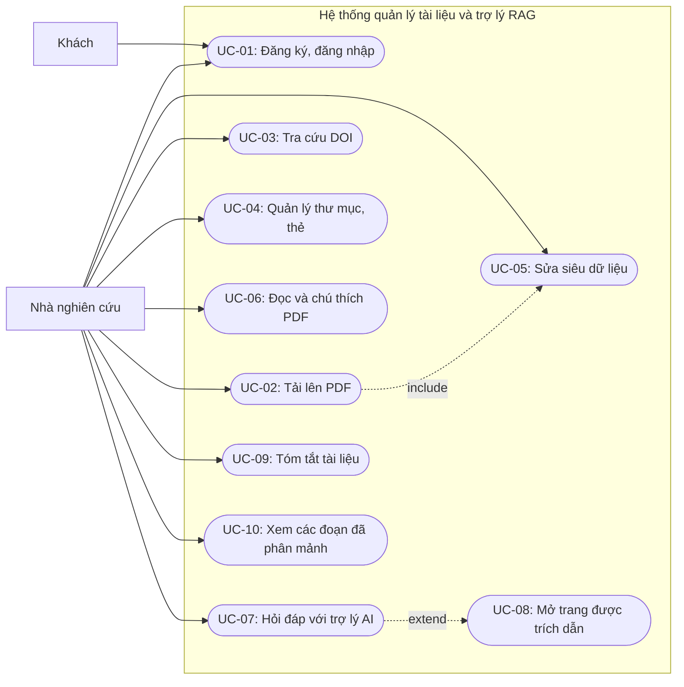

*Hình 4.1: Sơ đồ Use Case tổng quát.*

---

## 4.3. Kiến trúc hệ thống

### 4.3.1. Kiến trúc tổng thể

Hệ thống gồm hai phần chạy trên cùng một máy: **giao diện web** (React, chạy trong trình duyệt) và **backend**. Backend dùng kiến trúc **khối đơn mô-đun hóa (modular monolith)**: một tiến trình Django chứa các mô-đun người dùng, thư mục, tài liệu và đường ống RAG; việc lập chỉ mục chạy trong luồng nền của chính tiến trình đó. Vi dịch vụ, hàng đợi Celery và Redis không được dùng vì làm tăng độ phức tạp vận hành mà một bản thử nghiệm khái niệm không cần; cái giá là khả năng mở rộng (Mục 4.3.3).

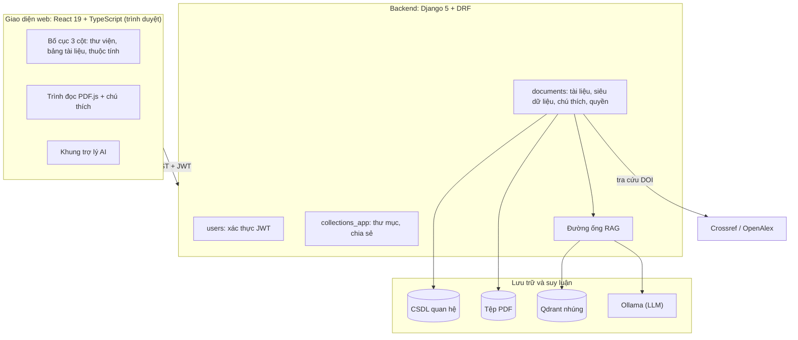

*Hình 4.2: Kiến trúc tổng thể của hệ thống.*

Bên trong mô-đun RAG, quá trình lập chỉ mục và quá trình trả lời câu hỏi dùng chung mô hình nhúng và kho vector:

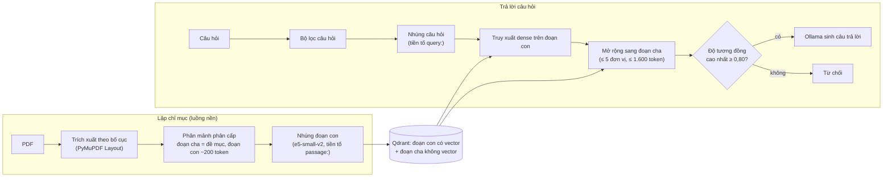

*Hình 4.3: Đường ống RAG: lập chỉ mục và trả lời câu hỏi.*

### 4.3.2. Mô hình triển khai: chạy cục bộ trên một máy

Bản thử nghiệm chạy toàn bộ trên một máy chỉ dùng CPU. Người dùng mở giao diện web trong trình duyệt; giao diện gọi REST API của backend Django trên cùng máy, và backend gọi Ollama qua địa chỉ nội bộ (`localhost`). Nội dung tài liệu không rời khỏi máy; chỉ chức năng tra cứu DOI gọi dịch vụ bên ngoài (Crossref, OpenAlex) và chỉ gửi định danh của bài báo.

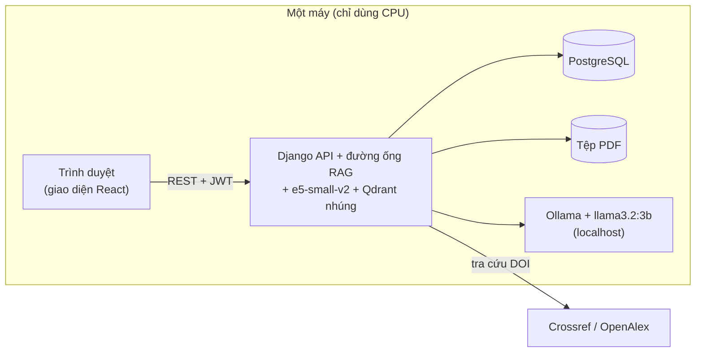

*Hình 4.4: Mô hình triển khai của bản thử nghiệm.*

| Thành phần | Cách chạy |
| :--- | :--- |
| Giao diện | Ứng dụng React 19 + TypeScript do Vite phục vụ, mở trong trình duyệt |
| Backend | Django 5 + DRF; đường ống RAG, mô hình nhúng `intfloat/e5-small-v2` và Qdrant nhúng chạy trong cùng tiến trình |
| Cơ sở dữ liệu | PostgreSQL 16 |
| Tệp | PDF trong `media/documents/`, dữ liệu Qdrant trong `media/qdrant_db/` |
| Mô hình ngôn ngữ | Ollama với `llama3.2:3b`, chỉ nhận kết nối từ `localhost` |

*Bảng 4.3: Các thành phần chạy trên máy cục bộ.*

Tài khoản và quyền chia sẻ (chủ sở hữu, EDIT, COMMENT, VIEW) được quản lý trong backend, nên chúng chỉ áp dụng giữa các tài khoản dùng chung một backend. Với mô hình một máy, những người dùng ở các máy khác nhau chưa thể chia sẻ một thư viện. Tệp PDF không được phục vụ qua đường dẫn tĩnh công khai mà qua điểm cuối `/api/v1/documents/{id}/file/`, có kiểm tra JWT và quyền xem tài liệu.

**Hướng mở rộng.** Hệ thống có thể được tách thành một ứng dụng máy tính chỉ chứa giao diện, cài trên máy người dùng, và một máy chủ dùng chung chạy backend, cơ sở dữ liệu, kho vector và các mô hình. Mô hình này cho phép nhiều người dùng chia sẻ thư viện và không đòi hỏi máy người dùng đủ mạnh để chạy mô hình ngôn ngữ. Đổi lại, nó cần kết nối HTTPS, giới hạn tần suất và giám sát, lưu trữ tệp tách khỏi ổ đĩa của máy chủ ứng dụng, và người dùng phải tin tưởng bên vận hành máy chủ. Các giới hạn ở Mục 4.3.3 vẫn còn nguyên khi chuyển sang mô hình này (Mục 6.3).

### 4.3.3. Giới hạn về khả năng mở rộng

Hệ thống là một **bản thử nghiệm khái niệm** và **không có khả năng mở rộng** ở dạng hiện tại. Thiết kế hiện tại chính là thiết kế một máy đã được dùng trong thực nghiệm; nó đủ để minh họa hệ thống, không đủ để phục vụ người dùng thực, kể cả khi được đặt trên một máy chủ dùng chung. Bảng 4.4 liệt kê các nguyên nhân.

| Giới hạn | Nguyên nhân trong thiết kế hiện tại | Hệ quả | Điều cần có để mở rộng |
| :--- | :--- | :--- | :--- |
| Một câu trả lời tại một thời điểm | Ollama chạy trên CPU, khoảng 30 giây cho mỗi câu trả lời với ngữ cảnh truy xuất (Mục 5.5.1); các yêu cầu xếp hàng | Với N người hỏi cùng lúc, người cuối chờ khoảng N × 30 giây; quá 60 giây thì hệ thống trả về nhánh dự phòng | Máy chủ suy luận có GPU, nhiều bản sao, hàng đợi yêu cầu và trả lời dạng luồng |
| Bộ nhớ | Ollama dùng 4,5–6,9 GB, phần còn lại của 16 GB dành cho mô hình nhúng và Django | Không còn chỗ cho thêm mô hình hoặc tiến trình | Tách máy chủ suy luận, nhúng và API |
| Một tiến trình | Qdrant ở chế độ nhúng chỉ cho một tiến trình; mô hình nhúng nằm trong tiến trình Django | Không chạy được nhiều tiến trình API hay nhiều máy | Qdrant và mô hình nhúng chạy như dịch vụ riêng |
| Lập chỉ mục trong luồng nền | Luồng nền nằm trong tiến trình web | Mất công việc khi khởi động lại, không thử lại, tranh CPU với yêu cầu hỏi đáp | Hàng đợi công việc (Celery/RQ + Redis) và worker riêng |
| Lưu trữ | Tệp PDF trên một ổ đĩa | Không dự phòng; dung lượng ổ đĩa giới hạn thư viện | Lưu trữ đối tượng (S3/MinIO) |
| Một máy | Mọi thành phần trên một máy | Một điểm lỗi duy nhất; không cập nhật mà không gián đoạn | Cân bằng tải, nhiều bản sao ứng dụng, cơ sở dữ liệu được quản lý |
| Vận hành và bảo mật | Chưa có giám sát, kiểm thử tải hay đánh giá bảo mật ngoài JWT, phân quyền và bộ lọc câu hỏi | Không biết sức chịu tải; chưa phù hợp với tài liệu mật của người dùng thực | Giám sát, kiểm thử tải, đánh giá bảo mật, mã hóa dữ liệu lưu trữ |

*Bảng 4.4: Các giới hạn về khả năng mở rộng của bản thử nghiệm.*

Các giới hạn này là lựa chọn có chủ đích: chúng giữ hệ thống đơn giản để tập trung vào chất lượng của đường ống RAG, là trọng tâm của đề tài. Đổi lại, các kết luận về chi phí trong Chương 5 chỉ áp dụng cho một người dùng tại một thời điểm.

---

## 4.4. Thiết kế dữ liệu

### 4.4.1. Cơ sở dữ liệu quan hệ

Cơ sở dữ liệu gồm 15 bảng được định nghĩa bằng Django ORM (PostgreSQL 16). Để dễ đọc, sơ đồ được tách thành hai phần: người dùng, thư mục và quyền (Hình 4.5); tài liệu và phân loại (Hình 4.6).

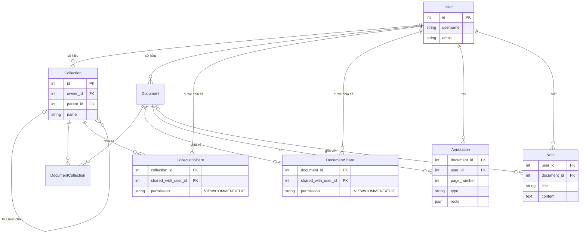

*Hình 4.5: Sơ đồ dữ liệu (1): người dùng, thư mục, chia sẻ và chú thích.*

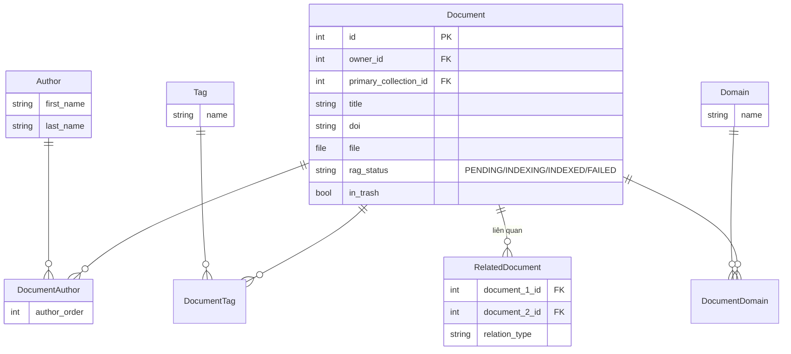

*Hình 4.6: Sơ đồ dữ liệu (2): tài liệu, tác giả và phân loại.*

Bảng `Document` chứa trực tiếp các trường siêu dữ liệu (loại tài liệu, kho lưu trữ, DOI, URL, ngày, ngôn ngữ, giấy phép, phiên bản, khóa trích dẫn...). Quan hệ nhiều-nhiều với tác giả, thẻ, lĩnh vực và thư mục đi qua các bảng trung gian; bảng `DocumentAuthor` giữ thứ tự tác giả.

### 4.4.2. Kho vector

Dữ liệu cho trợ lý AI được lưu trong Qdrant (Qdrant, 2024), chạy ở chế độ nhúng trong tiến trình backend (chế độ này chỉ cho phép một tiến trình, Mục 4.3.3). Để thực hiện phân mảnh phân cấp mà không lặp lại văn bản đoạn cha trong từng vector con, mỗi tài liệu có hai bộ sưu tập:

| Bộ sưu tập | Nội dung | Dùng để |
| :--- | :--- | :--- |
| `doc_{id}` | Vector 384 chiều của các đoạn con (khoảng 200 token, chồng lấp 40), kèm số trang, tên đề mục, mã đoạn cha | Tìm kiếm theo độ tương đồng |
| `doc_{id}_parents` | Không có vector; lưu nguyên văn từng đề mục (đoạn cha) | Đọc đoạn cha theo khóa khi mở rộng ngữ cảnh |

*Bảng 4.5: Hai bộ sưu tập Qdrant của mỗi tài liệu.*

---

## 4.5. Các quy trình chính

### 4.5.1. Tải lên và lập chỉ mục

Việc tải lên gồm hai bước: trích siêu dữ liệu để người dùng xem và sửa, rồi lưu tài liệu và lập chỉ mục trong luồng nền. Trạng thái lập chỉ mục được hiển thị trên bảng tài liệu (Hình 4.7).

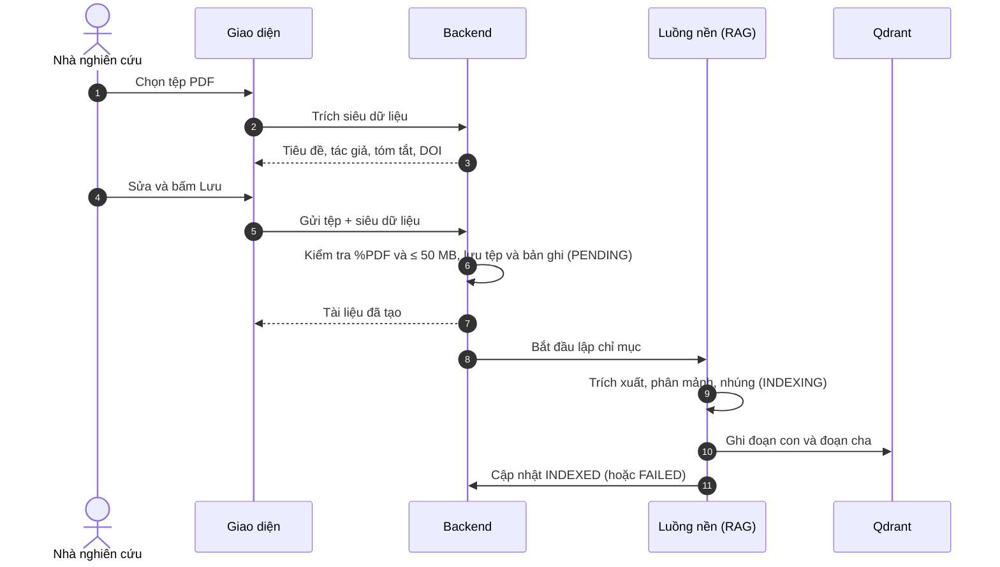

*Hình 4.7: Quy trình tải lên và lập chỉ mục tài liệu.*

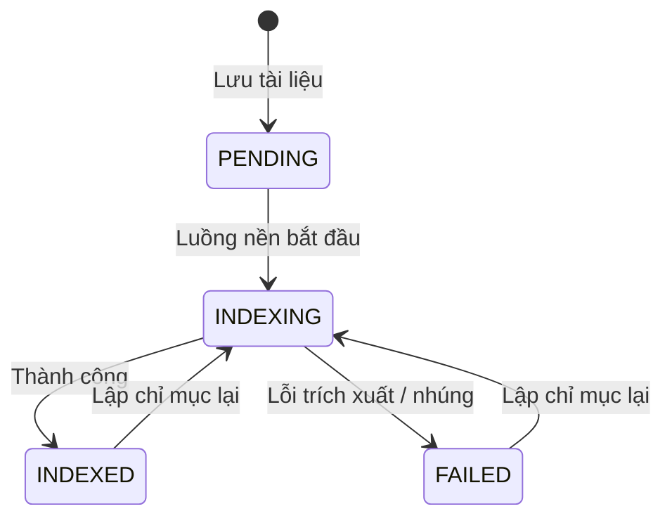

*Hình 4.8: Trạng thái lập chỉ mục của tài liệu.*

### 4.5.2. Hỏi đáp với trợ lý AI

Mỗi câu hỏi đi qua các bước kiểm tra trước khi đến mô hình sinh (Hình 4.9). Ba điểm có thể dừng sớm: bộ lọc câu hỏi, ngưỡng tương đồng, và nhánh dự phòng khi Ollama không phản hồi.

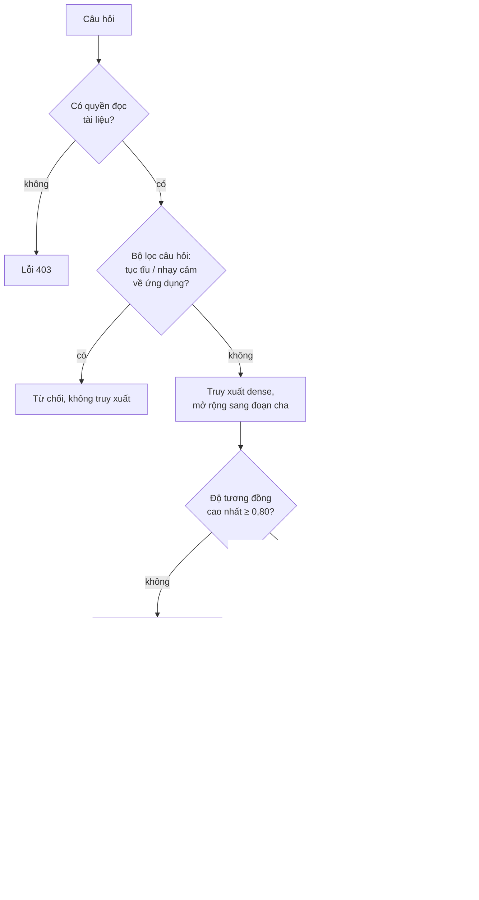

*Hình 4.9: Luồng xử lý một câu hỏi.*

### 4.5.3. Điều hướng trích dẫn

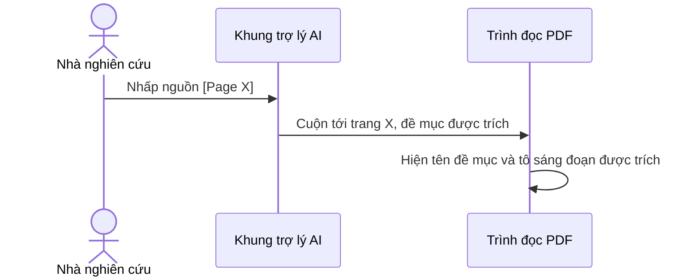

*Hình 4.10: Điều hướng từ câu trả lời tới đoạn được trích dẫn.*

---

## 4.6. Thiết kế giao diện

Giao diện theo bố cục 3 cột của Zotero (Hình 4.11):
- **Cột trái** (thu gọn được): các mục thư viện (Tất cả, Đọc gần đây, Chưa phân loại, Bài của tôi, Trùng lặp, Thùng rác), cây thư mục và danh sách thẻ.
- **Cột giữa:** thanh công cụ (tìm kiếm `Ctrl+F`, thêm tài liệu từ tệp hoặc DOI) và bảng tài liệu có sắp xếp, lọc và huy hiệu trạng thái lập chỉ mục.
- **Cột phải** (tối thiểu 320 px, kéo giãn được): bảng siêu dữ liệu khi ở thư viện; khi mở trình đọc PDF, chuyển giữa danh sách chú thích và khung trợ lý AI.

Tài liệu được mở trong các tab kiểu trình duyệt (`Ctrl+1..9` để chuyển tab).

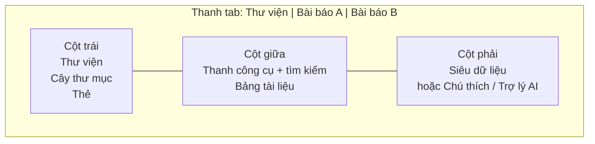

*Hình 4.11: Bố cục giao diện 3 cột.*

Bảng siêu dữ liệu hiển thị 22 trường, được khai báo trong một tệp cấu hình (`metadataConfig.ts`) thay vì viết cứng trong giao diện:

| Nhóm | Trường |
| :--- | :--- |
| Mô tả | Tiêu đề, tiêu đề rút gọn, loại tài liệu, tác giả, ngày, thể loại, ngôn ngữ |
| Định danh và nguồn | DOI, URL, kho lưu trữ, mã trong kho, vị trí lưu trữ, phiên bản, giấy phép, khóa trích dẫn |
| Phân loại | Thẻ (tự do), lĩnh vực (chuẩn hóa), nhóm tài liệu, màu nhóm |
| Hệ thống | Ngày thêm, ngày sửa (chỉ đọc), ghi chú thêm |

*Bảng 4.6: Các trường siêu dữ liệu.*

Thẻ là nhãn tự do do người dùng đặt (ví dụ `transformer`, `cần-đọc`), còn lĩnh vực là danh mục ngành chuẩn hóa (ví dụ `Natural Language Processing`).

---

## 4.7. Cài đặt các phân hệ

- **Xác thực:** SimpleJWT; giao diện tự làm mới access token khi nhận lỗi 401; refresh token bị đưa vào danh sách đen khi đăng xuất.
- **Siêu dữ liệu:** trích từ trang đầu PDF bằng PyMuPDF (tiêu đề theo cỡ chữ lớn nhất, DOI và mã arXiv bằng biểu thức chính quy), chạy trong backend, không gọi dịch vụ bên ngoài; tra cứu DOI qua Crossref (Crossref, 2024), dự phòng OpenAlex (Priem et al., 2022).
- **Trình đọc và chú thích:** `pdfjs-dist` (Mozilla, 2024) với lớp văn bản cho phép chọn chữ; tọa độ chú thích được lưu theo tỷ lệ trang nên hiển thị đúng ở mọi mức phóng to.
- **Phân quyền chia sẻ:** VIEW cho phép đọc, hỏi đáp, tóm tắt; COMMENT cho phép chú thích; EDIT cho phép sửa siêu dữ liệu; xóa, lập chỉ mục lại và quản lý chia sẻ chỉ dành cho chủ sở hữu.
- **Trợ lý AI:**
  - đường ống RAG như Hình 4.3, với cấu hình được chọn từ thực nghiệm (Chương 5); chế độ tùy chọn `rrf_legacy` kết hợp thêm BM25 bằng RRF;
  - tóm tắt nhanh dùng 5 đoạn phân bố đều trong tài liệu làm ngữ cảnh, không dựa trên truy xuất;
  - ngưỡng 0,80 được đặt phía trên điểm tương đồng của một số câu hỏi lạc đề thử thủ công (khoảng 0,75–0,76); ngưỡng chưa được hiệu chuẩn trên một tập câu hỏi lớn;
  - bộ lọc câu hỏi dựa trên danh sách từ và mẫu cụm từ; câu hỏi vẫn được xử lý nếu từ bị gắn cờ xuất hiện trong chính bài báo. Bộ lọc không chặn câu hỏi nào trong 5.428 câu hỏi của QASPER và PeerQA, nên không ảnh hưởng đến các thực nghiệm.

---

## 4.8. Kiểm thử và giới hạn

**Kiểm thử:** 104 bài kiểm thử tự động cho backend (`apps.documents.tests`, `apps.documents.tests_app`, `apps.users.tests`) đều vượt qua; một số bài cần kết nối mạng tới Crossref/arXiv. Frontend được kiểm tra bằng ESLint và bản dựng TypeScript/Vite; chưa có kiểm thử tự động cho giao diện.

**Giới hạn:**
1. **Hỏi đáp trên một tài liệu:** chưa hỗ trợ hỏi đáp tổng hợp trên nhiều tài liệu.
2. **Hội thoại theo phiên:** lịch sử hỏi đáp không được lưu lại (NFR-04).
3. **Chia sẻ chỉ qua API:** phân quyền đã có ở backend nhưng chưa có giao diện quản lý chia sẻ.
4. **Bộ lọc câu hỏi đơn giản:** dựa trên danh sách từ nên có thể bị lách; tỷ lệ từ chối đúng chưa được đo.
5. **Dữ liệu mẫu khi mất kết nối:** giao diện có thể hiển thị dữ liệu mẫu để trình diễn khi không kết nối được backend; trợ lý AI không bao giờ hiển thị câu trả lời giả lập.
6. **Chạy từ mã nguồn trên một máy:** chưa có bộ cài đặt; những người dùng ở các máy khác nhau chưa thể dùng chung một thư viện.
7. **Không mở rộng được:** đây là bản thử nghiệm khái niệm; các giới hạn được liệt kê ở Mục 4.3.3.

---

## 4.9. Tổng kết chương

Chương 4 đã trình bày yêu cầu (15 chức năng đã triển khai, 1 chức năng dự kiến và 7 yêu cầu phi chức năng), kiến trúc khối đơn mô-đun hóa, mô hình triển khai (chạy cục bộ trên một máy) cùng các giới hạn về khả năng mở rộng của bản thử nghiệm khái niệm, thiết kế dữ liệu (cơ sở dữ liệu quan hệ và kho vector hai bộ sưu tập), các quy trình chính và giao diện. Hệ thống này là nền tảng cho các thực nghiệm ở Chương 5.

---

# CHƯƠNG 5. KẾT QUẢ THỰC NGHIỆM VÀ THẢO LUẬN

---

Chương này trình bày kết quả của bốn giai đoạn đánh giá (Mục 3.3). Mỗi mục gồm: kỳ vọng theo lý thuyết, kết quả đo được, đối chiếu giữa hai bên, và lựa chọn cho giai đoạn tiếp theo. Mọi kết quả là giá trị trung bình mô tả trên tập dữ liệu được nêu kèm; kết quả từ những tập dữ liệu hoặc môi trường khác nhau không được so sánh trực tiếp với nhau. Số liệu được lấy từ các tệp kết quả trong `eval/phases/`, và các biểu đồ được sinh lại bằng `eval/scripts/make_thesis_figures.py`. Các phần còn chờ kết quả được đánh dấu **[Chờ kết quả]**.

---

## 5.1. Dữ liệu thực nghiệm

### 5.1.1. Đặc trưng của ngữ liệu QASPER

QASPER v0.3 gồm 1.585 bài báo NLP/ML và 5.049 câu hỏi. Người đặt câu hỏi chỉ đọc tiêu đề và tóm tắt; câu trả lời và đoạn bằng chứng do người khác đọc toàn văn gán nhãn. Hình 5.1 tóm tắt ba đặc trưng chính.

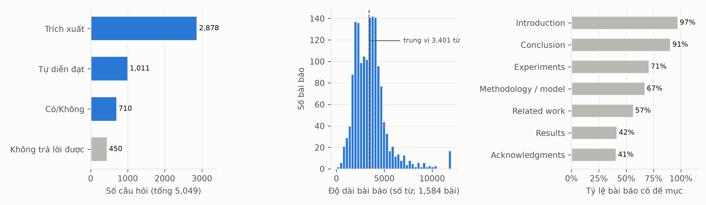

*Hình 5.1: Tổng quan ngữ liệu QASPER: phân bố loại câu hỏi, độ dài bài báo và tỷ lệ bài báo có các đề mục phổ biến.*

Ba đặc trưng này ảnh hưởng trực tiếp đến thiết kế đường ống:
1. **Bài báo dài hơn nhiều so với cửa sổ ngữ cảnh.** Độ dài trung vị khoảng 3.400 từ, nên văn bản phải được phân mảnh và chỉ một phần nhỏ được đưa vào mô hình sinh.
2. **Câu hỏi ngắn, bằng chứng dài và ít trùng từ.** Câu hỏi trung bình 8,1 từ, đoạn bằng chứng trung bình 175,5 từ, và tỷ lệ trùng từ (Jaccard) giữa câu hỏi và bằng chứng chỉ khoảng 1,6%. Điều này gợi ý rằng tìm kiếm theo từ khóa (BM25) sẽ gặp khó khăn và cần truy xuất theo ngữ nghĩa.
3. **Cấu trúc đề mục rõ ràng.** Gần như mọi bài báo có *Introduction* (97%) và *Conclusion* (91%), nên đề mục là đơn vị tự nhiên cho phân mảnh phân cấp.

### 5.1.2. Tập dữ liệu dùng cho từng giai đoạn

| Giai đoạn | Tập dữ liệu | Số tài liệu | Số câu hỏi |
| :--- | :--- | :---: | :---: |
| 1. Trích xuất | OHR-Bench (7 lĩnh vực, PDF có lớp văn bản) | 706 | 6.916 |
| 2. Phân mảnh × mô hình nhúng | C-RET (QASPER Train, toàn văn QASPER) | 335 | 567 |
| 2. Phân mảnh × mô hình nhúng | PeerQA (PDF) | 107 | 288 |
| 3. Từ khóa, kết hợp, xếp hạng lại | C-RET và PeerQA, như giai đoạn 2 | 335 / 107 | 567 / 288 |
| 4. Mô hình sinh | C-RET; PeerQA (câu hỏi có câu trả lời của tác giả) | 335 / 107 | 567 / [Chờ kết quả] |
| Đánh giá sơ bộ mô hình sinh | QASPER Train, không trùng C-RET | 250 | 500 |

*Bảng 5.1: Tập dữ liệu dùng cho từng giai đoạn.*

---

## 5.2. Giai đoạn 1: Trích xuất văn bản PDF

**Kỳ vọng theo lý thuyết.**
- Các thư viện trích xuất văn bản thô và theo bố cục đọc trực tiếp lớp văn bản của PDF, nên được kỳ vọng lấy lại gần như toàn bộ chữ, và khác nhau chủ yếu ở thứ tự đọc và tốc độ.
- GROBID phân tích cấu trúc bài báo bằng học máy, nên được kỳ vọng tốt trên bài báo khoa học nhưng chậm hơn nhiều và có thể bỏ những phần không thuộc thân bài (bảng, chú thích, phần đầu và cuối trang).

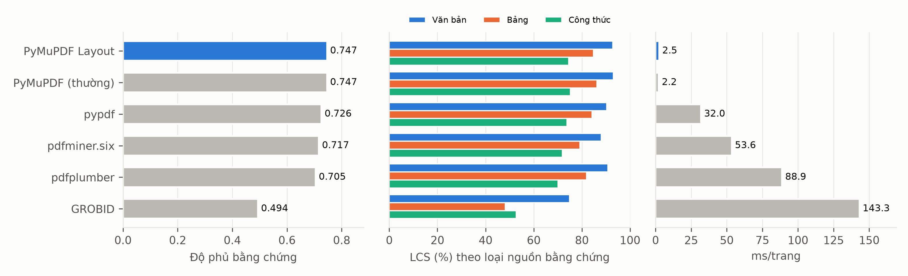

*Hình 5.2: So sánh các bộ trích xuất PDF trên OHR-Bench (706 tài liệu, 6.916 câu hỏi): độ phủ bằng chứng, LCS theo loại nguồn bằng chứng và thời gian xử lý mỗi trang.*

| Bộ trích xuất | Độ phủ bằng chứng | LCS (%) | Hit@1 | Hit@5 | ms/trang |
| :--- | :---: | :---: | :---: | :---: | :---: |
| **PyMuPDF Layout** | **0,747** | 76,2 | **0,733** | **0,921** | 2,55 |
| PyMuPDF (thường) | **0,747** | **77,0** | **0,733** | **0,921** | **2,25** |
| pypdf | 0,726 | 75,1 | 0,718 | 0,913 | 32,0 |
| pdfminer.six | 0,717 | 72,5 | 0,715 | 0,909 | 53,6 |
| pdfplumber | 0,705 | 73,9 | 0,711 | 0,907 | 88,9 |
| GROBID | 0,494 | 54,3 | 0,577 | 0,775 | 143,3 |

*Bảng 5.2: Kết quả trích xuất trên OHR-Bench (nguồn: `phase_1_extraction/artifacts/summary.json`).*

**Đối chiếu.**
- **Các thư viện đọc lớp văn bản cho kết quả gần nhau, PyMuPDF dẫn đầu và nhanh nhất.** Độ phủ bằng chứng nằm trong khoảng 0,705–0,747; PyMuPDF nhanh hơn pypdf khoảng 12 lần và pdfplumber khoảng 35 lần. Kết quả phù hợp với kỳ vọng rằng khác biệt giữa các thư viện này nhỏ.
- **PyMuPDF Layout và PyMuPDF thường có cùng độ phủ và cùng Hit@k.** Hai chỉ số này dựa trên tập từ, không phụ thuộc thứ tự đọc; khác biệt về thứ tự chỉ thấy ở LCS (76,2% so với 77,0%). Trong thực nghiệm này, PyMuPDF Layout là bản sắp xếp khối theo vị trí trong tập lệnh đánh giá, không phải hàm `extract_sections_from_pdf` của ứng dụng (vốn thêm bước nhận diện đề mục).
- **GROBID thấp hơn rõ rệt, kể cả trên tài liệu học thuật.** Trên riêng nhóm học thuật (77 tài liệu, 1.152 câu hỏi), độ phủ bằng chứng của PyMuPDF là 0,629 và của GROBID là 0,391. Theo loại nguồn bằng chứng, khoảng cách lớn nhất nằm ở bảng (LCS 84,9% so với 48,2%) và công thức (74,6% so với 52,8%): GROBID chỉ giữ lại phần thân bài được cấu trúc hóa và bỏ hoặc tách riêng nhiều nội dung ngoài thân bài, trong khi OHR-Bench đặt nhiều câu hỏi vào chính những nội dung đó. Kết quả này **khác kỳ vọng** rằng GROBID mạnh trên bài báo khoa học; giải thích trên phù hợp với cách GROBID xuất văn bản nhưng chưa được kiểm tra riêng.
- **Mọi bộ trích xuất đều yếu ở biểu đồ và thứ tự đọc** (LCS khoảng 45% và dưới 11%), vì nội dung biểu đồ không nằm trong lớp văn bản và thứ tự đọc của bố cục nhiều cột khó khôi phục.

**Lựa chọn: giữ PyMuPDF Layout cho ứng dụng.**
1. **Theo kết quả đo:** PyMuPDF có độ phủ bằng chứng và khả năng tìm đúng trang cao nhất, và nhanh nhất (khoảng 2,5 ms/trang).
2. **Theo yêu cầu của đường ống:** phân mảnh phân cấp cần đề mục; hàm `extract_sections_from_pdf` của ứng dụng dùng PyMuPDF và nhận diện đề mục theo định dạng chữ, điều mà các thư viện văn bản thô không cung cấp.
3. **Theo chi phí:** GROBID cần một dịch vụ Java chạy riêng (container Docker, bộ nhớ đáng kể), chậm hơn khoảng 56 lần, và cho kết quả thấp hơn trên bộ đánh giá này.

Giai đoạn 2–4 dùng toàn văn có cấu trúc của QASPER (và văn bản PDF của PeerQA), nên kết quả của các giai đoạn sau không phụ thuộc vào lựa chọn này.

---

## 5.3. Giai đoạn 2: Phân mảnh và mô hình nhúng

**Kỳ vọng theo lý thuyết.**
- **Phân mảnh phân cấp (small-to-big)** so khớp bằng đoạn con nhỏ nhưng trả về đoạn cha đầy đủ ngữ cảnh, nên được kỳ vọng tốt hơn phân mảnh phẳng; phân mảnh theo đề mục được kỳ vọng tốt hơn kích thước cố định vì tôn trọng ranh giới nội dung.
- **Mô hình nhúng lớn hơn** (Qwen3-Embedding 600M, embeddinggemma 300M, ModernBERT 149M) được kỳ vọng chính xác hơn các mô hình nhỏ (e5, arctic, 33M), với chi phí tính toán cao hơn.

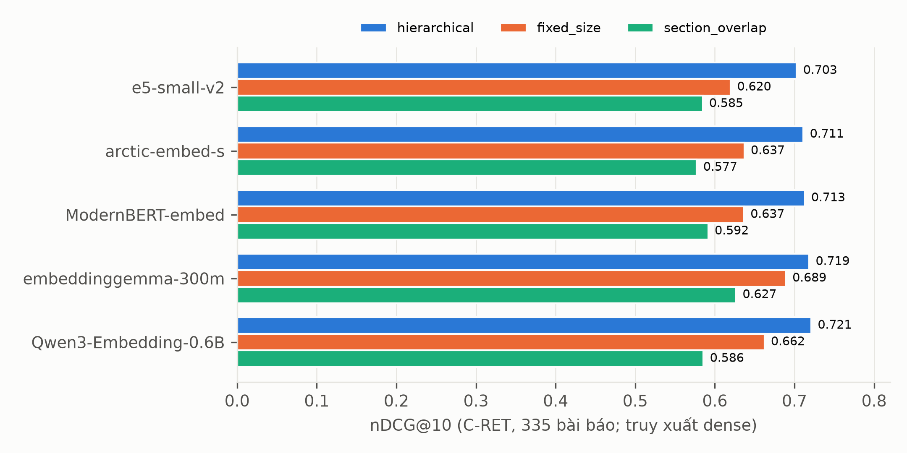

*Hình 5.3: nDCG@10 của 15 tổ hợp phân mảnh × mô hình nhúng trên C-RET (335 bài báo, 566 câu hỏi có đơn vị liên quan; truy xuất dense).*

| Phân mảnh | Mô hình nhúng | nDCG@10 | MRR@10 | Recall@10 | P@5 |
| :--- | :--- | :---: | :---: | :---: | :---: |
| `hierarchical` | **Qwen3-Embedding-0.6B** | **0,721** | 0,663 | **0,955** | **0,260** |
| `hierarchical` | embeddinggemma-300m | 0,719 | **0,664** | **0,955** | 0,257 |
| `hierarchical` | ModernBERT-embed-base | 0,713 | 0,660 | 0,953 | 0,259 |
| `hierarchical` | snowflake-arctic-embed-s | 0,711 | 0,655 | 0,953 | 0,255 |
| `hierarchical` | e5-small-v2 | 0,703 | 0,647 | 0,945 | 0,258 |
| `fixed_size` | embeddinggemma-300m | 0,689 | 0,642 | 0,935 | 0,270 |
| `fixed_size` | Qwen3-Embedding-0.6B | 0,662 | 0,596 | 0,928 | 0,266 |
| `fixed_size` | snowflake-arctic-embed-s | 0,637 | 0,571 | 0,911 | 0,248 |
| `fixed_size` | ModernBERT-embed-base | 0,637 | 0,566 | 0,937 | 0,248 |
| `fixed_size` | e5-small-v2 | 0,620 | 0,544 | 0,924 | 0,249 |
| `section_overlap` | embeddinggemma-300m | 0,627 | 0,573 | 0,874 | 0,212 |
| `section_overlap` | ModernBERT-embed-base | 0,592 | 0,537 | 0,855 | 0,197 |
| `section_overlap` | Qwen3-Embedding-0.6B | 0,586 | 0,524 | 0,854 | 0,199 |
| `section_overlap` | e5-small-v2 | 0,585 | 0,527 | 0,858 | 0,196 |
| `section_overlap` | snowflake-arctic-embed-s | 0,577 | 0,527 | 0,835 | 0,191 |

*Bảng 5.3: Kết quả giai đoạn 2 trên C-RET (nguồn: lần chạy đầy đủ trên Kaggle, `phase_2_retrieval/artifacts/kaggle_full_run.log`).*

**PeerQA.** Lần chạy đầu chỉ tìm thấy PDF của 8/107 bài báo (26 câu hỏi), nên kết quả PeerQA chưa được báo cáo. **[Chờ kết quả]** Lần chạy lại với đầy đủ PDF (notebook `eval/kaggle/phase2_peerqa_gemma_rerun.ipynb`).

**Đối chiếu.**
1. **Phân mảnh phân cấp tốt nhất với mọi mô hình nhúng, phù hợp với lý thuyết.** nDCG@10 cao hơn chiến lược phẳng tốt nhất từ 0,03 (embeddinggemma) đến 0,08 (e5), và Recall@10 cũng cao nhất (0,945–0,955). *Lưu ý về cách chấm:* đơn vị được chấm của `hierarchical` là cả đoạn cha, lớn hơn đoạn phẳng, nên một phần lợi thế đến từ kích thước đơn vị (Mục 3.4).
2. **Phân mảnh theo đề mục không vượt kích thước cố định, khác kỳ vọng.** `section_overlap` thấp hơn `fixed_size` với mọi mô hình nhúng (ví dụ 0,585 so với 0,620 với e5). Các đoạn theo đề mục ngắn hơn (đề mục ngắn tạo ra đoạn nhỏ), nên mỗi đoạn mang ít ngữ cảnh hơn khi được so khớp riêng; giải thích này phù hợp với số liệu nhưng chưa được kiểm tra riêng.
3. **Khi dùng phân mảnh phân cấp, các mô hình nhúng gần như ngang nhau.** Khoảng cách giữa mô hình tốt nhất và kém nhất chỉ 0,018 (0,703–0,721), trong khi với `fixed_size` là 0,069. Việc trả về cả đoạn cha bù lại phần lớn khác biệt giữa các mô hình; chọn chiến lược phân mảnh quan trọng hơn chọn mô hình nhúng.
4. **Mô hình lớn hơn tốt hơn một chút, với chi phí cao hơn nhiều.** Qwen3-Embedding (600M) dẫn đầu nhưng chỉ hơn e5 (33M) 0,018; trên GPU, thời gian chạy tổ hợp `hierarchical` của Qwen3 khoảng 1.650 giây so với khoảng 120 giây của e5 (ước lượng từ nhật ký chạy). embeddinggemma gần bằng Qwen3 với chi phí khoảng một phần tư.

**Lưu ý về embeddinggemma.** Lần chạy này dùng chuỗi rỗng làm chỉ dẫn cho đoạn văn, trong khi hướng dẫn của nhà phát triển dùng `title: none | text: `. Lỗi đã được sửa trong mã nguồn; **[Chờ kết quả]** các dòng embeddinggemma sẽ được thay bằng lần chạy lại.

**Lựa chọn cho giai đoạn 3.** Phân mảnh `hierarchical`, với bốn mô hình nhúng:
- e5-small-v2: mô hình của ứng dụng, nhỏ và nhanh nhất;
- Qwen3-Embedding-0.6B: cao nhất;
- embeddinggemma-300m: gần cao nhất, chi phí trung bình, tốt nhất với phân mảnh phẳng;
- ModernBERT-embed-base: cửa sổ ngữ cảnh dài.

---

## 5.4. Giai đoạn 3: Truy xuất từ khóa, kết hợp và xếp hạng lại

**Kỳ vọng theo lý thuyết.**
- BM25 riêng lẻ được kỳ vọng kém hơn dense trên QASPER, vì câu hỏi ít trùng từ với bằng chứng (Mục 5.1.1), nhưng tốt hơn trên PeerQA, nơi người phản biện dùng thuật ngữ của chính bài báo.
- Kết hợp dense với BM25 được kỳ vọng ít nhất bằng phương pháp tốt hơn trong hai. Lợi ích được kỳ vọng lớn nhất ở mô hình nhúng yếu hơn.
- Xếp hạng lại bằng cross-encoder được kỳ vọng tăng độ chính xác ở các vị trí đầu (nDCG@10, MRR@10), với độ trễ cộng thêm đáng kể, nhất là với `bge-reranker-v2-m3`.

**Kết quả.** **[Chờ kết quả]** Notebook `eval/kaggle/phase3_hybrid_reranking.ipynb`; bảng xếp hạng 29 cấu hình (nDCG@10, MRR@10, Recall@10, độ trễ) và chênh lệch so với dense theo từng mô hình nhúng được sinh trong `phase_3_hybrid_reranking/artifacts/<cohort>/REPORT.md`, cho C-RET và PeerQA.

**Đối chiếu và lựa chọn.** **[Chờ kết quả]** Chọn đường ống truy xuất cho giai đoạn 4 theo nDCG@10 trên cả hai bộ dữ liệu và độ trễ cộng thêm trên CPU.

---

## 5.5. Giai đoạn 4: Mô hình ngôn ngữ sinh câu trả lời

### 5.5.1. Đánh giá sơ bộ trên CPU (bằng chứng chuẩn)

Trước giai đoạn 4, năm mô hình nhỏ đã được đánh giá trên máy cục bộ (CPU) với **bằng chứng chuẩn** làm ngữ cảnh, trên tập sinh câu trả lời sơ bộ (500 câu hỏi, 250 bài báo). Thiết lập: nhiệt độ 0, tối đa 256 token đầu ra, lời nhắc yêu cầu từ chối khi ngữ cảnh không đủ thông tin.

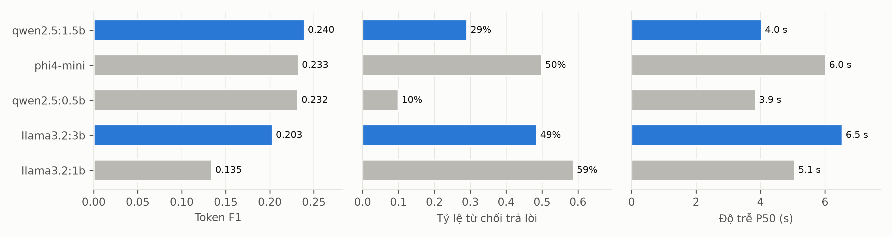

*Hình 5.4: Token F1, tỷ lệ từ chối và độ trễ của năm mô hình sinh trong đánh giá sơ bộ (500 câu hỏi, 250 bài báo, ngữ cảnh là bằng chứng chuẩn, CPU).*

| Mô hình | Token F1 | Tỷ lệ từ chối | Độ trễ P50 (CPU) |
| :--- | :---: | :---: | :---: |
| **qwen2.5:1.5b** | **0,240** | 29,2% | 4,0 s |
| phi4-mini | 0,233 | 50,0% | 6,0 s |
| qwen2.5:0.5b | 0,232 | 10,0% | 3,9 s |
| **llama3.2:3b** | 0,203 | 48,6% | 6,5 s |
| llama3.2:1b | 0,135 | 58,8% | 5,1 s |

*Bảng 5.4: Kết quả đánh giá sơ bộ mô hình sinh với bằng chứng chuẩn.*

Một người đánh giá đã gán nhãn độ bám ngữ cảnh cho 100 câu trả lời (cùng 20 câu hỏi cho cả năm mô hình, ẩn danh mô hình, hai đợt; Hình 5.5). Ở đợt 2, bảy nhãn được điều chỉnh để thống nhất với quyết định của đợt 1 trên cùng câu hỏi. 100 câu trả lời này là dữ liệu kiểm tra mô hình chấm ở giai đoạn 4.

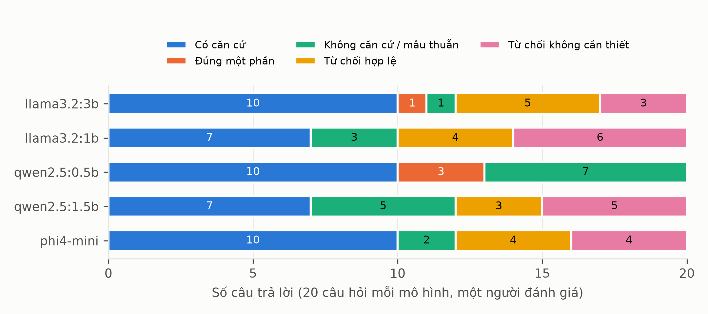

*Hình 5.5: Phân bố nhãn đánh giá thủ công (20 câu trả lời mỗi mô hình, năm mô hình, một người đánh giá; chỉ mang tính minh họa).*

**Nhận xét từ đánh giá sơ bộ.**
- **Lý thuyết chỉ đúng một phần.** Mô hình 3B tốt hơn mô hình 1B, nhưng có Token F1 thấp hơn hai mô hình qwen nhỏ hơn; phần lớn khoảng cách đến từ việc `llama3.2:3b` từ chối khoảng một nửa số câu hỏi.
- **Token F1 cao không đi kèm ít câu trả lời không căn cứ.** `qwen2.5:0.5b` gần như không từ chối nhưng có 7/20 câu trả lời không có căn cứ hoặc mâu thuẫn, so với 1/20 của `llama3.2:3b`; `qwen2.5:1.5b` có 5/20.
- **Chi phí với ngữ cảnh truy xuất thực tế cao hơn nhiều.** Với ngữ cảnh 1.300–1.600 token trên CPU, `llama3.2:3b` mất khoảng 32 giây mỗi câu trả lời (so với 6,5 giây với bằng chứng chuẩn ngắn); đây là giới hạn chính về khả năng mở rộng của bản thử nghiệm (Mục 4.3.3).

### 5.5.2. Kết quả giai đoạn 4

**Kỳ vọng theo lý thuyết.**
- Các mô hình thế hệ mới (`qwen3:4b`, `gemma3:4b`) được kỳ vọng tuân thủ chỉ dẫn và bám ngữ cảnh tốt hơn các mô hình cũ cùng cỡ.
- Ngữ cảnh truy xuất được kỳ vọng cho Token F1 thấp hơn và tỷ lệ từ chối cao hơn bằng chứng chuẩn, vì ngữ cảnh có thể thiếu bằng chứng và dài hơn.

**Kiểm tra mô hình chấm.** **[Chờ kết quả]** Mức đồng thuận giữa `qwen2.5:14b` và người đánh giá trên 100 câu trả lời (sáu nhãn và ba nhóm, tỷ lệ đồng thuận và kappa), từ `phase_4_generation/artifacts/judge_validation.json`.

**Kết quả.** **[Chờ kết quả]** Với mỗi bộ dữ liệu, mỗi loại ngữ cảnh và mỗi mô hình: Token F1, tỷ lệ từ chối, tỷ lệ chứa, độ chính xác Có/Không, độ trễ (GPU) và phân bố nhãn độ bám ngữ cảnh; chênh lệch giữa bằng chứng chuẩn và ngữ cảnh truy xuất (`phase_4_generation/artifacts/summary.json`).

**Đối chiếu và lựa chọn.** **[Chờ kết quả]** Chọn mô hình sinh cho ứng dụng dựa trên Token F1, tỷ lệ từ chối và độ bám ngữ cảnh, kèm chi phí trên CPU.

---

## 5.6. Tổng hợp lựa chọn

| Thành phần | Lựa chọn | Căn cứ |
| :--- | :--- | :--- |
| Trích xuất | PyMuPDF Layout | Độ phủ bằng chứng cao nhất và nhanh nhất trên OHR-Bench; cung cấp đề mục cho phân mảnh phân cấp; GROBID thấp hơn rõ rệt và cần dịch vụ riêng (Mục 5.2) |
| Phân mảnh | `hierarchical` | Tốt nhất với cả năm mô hình nhúng trên C-RET (Mục 5.3) |
| Mô hình nhúng | e5-small-v2, Qwen3-Embedding-0.6B, embeddinggemma-300m, ModernBERT-embed-base vào giai đoạn 3 | Các mô hình gần nhau khi dùng phân mảnh phân cấp; lựa chọn cuối cùng cân nhắc chi phí [Chờ kết quả giai đoạn 3] |
| Truy xuất | [Chờ kết quả] | Giai đoạn 3 |
| Mô hình sinh | [Chờ kết quả] | Giai đoạn 4 |

*Bảng 5.5: Tổng hợp lựa chọn qua các giai đoạn.*

---

## 5.7. Hạn chế

- **Chọn và đánh giá trên cùng dữ liệu.** Các phương pháp được chọn và đánh giá trên cùng các bài báo QASPER (C-RET), nên kết quả không phải phép kiểm tra độc lập.
- **Giai đoạn 1 dùng bộ dữ liệu khác các giai đoạn sau.** OHR-Bench gồm nhiều lĩnh vực, không chỉ bài báo khoa học; kết luận về bộ trích xuất được kiểm tra thêm trên riêng nhóm tài liệu học thuật.
- **Giai đoạn 2–4 dùng toàn văn của QASPER thay vì văn bản trích xuất từ PDF** đối với QASPER, nên kết quả truy xuất không bao gồm sai số của khâu trích xuất trong ứng dụng.
- **Các chỉ số tự động là xấp xỉ.** Độ liên quan và tỷ lệ chứa dựa trên mức trùng từ; Token F1 đo mức trùng từ với đáp án, không đo tính đúng sự thật.
- **Mô hình chấm và đánh giá thủ công nhỏ.** Chỉ có một người đánh giá và 100 câu trả lời để kiểm tra mô hình chấm.
- **Môi trường.** Độ trễ của giai đoạn 2–4 đo trên GPU của Kaggle, không phải trên CPU của ứng dụng.
- **Khả năng nhiễm dữ liệu huấn luyện.** Các mô hình có thể đã gặp các bài báo công khai này trong quá trình huấn luyện.

---

## 5.8. Tổng kết chương

Hai giai đoạn đầu cho kết quả phần lớn phù hợp với lý thuyết:
- các thư viện đọc lớp văn bản cho kết quả gần nhau, PyMuPDF tốt nhất và nhanh nhất;
- phân mảnh phân cấp tốt nhất với mọi mô hình nhúng;
- mô hình nhúng lớn hơn tốt hơn một chút với chi phí cao hơn nhiều.

Hai điểm khác kỳ vọng được ghi nhận kèm giải thích chưa được kiểm tra riêng: GROBID thấp hơn các thư viện khác trên OHR-Bench, kể cả với tài liệu học thuật; và phân mảnh theo đề mục không vượt phân mảnh kích thước cố định. Giai đoạn 3 và 4 đã có mã nguồn và notebook; kết quả sẽ được bổ sung khi chạy xong.

---

# CHƯƠNG 6. KẾT LUẬN VÀ HƯỚNG PHÁT TRIỂN

---

## 6.1. Kết quả đạt được

### 6.1.1. Về xây dựng phần mềm
Đề tài đã xây dựng một bản thử nghiệm khái niệm của ứng dụng quản lý tài liệu nghiên cứu theo phong cách Zotero:
- **Kiến trúc và giao diện:** kiến trúc Khối đơn mô-đun hóa (Django 5 + React 19); bố cục 3 cột; trình đọc PDF.js có bôi đậm và ghi chú.
- **Quản lý tài liệu:** 22 trường siêu dữ liệu; tra cứu DOI; chia sẻ theo quyền.
- **Trợ lý AI tự vận hành:** đường ống RAG chạy trên phần cứng chỉ dùng CPU, không dùng dịch vụ AI của bên thứ ba:
  - PyMuPDF Layout → phân mảnh phân cấp → e5-small-v2 → Qdrant nhúng → truy xuất dense → `llama3.2:3b` qua Ollama;
  - ngưỡng từ chối khi ngữ cảnh không liên quan;
  - định vị trích dẫn trên trang PDF.
- **Kiểm thử:** bộ kiểm thử backend gồm 104 bài kiểm thử tự động đều vượt qua.

### 6.1.2. Về thực nghiệm
Đề tài đánh giá đường ống RAG theo bốn giai đoạn nối tiếp nhau, đối chiếu kết quả với lý thuyết và chọn phương pháp cho từng thành phần (Chương 5):

| Giai đoạn | Kết quả chính | Lựa chọn |
| :--- | :--- | :--- |
| 1. Trích xuất (OHR-Bench) | PyMuPDF có độ phủ bằng chứng cao nhất (0,747) và nhanh nhất; GROBID thấp hơn rõ rệt (0,494), kể cả trên tài liệu học thuật | PyMuPDF Layout |
| 2. Phân mảnh × mô hình nhúng (QASPER) | Phân cấp tốt nhất với mọi mô hình nhúng (nDCG@10 0,703–0,721); các mô hình nhúng gần như ngang nhau khi dùng phân cấp | `hierarchical`; bốn mô hình nhúng vào giai đoạn 3 |
| 3. Từ khóa, kết hợp, xếp hạng lại | [Chờ kết quả] | [Chờ kết quả] |
| 4. Mô hình sinh | Đánh giá sơ bộ: Token F1 cao không đi kèm ít câu trả lời không căn cứ; giai đoạn 4: [Chờ kết quả] | [Chờ kết quả] |

*Bảng 6.1: Tóm tắt kết quả các giai đoạn đánh giá.*

Hai điểm khác kỳ vọng được ghi nhận kèm giải thích chưa được kiểm tra riêng: GROBID thấp hơn các thư viện khác trên OHR-Bench, và phân mảnh theo đề mục không vượt phân mảnh kích thước cố định.

---

## 6.2. Hạn chế

1. **Giai đoạn 3 và 4 chưa có kết quả.** Kết luận hiện dựa trên giai đoạn 1–2 và đánh giá sơ bộ mô hình sinh.
2. **Chọn và đánh giá trên cùng dữ liệu.** Các phương pháp được chọn và đánh giá trên cùng các bài báo QASPER (NLP/ML), nên kết quả không chứng minh khả năng tổng quát hóa.
3. **Chỉ số tự động dựa trên mức trùng từ,** và đánh giá thủ công chỉ có một người đánh giá với số câu nhỏ.
4. **Tốc độ sinh câu trả lời trên CPU chậm khi ngữ cảnh dài:** khoảng 30 giây mỗi câu với `llama3.2:3b`. Bộ nhớ của máy 16 GB gần đạt giới hạn khi chạy mô hình sinh.
5. **Bản thử nghiệm khái niệm, không mở rộng được.** Toàn bộ giao diện, backend, dữ liệu và mô hình chạy trên một máy; mô hình ngôn ngữ trên CPU trả lời khoảng một câu mỗi 30 giây và xử lý tuần tự; Qdrant nhúng chỉ cho phép một tiến trình; lập chỉ mục chạy trong luồng nền; chưa có kiểm thử tải, giám sát hay đánh giá bảo mật. Hệ thống chưa phù hợp để phục vụ người dùng thực.
6. **Một số kết quả chưa được giải thích đầy đủ:** GROBID thấp hơn các thư viện khác trên OHR-Bench, và phân mảnh theo đề mục không vượt phân mảnh kích thước cố định.

---

## 6.3. Hướng phát triển

1. **Hoàn thành giai đoạn 3 và 4,** chọn đường ống truy xuất và mô hình sinh cho ứng dụng, rồi cập nhật cấu hình của ứng dụng nếu lựa chọn khác cấu hình hiện tại.
2. **Rút ngắn ngữ cảnh hoặc dùng mô hình nhỏ hơn** để giảm thời gian sinh câu trả lời trên CPU.
3. **Kiểm tra nguyên nhân kết quả của GROBID** (nội dung ngoài thân bài bị bỏ) và đánh giá bộ trích xuất của ứng dụng (có nhận diện đề mục) trên PDF của QASPER.
4. **Mở rộng ngữ cảnh khi thiếu căn cứ (FR-16):** khi mô hình từ chối vì ngữ cảnh không đủ, truy xuất các mục xếp hạng tiếp theo chưa được dùng và hỏi lại, với ba chế độ `strict`, `once` và `loop` (có giới hạn số vòng). Cần đo trên tập câu hỏi của giai đoạn 4: tỷ lệ từ chối, Token F1, thời gian trả lời (mỗi vòng thêm khoảng 30 giây) và đánh giá thủ công các câu trả lời thay đổi, vì giảm từ chối có thể làm tăng câu trả lời không có căn cứ.
5. **Mở rộng sang hỏi đáp trên nhiều tài liệu** trong cùng một thư mục, và hỗ trợ PDF dạng ảnh (OCR).
6. **Mô hình ứng dụng máy tính và máy chủ dùng chung:** người dùng cài một ứng dụng máy tính (ví dụ Tauri) chỉ chứa giao diện, gọi API tới một máy chủ chạy backend, PostgreSQL, Qdrant và Ollama, kèm HTTPS và truy cập PDF có kiểm tra quyền (Mục 4.3.2). Mô hình này cho phép nhiều người dùng chia sẻ thư viện và không đòi hỏi máy người dùng đủ mạnh để chạy mô hình ngôn ngữ.
7. **Hướng tới khả năng mở rộng:** máy chủ suy luận có GPU, hàng đợi công việc và worker riêng cho lập chỉ mục, Qdrant chạy như dịch vụ riêng, lưu trữ đối tượng cho PDF, cùng kiểm thử tải và giám sát (Mục 4.3.3).

---

## 6.4. Lời kết

Đề tài cho thấy, ở mức thử nghiệm khái niệm, một trợ lý AI dựa trên RAG có thể chạy cục bộ trên phần cứng chỉ dùng CPU để hỗ trợ đọc tài liệu khoa học; việc phục vụ nhiều người dùng đòi hỏi thay đổi kiến trúc đáng kể. Đồng thời, việc lựa chọn phương pháp cho từng thành phần nên dựa trên cả kết quả đo, lý thuyết và chi phí, thay vì chỉ chọn phương pháp có điểm cao nhất.

---

# TÀI LIỆU THAM KHẢO

Artifex Software. (2024). *PyMuPDF documentation*. https://pymupdf.readthedocs.io/

Baumgärtner, T., Briscoe, T., & Gurevych, I. (2025). PeerQA: A scientific question answering dataset from peer reviews. In *Proceedings of the 2025 Conference of the Nations of the Americas Chapter of the Association for Computational Linguistics: Human Language Technologies* (pp. 508–544). Association for Computational Linguistics. https://doi.org/10.18653/v1/2025.naacl-long.22

Chen, J., Xiao, S., Zhang, P., Luo, K., Lian, D., & Liu, Z. (2024). *BGE M3-Embedding: Multi-lingual, multi-functionality, multi-granularity text embeddings through self-knowledge distillation* (arXiv:2402.03216). arXiv. https://doi.org/10.48550/arXiv.2402.03216

Chen, T., Kornblith, S., Norouzi, M., & Hinton, G. (2020). A simple framework for contrastive learning of visual representations. In *Proceedings of the 37th International Conference on Machine Learning* (Vol. 119, pp. 1597–1607). PMLR.

Cohen, J. (1960). A coefficient of agreement for nominal scales. *Educational and Psychological Measurement, 20*(1), 37–46. https://doi.org/10.1177/001316446002000104

Cormack, G. V., Clarke, C. L. A., & Büttcher, S. (2009). Reciprocal rank fusion outperforms Condorcet and individual rank learning methods. In *Proceedings of the 32nd International ACM SIGIR Conference on Research and Development in Information Retrieval* (pp. 758–759). ACM. https://doi.org/10.1145/1571941.1572114

Crossref. (2024). *Crossref REST API documentation*. https://api.crossref.org/

Dasigi, P., Lo, K., Beltagy, I., Cohan, A., Smith, N. A., & Gardner, M. (2021). A dataset of information-seeking questions and answers anchored in research papers. In *Proceedings of the 2021 Conference of the North American Chapter of the Association for Computational Linguistics: Human Language Technologies* (pp. 4599–4610). Association for Computational Linguistics. https://doi.org/10.18653/v1/2021.naacl-main.365

Devlin, J., Chang, M.-W., Lee, K., & Toutanova, K. (2019). BERT: Pre-training of deep bidirectional transformers for language understanding. In *Proceedings of the 2019 Conference of the North American Chapter of the Association for Computational Linguistics: Human Language Technologies* (pp. 4171–4186). Association for Computational Linguistics. https://doi.org/10.18653/v1/N19-1423

Gemma Team. (2025). *Gemma 3 technical report* (arXiv:2503.19786). arXiv. https://doi.org/10.48550/arXiv.2503.19786

Järvelin, K., & Kekäläinen, J. (2002). Cumulated gain-based evaluation of IR techniques. *ACM Transactions on Information Systems, 20*(4), 422–446. https://doi.org/10.1145/582415.582418

Karpukhin, V., Oğuz, B., Min, S., Lewis, P., Wu, L., Edunov, S., Chen, D., & Yih, W. (2020). Dense passage retrieval for open-domain question answering. In *Proceedings of the 2020 Conference on Empirical Methods in Natural Language Processing* (pp. 6769–6781). Association for Computational Linguistics. https://doi.org/10.18653/v1/2020.emnlp-main.550

Lewis, P., Perez, E., Piktus, A., Petroni, F., Karpukhin, V., Goyal, N., Küttler, H., Lewis, M., Yih, W., Rocktäschel, T., Riedel, S., & Kiela, D. (2020). Retrieval-augmented generation for knowledge-intensive NLP tasks. *Advances in Neural Information Processing Systems, 33*, 9459–9474.

Liu, N. F., Lin, K., Hewitt, J., Paranjape, A., Bevilacqua, M., Petroni, F., & Liang, P. (2024). Lost in the middle: How language models use long contexts. *Transactions of the Association for Computational Linguistics, 12*, 157–173. https://doi.org/10.1162/tacl_a_00638

LlamaIndex. (n.d.). *Recursive retriever + node references* [Documentation]. Retrieved October 31, 2026, from https://developers.llamaindex.ai/python/framework/integrations/retrievers/recursive_retriever_nodes/

Manning, C. D., Raghavan, P., & Schütze, H. (2008). *Introduction to information retrieval*. Cambridge University Press.

Merrick, L., Xu, D., Nuti, G., & Campos, D. (2024). *Arctic-Embed: Scalable, efficient, and accurate text embedding models* (arXiv:2405.05374). arXiv. https://doi.org/10.48550/arXiv.2405.05374

Meta AI. (2024, September 25). *Llama 3.2: Revolutionizing edge AI and vision with open, customizable models*. https://ai.meta.com/blog/llama-3-2-connect-2024-vision-edge-mobile-devices/

Microsoft. (2025). *Phi-4-Mini technical report: Compact yet powerful multimodal language models via mixture-of-LoRAs* (arXiv:2503.01743). arXiv. https://doi.org/10.48550/arXiv.2503.01743

Mozilla. (2024). *PDF.js: A general-purpose, web standards-based platform for parsing and rendering PDFs*. https://mozilla.github.io/pdf.js/

Nogueira, R., & Cho, K. (2019). *Passage re-ranking with BERT* (arXiv:1901.04085). arXiv. https://doi.org/10.48550/arXiv.1901.04085

van den Oord, A., Li, Y., & Vinyals, O. (2018). *Representation learning with contrastive predictive coding* (arXiv:1807.03748). arXiv. https://doi.org/10.48550/arXiv.1807.03748

Priem, J., Piwowar, H., & Orr, R. (2022). *OpenAlex: A fully-open index of scholarly works, authors, venues, institutions, and concepts* (arXiv:2205.01833). arXiv. https://doi.org/10.48550/arXiv.2205.01833

Qdrant. (2024). *Qdrant documentation*. https://qdrant.tech/documentation/

Qu, R., Tu, R., & Bao, F. S. (2025). Is semantic chunking worth the computational cost? In *Findings of the Association for Computational Linguistics: NAACL 2025* (pp. 2155–2177). Association for Computational Linguistics. https://doi.org/10.18653/v1/2025.findings-naacl.114

Qwen Team. (2024). *Qwen2.5 technical report* (arXiv:2412.15115). arXiv. https://doi.org/10.48550/arXiv.2412.15115

Qwen Team. (2025). *Qwen3 technical report* (arXiv:2505.09388). arXiv. https://doi.org/10.48550/arXiv.2505.09388

Rajpurkar, P., Zhang, J., Lopyrev, K., & Liang, P. (2016). SQuAD: 100,000+ questions for machine comprehension of text. In *Proceedings of the 2016 Conference on Empirical Methods in Natural Language Processing* (pp. 2383–2392). Association for Computational Linguistics. https://doi.org/10.18653/v1/D16-1264

Reimers, N., & Gurevych, I. (2019). Sentence-BERT: Sentence embeddings using Siamese BERT-networks. In *Proceedings of the 2019 Conference on Empirical Methods in Natural Language Processing and the 9th International Joint Conference on Natural Language Processing* (pp. 3982–3992). Association for Computational Linguistics. https://doi.org/10.18653/v1/D19-1410

Robertson, S., & Zaragoza, H. (2009). The probabilistic relevance framework: BM25 and beyond. *Foundations and Trends in Information Retrieval, 3*(4), 333–389. https://doi.org/10.1561/1500000019

Salton, G., Wong, A., & Yang, C. S. (1975). A vector space model for automatic indexing. *Communications of the ACM, 18*(11), 613–620. https://doi.org/10.1145/361219.361220

Su, J., Ahmed, M., Lu, Y., Pan, S., Bo, W., & Liu, Y. (2024). RoFormer: Enhanced transformer with rotary position embedding. *Neurocomputing, 568*, Article 127063. https://doi.org/10.1016/j.neucom.2023.127063

Vaswani, A., Shazeer, N., Parmar, N., Uszkoreit, J., Jones, L., Gomez, A. N., Kaiser, Ł., & Polosukhin, I. (2017). Attention is all you need. *Advances in Neural Information Processing Systems, 30*, 5998–6008.

Vera, H. S., Dua, S., et al. (2025). *EmbeddingGemma: Powerful and lightweight text representations* (arXiv:2509.20354). arXiv. https://doi.org/10.48550/arXiv.2509.20354

Wang, L., Yang, N., Huang, X., Jiao, B., Yang, L., Jiang, D., Majumder, R., & Wei, F. (2022). *Text embeddings by weakly-supervised contrastive pre-training* (arXiv:2212.03533). arXiv. https://doi.org/10.48550/arXiv.2212.03533

Warner, B., Chaffin, A., Clavié, B., Weller, O., Hallström, O., Taghadouini, S., Gallagher, A., Biswas, R., Ladhak, F., Aarsen, T., Cooper, N., Adams, G., Howard, J., & Poli, I. (2024). *Smarter, better, faster, longer: A modern bidirectional encoder for fast, memory efficient, and long context finetuning and inference* (arXiv:2412.13663). arXiv. https://doi.org/10.48550/arXiv.2412.13663

Xiao, S., Liu, Z., Zhang, P., Muennighoff, N., Lian, D., & Nie, J.-Y. (2024). C-Pack: Packed resources for general Chinese embeddings. In *Proceedings of the 47th International ACM SIGIR Conference on Research and Development in Information Retrieval*. ACM. https://doi.org/10.1145/3626772.3657878

Zhang, J., Zhang, Q., Wang, B., Ouyang, L., Wen, Z., Li, Y., Chow, K.-H., He, C., & Zhang, W. (2025a). *OCR hinders RAG: Evaluating the cascading impact of OCR on retrieval-augmented generation* (arXiv:2412.02592). arXiv. https://doi.org/10.48550/arXiv.2412.02592

Zhang, Y., Li, M., Long, D., Zhang, X., Lin, H., Yang, B., Xie, P., Yang, A., Liu, D., Lin, J., Huang, F., & Zhou, J. (2025b). *Qwen3 Embedding: Advancing text embedding and reranking through foundation models* (arXiv:2506.05176). arXiv. https://doi.org/10.48550/arXiv.2506.05176

Zheng, L., Chiang, W.-L., Sheng, Y., Zhuang, S., Wu, Z., Zhuang, Y., Lin, Z., Li, Z., Li, D., Xing, E. P., Zhang, H., Gonzalez, J. E., & Stoica, I. (2023). Judging LLM-as-a-judge with MT-Bench and Chatbot Arena. In *Advances in Neural Information Processing Systems 36* (Datasets and Benchmarks Track). https://doi.org/10.48550/arXiv.2306.05685

---

# PHỤ LỤC LUẬN VĂN: TÀI LIỆU KỸ THUẬT VÀ TỪ ĐIỂN DỮ LIỆU

---

## Phụ lục A. Các trường siêu dữ liệu

Các trường siêu dữ liệu được khai báo trong `frontend/src/constants/metadataConfig.ts`; bảng thuộc tính hiển thị theo danh sách này thay vì viết cố định từng dòng. Cột "Lưu ở backend" cho biết trường tương ứng trong mô hình Django (`backend/apps/documents/models.py`); việc chuyển đổi tên trường nằm trong `frontend/src/api/documentsApi.ts`.

| STT | Khóa | Nhãn | Kiểu giao diện | Lưu ở backend | Ghi chú |
| :---: | :--- | :--- | :--- | :--- | :--- |
| 1 | `title` | Title | `text` | `Document.title` | Tiêu đề bài báo |
| 2 | `shortTitle` | Short Title | `text` | `Document.short_title` | Tiêu đề rút gọn |
| 3 | `itemType` | Item Type | `text` | `Document.item_type` | Loại ấn phẩm, mặc định `journalArticle` |
| 4 | `authors` | Authors | `authors` | `Author` qua `DocumentAuthor` | Họ, tên và thứ tự tác giả (`author_order`) |
| 5 | `doi` | DOI | `text` | `Document.doi` | Có nút tra cứu Crossref |
| 6 | `url` | URL | `url` | `Document.url` | |
| 7 | `date` | Date | `text` | `Document.date` | Ngày xuất bản |
| 8 | `genre` | Genre | `text` | `Document.genre` | |
| 9 | `repository` | Repository | `text` | `Document.repository` | Ví dụ: arXiv |
| 10 | `archiveId` | Archive ID | `text` | `Document.archive_id` | Ví dụ: mã arXiv |
| 11 | `language` | Language | `text` | `Document.language` | Mặc định `English` |
| 12 | `license` | License | `text` | `Document.license` | |
| 13 | `version` | Version | `text` | `Document.version` | Mặc định `1.0` |
| 14 | `citationKey` | Citation Key | `text` | `Document.citation_key` | Khóa trích dẫn BibTeX |
| 15 | `locationInArchive` | Location In Archive | `text` | `Document.loc_in_archive` | |
| 16 | `dateAdded` | Date Added | `text` | `Document.date_added` | Tự động khi tạo |
| 17 | `dateModified` | Date Modified | `text` | `Document.date_modified` | Tự động khi sửa |
| 18 | `extra` | Extra | `text` | `Document.extra` | Ghi chú tự do |
| 19 | `tags` | Tags | `chips` | `Tag` qua `DocumentTag` | Thẻ tự do |
| 20 | `domains` | Domains | `chips` | `Domain` qua `DocumentDomain` | Lĩnh vực |
| 21 | `documentGroups` | Document Groups | `chips` | `Document.primary_collection` | Hiển thị tên thư mục chính của tài liệu; không có bảng riêng |
| 22 | `groupColor` | Group Color | `color` | Không lưu | Giao diện dùng màu mặc định `#3b82f6` |

*Bảng A.1: Các trường siêu dữ liệu và nơi lưu trữ.*

---

## Phụ lục B. Hai bộ sưu tập Qdrant của mỗi tài liệu

Qdrant chạy ở chế độ nhúng trong tiến trình backend và lưu dữ liệu trên đĩa tại `media/qdrant_db/`. Khi lập chỉ mục tài liệu có mã `id` (`rag_service.ingest_document`), hệ thống tạo hai bộ sưu tập: `doc_{id}` chứa vector của đoạn con, và `doc_{id}_parents` chứa văn bản đoạn cha, không có vector.

### B.1. Bộ sưu tập đoạn con `doc_{id}`
- **Vector:** 384 chiều, khoảng cách cosine; mã hóa bằng `intfloat/e5-small-v2` với tiền tố `passage: `.
- **Mã điểm:** UUIDv5 sinh tất định từ chuỗi `doc_{id}::{document_id}::{chunk_id}`, nên lập chỉ mục lại không tạo bản trùng.
- **Chỉ mục payload:** `document_id`, `parent_id`, `paper_arxiv_id` (kiểu từ khóa).

| Trường payload | Ý nghĩa |
| :--- | :--- |
| `document_id` | Mã tài liệu trong PostgreSQL (dạng chuỗi) |
| `chunk_id` | Mã đoạn con, dạng `{mã đoạn cha}_c{số thứ tự}` |
| `parent_id` | Mã đoạn cha chứa đoạn con này |
| `text`, `child_text` | Văn bản đoạn con (khoảng 200 token) |
| `section`, `section_title` | Đề mục chứa đoạn con |
| `page_start`, `page_end`, `page_number` | Trang PDF của đoạn con |
| `char_start`, `char_end` | Vị trí ký tự của đoạn con |
| `token_count` | Số token ước lượng |
| `strategy` | Chiến lược phân mảnh (`hierarchical`) |
| `locations` (nếu có) | Tọa độ trên trang PDF, chỉ dùng để tô sáng trích dẫn, không dùng khi truy xuất |

*Bảng B.1: Payload của điểm trong bộ sưu tập `doc_{id}`.*

### B.2. Bộ sưu tập đoạn cha `doc_{id}_parents`
- **Vector:** không có (`vectors_config = {}`); văn bản đoạn cha chỉ được lưu một lần thay vì lặp lại trong từng đoạn con.
- **Mã điểm:** UUIDv5 sinh từ chuỗi `doc_{id}_parents::{document_id}::{parent_id}`.
- **Cách đọc:** sau khi truy xuất đoạn con, backend tính lại mã điểm của các đoạn cha liên quan và đọc chúng bằng `client.retrieve(...)` theo mã, không cần tìm kiếm.

| Trường payload | Ý nghĩa |
| :--- | :--- |
| `parent_id` | Mã đoạn cha, dạng `{mã tài liệu}_parent_{số thứ tự đề mục}` |
| `document_id` | Mã tài liệu trong PostgreSQL |
| `section`, `section_title` | Tên đề mục |
| `parent_text`, `text` | Toàn văn đề mục |
| `token_count` | Số token ước lượng của đề mục |
| `page_start`, `page_end`, `page_number` | Trang PDF |

*Bảng B.2: Payload của điểm trong bộ sưu tập `doc_{id}_parents`.*

---

## Phụ lục C. Các điểm cuối REST API chính

Mọi điểm cuối (trừ đăng ký, đăng nhập và làm mới token) yêu cầu JWT. Đăng nhập, đăng ký, hỏi đáp, tóm tắt và trích xuất siêu dữ liệu có giới hạn tần suất (trả về 429 khi vượt). Hỏi đáp và tóm tắt trả về 409 khi tài liệu chưa lập chỉ mục xong. Với tài liệu, quyền tối thiểu được khai báo trong `backend/apps/documents/permissions.py`: xem và hỏi đáp cần VIEW, tạo chú thích cần COMMENT, sửa cần EDIT; xóa, chuyển vào thùng rác, nhân bản, lập chỉ mục lại và quản lý chia sẻ chỉ dành cho chủ sở hữu.

| Nhóm | Phương thức | Điểm cuối | Quyền | Chức năng |
| :--- | :---: | :--- | :--- | :--- |
| Xác thực | `POST` | `/api/v1/auth/register/` | Công khai | Đăng ký |
| | `POST` | `/api/v1/auth/token/` | Công khai | Đăng nhập, nhận cặp access/refresh token |
| | `POST` | `/api/v1/auth/token/refresh/` | Công khai | Làm mới access token |
| | `POST` | `/api/v1/auth/logout/` | JWT | Đăng xuất, đưa refresh token vào danh sách đen |
| | `GET` | `/api/v1/auth/me/` | JWT | Thông tin người dùng hiện tại |
| Thư mục | `GET`, `POST` | `/api/v1/collections/` | JWT | Liệt kê, tạo thư mục |
| | `GET` | `/api/v1/collections/tree/` | JWT | Cây thư mục |
| | `PATCH`, `DELETE` | `/api/v1/collections/{id}/` | Chủ sở hữu | Sửa, di chuyển, xóa thư mục |
| | `GET`, `POST` | `/api/v1/collections/{id}/shares/` | Chủ sở hữu | Xem, thêm chia sẻ thư mục |
| Tài liệu | `GET` | `/api/v1/documents/` | JWT | Liệt kê (lọc theo `collection_id`, `tag`, `in_trash`) |
| | `POST` | `/api/v1/documents/` | JWT | Tải lên PDF, bắt đầu lập chỉ mục trong luồng nền |
| | `GET` | `/api/v1/documents/{id}/` | VIEW | Chi tiết tài liệu |
| | `PATCH` | `/api/v1/documents/{id}/` | EDIT | Sửa siêu dữ liệu (thư mục chính, thùng rác và tệp chỉ chủ sở hữu được đổi) |
| | `GET` | `/api/v1/documents/{id}/file/` | VIEW | Tải tệp PDF để hiển thị trong trình đọc |
| | `GET` | `/api/v1/documents/rag-status/?ids=…` | JWT | Trạng thái lập chỉ mục của nhiều tài liệu (tối đa 100) |
| | `DELETE` | `/api/v1/documents/{id}/` | Chủ sở hữu | Xóa tài liệu, tệp PDF và hai bộ sưu tập Qdrant |
| | `POST` | `/api/v1/documents/bulk/` | JWT | Thao tác hàng loạt |
| | `POST` | `/api/v1/documents/{id}/toggle-trash/` | Chủ sở hữu | Chuyển vào hoặc lấy ra khỏi thùng rác |
| | `POST` | `/api/v1/documents/{id}/reindex/` | Chủ sở hữu | Lập chỉ mục lại trong luồng nền (trả về 202) |
| | `GET` | `/api/v1/documents/{id}/chunks/` | VIEW | Danh sách đoạn đã phân mảnh |
| | `GET`, `POST` | `/api/v1/documents/{id}/shares/` | Chủ sở hữu | Xem, thêm chia sẻ tài liệu |
| Siêu dữ liệu | `POST` | `/api/v1/metadata/extract-pdf/` | JWT | Trích tiêu đề, tác giả, DOI từ PDF |
| | `POST` | `/api/v1/metadata/lookup-doi/` | JWT | Tra cứu DOI (Crossref, dự phòng OpenAlex) |
| Chú thích | `GET`, `POST` | `/api/v1/documents/{id}/annotations/` | VIEW / COMMENT | Xem, tạo chú thích |
| | `PATCH`, `DELETE` | `/api/v1/annotations/{id}/` | Tác giả / chủ tài liệu | Tác giả sửa; tác giả hoặc chủ tài liệu xóa |
| | `GET`, `POST` | `/api/v1/notes/` | JWT | Ghi chú cá nhân (lọc theo `document_id`) |
| Trợ lý AI | `POST` | `/api/v1/documents/{id}/chat/` | VIEW | Hỏi đáp, trả về câu trả lời và nguồn trích dẫn |
| | `POST` | `/api/v1/documents/{id}/summarize/` | VIEW | Tóm tắt tài liệu |

*Bảng C.1: Các điểm cuối REST API chính.*

---

## Phụ lục D. Phím tắt

Phím tắt toàn ứng dụng được tập trung trong `frontend/src/hooks/useKeyboardShortcuts.ts` và không hoạt động khi người dùng đang nhập liệu trong ô văn bản. Phím tắt của trình đọc PDF nằm trong `PdfViewer.tsx` và `useZoom.ts`, chỉ hoạt động khi con trỏ ở vùng tài liệu.

| Phím tắt (Windows; macOS dùng `Cmd`) | Phạm vi | Chức năng |
| :--- | :--- | :--- |
| `Ctrl + 1` … `Ctrl + 9` | Toàn ứng dụng | Chuyển tới tab thứ 1 đến 9 |
| `Ctrl + F` | Thư viện | Đưa con trỏ vào ô tìm kiếm |
| `Ctrl + N` | Toàn ứng dụng | Mở hộp thoại thêm PDF (trình duyệt có thể chặn tổ hợp này) |
| `Delete` / `Backspace` | Bảng tài liệu | Xóa các tài liệu đang chọn |
| `Ctrl + F` | Trình đọc PDF | Mở thanh tìm kiếm trong tài liệu |
| `Ctrl + +` / `Ctrl + -` / `Ctrl + 0` | Trình đọc PDF | Phóng to, thu nhỏ (25–400%), về chế độ vừa trang |
| `Ctrl + cuộn chuột` | Trình đọc PDF | Phóng to, thu nhỏ |
| `Delete` / `Backspace` | Trình đọc PDF | Xóa chú thích đang chọn |
| `Ctrl + C` / `Ctrl + X` / `Ctrl + V` | Trình đọc PDF | Sao chép, cắt, dán chú thích đang chọn |
| `Escape` | Trình đọc PDF, hộp thoại tải lên | Đóng menu, thanh tìm kiếm hoặc hộp thoại |

*Bảng D.1: Các phím tắt được hỗ trợ.*

---

## Phụ lục E. Mã nguồn và tệp kết quả thực nghiệm

Bảng dưới đây liệt kê tập lệnh và thư mục kết quả của từng giai đoạn (đường dẫn tính từ `eval/phases/`). Mỗi thư mục kết quả chứa `summary.json` (tóm tắt), `per_query.jsonl` (kết quả từng câu hỏi) và `REPORT.md`. Các biểu đồ ở Chương 5 được sinh lại bằng `eval/scripts/make_thesis_figures.py`.

| Giai đoạn | Tập lệnh | Thư mục kết quả |
| :--- | :--- | :--- |
| 1. Trích xuất (OHR-Bench) | `phase_1_extraction/scripts/evaluate_extraction_ohr.py` | `phase_1_extraction/artifacts/` |
| 2. Phân mảnh × mô hình nhúng | `phase_2_retrieval/scripts/evaluate_retrieval.py` | `phase_2_retrieval/artifacts/` (nhật ký lần chạy đầy đủ: `kaggle_full_run.log`) |
| 3. Từ khóa, kết hợp, xếp hạng lại | `phase_3_hybrid_reranking/scripts/evaluate_hybrid_reranking.py` | `phase_3_hybrid_reranking/artifacts/<tập dữ liệu>/` |
| 4. Mô hình sinh | `phase_4_generation/scripts/evaluate_llm_generation.py` | `phase_4_generation/artifacts/<tập dữ liệu>/<loại ngữ cảnh>/`, `judge_validation.json` |
| Đánh giá sơ bộ mô hình sinh | `phase_9_generation/scripts/evaluate_generation.py`, `evaluate_generation_extra_llms.py` | `phase_9_generation/artifacts/` (gồm nhãn đánh giá thủ công) |

*Bảng E.1: Tập lệnh và tệp kết quả của các giai đoạn đánh giá.*

Giai đoạn 2–4 được chạy trên Kaggle bằng các notebook trong `eval/kaggle/` (`phase2_peerqa_gemma_rerun.ipynb`, `phase3_hybrid_reranking.ipynb`, `phase4_llm_generation.ipynb`). Mỗi notebook sao chép kho mã, nạp QASPER và PDF của PeerQA, chạy thử trên vài bài báo rồi chạy đầy đủ, và nén thư mục kết quả để tải về đúng đường dẫn trong kho mã. Ví dụ:

```
python eval/phases/phase_3_hybrid_reranking/scripts/evaluate_hybrid_reranking.py --limit 2      # chạy thử
python eval/phases/phase_3_hybrid_reranking/scripts/evaluate_hybrid_reranking.py                # chạy đầy đủ (tiếp tục được khi bị dừng)
python eval/phases/phase_4_generation/scripts/evaluate_llm_generation.py --judge-validate        # kiểm tra mô hình chấm
python eval/phases/phase_4_generation/scripts/evaluate_llm_generation.py --condition gold
python eval/phases/phase_4_generation/scripts/evaluate_llm_generation.py --condition retrieved --pipeline <cấu hình từ giai đoạn 3>
python eval/phases/phase_4_generation/scripts/evaluate_llm_generation.py --judge
```
