# TRƯỜNG ĐẠI HỌC TÔN ĐỨC THẮNG
## KHOA CÔNG NGHỆ THÔNG TIN
***

# ĐỒ ÁN TỐT NGHIỆP ĐẠI HỌC
### CHUYÊN NGÀNH: KHOA HỌC MÁY TÍNH

<br/>

## XÂY DỰNG HỆ THỐNG QUẢN LÝ TÀI LIỆU NGHIÊN CỨU KHOA HỌC TÍCH HỢP TRỢ LÝ AI SỬ DỤNG RAG

<br/>

**Sinh viên thực hiện:**
- **ĐẶNG HỮU GIA HUÂN** — MSSV: **52300105**
- **HỒ GIA KIỆN** — MSSV: **52300122**

**Giảng viên hướng dẫn:**
- **ThS. DUNG CẨM QUANG**

<br/>

**THÀNH PHỐ HỒ CHÍ MINH, NĂM 2026**

---

## LỜI CẢM ƠN

Để hoàn thành đồ án tốt nghiệp này, nhóm tác giả xin bày tỏ lòng biết ơn sâu sắc và chân thành nhất đến quý Thầy, Cô Khoa Công nghệ Thông tin – Trường Đại học Tôn Đức Thắng, những người đã tận tâm truyền đạt tri thức nền tảng và chuyên sâu trong suốt những năm tháng học tập tại trường.

Đặc biệt, nhóm tác giả xin gửi lời cảm ơn sâu sắc nhất tới **ThS. Dung Cẩm Quang**, giảng viên hướng dẫn đồ án. Thầy đã luôn dành thời gian quý báu để định hướng phương pháp luận khoa học, góp ý tỉ mỉ từ những thiết kế kiến trúc hệ thống ban đầu cho đến từng phép kiểm định thống kê và các chuẩn mực trung thực học thuật trong báo cáo kết quả thực nghiệm. Sự chỉ dẫn nghiêm cẩn của Thầy là kim chỉ nam giúp nhóm hoàn thiện cả sản phẩm ứng dụng thực tế lẫn công trình nghiên cứu một cách trọn vẹn.

Cuối cùng, chúng con xin gửi lòng biết ơn vô hạn đến gia đình, cha mẹ đã luôn là hậu phương vững chắc, yêu thương và tạo mọi điều kiện tốt nhất cho chúng con trong suốt quá trình học tập. Nhóm cũng xin cảm ơn bạn bè, các đồng môn đã luôn động viên, chia sẻ tài liệu và đồng hành cùng nhóm trong suốt chặng đường thực hiện đồ án.

*TP. Hồ Chí Minh, năm 2026*  
**Nhóm sinh viên thực hiện:**  
*Đặng Hữu Gia Huân — Hồ Gia Kiện*

---

## LỜI CAM ĐOAN

### CÔNG TRÌNH ĐƯỢC HOÀN THÀNH TẠI TRƯỜNG ĐẠI HỌC TÔN ĐỨC THẮNG

Chúng tôi xin cam đoan đây là công trình nghiên cứu của riêng chúng tôi và được sự hướng dẫn khoa học của **ThS. Dung Cẩm Quang**. Các nội dung nghiên cứu, kết quả trong đề tài này là trung thực và chưa công bố dưới bất kỳ hình thức nào trước đây. Những số liệu trong các bảng biểu phục vụ cho việc phân tích, nhận xét, đánh giá được chính tác giả thu thập từ các nguồn khác nhau có ghi rõ trong phần tài liệu tham khảo.

Ngoài ra, trong Đồ án còn sử dụng một số nhận xét, đánh giá cũng như số liệu của các tác giả khác, cơ quan tổ chức khác đều có trích dẫn và chú thích nguồn gốc.

Nếu phát hiện có bất kỳ sự gian lận nào chúng tôi xin hoàn toàn chịu trách nhiệm về nội dung Đồ án của mình. Trường Đại học Tôn Đức Thắng không liên quan đến những vi phạm tác quyền, bản quyền do chúng tôi gây ra trong quá trình thực hiện (nếu có).

*TP. Hồ Chí Minh, ngày 25 tháng 10 năm 2026*  
**Tác giả**  
*(Ký tên và ghi rõ họ tên)*  

<br/>

**Đặng Hữu Gia Huân**  
MSSV: **52300105**  

<br/>

**Hồ Gia Kiện**  
MSSV: **52300122**  

---

## TÓM TẮT ĐỒ ÁN (ABSTRACT)

### Tóm tắt tiếng Việt
Các nhà nghiên cứu và sinh viên phải xử lý khối lượng lớn tài liệu PDF. Các phần mềm quản lý tài liệu như Zotero, Mendeley tổ chức thư viện tốt nhưng không hỗ trợ đọc hiểu nội dung, còn các dịch vụ mô hình ngôn ngữ lớn trên đám mây gặp vấn đề về bảo mật bản thảo, ảo giác và chi phí.

Đồ án có hai đóng góp:
1. **Về phần mềm:** Xây dựng ứng dụng quản lý tài liệu nghiên cứu theo phong cách Zotero, kiến trúc Khối đơn mô-đun hóa (Django 5, React 19), tích hợp trợ lý AI dùng kiến trúc Truy xuất tăng cường sinh (RAG). Ứng dụng được thiết kế để phân phối dưới dạng **ứng dụng máy tính cài đặt cục bộ**: người dùng tải về một bộ cài gọn nhẹ chứa ứng dụng, máy chủ backend và cơ sở dữ liệu; ở lần chạy đầu, ứng dụng tự tải Ollama và các mô hình (mô hình ngôn ngữ, mô hình nhúng) một lần duy nhất, sau đó chạy hoàn toàn trên máy tính cá nhân (CPU, 16 GB RAM, không cần GPU, không dùng dịch vụ đám mây). Hệ thống gồm:
   - giao diện 3 cột và trình đọc PDF.js có bôi đậm, ghi chú;
   - 22 trường siêu dữ liệu học thuật;
   - kho vector Qdrant nhúng;
   - ngưỡng từ chối khi ngữ cảnh không liên quan;
   - định vị trích dẫn trên trang PDF.
2. **Về thực nghiệm:** Đánh giá từng thành phần của đường ống RAG trên ngữ liệu QASPER, đối chiếu kết quả với lý thuyết và chọn hai phương pháp cho mỗi thành phần. Kết quả chính (nDCG@10):
   - **Trích xuất:** PyMuPDF Layout giữ được đề mục và cho truy xuất phía sau tốt nhất (0,454);
   - **Phân mảnh:** phân cấp small-to-big (0,445) tốt hơn phân mảnh kích thước cố định (0,386) và đệ quy (0,384);
   - **Mô hình nhúng:** ModernBERT-embed (0,464) chính xác nhất, e5-small-v2 (0,454) nhanh hơn khoảng 4 lần;
   - **Truy xuất:** trên QASPER, truy xuất lai không vượt dense (0,444 so với 0,445) vì phép kết hợp mất gần bằng số câu hỏi nó cứu được, nhưng có lợi trên PeerQA và với các đường ống yếu hơn;
   - **Sinh câu trả lời:** `qwen2.5:1.5b` có Token F1 cao nhất (0,240), còn `llama3.2:3b` từ chối nhiều hơn nhưng ít câu trả lời không có căn cứ nhất trong đánh giá thủ công.

   Các phương pháp được chọn tạo thành 16 cấu hình đường ống hoàn chỉnh. Thực nghiệm kết hợp đã được chuẩn bị (1.142 bài báo, 3.122 câu hỏi) và đang chờ chạy.

### Abstract in English
Researchers and students handle large numbers of PDF papers. Reference managers such as Zotero and Mendeley organise libraries well but do not help with reading content, while cloud large-language-model services raise concerns about manuscript confidentiality, hallucination and cost.

This thesis makes two contributions:
1. **Software:** A Zotero-style application for managing research papers (Modular Monolith; Django 5, React 19) with a Retrieval-Augmented Generation (RAG) assistant. It is designed to be distributed as a **locally installed desktop application**: the user downloads one lightweight installer containing the app, backend server and database; on first run the app downloads Ollama and the models (language model, embedding model) once, after which it runs entirely on a personal computer (CPU, 16 GB RAM, no GPU, no cloud services). The system includes:
   - a 3-column interface and a PDF.js reader with highlights and notes;
   - 22 bibliographic fields;
   - an embedded Qdrant vector store;
   - a refusal threshold for irrelevant context;
   - in-page citation highlighting.
2. **Evaluation:** Each RAG component was evaluated on the QASPER corpus, the results were compared with what theory predicts, and two methods were selected per component. Main results (nDCG@10):
   - **Extraction:** PyMuPDF Layout preserves section headings and gives the best downstream retrieval (0.454);
   - **Chunking:** small-to-big hierarchical chunking (0.445) outperforms fixed-size (0.386) and recursive (0.384) chunking;
   - **Embedding:** ModernBERT-embed (0.464) is the most accurate, while e5-small-v2 (0.454) is about four times faster;
   - **Retrieval:** on QASPER, hybrid retrieval does not beat dense (0.444 vs 0.445) because fusion loses almost as many questions as it gains, but it helps on PeerQA and with weaker pipelines;
   - **Generation:** `qwen2.5:1.5b` has the highest Token F1 (0.240), while `llama3.2:3b` refuses more often but gave the fewest unsupported answers in a manual check.

   The selected methods form 16 complete pipeline configurations. The combination experiment has been prepared (1,142 papers, 3,122 questions) and is awaiting its full run.

---

## MỤC LỤC TOÀN VĂN

- **LỜI CẢM ƠN**
- **LỜI CAM ĐOAN**
- **TÓM TẮT ĐỒ ÁN (ABSTRACT)**
- **DANH MỤC HÌNH VẼ**
- **DANH MỤC BẢNG BIỂU**
- **DANH MỤC TỪ VIẾT TẮT**
- **CHƯƠNG 1. MỞ ĐẦU VÀ TỔNG QUAN ĐỀ TÀI**
  - 1.1. Lý do chọn đề tài
  - 1.2. Mục tiêu thực hiện đề tài
    - 1.2.1. Mục tiêu tổng quát
    - 1.2.2. Mục tiêu cụ thể
  - 1.3. Đối tượng và phạm vi nghiên cứu
  - 1.4. Phương pháp nghiên cứu
  - 1.5. Ý nghĩa khoa học và thực tiễn của đề tài
- **CHƯƠNG 2. CƠ SỞ LÝ THUYẾT VÀ TỔNG QUAN NGHIÊN CỨU**
  - 2.1. Các hệ thống quản lý tài liệu nghiên cứu
  - 2.2. Retrieval-Augmented Generation (RAG)
  - 2.3. Các thành phần của đường ống RAG
    - 2.3.1. Trích xuất văn bản PDF
    - 2.3.2. Phân mảnh văn bản (Chunking)
    - 2.3.3. Mô hình nhúng
    - 2.3.4. Chiến lược truy xuất
    - 2.3.5. Sinh câu trả lời
  - 2.4. Các chỉ số đánh giá
  - 2.5. Nhận xét
- **CHƯƠNG 3. PHƯƠNG PHÁP NGHIÊN CỨU VÀ THIẾT KẾ THỰC NGHIỆM**
  - 3.1. Phương pháp nghiên cứu
  - 3.2. Dữ liệu và môi trường thực nghiệm
    - 3.2.1. Dữ liệu
    - 3.2.2. Môi trường thực nghiệm
  - 3.3. Thiết kế thực nghiệm theo từng thành phần
    - 3.3.1. Trích xuất văn bản PDF
    - 3.3.2. Phân mảnh văn bản
    - 3.3.3. Mô hình nhúng
    - 3.3.4. Chiến lược truy xuất
    - 3.3.5. Sinh câu trả lời
    - 3.3.6. Thực nghiệm kết hợp toàn trình: 16 cấu hình đường ống RAG
  - 3.4. Cách tính các chỉ số
  - 3.5. Khả năng tái lập
  - 3.6. Phạm vi thực hiện và giới hạn
    - 3.6.1. Các nội dung đã hoàn thành
    - 3.6.2. Các nội dung tiếp theo
    - 3.6.3. Giới hạn
- **CHƯƠNG 4. PHÂN TÍCH, THIẾT KẾ VÀ XÂY DỰNG HỆ THỐNG**
  - 4.1. Yêu cầu hệ thống
    - 4.1.1. Bối cảnh và tác nhân
    - 4.1.2. Yêu cầu chức năng
    - 4.1.3. Yêu cầu phi chức năng
  - 4.2. Phân tích Use Case
  - 4.3. Kiến trúc hệ thống
    - 4.3.1. Kiến trúc tổng thể
    - 4.3.2. Mô hình triển khai: ứng dụng máy tính cài đặt cục bộ
  - 4.4. Thiết kế dữ liệu
    - 4.4.1. Cơ sở dữ liệu quan hệ
    - 4.4.2. Kho vector
  - 4.5. Các quy trình chính
    - 4.5.1. Tải lên và lập chỉ mục
    - 4.5.2. Hỏi đáp với trợ lý AI
    - 4.5.3. Điều hướng trích dẫn
  - 4.6. Thiết kế giao diện
  - 4.7. Cài đặt các phân hệ
  - 4.8. Kiểm thử và giới hạn
  - 4.9. Tổng kết chương
- **CHƯƠNG 5. KẾT QUẢ THỰC NGHIỆM VÀ THẢO LUẬN**
  - 5.1. Dữ liệu thực nghiệm
    - 5.1.1. Đặc trưng của ngữ liệu QASPER
    - 5.1.2. Tập dữ liệu dùng cho từng thực nghiệm
  - 5.2. Trích xuất văn bản PDF
  - 5.3. Phân mảnh văn bản
  - 5.4. Mô hình nhúng
  - 5.5. Chiến lược truy xuất
  - 5.6. Sinh câu trả lời
  - 5.7. Tổng hợp lựa chọn cho thực nghiệm kết hợp
  - 5.8. Thực nghiệm kết hợp 16 cấu hình
  - 5.9. Hạn chế
  - 5.10. Tổng kết chương
- **CHƯƠNG 6. KẾT LUẬN VÀ HƯỚNG PHÁT TRIỂN**
  - 6.1. Kết quả đạt được
    - 6.1.1. Về xây dựng phần mềm
    - 6.1.2. Về thực nghiệm
  - 6.2. Hạn chế
  - 6.3. Hướng phát triển
  - 6.4. Lời kết
- **TÀI LIỆU THAM KHẢO**
- **PHỤ LỤC LUẬN VĂN: TÀI LIỆU KỸ THUẬT VÀ TỪ ĐIỂN DỮ LIỆU**
  - Phụ lục A. Danh mục 22 Trường Siêu Dữ liệu Học thuật (Bibliographic Metadata)
  - Phụ lục B. Từ điển Dữ liệu Qdrant Hai Bộ sưu tập Song hành (Companion Vectorless Collections)
    - B.1. Bộ sưu tập Vector Đoạn con: `doc_{id}`
    - B.2. Bộ sưu tập Phụ trợ Phi Vector (Vectorless Parent Store): `doc_{id}_parents`
  - Phụ lục C. Danh mục Điểm cuối Giao diện Lập trình REST API (Backend API Reference)
  - Phụ lục D. Bảng Phím tắt Trình duyệt trong Ứng dụng (Keyboard Shortcuts Reference)
  - Phụ lục E. Mã nguồn và tệp kết quả thực nghiệm

---

## DANH MỤC HÌNH VẼ

| Ký hiệu | Tên hình vẽ | Vị trí |
| :--- | :--- | :--- |
| **Hình 4.1** | Sơ đồ Use Case tổng quát | Chương 4 |
| **Hình 4.2** | Kiến trúc tổng thể của hệ thống | Chương 4 |
| **Hình 4.3** | Đường ống RAG: lập chỉ mục và trả lời câu hỏi | Chương 4 |
| **Hình 4.4** | Mô hình triển khai của ứng dụng cài đặt cục bộ | Chương 4 |
| **Hình 4.5** | Sơ đồ dữ liệu (1): người dùng, thư mục, chia sẻ và chú thích | Chương 4 |
| **Hình 4.6** | Sơ đồ dữ liệu (2): tài liệu, tác giả và phân loại | Chương 4 |
| **Hình 4.7** | Quy trình tải lên và lập chỉ mục tài liệu | Chương 4 |
| **Hình 4.8** | Trạng thái lập chỉ mục của tài liệu | Chương 4 |
| **Hình 4.9** | Luồng xử lý một câu hỏi | Chương 4 |
| **Hình 4.10** | Điều hướng từ câu trả lời tới đoạn được trích dẫn | Chương 4 |
| **Hình 4.11** | Bố cục giao diện 3 cột | Chương 4 |
| **Hình 5.1** | Tổng quan ngữ liệu QASPER: phân bố loại câu hỏi, độ dài bài báo và tỷ lệ bài báo có các đề mục phổ biến | Chương 5 |
| **Hình 5.2** | So sánh các bộ trích xuất PDF: độ phủ bằng chứng (335 bài), nDCG@10 của truy xuất phía sau (150 bài; hierarchical + e5 + dense) và thời gian xử lý mỗi trang | Chương 5 |
| **Hình 5.3** | So sánh các chiến lược phân mảnh trên tập thành phần (335 bài, 567 câu hỏi; e5 + dense; ngân sách 1.600 token, tối đa 5 đơn vị) | Chương 5 |
| **Hình 5.4** | nDCG@10 và độ trễ mã hóa một truy vấn của các mô hình nhúng (150 bài, 249 câu hỏi; hierarchical + dense) | Chương 5 |
| **Hình 5.5** | nDCG@10 của các chiến lược truy xuất trên QASPER và PeerQA (hierarchical + e5; BM25 dùng bộ tách từ biểu thức chính quy) | Chương 5 |
| **Hình 5.6** | Tỷ lệ câu hỏi mà bằng chứng được đưa vào ngữ cảnh bởi cả hai, chỉ dense, chỉ BM25, hoặc không bởi phương pháp nào | Chương 5 |
| **Hình 5.7** | nDCG@10 theo trọng số α của phép kết hợp hybrid (α = 0: chỉ BM25; α = 1: chỉ dense; 150 bài báo Train, 249 câu hỏi) | Chương 5 |
| **Hình 5.8** | Chênh lệch nDCG@10 (hybrid − dense) theo chiến lược phân mảnh và mô hình nhúng (150 bài, PyMuPDF Layout) | Chương 5 |
| **Hình 5.9** | nDCG@10 và độ trễ cộng thêm của hai mô hình xếp hạng lại (335 bài, 567 câu hỏi; xếp hạng lại 30 đoạn đầu của dense) | Chương 5 |
| **Hình 5.10** | Token F1, tỷ lệ từ chối và độ trễ của năm mô hình sinh (500 câu hỏi, 250 bài báo, ngữ cảnh là bằng chứng chuẩn) | Chương 5 |
| **Hình 5.11** | Phân bố nhãn đánh giá thủ công (20 câu trả lời mỗi mô hình, năm mô hình, một người đánh giá; chỉ mang tính minh họa) | Chương 5 |

---

## DANH MỤC BẢNG BIỂU

| Ký hiệu | Tên bảng biểu | Vị trí |
| :--- | :--- | :--- |
| **Bảng 3.1** | Môi trường thực nghiệm | Chương 3 |
| **Bảng 3.2** | Cấu hình tham chiếu được giữ cố định khi đánh giá từng thành phần | Chương 3 |
| **Bảng 3.3** | Cách tính các chỉ số | Chương 3 |
| **Bảng 4.1** | Yêu cầu chức năng | Chương 4 |
| **Bảng 4.2** | Yêu cầu phi chức năng | Chương 4 |
| **Bảng 4.3** | Thành phần trong bộ cài và thành phần tải ở lần chạy đầu | Chương 4 |
| **Bảng 4.4** | Hai bộ sưu tập Qdrant của mỗi tài liệu | Chương 4 |
| **Bảng 4.5** | Các trường siêu dữ liệu | Chương 4 |
| **Bảng 5.1** | Tập dữ liệu dùng cho từng thực nghiệm | Chương 5 |
| **Bảng 5.2** | Kết quả trích xuất văn bản | Chương 5 |
| **Bảng 5.3** | Kết quả các chiến lược phân mảnh | Chương 5 |
| **Bảng 5.4** | Kết quả các mô hình nhúng | Chương 5 |
| **Bảng 5.5** | Kết quả sinh câu trả lời với bằng chứng chuẩn | Chương 5 |
| **Bảng 5.6** | Hai phương pháp được chọn cho mỗi thành phần trong thực nghiệm kết hợp | Chương 5 |
| **Bảng 6.1** | Tóm tắt kết quả các thực nghiệm thành phần | Chương 6 |
| **Bảng A.1** | Danh mục 22 Trường Siêu dữ liệu Học thuật và Kiểu Dữ liệu Giao diện | Phụ lục A |
| **Bảng A.3** | Danh mục Điểm cuối RESTful API của Hệ thống | Phụ lục A |
| **Bảng A.4** | Danh mục Phím tắt Trình duyệt được Hỗ trợ | Phụ lục A |
| **Bảng E.1** | Tập lệnh và tệp kết quả của các thực nghiệm | Phụ lục E |

---

## DANH MỤC CÁC CHỮ VIẾT TẮT

| Từ viết tắt | Thuật ngữ tiếng Anh | Ý nghĩa tiếng Việt |
| :--- | :--- | :--- |
| **AI** | Artificial Intelligence | Trí tuệ nhân tạo |
| **API** | Application Programming Interface | Giao diện lập trình ứng dụng |
| **CPU** | Central Processing Unit | Bộ vi xử lý trung tâm |
| **CEC** | Context Evidence Coverage | Độ bao phủ bằng chứng trong ngữ cảnh đưa vào mô hình sinh |
| **DRF** | Django REST Framework | Bộ công cụ xây dựng REST API cho Django |
| **EDA** | Exploratory Data Analysis | Phân tích khám phá dữ liệu |
| **GPU** | Graphics Processing Unit | Bộ xử lý đồ họa chuyên dụng |
| **HNSW** | Hierarchical Navigable Small World | Đồ thị phân cấp tìm kiếm láng giềng gần |
| **IDF** | Inverse Document Frequency | Nghịch đảo tần suất văn bản |
| **IR** | Information Retrieval | Truy xuất thông tin |
| **JWT** | JSON Web Token | Chuỗi mã hóa xác thực người dùng dựa trên JSON |
| **LLM** | Large Language Model | Mô hình ngôn ngữ lớn |
| **MRR** | Mean Reciprocal Rank | Hạng nghịch đảo trung bình |
| **nDCG** | Normalized Discounted Cumulative Gain | Độ lợi tích lũy giảm dần chuẩn hóa |
| **NLP** | Natural Language Processing | Xử lý ngôn ngữ tự nhiên |
| **NFR** | Non-Functional Requirement | Yêu cầu phi chức năng |
| **ORM** | Object-Relational Mapping | Ánh xạ đối tượng - quan hệ trong cơ sở dữ liệu |
| **PDF** | Portable Document Format | Định dạng tài liệu di động |
| **RAG** | Retrieval-Augmented Generation | Truy xuất tăng cường sinh |
| **RRF** | Reciprocal Rank Fusion | Thuật toán kết hợp hạng nghịch đảo |
| **SPA** | Single Page Application | Ứng dụng trang đơn |
| **TF** | Term Frequency | Tần suất xuất hiện của từ tố trong văn bản |
| **UI** | User Interface | Giao diện người dùng |

---

# CHƯƠNG 1. MỞ ĐẦU VÀ TỔNG QUAN ĐỀ TÀI

---

## 1.1. Lý do chọn đề tài

Trong kỷ nguyên kinh tế tri thức và chuyển đổi số, nghiên cứu khoa học đóng vai trò đòn bẩy then chốt thúc đẩy sự phát triển của mọi lĩnh vực công nghệ. Cùng với sự mở rộng của các kho lưu trữ mở như arXiv, PubMed, IEEE Xplore và ACM Digital Library, số lượng bài báo khoa học được công bố gia tăng với tốc độ cấp số nhân hàng triệu bài mỗi năm. Thực tế này đẩy các nhà nghiên cứu khoa học, giảng viên đại học, nghiên cứu sinh và sinh viên vào tình trạng quá tải thông tin trầm trọng (*information overload*).

Một bài báo khoa học điển hình có cấu trúc học thuật phức tạp, thường kéo dài từ 8 đến 30 trang với cách trình bày đa cột, chứa nhiều công thức toán học, bảng biểu và danh mục tài liệu tham khảo đồ sộ. Để trả lời các câu hỏi kỹ thuật cụ thể (chẳng hạn như: *"Hàm mất mát nào được sử dụng?", "Siêu tham số học tập bằng bao nhiêu?", "Kiến trúc mô hình khác biệt gì so với nghiên cứu tiền nhiệm?"*), người nghiên cứu buộc phải đọc quét (*scanning*) và đối chiếu thủ công qua nhiều trang tài liệu. Quá trình này tiêu tốn rất nhiều thời gian và dễ bỏ sót các chi tiết kỹ thuật cốt lõi nằm rải rác trong bài báo (SYS-001).

Trước thách thức trên, các công cụ quản lý tài liệu học thuật kinh điển như Zotero, Mendeley hay EndNote đã ra đời và phát huy xuất sắc vai trò quản lý thư viện số cá nhân: phân loại thư mục, lập chỉ mục siêu dữ liệu tác giả, năm xuất bản và hỗ trợ xuất trích dẫn tự động theo các chuẩn BibTeX, APA, IEEE. Tuy nhiên, các phần mềm này hoàn toàn thiếu vắng năng lực thấu hiểu nội dung sâu (*deep content comprehension*). Chúng chỉ đóng vai trò như các tủ lưu trữ tệp thụ động; mọi thao tác đọc hiểu, ghi chú và phân tích ngữ nghĩa vẫn phụ thuộc 100% vào nỗ lực thủ công của người đọc.

Sự bùng nổ của các Mô hình Ngôn ngữ Lớn (Large Language Models - LLM) và kiến trúc Truy xuất tăng cường sinh (Retrieval-Augmented Generation - RAG) mở ra tiềm năng to lớn trong việc tự động hóa quá trình hỏi đáp trên văn bản. Tuy nhiên, việc áp dụng trực tiếp các dịch vụ AI đám mây thương mại (như OpenAI ChatGPT, Anthropic Claude, Google Gemini) vào môi trường học thuật vấp phải ba rào cản nghiêm trọng (SYS-002):
1. **Nguy cơ rò rỉ dữ liệu nghiên cứu chưa công bố:** Việc tải toàn bộ bản thảo các công trình sáng chế hoặc các bài báo đang trong giai đoạn bình duyệt mật lên máy chủ bên thứ ba vi phạm nghiêm trọng chính sách bảo mật thông tin và đạo đức nghiên cứu khoa học.
2. **Hiện tượng ảo giác học thuật (Academic Hallucinations):** Các mô hình ngôn ngữ lớn thuần túy có xu hướng tự tin ngụy tạo trích dẫn, xuyên tạc công thức hoặc khẳng định các kết quả thí nghiệm không có thật trong bài báo, gây ra rủi ro học thuật khôn lường.
3. **Chi phí vận hành và rào cản tài nguyên:** Các mô hình thương mại đòi hỏi chi phí API đắt đỏ duy trì theo token, trong khi việc triển khai các mô hình mã nguồn mở quy mô lớn (70B tham số) tại chỗ lại đòi hỏi dàn máy chủ GPU công nghiệp đắt tiền nằm ngoài khả năng tiếp cận của các nhà nghiên cứu cá nhân.

Xuất phát từ các vấn đề thực tiễn cấp thiết trên, đề tài *"Xây dựng hệ thống quản lý tài liệu nghiên cứu khoa học tích hợp trợ lý AI sử dụng RAG"* được lựa chọn nhằm kết hợp hài hòa giữa năng lực quản trị thư viện học thuật tiện dụng của Zotero và sức mạnh phân tích ngữ nghĩa của trợ lý AI cục bộ tiếp đất (grounded AI), bảo đảm an toàn dữ liệu tuyệt đối và vận hành ổn định trên máy tính cá nhân thông thường.

---

## 1.2. Mục tiêu thực hiện đề tài

Đề tài xác định hệ thống mục tiêu gồm hai thành phần gắn kết mật thiết với nhau (SYS-004):

### 1.2.1. Mục tiêu tổng quát
Nghiên cứu, phân tích, thiết kế và phát triển một ứng dụng quản lý tài liệu nghiên cứu khoa học tích hợp trợ lý AI cục bộ sử dụng kiến trúc RAG. Ứng dụng được phân phối dưới dạng **ứng dụng máy tính cài đặt cục bộ**: người dùng chỉ cần tải về và chạy một bộ cài gọn nhẹ chứa ứng dụng, máy chủ backend và cơ sở dữ liệu; ở lần chạy đầu, ứng dụng tự tải Ollama và các mô hình cần thiết một lần duy nhất. Sau bước thiết lập này, ứng dụng hoạt động trên máy tính cá nhân mà không cần cài thêm phần mềm, không cần kết nối mạng và không phụ thuộc vào dịch vụ đám mây. Đồng thời, đề tài tiến hành các thực nghiệm để đánh giá và lựa chọn phương pháp cho từng thành phần trong đường ống RAG trên tài liệu khoa học.

### 1.2.2. Mục tiêu cụ thể
1. **Về mặt Kỹ thuật phần mềm:**
   - Xây dựng hoàn chỉnh ứng dụng quản lý tài liệu nghiên cứu theo kiến trúc phân tầng rõ ràng giữa giao diện, dịch vụ nghiệp vụ và đường ống AI, với giao diện tái hiện bố cục 3 cột quen thuộc của các phần mềm quản lý tài liệu học thuật.
   - Hiện thực hóa các yêu cầu chức năng và phi chức năng cốt lõi: tổ chức tài liệu theo thư mục phân cấp và thẻ, quản lý siêu dữ liệu học thuật theo cấu hình, tra cứu siêu dữ liệu tự động theo định danh (DOI), và trình đọc PDF cho phép bôi đậm, ghi chú trực tiếp trên trang.
   - Tích hợp trợ lý AI hỏi đáp và tóm tắt tài liệu dựa trên kiến trúc RAG chạy cục bộ: tự động phân tích và lập chỉ mục tài liệu khi tải lên, truy xuất các đoạn liên quan, từ chối trả lời khi ngữ cảnh không đủ liên quan, và chỉ rõ vị trí trích dẫn trên trang PDF.
   - Đóng gói ứng dụng thành một bộ cài cho máy tính cá nhân, sao cho người dùng chỉ cần tải về và cài đặt; các mô hình AI được tự động tải ở lần chạy đầu, sau đó ứng dụng hoạt động ngoại tuyến mà không cần cài đặt thêm thành phần nào.
2. **Về mặt Nghiên cứu thực nghiệm:**
   - Đánh giá từng thành phần của đường ống RAG trên ngữ liệu khoa học QASPER: trích xuất văn bản PDF, phân mảnh, mô hình nhúng, chiến lược truy xuất và mô hình sinh câu trả lời.
   - Đối chiếu kết quả đo với kỳ vọng lý thuyết, giải thích những điểm khác biệt, và chọn hai phương pháp triển vọng nhất cho mỗi thành phần dựa trên kết quả, lý thuyết và chi phí.
   - Ghép các phương pháp đã chọn thành 16 cấu hình đường ống hoàn chỉnh và đánh giá chúng trong cùng một thiết lập.

---

## 1.3. Đối tượng và phạm vi nghiên cứu

- **Đối tượng nghiên cứu:** 
  - Tài liệu nghiên cứu khoa học toàn văn định dạng PDF, tập trung chủ yếu vào các bài báo tiếng Anh có cấu trúc học thuật chuẩn mực (hai cột, có tiêu đề đề mục IMRaD, công thức toán học và tài liệu tham khảo).
  - Ngữ liệu QASPER (*Question Answering on Scientific Papers*, Dasigi et al., 2021) phiên bản chuẩn v0.3 gồm 1.585 bài báo và 5.049 câu hỏi nghiên cứu thực tế kèm bằng chứng nguyên văn do chuyên gia gán nhãn thủ công.
- **Phạm vi hệ thống:**
  - Hình thức triển khai: Ứng dụng máy tính cài đặt cục bộ cho một người dùng (nhà nghiên cứu cá nhân), phân phối dưới dạng một bộ cài gọn nhẹ; Ollama và các mô hình được tải tự động ở lần chạy đầu (SYS-006).
  - Giới hạn phần cứng: Máy tính cá nhân thông thường (thực nghiệm trên AMD Ryzen 7 7735HS, 16 GB RAM), không dùng GPU; toàn bộ suy luận AI chạy cục bộ qua Ollama và thư viện Sentence-Transformers.
  - Phạm vi tương tác RAG: Hệ thống tập trung tối ưu hóa bài toán hỏi đáp trên từng tài liệu khoa học đơn lẻ (Single-Document RAG) mà người dùng đang mở trong trình đọc PDF.

---

## 1.4. Phương pháp nghiên cứu

Đề tài áp dụng kết hợp chặt chẽ giữa ba phương pháp nghiên cứu chính:

1. **Phương pháp Nghiên cứu Tài liệu (Literature Review):** Khảo sát toàn diện các công trình nghiên cứu khoa học trong nước và quốc tế về các hệ thống quản lý tài liệu, kiến trúc RAG, các mô hình nhúng ngôn ngữ lớn, các chiến lược phân đoạn văn bản và các thuật toán hợp nhất thứ hạng nhằm xác lập cơ sở lý thuyết vững chắc cho đề tài.
2. **Phương pháp Kỹ thuật Phần mềm (Software Engineering):** Áp dụng phong cách kiến trúc Khối đơn mô-đun hóa (Modular Monolith) với phân tầng trách nhiệm rạch ròi giữa giao diện người dùng Single Page Application (React 19, TypeScript, CSS Modules thuần), dịch vụ nghiệp vụ Backend (Django 5, Django REST Framework, PostgreSQL 16) và đường ống dịch vụ RAG in-process (`RagService`). Mã nguồn backend được kiểm chứng qua 51 bài kiểm thử tự động (`apps.documents.tests`, `apps.users.tests`).
3. **Phương pháp Thực nghiệm so sánh:** Đánh giá từng thành phần trong cùng điều kiện (cùng câu hỏi, cùng ngân sách ngữ cảnh, các thành phần khác giữ ở cấu hình của hệ thống), báo cáo kết quả bằng giá trị trung bình, chênh lệch và chi phí tính toán, và đối chiếu kết quả với lý thuyết.

---

## 1.5. Ý nghĩa khoa học và thực tiễn của đề tài

### 1. Ý nghĩa Khoa học
- Cung cấp kết quả thực nghiệm có thể tái lập về hiệu quả và chi phí của các thành phần trong đường ống RAG trên tài liệu khoa học, chạy trên máy tính cá nhân.
- Cho thấy phân mảnh phân cấp small-to-big hiệu quả khi ngữ cảnh được ghép đúng cách, và lợi ích của truy xuất lai phụ thuộc vào phần còn lại của đường ống.
- Minh họa cách lựa chọn phương pháp dựa trên cả kết quả đo, lý thuyết và chi phí, thay vì chỉ dựa vào điểm số cao nhất.

### 2. Ý nghĩa Thực tiễn
- Xây dựng thành công một phần mềm quản lý tài liệu nghiên cứu hoàn chỉnh, giúp các nhà nghiên cứu, giảng viên và sinh viên nâng cao đáng kể năng suất đọc hiểu và khai thác tri thức học thuật.
- Giải quyết triệt để mối lo ngại về an toàn dữ liệu và quyền riêng tư bản quyền, cho phép các cơ sở nghiên cứu và trường đại học ứng dụng AI trong quản lý tài liệu mật mà không cần gửi dữ liệu lên các dịch vụ đám mây.
- Giảm thiểu tối đa chi phí hạ tầng, chứng minh tính khả thi của việc triển khai một trợ lý AI thông minh vận hành mượt mà trên máy tính cá nhân thông thường mà không cần đầu tư các hệ thống máy chủ GPU đắt tiền.

---

# CHƯƠNG 2. CƠ SỞ LÝ THUYẾT VÀ TỔNG QUAN NGHIÊN CỨU

---

## 2.1. Các hệ thống quản lý tài liệu nghiên cứu

Các phần mềm quản lý tài liệu như Zotero, Mendeley và EndNote giúp nhà nghiên cứu lưu trữ, tổ chức tài liệu theo thư mục và thẻ, quản lý siêu dữ liệu, đọc và chú thích PDF, và tạo danh mục tài liệu tham khảo. Tuy nhiên, các công cụ này không hỗ trợ khai thác nội dung: người dùng vẫn phải tự đọc từng tài liệu để tìm thông tin cần thiết. Việc tích hợp một trợ lý AI có thể trả lời câu hỏi dựa trên nội dung tài liệu giúp khắc phục hạn chế này.

---

## 2.2. Retrieval-Augmented Generation (RAG)

Truy xuất tăng cường sinh (Retrieval-Augmented Generation - RAG; Lewis et al., 2020) kết hợp một bộ truy xuất với một mô hình ngôn ngữ lớn (LLM). Tài liệu được trích xuất văn bản, chia thành các đoạn nhỏ (*chunks*), chuyển thành vector nhúng và lưu vào cơ sở dữ liệu vector. Khi người dùng đặt câu hỏi, hệ thống tìm các đoạn liên quan nhất, ghép chúng thành ngữ cảnh và đưa vào LLM để sinh câu trả lời dựa trên tài liệu, thay vì chỉ dựa vào tri thức có sẵn của mô hình.

Lượng ngữ cảnh đưa vào mô hình cần được giới hạn: Liu et al. (2024) cho thấy LLM khai thác thông tin kém hơn khi đoạn quan trọng nằm giữa một ngữ cảnh dài, và ngữ cảnh dài làm tăng chi phí tính toán.

---

## 2.3. Các thành phần của đường ống RAG

### 2.3.1. Trích xuất văn bản PDF
PDF được thiết kế để hiển thị, không phải để lưu văn bản có cấu trúc. Với bài báo khoa học, các khó khăn chính là bố cục hai cột (dễ trộn lẫn thứ tự đọc), việc nhận diện đề mục, và các thành phần ngoài văn bản chính như bảng, chú thích hình và công thức. Các phương pháp trích xuất gồm:
- **Trích xuất văn bản thô:** lấy chữ theo thứ tự trong tệp. Cách này nhanh nhưng không giữ được cấu trúc.
- **Trích xuất có phân tích bố cục:** sắp xếp khối văn bản theo vị trí và nhận diện đề mục qua định dạng chữ, giữ được thứ tự đọc và cấu trúc đề mục.
- **Phân tích cấu trúc bằng mô hình học máy:** ví dụ GROBID, chuyển bài báo thành văn bản có cấu trúc (đề mục, đoạn, tài liệu tham khảo). Cách này thường chính xác hơn nhưng nặng hơn về tài nguyên.

### 2.3.2. Phân mảnh văn bản (Chunking)
Phân mảnh quyết định đơn vị văn bản được lập chỉ mục và đưa vào ngữ cảnh. Đoạn nhỏ cho phép so khớp chính xác với câu hỏi nhưng thiếu ngữ cảnh; đoạn lớn đủ ngữ cảnh nhưng dễ bị "loãng" khi biểu diễn thành một vector. Các chiến lược phổ biến:
- **Kích thước cố định:** cắt theo số token, có thể kèm chồng lấp. Cách này đơn giản nhưng có thể cắt ngang câu hoặc ý.
- **Đệ quy theo cấu trúc:** chia theo các ranh giới tự nhiên (đề mục, đoạn, câu) và chỉ cắt nhỏ hơn khi đoạn vượt độ dài cho phép.
- **Ngữ nghĩa:** đặt ranh giới tại các điểm mà độ tương đồng giữa các câu liên tiếp giảm, tức chỗ chuyển chủ đề. Các đánh giá gần đây cho thấy cách này không luôn tốt hơn phân mảnh kích thước cố định (Qu et al., 2025).
- **Phân cấp (small-to-big):** dùng đoạn con nhỏ để so khớp, nhưng đưa đoạn cha lớn hơn chứa nó vào ngữ cảnh (LlamaIndex, n.d.). Cách này kết hợp độ chính xác của đoạn nhỏ với ngữ cảnh đầy đủ của đoạn lớn.

### 2.3.3. Mô hình nhúng
Mô hình nhúng biến câu hỏi và đoạn văn thành vector, sao cho các văn bản có nghĩa gần nhau có vector gần nhau; độ liên quan được đo bằng độ tương đồng cosine. Các mô hình dùng cho truy xuất thường có dạng mã hóa hai nhánh (*bi-encoder*; Reimers & Gurevych, 2019; Karpukhin et al., 2020): câu hỏi và đoạn văn được mã hóa độc lập, nên các đoạn văn có thể được mã hóa trước một lần. Khi chọn mô hình, cần cân nhắc:
- **Mục tiêu huấn luyện:** mô hình được huấn luyện tương phản trên các cặp câu hỏi – đoạn văn (Wang et al., 2022; Xiao et al., 2024) thường tốt hơn mô hình câu tổng quát. Nhiều mô hình yêu cầu tiền tố riêng cho câu hỏi và đoạn văn. Mô hình được huấn luyện cho một tác vụ khác, như tương đồng giữa các bài báo, có thể không phù hợp với việc tìm đoạn trả lời câu hỏi.
- **Kích thước và độ dài ngữ cảnh:** mô hình lớn hơn với cửa sổ ngữ cảnh dài (Warner et al., 2024) thường chính xác hơn nhưng chậm hơn và tốn bộ nhớ hơn; mô hình có cửa sổ ngắn sẽ cắt bỏ phần cuối của đoạn văn dài.

### 2.3.4. Chiến lược truy xuất
- **Truy xuất dense:** xếp hạng các đoạn theo độ tương đồng giữa vector câu hỏi và vector đoạn văn. Cách này hiểu được các cách diễn đạt khác nhau của cùng một ý.
- **Truy xuất từ khóa (BM25):** (Robertson & Zaragoza, 2009) chấm điểm theo tần suất từ trong đoạn và độ hiếm của từ trong tập văn bản. Cách này mạnh khi câu hỏi dùng đúng thuật ngữ, tên riêng hoặc con số trong văn bản, nhưng yếu khi câu hỏi diễn đạt khác văn bản.
- **Truy xuất lai (hybrid):** kết hợp hai nguồn tín hiệu, theo hai cách:
  - kết hợp theo thứ hạng (Reciprocal Rank Fusion, Cormack et al., 2009), không cần chuẩn hóa điểm;
  - kết hợp theo điểm đã chuẩn hóa với một trọng số.

  Truy xuất lai thường được kỳ vọng ít nhất bằng phương pháp tốt hơn trong hai, khi hai phương pháp tìm được những bằng chứng khác nhau.
- **Xếp hạng lại (reranking):** mô hình mã hóa chéo (*cross-encoder*) đọc đồng thời câu hỏi và đoạn văn để chấm lại các ứng viên đầu. Cách này chính xác hơn bi-encoder nhưng tốn chi phí tính toán hơn nhiều.

### 2.3.5. Sinh câu trả lời
Mô hình ngôn ngữ nhận câu hỏi cùng ngữ cảnh đã truy xuất và sinh câu trả lời. Mô hình lớn hơn thường tuân thủ chỉ dẫn và bám ngữ cảnh tốt hơn, nhưng chậm hơn và tốn bộ nhớ hơn, điều quan trọng khi chạy trên máy cá nhân. Lời nhắc có thể yêu cầu mô hình từ chối khi ngữ cảnh không đủ thông tin, để hạn chế câu trả lời không có căn cứ (ảo giác).

---

## 2.4. Các chỉ số đánh giá

- **nDCG@k** (Järvelin & Kekäläinen, 2002): đo chất lượng xếp hạng; đơn vị liên quan ở vị trí càng cao thì điểm càng lớn:

$$\text{DCG}@k = \sum_{i=1}^k \frac{2^{rel_i} - 1}{\log_2(i + 1)}, \quad \text{nDCG}@k = \frac{\text{DCG}@k}{\text{IDCG}@k}$$

- **MRR@k:** nghịch đảo thứ hạng của đơn vị liên quan đầu tiên, lấy trung bình trên các câu hỏi.
- **Độ bao phủ bằng chứng trong ngữ cảnh (CEC):** cho biết ngữ cảnh đưa vào mô hình sinh có chứa bằng chứng hay không. Chỉ số này không phụ thuộc vào kích thước đơn vị phân mảnh, nên phù hợp để so sánh các chiến lược phân mảnh khác nhau.
- **Token F1:** mức trùng từ giữa câu trả lời sinh ra và câu trả lời tham chiếu (Rajpurkar et al., 2016; QASPER dùng cùng cách tính). Chỉ số này đo mức trùng từ, không đo tính đúng sự thật, nên cần được đọc cùng với tỷ lệ từ chối và đánh giá thủ công.

---

## 2.5. Nhận xét

1. Các hệ thống RAG thương mại phần lớn dựa vào dịch vụ đám mây, gây lo ngại về bảo mật tài liệu nghiên cứu và chi phí. Một hệ thống chạy cục bộ phải cân bằng giữa chất lượng và chi phí tính toán trên máy cá nhân.
2. Với mỗi thành phần của đường ống, lý thuyết đưa ra kỳ vọng về phương pháp tốt hơn, nhưng hiệu quả thực tế phụ thuộc vào dữ liệu và vào các thành phần còn lại. Vì vậy, các phương pháp cần được đánh giá trên dữ liệu của bài toán và đối chiếu với kỳ vọng lý thuyết.

Những nhận định trên là cơ sở cho thiết kế thực nghiệm trong Chương 3.

---

# CHƯƠNG 3. PHƯƠNG PHÁP NGHIÊN CỨU VÀ THIẾT KẾ THỰC NGHIỆM

---

## 3.1. Phương pháp nghiên cứu

Đề tài đánh giá đường ống RAG theo một quy trình đơn giản, gồm năm bước:
1. **Xác định các thành phần chính của đường ống RAG:** trích xuất văn bản PDF, phân mảnh, mô hình nhúng, chiến lược truy xuất và mô hình sinh câu trả lời.
2. **Chọn một số phương pháp thay thế cho mỗi thành phần** và tìm hiểu ưu, nhược điểm của chúng theo lý thuyết (Chương 2).
3. **Đánh giá từng thành phần riêng lẻ.** Chỉ thay đổi thành phần đang xét và giữ các thành phần còn lại ở cấu hình của hệ thống (Mục 3.3). Kết quả được báo cáo bằng giá trị trung bình của các chỉ số, chênh lệch giữa các phương pháp và chi phí tính toán.
4. **Lựa chọn hai phương pháp triển vọng nhất cho mỗi thành phần,** dựa trên cả kết quả đo, cơ sở lý thuyết và chi phí. Với mỗi thành phần, kết quả được đối chiếu với kỳ vọng lý thuyết; khi hai bên khác nhau, nguyên nhân được tìm hiểu qua mã nguồn và kết quả từng câu hỏi, không chạy lại thực nghiệm chỉ vì kết quả không như mong đợi.
5. **Ghép các phương pháp đã chọn thành 16 đường ống hoàn chỉnh** và đánh giá chúng trong cùng một thiết lập (Mục 3.3.6).

Toàn bộ kết quả là thống kê mô tả (giá trị trung bình, chênh lệch, chi phí); đề tài không dùng các phép kiểm định thống kê suy diễn.

---

## 3.2. Dữ liệu và môi trường thực nghiệm

### 3.2.1. Dữ liệu

**QASPER** (Dasigi et al., 2021) gồm 1.585 bài báo NLP/ML từ arXiv và 5.049 câu hỏi, chia thành ba tập: Train (888 bài / 2.593 câu hỏi), Dev (281 / 1.005) và Test (416 / 1.451). Mỗi câu hỏi có câu trả lời và các đoạn bằng chứng do người đọc toàn văn gán nhãn. Các tập con được dùng trong đề tài:
- **Tập thành phần:** 335 bài báo, 567 câu hỏi thuộc QASPER Train có PDF tải được; dùng cho trích xuất, phân mảnh và chiến lược truy xuất.
- **Tập con 150 bài:** 150 bài báo, 249 câu hỏi; dùng cho mô hình nhúng và đánh giá ảnh hưởng của bộ trích xuất đến truy xuất phía sau.
- **Tập sinh câu trả lời:** 250 bài báo, 500 câu hỏi thuộc QASPER Train; dùng cho đánh giá mô hình sinh với bằng chứng chuẩn.
- **Tập kết hợp:** 1.142 bài báo, 3.122 câu hỏi từ cả ba tập Train, Dev và Test (PDF phiên bản mới nhất từ arXiv); dùng cho thực nghiệm kết hợp. Phần sinh câu trả lời dùng 300 câu hỏi cố định trong tập này.

**PeerQA** (Baumgärtner et al., 2025) gồm câu hỏi của người phản biện trên các bài báo ngoài QASPER. Bộ dữ liệu này chỉ được dùng để kiểm tra khâu truy xuất trên một miền khác.

Các phương pháp được so sánh và lựa chọn trên cùng các bài báo QASPER, nên kết quả không phải là một phép kiểm tra độc lập về khả năng tổng quát hóa. Hạn chế này được nêu rõ khi diễn giải kết quả.

### 3.2.2. Môi trường thực nghiệm

| Thành phần | Cấu hình |
| :--- | :--- |
| CPU | AMD Ryzen 7 7735HS (8 nhân / 16 luồng), không dùng GPU |
| Bộ nhớ | 16 GB (khoảng 13,7 GB khả dụng cho hệ điều hành) |
| Hệ điều hành | Windows 11 |
| Phần mềm | Python 3.11 (`backend/venv`), Sentence-Transformers, rank-bm25, Ollama |

*Bảng 3.1: Môi trường thực nghiệm.*

Các phép đo trong lần thực nghiệm đầu tiên của đề tài được thực hiện trên một máy khác (AMD Ryzen 5 5600). Chương 5 chỉ báo cáo kết quả của lần thực nghiệm hiện tại, nên độ trễ và bộ nhớ đều đo trên cùng một máy.

---

## 3.3. Thiết kế thực nghiệm theo từng thành phần

Mỗi thực nghiệm thành phần chỉ thay đổi thành phần đang xét; các thành phần còn lại được giữ cố định ở cấu hình của hệ thống (Bảng 3.2). Với mỗi thành phần, phần dưới đây nêu các phương pháp được thử, lý do chọn chúng, các chỉ số đo, và tiêu chí dùng để chọn hai phương pháp cho thực nghiệm kết hợp. Việc lựa chọn cụ thể và lý do được trình bày cùng kết quả ở Chương 5.

| Thành phần | Cấu hình của hệ thống (mốc tham chiếu) |
| :--- | :--- |
| Trích xuất | PyMuPDF Layout (`extract_sections_from_pdf`) |
| Phân mảnh | `hierarchical`: đoạn con 200 token, chồng lấp 40, đoạn cha là đơn vị ngữ cảnh |
| Mô hình nhúng | `intfloat/e5-small-v2` với tiền tố `query: ` / `passage: ` |
| Truy xuất | dense (cosine) |
| Ghép ngữ cảnh | tối đa 5 đơn vị, 1.600 token ước lượng; đoạn cha dài hơn 800 token được cắt quanh đoạn con khớp (±200 từ) |
| Ngưỡng từ chối | không gọi mô hình sinh nếu độ tương đồng cosine cao nhất trong ngữ cảnh dưới 0,80 |
| Mô hình sinh | `llama3.2:3b` qua Ollama, nhiệt độ 0, `num_ctx` 4096 |

*Bảng 3.2: Cấu hình tham chiếu được giữ cố định khi đánh giá từng thành phần.*

### 3.3.1. Trích xuất văn bản PDF
- **Phương pháp:** PyMuPDF Layout (sắp xếp theo bố cục, nhận diện đề mục), PyMuPDF thường, pypdf, pdfminer.six, pdfplumber; GROBID được đánh giá riêng như một dịch vụ Docker.
- **Chỉ số:**
  - độ phủ bằng chứng (tỷ lệ đoạn bằng chứng tìm thấy trong văn bản trích xuất);
  - Heading F1 (so với đề mục của QASPER);
  - thời gian xử lý mỗi trang;
  - nDCG@10 và CEC của truy xuất phía sau.
- **Dữ liệu:** tập thành phần (độ phủ bằng chứng) và tập con 150 bài (truy xuất phía sau).
- **Lý do chọn các phương pháp:** đây là các thư viện trích xuất PDF mã nguồn mở phổ biến, chạy cục bộ và miễn phí, đại diện cho hai nhóm ở Mục 2.3.1: trích xuất văn bản thô (PyMuPDF thường, pypdf, pdfminer.six, pdfplumber) và trích xuất có phân tích bố cục (PyMuPDF Layout). GROBID được thêm vào làm đại diện cho nhóm phân tích cấu trúc bằng học máy, để biết hệ thống có bỏ lỡ nhiều hay không khi không dùng nhóm này.
- **Tiêu chí lựa chọn:** độ phủ bằng chứng, ảnh hưởng đến truy xuất phía sau (nDCG@10, CEC), khả năng giữ đề mục (cần cho phân mảnh theo cấu trúc), tốc độ, và chi phí hạ tầng (có cần dịch vụ chạy riêng hay không).

### 3.3.2. Phân mảnh văn bản
- **Phương pháp:**
  - `hierarchical`: phân mảnh phân cấp small-to-big;
  - `fixed_size`: 400 token;
  - `section_overlap`: phân mảnh đệ quy trong từng đề mục bằng `RecursiveCharacterTextSplitter`, 400 token, chồng lấp 80.

  Ngoài ra có ba phần mở rộng: phân mảnh ngữ nghĩa (hai biến thể), chỉ đoạn con không mở rộng sang đoạn cha, và cách ghép ngữ cảnh "fill" (bỏ qua đoạn không vừa ngân sách thay vì dừng lại).
- **Chỉ số:** nDCG@10, CEC@0,5, số token và số đơn vị trong ngữ cảnh.
- **Điều kiện so sánh:** mọi chiến lược dùng cùng mô hình nhúng (e5), cùng ngân sách 1.600 token và tối đa 5 đơn vị.
- **Lý do chọn các phương pháp:** mỗi chiến lược đại diện cho một nhóm ở Mục 2.3.2. Kích thước cố định là mốc đơn giản nhất; đệ quy theo đề mục là cách làm thông dụng trong các thư viện RAG; phân mảnh ngữ nghĩa là hướng thường được giới thiệu là tốt hơn; phân cấp small-to-big là chiến lược đang dùng trong hệ thống. Biến thể "chỉ đoạn con" được thêm để tách riêng tác dụng của bước mở rộng sang đoạn cha, và biến thể "fill" để kiểm tra ảnh hưởng của cách ghép ngữ cảnh.
- **Tiêu chí lựa chọn:** nDCG@10 và CEC được xem cùng nhau, kèm số token thực sự đưa vào ngữ cảnh (vì đoạn lớn hơn có thể có CEC cao hơn chỉ do chứa nhiều chữ hơn), và chi phí phân mảnh.

### 3.3.3. Mô hình nhúng
- **Phương pháp:** năm mô hình mã nguồn mở đến 149M tham số (e5-small-v2, all-MiniLM-L6-v2, snowflake-arctic-embed-s, bge-small-en-v1.5, ModernBERT-embed-base) và SPECTER2 (mô hình chuyên cho bài báo khoa học). Mỗi mô hình dùng đúng tiền tố câu hỏi/đoạn văn theo hướng dẫn của nhà phát triển.
- **Chỉ số:** nDCG@10, CEC@0,5, độ trễ mã hóa một truy vấn, tốc độ lập chỉ mục và bộ nhớ đỉnh.
- **Lý do chọn các phương pháp:** các mô hình đều có giấy phép mở (MIT/Apache) và đủ nhỏ (đến khoảng 150M tham số) để chạy trên CPU cùng lúc với mô hình sinh. Chúng đại diện cho các trường hợp ở Mục 2.3.3: mô hình câu tổng quát được dùng rộng rãi (MiniLM) làm mốc; các mô hình nhỏ huấn luyện riêng cho truy xuất, thuộc nhóm tốt nhất trong cỡ của chúng (e5, bge, arctic); một mô hình lớn hơn với cửa sổ ngữ cảnh dài (ModernBERT-embed) để xem lợi ích của kích thước; và một mô hình chuyên cho bài báo khoa học (SPECTER2) để xem lợi ích của việc chuyên về lĩnh vực.
- **Tiêu chí lựa chọn:** nDCG@10 đặt cạnh độ trễ truy vấn, tốc độ lập chỉ mục và bộ nhớ; với các mô hình có điểm gần nhau, ưu tiên mô hình nhẹ hơn.

### 3.3.4. Chiến lược truy xuất
- **Phương pháp:**
  - dense;
  - BM25 (hai cách tách từ: theo khoảng trắng và theo biểu thức chính quy kèm loại bỏ từ dừng);
  - RRF ($k = 60$);
  - hybrid kết hợp lồi: điểm = α · min-max(dense) + (1 − α) · min-max(BM25), tính trên mọi đoạn của bài báo;
  - riêng: hai mô hình xếp hạng lại cross-encoder trên 30 đoạn đầu của dense.
- **Trọng số α:** kiểm tra trên 150 bài báo Train với α từ 0 đến 1.
- **Dữ liệu:** tập thành phần (QASPER) và PeerQA (kiểm tra trên miền khác).
- **Lý do chọn các phương pháp:** dense là phương pháp mặc định của hệ thống; BM25 là phương pháp từ khóa kinh điển; RRF và kết hợp lồi là hai cách kết hợp chính ở Mục 2.3.4. Hai cách tách từ cho BM25 được so sánh vì cách tách theo khoảng trắng (dùng trong phiên bản trước của hệ thống) giữ nguyên dấu câu dính vào từ. Hai mô hình xếp hạng lại là một mô hình nhỏ, nhanh và một mô hình lớn hơn, đều chạy được trên CPU. PeerQA được thêm để kiểm tra trên câu hỏi có cách dùng từ khác QASPER.
- **Tiêu chí lựa chọn:** nDCG@10 trên QASPER và trên PeerQA, độ trễ cộng thêm (với xếp hạng lại, độ trễ phải chấp nhận được trong một ứng dụng tương tác), và mức độ đơn giản khi đưa vào hệ thống.

### 3.3.5. Sinh câu trả lời
- **Phương pháp:** năm mô hình chạy cục bộ qua Ollama: llama3.2:1b, llama3.2:3b, qwen2.5:0.5b, qwen2.5:1.5b, phi4-mini.
- **Cô lập khâu sinh:** mỗi mô hình nhận cùng lời nhắc và **bằng chứng chuẩn** làm ngữ cảnh, nên thực nghiệm chỉ đo khâu sinh. Kết quả không phải là chất lượng của toàn bộ đường ống.
- **Chỉ số:** Token F1 (so với câu trả lời tham chiếu tốt nhất), tỷ lệ từ chối, độ chính xác với câu hỏi Có/Không, độ trễ và bộ nhớ.
- **Đánh giá thủ công:** cùng 20 câu hỏi (lấy cách đều 25 câu trong 500 câu) cho cả năm mô hình, một người đánh giá, ẩn danh mô hình, đối chiếu câu trả lời với ngữ cảnh được cung cấp. Việc đánh giá chia làm hai đợt: đợt 1 gồm llama3.2:1b, llama3.2:3b, qwen2.5:0.5b (60 câu trả lời); đợt 2 gồm qwen2.5:1.5b và phi4-mini (40 câu trả lời, dùng lại câu trả lời đã sinh, không chạy lại mô hình). Mỗi câu trả lời nhận một trong sáu nhãn:
  - có căn cứ;
  - đúng một phần;
  - không có căn cứ;
  - mâu thuẫn;
  - từ chối hợp lệ;
  - từ chối không cần thiết.
- **Lý do chọn các phương pháp:** các mô hình mở chạy được qua Ollama trên CPU với 16 GB RAM, thuộc hai họ (Llama 3.2, Qwen2.5) ở nhiều kích thước (0,5B–3B) để xem ảnh hưởng của kích thước trong và giữa các họ; phi4-mini (3,8B) là mô hình lớn nhất còn chạy được ở mức chấp nhận được trên máy này.
- **Tiêu chí lựa chọn:** Token F1, tỷ lệ từ chối và đánh giá thủ công được xem cùng nhau (không chỉ số nào đủ một mình), kèm độ trễ và bộ nhớ trên máy cá nhân.

### 3.3.6. Thực nghiệm kết hợp toàn trình: 16 cấu hình đường ống RAG

> **Trạng thái:** Thiết kế và mã nguồn thực nghiệm đã hoàn tất (`eval/phases/phase_12_combination/scripts/run_combinations.py`). **Kết quả đang chờ** lần chạy đầy đủ; chưa có số liệu kết hợp nào được báo cáo.

#### 1. Mục tiêu
Các thực nghiệm thành phần (Mục 3.3.1–3.3.5) đánh giá từng thành phần riêng lẻ, giữ các thành phần còn lại ở cấu hình sản phẩm. Thực nghiệm kết hợp đánh giá các phương pháp đã chọn khi ghép thành một đường ống hoàn chỉnh, **trên cùng một tập dữ liệu và cùng một thiết lập**. Mục đích là quan sát cách các thành phần tác động lẫn nhau, không mặc định rằng ghép các phương pháp tốt nhất của từng thành phần sẽ cho đường ống tốt nhất.

#### 2. Thiết kế 2 × 2 × 2 × 2 = 16 cấu hình
Bộ trích xuất được cố định. Với mỗi thành phần còn lại (phân mảnh, mô hình nhúng, chiến lược truy xuất, mô hình sinh), hai phương pháp được chọn từ thực nghiệm thành phần tương ứng theo các tiêu chí ở Mục 3.3.1–3.3.5, có xét cả cơ sở lý thuyết và chi phí tính toán. Các phương pháp được chọn, lý do lựa chọn và lý do cố định bộ trích xuất được trình bày cùng kết quả ở Chương 5 (Mục 5.2 và Mục 5.7).

Tám đường ống truy xuất (2 phân mảnh × 2 mô hình nhúng × 2 phương pháp truy xuất) được ghép với hai mô hình sinh, tạo thành 16 cấu hình. Các tham số còn lại giữ như thực nghiệm thành phần: ngân sách ngữ cảnh 1.600 token, tối đa 5 đơn vị, nhiệt độ sinh 0.

#### 3. Dữ liệu
Thực nghiệm kết hợp dùng một tập QASPER riêng gồm **1.142 bài báo và 3.122 câu hỏi** (Train, Dev và Test): các bài báo có PDF phiên bản mới nhất sử dụng được và các câu hỏi có câu trả lời kèm bằng chứng dạng văn bản; các trường hợp bị loại được ghi trong `combination_set.json`. Chỉ số truy xuất được tính trên toàn bộ tập; phần sinh câu trả lời dùng chung **300 câu hỏi** cố định (100 câu mỗi tập, phân tầng theo loại câu trả lời, `seed = 42`) để giữ thời gian chạy hợp lý.

Tập này không phải là mẫu đại diện của QASPER (phần Train chỉ gồm 463/888 bài đã tải trước đó), và nhiều bài báo đã được dùng ở các thực nghiệm thành phần. Vì vậy đây là một **so sánh toàn trình mang tính khám phá**: nó cho biết các cấu hình hoạt động ra sao trên tập này, không chứng minh khả năng tổng quát hóa.

#### 4. Chỉ số và cách diễn giải
Kết quả được báo cáo theo từng tầng, không gộp thành một điểm tổng hợp:
- **Truy xuất:** nDCG@10 và MRR@10 trên ngữ cảnh đã ghép (tối đa 5 đơn vị);
- **Ghép ngữ cảnh:** CEC@0,5 (bằng chứng có nằm trong ngữ cảnh đưa vào mô hình hay không);
- **Sinh câu trả lời:** Token F1 và tỷ lệ từ chối trả lời (Token F1 không phải độ chính xác về sự thật);
- **Độ tin cậy:** một đánh giá thủ công nhỏ (15 câu hỏi × 2 mô hình sinh, cùng một đường ống truy xuất, một người đánh giá), chỉ mang tính mô tả;
- **Chi phí:** độ trễ, thời gian lập chỉ mục và bộ nhớ đỉnh.

Cấu hình tốt nhất ở mỗi tầng được so sánh với cấu hình ghép từ các phương pháp tốt nhất của từng thực nghiệm thành phần (`hierarchical` + ModernBERT + dense, với cả hai mô hình sinh). Lựa chọn cuối cùng cho hệ thống dựa trên thảo luận kết hợp chất lượng, độ tin cậy và chi phí trên kết quả toàn trình, không chỉ dựa trên thứ hạng của từng thành phần.

---

## 3.4. Cách tính các chỉ số

Ý nghĩa của các chỉ số được trình bày ở Mục 2.4. Bảng 3.3 chỉ nêu cách tính cụ thể trong các thực nghiệm.

| Chỉ số | Cách tính |
| :--- | :--- |
| **Độ phủ bằng chứng** | Tỷ lệ đoạn bằng chứng chuẩn tìm thấy trong văn bản trích xuất (nguyên văn, hoặc ít nhất 80% từ nội dung xuất hiện) |
| **nDCG@10, MRR@10** | Một đơn vị được coi là liên quan nếu chứa ít nhất 50% từ nội dung của một đoạn bằng chứng. nDCG@10 là chỉ số chính cho truy xuất |
| **CEC@0,5** | Bằng 1 nếu ngữ cảnh đưa vào mô hình sinh chứa ít nhất 50% từ nội dung của một đoạn bằng chứng, ngược lại bằng 0 |
| **Token F1, tỷ lệ từ chối** | Token F1 so với câu trả lời tham chiếu gần nhất; câu từ chối nhận 0, nên Token F1 luôn được đọc cùng tỷ lệ từ chối |
| **Nhãn đánh giá thủ công** | Sáu nhãn ở Mục 3.3.5, đối chiếu câu trả lời với ngữ cảnh được cung cấp |
| **Chi phí** | Độ trễ (P50/P95), tốc độ lập chỉ mục (đoạn/giây), bộ nhớ đỉnh |

*Bảng 3.3: Cách tính các chỉ số.*

Hai lưu ý khi đọc kết quả:
- **Token F1 đo mức trùng từ, không đo tính đúng.** CEC và độ liên quan cũng dựa trên mức trùng từ, không phải đánh giá ngữ nghĩa.
- **nDCG@10 giữa các chiến lược phân mảnh không hoàn toàn tương đương.** Với `hierarchical`, độ liên quan được tính trên toàn bộ đoạn cha (lớn hơn đoạn phẳng), nên CEC là phép so sánh công bằng hơn giữa các chiến lược phân mảnh.

---

## 3.5. Khả năng tái lập

- **Mã nguồn đánh giá:** mỗi thực nghiệm có tập lệnh riêng trong `eval/phases/phase_<n>_<thành phần>/scripts/`, dùng chung mã chương trình của hệ thống (trích xuất, phân mảnh, tiền tố mô hình, ghép ngữ cảnh), nên hành vi được đánh giá trùng với hành vi của ứng dụng.
- **Kết quả lưu trữ:** kết quả từng câu hỏi (`per_query.jsonl`) và tóm tắt (`summary.json`) được lưu cho mọi thực nghiệm; các biểu đồ trong Chương 5 được sinh lại từ các tệp này.
- **Tính tất định:** các thiết lập cố định nằm trong mã nguồn; việc lấy mẫu dùng `seed = 42`; mô hình sinh dùng nhiệt độ 0.
- **Tài liệu:** phương pháp và kết quả được ghi tại `eval/README.md`.

---

## 3.6. Phạm vi thực hiện và giới hạn

### 3.6.1. Các nội dung đã hoàn thành
- Ứng dụng web quản lý tài liệu tích hợp RAG cục bộ, với bộ kiểm thử backend tự động (104 bài kiểm thử) đều vượt qua.
- Năm thực nghiệm thành phần (trích xuất, phân mảnh, mô hình nhúng, chiến lược truy xuất, sinh câu trả lời), cùng các phần mở rộng (phân mảnh ngữ nghĩa, xếp hạng lại, kiểm tra trọng số α, đánh giá thủ công).
- Thiết kế, dữ liệu và công cụ cho thực nghiệm kết hợp 16 cấu hình, đã chạy thử và đo chi phí.

### 3.6.2. Các nội dung tiếp theo
- Chạy đầy đủ thực nghiệm kết hợp 16 cấu hình và bổ sung kết quả.
- Phân tích nhỏ về nguyên nhân GROBID cho truy xuất phía sau tốt hơn (tắt so khớp nguyên văn; loại bỏ danh mục tài liệu tham khảo).

### 3.6.3. Giới hạn
- Dữ liệu tập trung vào bài báo NLP/ML tiếng Anh.
- Các chỉ số tự động dựa trên mức trùng từ.
- Đánh giá thủ công nhỏ, chỉ có một người đánh giá.
- Các phương pháp được chọn và đánh giá trên cùng dữ liệu.

---

# CHƯƠNG 4. PHÂN TÍCH, THIẾT KẾ VÀ XÂY DỰNG HỆ THỐNG

---

## 4.1. Yêu cầu hệ thống

### 4.1.1. Bối cảnh và tác nhân

Các phần mềm quản lý tài liệu như Zotero hay Mendeley tổ chức thư viện tốt nhưng không hỗ trợ khai thác nội dung; còn các dịch vụ LLM trên đám mây gây lo ngại về rò rỉ tài liệu chưa công bố, ảo giác và chi phí. Hệ thống trong đồ án tích hợp một trợ lý RAG chạy cục bộ vào một ứng dụng quản lý tài liệu theo phong cách Zotero, hoạt động hoàn toàn trên máy tính cá nhân.

Hệ thống có hai tác nhân:
- **Khách:** chỉ có thể đăng ký hoặc đăng nhập.
- **Nhà nghiên cứu (người dùng đã đăng nhập):** quản lý thư viện, đọc và chú thích PDF, hỏi đáp với trợ lý AI, chia sẻ tài liệu theo các mức quyền (chủ sở hữu, EDIT, COMMENT, VIEW).

### 4.1.2. Yêu cầu chức năng

| Mã | Yêu cầu | Mô tả |
| :--- | :--- | :--- |
| **FR-01** | Xác thực | Đăng ký, đăng nhập bằng JWT (access 15 phút, refresh 7 ngày), thu hồi token khi đăng xuất |
| **FR-02** | Tải lên PDF | Kiểm tra kích thước (≤ 50 MB) và 4 byte đầu của tệp (`%PDF`) |
| **FR-03** | Trích xuất siêu dữ liệu | Trích tiêu đề, tác giả, tóm tắt, DOI từ PDF để người dùng xem và sửa trước khi lưu |
| **FR-04** | Tra cứu DOI | Lấy siêu dữ liệu từ Crossref, dự phòng OpenAlex |
| **FR-05** | Thư mục phân cấp | Tạo, sửa, xóa cây thư mục lồng nhau |
| **FR-06** | Thẻ và lĩnh vực | Gán thẻ tự do (tags) và lĩnh vực chuẩn hóa (domains) |
| **FR-07** | Bảng tài liệu | Lọc theo thư mục/thẻ, tìm kiếm, sắp xếp hai chiều, hiển thị trạng thái lập chỉ mục |
| **FR-08** | Sửa siêu dữ liệu | Sửa trực tiếp 22 trường siêu dữ liệu trên bảng thuộc tính |
| **FR-09** | Trình đọc PDF | Đọc PDF, phóng to/thu nhỏ, điều hướng trang |
| **FR-10** | Chú thích | Bôi đậm nhiều màu và ghi chú trên trang, lưu lên máy chủ |
| **FR-11** | Lập chỉ mục RAG | Phân mảnh và nhúng tài liệu trong luồng nền, không chặn giao diện |
| **FR-12** | Hỏi đáp có căn cứ | Truy xuất đoạn liên quan, từ chối khi không đủ căn cứ, sinh câu trả lời bằng LLM cục bộ |
| **FR-13** | Điều hướng trích dẫn | Câu trả lời kèm nguồn `[Page X]`; nhấp vào sẽ cuộn tới trang và tô sáng đoạn được trích |
| **FR-14** | Tóm tắt nhanh | Tóm tắt bài báo (vấn đề, phương pháp, kết quả) bằng một nút bấm |
| **FR-15** | Xem các đoạn đã phân mảnh | Xem danh sách đoạn, số token và đề mục cha của tài liệu |

*Bảng 4.1: Yêu cầu chức năng.*

### 4.1.3. Yêu cầu phi chức năng

| Mã | Nhóm | Yêu cầu |
| :--- | :--- | :--- |
| **NFR-01** | Hiệu năng | Chạy trên CPU của máy cá nhân 16 GB RAM, không cần GPU |
| **NFR-02** | Riêng tư | Tệp PDF, văn bản và vector được lưu cục bộ; không gửi nội dung tài liệu ra dịch vụ AI bên ngoài |
| **NFR-03** | Bám ngữ cảnh | Trợ lý chỉ trả lời dựa trên ngữ cảnh truy xuất; từ chối khi độ tương đồng cao nhất dưới ngưỡng (0,80) |
| **NFR-04** | Phạm vi hội thoại | Lịch sử hỏi đáp chỉ tồn tại trong phiên và được làm mới khi chuyển tài liệu |
| **NFR-05** | Chịu lỗi | Khi Ollama không phản hồi (quá 60 giây), trả về các trích đoạn liên quan nhất kèm nguồn thay vì báo lỗi |
| **NFR-06** | Giao diện | Bố cục 3 cột kiểu Zotero, bảng thuộc tính rộng tối thiểu 320 px, phím tắt (`Ctrl+1..9`, `Ctrl+F`, `Delete`) |
| **NFR-07** | Phạm vi câu hỏi | Từ chối câu hỏi tục tĩu hoặc nhạy cảm về chính ứng dụng (mật khẩu, cấu hình, dữ liệu người dùng khác) |

*Bảng 4.2: Yêu cầu phi chức năng.*

---

## 4.2. Phân tích Use Case


*Hình 4.1: Sơ đồ Use Case tổng quát.*

---

## 4.3. Kiến trúc hệ thống

### 4.3.1. Kiến trúc tổng thể

Hệ thống dùng kiến trúc **khối đơn mô-đun hóa (modular monolith)**: một tiến trình backend Django chứa các mô-đun người dùng, thư mục, tài liệu và đường ống RAG; việc lập chỉ mục chạy trong luồng nền của chính tiến trình đó. Vi dịch vụ, hàng đợi Celery và Redis không được dùng vì làm tăng bộ nhớ và độ phức tạp cài đặt trên máy cá nhân mà không mang lại lợi ích cho một người dùng.

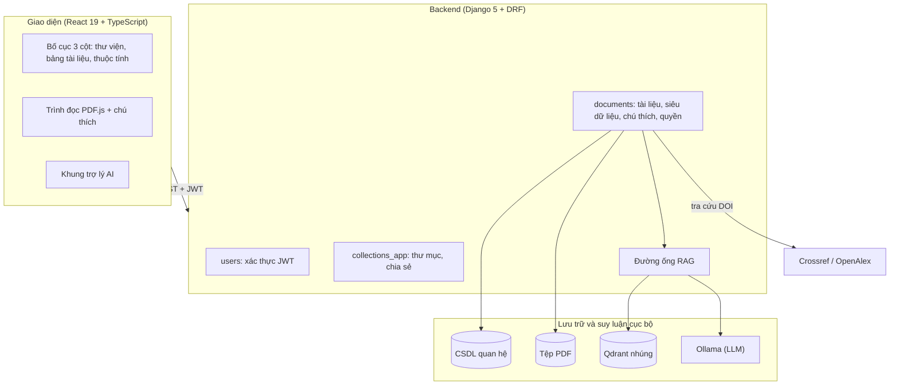

*Hình 4.2: Kiến trúc tổng thể của hệ thống.*

Bên trong mô-đun RAG, quá trình lập chỉ mục và quá trình trả lời câu hỏi dùng chung mô hình nhúng và kho vector:

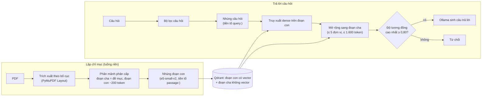

*Hình 4.3: Đường ống RAG: lập chỉ mục và trả lời câu hỏi.*

### 4.3.2. Mô hình triển khai: ứng dụng máy tính cài đặt cục bộ

Người dùng tải về và cài đặt hệ thống như một ứng dụng máy tính thông thường, không cần tự cài Python, cơ sở dữ liệu hay Ollama. Bộ cài được giữ gọn nhẹ; các mô hình được tải ở lần chạy đầu.

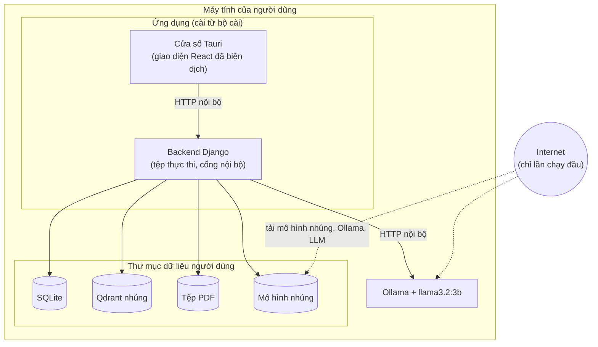

*Hình 4.4: Mô hình triển khai của ứng dụng cài đặt cục bộ.*

| Thành phần | Cách cung cấp |
| :--- | :--- |
| Cửa sổ ứng dụng, backend | Trong bộ cài: Tauri và Django đóng gói bằng PyInstaller, chạy ngầm trên cổng nội bộ |
| Cơ sở dữ liệu, kho vector, tệp PDF | Tạo trong thư mục dữ liệu người dùng: SQLite, Qdrant nhúng, thư mục tệp |
| Mô hình nhúng | Tải ở lần chạy đầu: `intfloat/e5-small-v2` (~130 MB) |
| Mô hình ngôn ngữ | Tải ở lần chạy đầu: Ollama (nếu máy chưa có) và `llama3.2:3b` (~2 GB) |

*Bảng 4.3: Thành phần trong bộ cài và thành phần tải ở lần chạy đầu.*

Ở lần chạy đầu, màn hình thiết lập tải khoảng 2,2 GB (có thanh tiến độ và tiếp tục được khi bị gián đoạn); sau đó ứng dụng chạy hoàn toàn ngoại tuyến. Mỗi lần mở, ứng dụng khởi động Ollama và backend, chờ cả hai sẵn sàng rồi hiển thị giao diện; khi đóng, các tiến trình ngầm được dừng. Ứng dụng dành cho một người dùng nên tài khoản cục bộ được tạo và đăng nhập tự động. Bộ cài dự kiến khoảng 1 GB; máy cần tối thiểu 16 GB RAM.

**Trạng thái:** trong quá trình phát triển và thực nghiệm, hệ thống chạy từ mã nguồn (Vite, Django, PostgreSQL và Ollama cài riêng). Việc đóng gói là bước tiếp theo, theo kế hoạch tại `docs/design/DESKTOP_PACKAGING_PLAN.md`.

---

## 4.4. Thiết kế dữ liệu

### 4.4.1. Cơ sở dữ liệu quan hệ

Cơ sở dữ liệu gồm 15 bảng được định nghĩa bằng Django ORM (PostgreSQL khi phát triển; các mô hình không dùng tính năng riêng của PostgreSQL nên chạy được trên SQLite trong bản cài). Để dễ đọc, sơ đồ được tách thành hai phần: người dùng, thư mục và quyền (Hình 4.5); tài liệu và phân loại (Hình 4.6).


*Hình 4.5: Sơ đồ dữ liệu (1): người dùng, thư mục, chia sẻ và chú thích.*

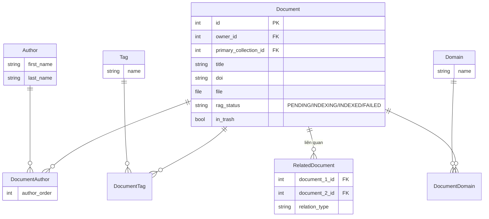

*Hình 4.6: Sơ đồ dữ liệu (2): tài liệu, tác giả và phân loại.*

Bảng `Document` chứa trực tiếp các trường siêu dữ liệu (loại tài liệu, kho lưu trữ, DOI, URL, ngày, ngôn ngữ, giấy phép, phiên bản, khóa trích dẫn...). Quan hệ nhiều-nhiều với tác giả, thẻ, lĩnh vực và thư mục đi qua các bảng trung gian; bảng `DocumentAuthor` giữ thứ tự tác giả.

### 4.4.2. Kho vector

Dữ liệu cho trợ lý AI được lưu trong Qdrant chạy nhúng cục bộ. Để thực hiện phân mảnh phân cấp mà không lặp lại văn bản đoạn cha trong từng vector con, mỗi tài liệu có hai bộ sưu tập:

| Bộ sưu tập | Nội dung | Dùng để |
| :--- | :--- | :--- |
| `doc_{id}` | Vector 384 chiều của các đoạn con (khoảng 200 token, chồng lấp 40), kèm số trang, tên đề mục, mã đoạn cha | Tìm kiếm theo độ tương đồng |
| `doc_{id}_parents` | Không có vector; lưu nguyên văn từng đề mục (đoạn cha) | Đọc đoạn cha theo khóa khi mở rộng ngữ cảnh |

*Bảng 4.4: Hai bộ sưu tập Qdrant của mỗi tài liệu.*

---

## 4.5. Các quy trình chính

### 4.5.1. Tải lên và lập chỉ mục

Việc tải lên gồm hai bước: trích siêu dữ liệu để người dùng xem và sửa, rồi lưu tài liệu và lập chỉ mục trong luồng nền. Trạng thái lập chỉ mục được hiển thị trên bảng tài liệu (Hình 4.7).

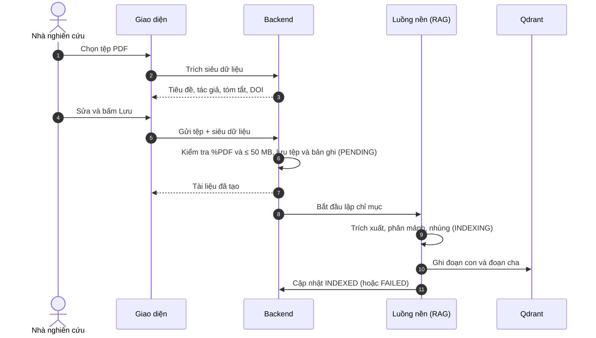

*Hình 4.7: Quy trình tải lên và lập chỉ mục tài liệu.*

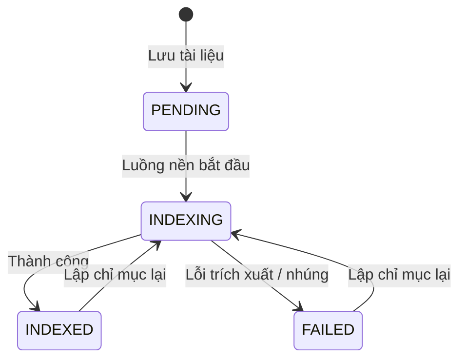

*Hình 4.8: Trạng thái lập chỉ mục của tài liệu.*

### 4.5.2. Hỏi đáp với trợ lý AI

Mỗi câu hỏi đi qua các bước kiểm tra trước khi đến mô hình sinh (Hình 4.9). Ba điểm có thể dừng sớm: bộ lọc câu hỏi, ngưỡng tương đồng, và nhánh dự phòng khi Ollama không phản hồi.

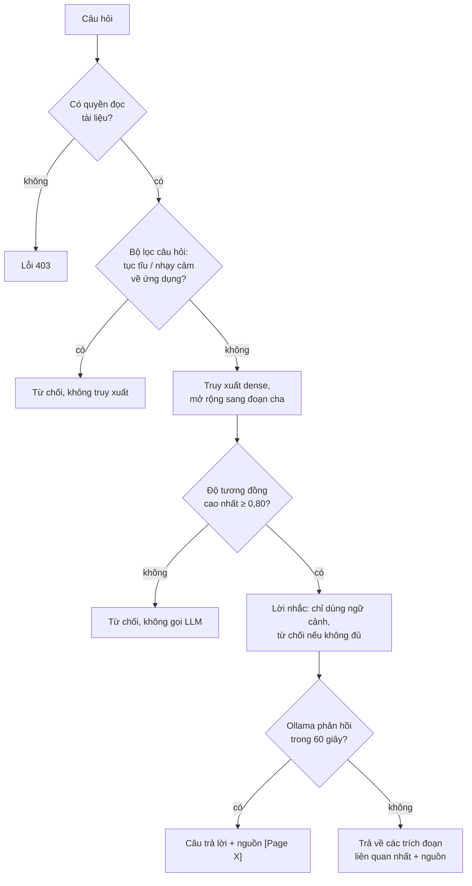

*Hình 4.9: Luồng xử lý một câu hỏi.*

### 4.5.3. Điều hướng trích dẫn

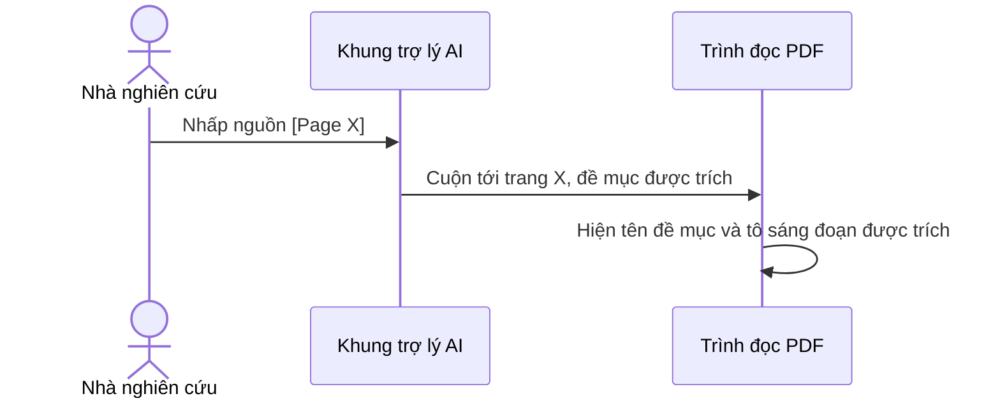

*Hình 4.10: Điều hướng từ câu trả lời tới đoạn được trích dẫn.*

---

## 4.6. Thiết kế giao diện

Giao diện theo bố cục 3 cột của Zotero (Hình 4.11):
- **Cột trái** (thu gọn được): các mục thư viện (Tất cả, Đọc gần đây, Chưa phân loại, Bài của tôi, Trùng lặp, Thùng rác), cây thư mục và danh sách thẻ.
- **Cột giữa:** thanh công cụ (tìm kiếm `Ctrl+F`, thêm tài liệu từ tệp hoặc DOI) và bảng tài liệu có sắp xếp, lọc và huy hiệu trạng thái lập chỉ mục.
- **Cột phải** (tối thiểu 320 px, kéo giãn được): bảng siêu dữ liệu khi ở thư viện; khi mở trình đọc PDF, chuyển giữa danh sách chú thích và khung trợ lý AI.

Tài liệu được mở trong các tab kiểu trình duyệt (`Ctrl+1..9` để chuyển tab).

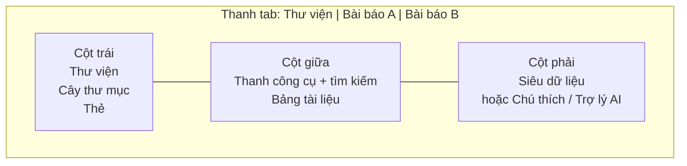

*Hình 4.11: Bố cục giao diện 3 cột.*

Bảng siêu dữ liệu hiển thị 22 trường, được khai báo trong một tệp cấu hình (`metadataConfig.ts`) thay vì viết cứng trong giao diện:

| Nhóm | Trường |
| :--- | :--- |
| Mô tả | Tiêu đề, tiêu đề rút gọn, loại tài liệu, tác giả, ngày, thể loại, ngôn ngữ |
| Định danh và nguồn | DOI, URL, kho lưu trữ, mã trong kho, vị trí lưu trữ, phiên bản, giấy phép, khóa trích dẫn |
| Phân loại | Thẻ (tự do), lĩnh vực (chuẩn hóa), nhóm tài liệu, màu nhóm |
| Hệ thống | Ngày thêm, ngày sửa (chỉ đọc), ghi chú thêm |

*Bảng 4.5: Các trường siêu dữ liệu.*

Thẻ là nhãn tự do do người dùng đặt (ví dụ `transformer`, `cần-đọc`), còn lĩnh vực là danh mục ngành chuẩn hóa (ví dụ `Natural Language Processing`).

---

## 4.7. Cài đặt các phân hệ

- **Xác thực:** SimpleJWT; giao diện tự làm mới access token khi nhận lỗi 401; refresh token bị đưa vào danh sách đen khi đăng xuất.
- **Siêu dữ liệu:** trích từ trang đầu PDF bằng PyMuPDF (tiêu đề theo cỡ chữ lớn nhất, DOI và mã arXiv bằng biểu thức chính quy), chạy hoàn toàn cục bộ; tra cứu DOI qua Crossref, dự phòng OpenAlex.
- **Trình đọc và chú thích:** `pdfjs-dist` với lớp văn bản cho phép chọn chữ; tọa độ chú thích được lưu theo tỷ lệ trang nên hiển thị đúng ở mọi mức phóng to.
- **Phân quyền chia sẻ:** VIEW cho phép đọc, hỏi đáp, tóm tắt; COMMENT cho phép chú thích; EDIT cho phép sửa siêu dữ liệu; xóa, lập chỉ mục lại và quản lý chia sẻ chỉ dành cho chủ sở hữu.
- **Trợ lý AI:**
  - đường ống RAG như Hình 4.3, với cấu hình được chọn từ thực nghiệm (Chương 5); chế độ tùy chọn `rrf_legacy` kết hợp thêm BM25 bằng RRF;
  - tóm tắt nhanh dùng 5 đoạn phân bố đều trong tài liệu làm ngữ cảnh, không dựa trên truy xuất;
  - ngưỡng 0,80 được đặt phía trên điểm tương đồng của một số câu hỏi lạc đề thử thủ công (khoảng 0,75–0,76); ngưỡng chưa được hiệu chuẩn trên một tập câu hỏi lớn;
  - bộ lọc câu hỏi dựa trên danh sách từ và mẫu cụm từ; câu hỏi vẫn được xử lý nếu từ bị gắn cờ xuất hiện trong chính bài báo. Bộ lọc không chặn câu hỏi nào trong 5.428 câu hỏi của QASPER và PeerQA, nên không ảnh hưởng đến các thực nghiệm.

---

## 4.8. Kiểm thử và giới hạn

**Kiểm thử:** 104 bài kiểm thử tự động cho backend (`apps.documents.tests`, `apps.documents.tests_app`, `apps.users.tests`) đều vượt qua; một số bài cần kết nối mạng tới Crossref/arXiv. Frontend được kiểm tra bằng ESLint và bản dựng TypeScript/Vite; chưa có kiểm thử tự động cho giao diện.

**Giới hạn:**
1. **Hỏi đáp trên một tài liệu:** chưa hỗ trợ hỏi đáp tổng hợp trên nhiều tài liệu.
2. **Hội thoại theo phiên:** lịch sử hỏi đáp không được lưu lại (NFR-04).
3. **Chia sẻ chỉ qua API:** phân quyền đã có ở backend nhưng chưa có giao diện quản lý chia sẻ.
4. **Bộ lọc câu hỏi đơn giản:** dựa trên danh sách từ nên có thể bị lách; tỷ lệ từ chối đúng chưa được đo.
5. **Dữ liệu mẫu khi mất kết nối:** giao diện có thể hiển thị dữ liệu mẫu để trình diễn khi không kết nối được backend; trợ lý AI không bao giờ hiển thị câu trả lời giả lập.
6. **Chưa đóng gói:** bộ cài (Mục 4.3.2) là bước phát triển tiếp theo.

---

## 4.9. Tổng kết chương

Chương 4 đã trình bày yêu cầu (15 chức năng, 7 phi chức năng), kiến trúc khối đơn mô-đun hóa, mô hình triển khai dạng ứng dụng cài đặt cục bộ, thiết kế dữ liệu (cơ sở dữ liệu quan hệ và kho vector hai bộ sưu tập), các quy trình chính và giao diện. Hệ thống này là nền tảng cho các thực nghiệm ở Chương 5.

---

# CHƯƠNG 5. KẾT QUẢ THỰC NGHIỆM VÀ THẢO LUẬN

---

Chương này trình bày kết quả của các thực nghiệm thành phần (trích xuất, phân mảnh, mô hình nhúng, chiến lược truy xuất, sinh câu trả lời) và trạng thái của thực nghiệm kết hợp 16 cấu hình. Mỗi mục gồm: kỳ vọng theo lý thuyết, kết quả đo được, đối chiếu giữa hai bên, và lựa chọn phương pháp cho thực nghiệm kết hợp. Mọi kết quả là giá trị trung bình mô tả trên tập dữ liệu được nêu kèm; các kết quả đến từ những tập dữ liệu hoặc thiết lập khác nhau không được so sánh trực tiếp với nhau. Toàn bộ số liệu được lấy từ các tệp kết quả trong thư mục `eval/phases/`, và các biểu đồ được sinh lại bằng tập lệnh `eval/scripts/make_thesis_figures.py`.

---

## 5.1. Dữ liệu thực nghiệm

### 5.1.1. Đặc trưng của ngữ liệu QASPER

QASPER v0.3 gồm 1.585 bài báo NLP/ML và 5.049 câu hỏi. Người đặt câu hỏi chỉ đọc tiêu đề và tóm tắt; câu trả lời và đoạn bằng chứng do người khác đọc toàn văn gán nhãn. Hình 5.1 tóm tắt ba đặc trưng chính.


*Hình 5.1: Tổng quan ngữ liệu QASPER: phân bố loại câu hỏi, độ dài bài báo và tỷ lệ bài báo có các đề mục phổ biến.*

Ba đặc trưng này ảnh hưởng trực tiếp đến thiết kế đường ống:
1. **Bài báo dài hơn nhiều so với cửa sổ ngữ cảnh.** Độ dài trung vị khoảng 3.400 từ, nên văn bản phải được phân mảnh và chỉ một phần nhỏ được đưa vào mô hình sinh.
2. **Câu hỏi ngắn, bằng chứng dài và ít trùng từ.** Câu hỏi trung bình 8,1 từ, đoạn bằng chứng trung bình 175,5 từ, và tỷ lệ trùng từ (Jaccard) giữa câu hỏi và bằng chứng chỉ khoảng 1,6%. Điều này gợi ý rằng tìm kiếm theo từ khóa (BM25) sẽ gặp khó khăn và cần truy xuất theo ngữ nghĩa.
3. **Cấu trúc đề mục rõ ràng.** Gần như mọi bài báo có *Introduction* (97%) và *Conclusion* (91%), nên việc giữ lại cấu trúc đề mục khi trích xuất có ích cho phân mảnh theo cấu trúc.

### 5.1.2. Tập dữ liệu dùng cho từng thực nghiệm

| Thực nghiệm | Tập dữ liệu | Số bài báo | Số câu hỏi |
| :--- | :--- | :---: | :---: |
| Trích xuất: độ phủ bằng chứng | Tập thành phần (QASPER Train) | 335 | (tính theo bài) |
| Trích xuất: ảnh hưởng đến truy xuất | Tập con 150 bài của tập thành phần | 150 | 249 |
| Phân mảnh, chiến lược truy xuất, xếp hạng lại | Tập thành phần | 335 | 567 |
| Mô hình nhúng | Tập con 150 bài | 150 | 249 |
| Truy xuất trên miền khác | PeerQA (PDF / văn bản) | 107 / 73 | 288 / 148 |
| Sinh câu trả lời (bằng chứng chuẩn) | Tập sinh câu trả lời (QASPER Train) | 250 | 500 |
| Thực nghiệm kết hợp | Tập kết hợp (Train, Dev, Test) | 1.142 | 3.122 (sinh câu trả lời: 300) |

*Bảng 5.1: Tập dữ liệu dùng cho từng thực nghiệm.*

Các phương pháp được so sánh và lựa chọn trên cùng các bài báo QASPER; vì vậy kết quả mô tả hành vi trên những bài báo này, không phải là một phép kiểm tra độc lập về khả năng tổng quát hóa.

---

## 5.2. Trích xuất văn bản PDF

**Kỳ vọng theo lý thuyết.** Các bộ trích xuất văn bản thô thường lấy lại được gần như toàn bộ chữ trong bài báo, nhưng chỉ bộ trích xuất có phân tích bố cục mới giữ được thứ tự đọc và tiêu đề đề mục. Vì phân mảnh phân cấp dựa trên đề mục, bộ trích xuất có bố cục được kỳ vọng cho kết quả truy xuất phía sau tốt hơn.

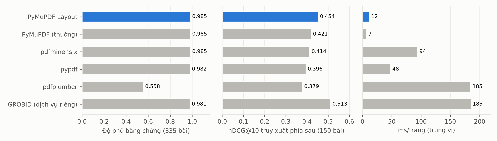

*Hình 5.2: So sánh các bộ trích xuất PDF: độ phủ bằng chứng (335 bài), nDCG@10 của truy xuất phía sau (150 bài; hierarchical + e5 + dense) và thời gian xử lý mỗi trang.*

| Bộ trích xuất | Độ phủ bằng chứng | Heading F1 | ms/trang (trung vị) | nDCG@10 phía sau |
| :--- | :---: | :---: | :---: | :---: |
| **PyMuPDF Layout** | **0,985** | **0,466** | 12 | **0,454** |
| PyMuPDF (thường) | 0,985 | – | 7 | 0,421 |
| pdfminer.six | 0,985 | – | 94 | 0,414 |
| pypdf | 0,982 | – | 48 | 0,396 |
| pdfplumber | 0,558 | – | 185 | 0,379 |
| GROBID (dịch vụ riêng) | 0,981 | 0,576 | 185* | 0,513 |

*Bảng 5.2: Kết quả trích xuất văn bản.*

(*) Thời gian của GROBID là thời gian gọi HTTP tới một container Docker, không so sánh trực tiếp được với các thư viện chạy trong tiến trình.

**Đối chiếu.**
- **Kết quả phù hợp với lý thuyết.** Bốn bộ trích xuất lấy lại 98–99% bằng chứng, nên khác biệt không nằm ở lượng chữ lấy được. Chỉ PyMuPDF Layout giữ được đề mục, và với cùng văn bản, truy xuất phía sau tốt hơn (0,454 so với 0,421 của PyMuPDF thường).
- **pdfplumber có độ phủ thấp (0,558) do cấu hình mặc định.** Trên các bài báo có điểm thấp nhất, văn bản đầu ra bị dính liền các từ (ví dụ `recurrentneuralnetworkarchitectures`) do thiết lập khoảng cách ký tự mặc định. Kết luận vì vậy chỉ áp dụng cho pdfplumber với cấu hình mặc định.
- **GROBID lấy lại lượng bằng chứng tương đương nhưng cho truy xuất phía sau tốt hơn.** Lý do chưa được kiểm chứng; hai khả năng được trình bày ở phần Lựa chọn bên dưới (cách so khớp bằng chứng có nhánh so khớp nguyên văn, và văn bản GROBID không chứa danh mục tài liệu tham khảo).

**Lựa chọn: cố định PyMuPDF Layout.**
Trong thực nghiệm kết hợp, bộ trích xuất được cố định là **PyMuPDF Layout**. Đây là một **quyết định về phạm vi thực hiện**, không phải kết luận rằng PyMuPDF Layout vượt trội trong mọi trường hợp. Quyết định dựa trên ba cân nhắc:

1. **Phù hợp theo kết quả thực nghiệm.** Trong thực nghiệm trích xuất (335 bài báo), PyMuPDF Layout khôi phục bằng chứng ngang các bộ trích xuất tốt nhất (độ phủ bằng chứng 0,985), là bộ trích xuất duy nhất trong nhóm thư viện Python có phát hiện tiêu đề mục (Heading F1 0,466), xử lý nhanh (khoảng 12 ms/trang) và cho kết quả truy xuất phía sau tốt nhất trong nhóm (nDCG@10 0,454 so với 0,421 của PyMuPDF thường; 150 bài báo).

2. **Ràng buộc kỹ thuật thực tế.** GROBID đã được xem xét và đánh giá riêng nhưng không được đưa vào tập ứng viên cuối cùng. GROBID là phần mềm mã nguồn mở và có thể chạy cục bộ, không phụ thuộc API bên ngoài. Tuy nhiên, việc tích hợp đòi hỏi:
   - triển khai và vận hành thêm một dịch vụ riêng (container Docker);
   - môi trường Java và bộ nhớ đáng kể (container chạm giới hạn 4 GB trong lần đánh giá);
   - chi phí tích hợp và bảo trì thêm cho ứng dụng.

   Với tài nguyên tính toán hạn chế của một đồ án đại học, chi phí này được xem là không tương xứng với lợi ích kỳ vọng so với phương án cục bộ hiện có.

3. **Đặc điểm của tập dữ liệu và cách đánh giá.** Văn bản toàn văn của QASPER được tạo từ quy trình xử lý PDF dựa trên GROBID. Trong đánh giá, GROBID khôi phục lượng bằng chứng tương đương PyMuPDF Layout (0,981 so với 0,985), nhưng cho kết quả truy xuất phía sau cao hơn (CEC@0,5: 0,823 so với 0,739; nDCG@10: 0,513 so với 0,454; 150 bài báo). Mã đánh giá cho thấy hai khả năng giải thích, hiện **chỉ là giả thuyết, chưa được kiểm chứng**:
   - phép so khớp bằng chứng và độ liên quan có một nhánh so khớp nguyên văn, có thể có lợi cho văn bản được tạo theo cùng cách với văn bản của QASPER;
   - văn bản GROBID không chứa danh mục tài liệu tham khảo (0/349 bài so với 304/349 bài ở PyMuPDF Layout), nên có ít đoạn gây nhiễu cho truy xuất hơn.

   Một phân tích chẩn đoán nhỏ (tắt nhánh so khớp nguyên văn; loại bỏ danh mục tham khảo khỏi văn bản PyMuPDF Layout) được để dành, chỉ thực hiện nếu cần cho lập luận của luận văn. Kết quả GROBID vì vậy không được diễn giải là GROBID kém hơn, mà là một hướng nghiên cứu tiếp theo.

---

## 5.3. Phân mảnh văn bản

**Kỳ vọng theo lý thuyết.**
- **Phân mảnh phân cấp (small-to-big)** dùng đoạn con nhỏ để so khớp chính xác với câu hỏi, sau đó đưa đoạn cha lớn hơn vào ngữ cảnh. Phương pháp này được kỳ vọng tốt hơn phân mảnh phẳng.
- **Phân mảnh đệ quy theo đề mục (`section_overlap`)** tôn trọng ranh giới câu và đề mục, nên được kỳ vọng tốt hơn phân mảnh kích thước cố định.
- **Phân mảnh ngữ nghĩa** đặt ranh giới tại điểm chuyển chủ đề, nên được kỳ vọng giữ ý trọn vẹn hơn.

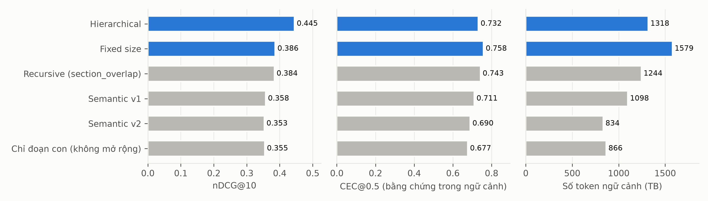

*Hình 5.3: So sánh các chiến lược phân mảnh trên tập thành phần (335 bài, 567 câu hỏi; e5 + dense; ngân sách 1.600 token, tối đa 5 đơn vị).*

| Chiến lược | nDCG@10 | CEC@0,5 | Token ngữ cảnh (TB) | Số đơn vị |
| :--- | :---: | :---: | :---: | :---: |
| **Hierarchical** | **0,445** | 0,732 | 1.318 | 3,4 |
| **Fixed size (400)** | 0,386 | **0,758** | 1.579 | 4,0 |
| Recursive (`section_overlap`, 400/80) | 0,384 | 0,743 | 1.244 | 4,9 |
| Semantic v1 / v2 | 0,358 / 0,353 | 0,711 / 0,690 | 1.098 / 834 | 4,9 / 5,0 |
| Chỉ đoạn con (không mở rộng sang đoạn cha) | 0,355 | 0,677 | 866 | 5,0 |

*Bảng 5.3: Kết quả các chiến lược phân mảnh.*

**Đối chiếu.**
1. **Small-to-big được ủng hộ.** Hierarchical có nDCG@10 cao nhất, và khi bỏ bước mở rộng sang đoạn cha (chỉ đoạn con), CEC giảm từ 0,732 xuống 0,677. Như vậy phần "big", tức đưa đoạn cha vào ngữ cảnh, là phần mang lại lợi ích.
   - *Lưu ý về cách chấm điểm.* nDCG@10 với hierarchical được chấm trên toàn bộ đoạn cha, là đơn vị lớn hơn nên dễ chứa bằng chứng hơn. CEC (bằng chứng có nằm trong ngữ cảnh đưa vào mô hình hay không) là phép so sánh công bằng hơn giữa các chiến lược.
   - Theo CEC, fixed size (0,758) nhỉnh hơn hierarchical (0,732), nhưng fixed size cũng đưa vào nhiều hơn khoảng 260 token. Nguyên nhân phía hierarchical là cách ghép ngữ cảnh: ở 48% câu hỏi, việc ghép dừng lại ngay khi gặp đoạn cha không vừa ngân sách. Khi bỏ qua đoạn đó và tiếp tục ghép (biến thể "fill"), hierarchical đạt CEC 0,769 với 1.469 token. Khi khắc phục điểm này, kết quả phù hợp với lý thuyết.
2. **Recursive không vượt fixed size.** Hai chiến lược ngang nhau về nDCG@10 (0,384 và 0,386). Các đoạn của recursive nhỏ hơn nên chạm giới hạn 5 đơn vị khi mới dùng khoảng 1.240 token; lợi ích của việc giữ ranh giới có thể bị bù trừ bởi lượng văn bản ít hơn.
3. **Semantic chunking kém hơn kỳ vọng, một phần do điều kiện đo.** Các đoạn ngữ nghĩa nhỏ, chạm giới hạn 5 đơn vị khi chỉ dùng 830–1.100 token. Chênh lệch nDCG@10 (khoảng −0,09) lớn hơn nhiều so với chênh lệch CEC (−0,02 đến −0,04), phù hợp với lưu ý về đơn vị chấm điểm ở trên. Kết luận chỉ áp dụng cho giới hạn ngân sách và số đơn vị này. Ngoài ra, phân mảnh ngữ nghĩa tốn khoảng 6 giây mỗi bài báo.

*Đối chiếu với nghiên cứu liên quan:* Sự khác biệt quan sát được giữa các chiến lược phân mảnh phù hợp với nhận định rộng hơn rằng phân đoạn phức tạp hơn không nhất thiết cải thiện hiệu năng RAG. Qu và cộng sự (Qu et al., 2025) đã so sánh phân đoạn kích thước cố định với hai cách phân đoạn ngữ nghĩa (đặt điểm ngắt theo khoảng cách ngữ nghĩa giữa các câu liên tiếp, và gom cụm các câu tương đồng) trên ba tác vụ: truy xuất tài liệu, truy xuất bằng chứng và sinh câu trả lời. Kết quả của họ cho thấy phân đoạn ngữ nghĩa không vượt trội một cách nhất quán so với phân đoạn kích thước cố định; hiệu năng thay đổi theo tập dữ liệu và tác vụ. Chẳng hạn, trên QASPER, F1@5 cho truy xuất tài liệu đạt 90,99 với phân đoạn cố định so với 89,27 và 90,77 với hai cách phân đoạn ngữ nghĩa, và chênh lệch ở truy xuất bằng chứng (8,66; 8,16; 8,50) cũng nhỏ. Các tác giả nhận thấy các phương pháp phân đoạn khác nhau thường truy xuất được cùng các câu bằng chứng, làm giảm lợi ích của việc gom nhóm theo ngữ nghĩa; ưu thế của phân đoạn ngữ nghĩa chỉ rõ hơn trên các tài liệu ghép nhân tạo có độ đa dạng chủ đề cao. Điều này gợi ý rằng hiệu quả của phân mảnh phụ thuộc không chỉ vào chiến lược phân đoạn mà còn vào đặc điểm tài liệu và khả năng của mô hình nhúng trong việc tìm ra bằng chứng liên quan.

Kết quả của đồ án **phù hợp với** nhận định chung này, chứ không phải là sự kiểm chứng trực tiếp nghiên cứu của Qu et al. (2025): thiết lập thực nghiệm khác nhau (đồ án so sánh `fixed_size`, `section_overlap`, `hierarchical` và một biến thể phân đoạn ngữ nghĩa trong đường ống RAG riêng, với giới hạn ngữ cảnh 1.600 token và tối đa 5 đơn vị). Đặc biệt, phân mảnh phân cấp (`hierarchical`) dựa trên cấu trúc cha – con của tài liệu và không phải là phân đoạn ngữ nghĩa; nghiên cứu của Qu et al. không dự đoán kết quả so sánh giữa `hierarchical` và `fixed_size`.

**Lựa chọn.** `hierarchical` (xếp hạng tốt nhất, có cơ sở lý thuyết) và `fixed_size` (đơn giản nhất, CEC cao nhất). Hai kết quả này đến từ các thiết lập khác nhau và không tạo thành một bảng xếp hạng chung; thực nghiệm kết hợp là nơi chúng được so sánh trong cùng một thiết lập.

---

## 5.4. Mô hình nhúng

**Kỳ vọng theo lý thuyết.**
- Các mô hình được huấn luyện tương phản cho truy xuất và dùng tiền tố câu hỏi/đoạn văn (e5, bge, arctic) được kỳ vọng tốt hơn mô hình câu tổng quát (MiniLM).
- Mô hình lớn hơn với cửa sổ ngữ cảnh dài (ModernBERT-embed, 8.192 token) được kỳ vọng chính xác hơn nhưng chậm hơn.
- SPECTER2 được huấn luyện cho độ tương đồng giữa các bài báo (qua trích dẫn), không phải cho tìm đoạn văn trả lời câu hỏi, nên được kỳ vọng không phù hợp với tác vụ này.

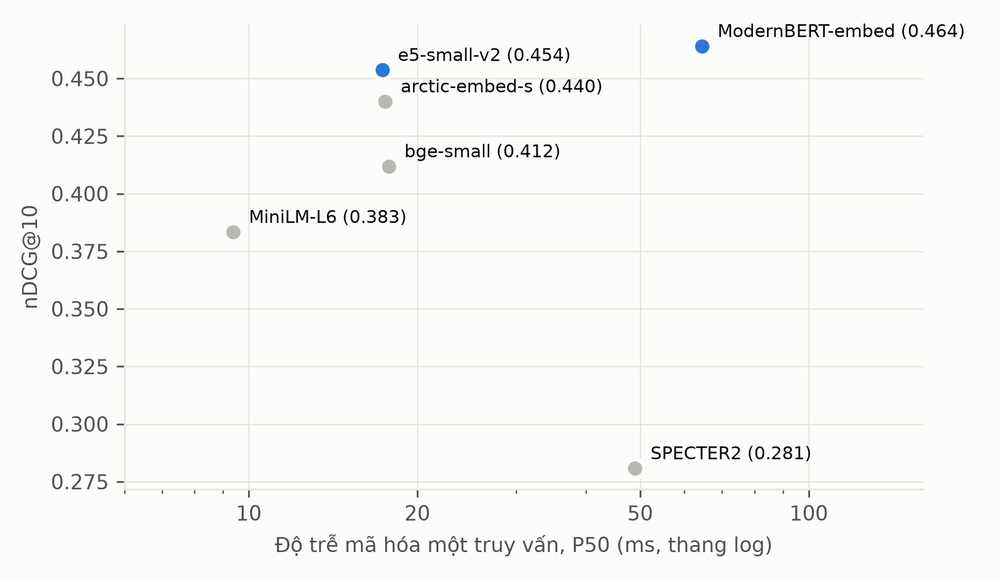

*Hình 5.4: nDCG@10 và độ trễ mã hóa một truy vấn của các mô hình nhúng (150 bài, 249 câu hỏi; hierarchical + dense).*

| Mô hình | Tham số | nDCG@10 | CEC@0,5 | Độ trễ truy vấn P50 | Lập chỉ mục (đoạn/s) | Bộ nhớ đỉnh |
| :--- | :---: | :---: | :---: | :---: | :---: | :---: |
| **ModernBERT-embed-base** | 149M | **0,464** | 0,743 | 64,5 ms | 3,0 | 2,2 GB |
| **e5-small-v2** | 33M | 0,454 | 0,739 | 17,3 ms | 17,3 | 1,3 GB |
| snowflake-arctic-embed-s | 33M | 0,440 | **0,751** | 17,5 ms | 16,2 | 1,3 GB |
| bge-small-en-v1.5 | 33M | 0,412 | 0,699 | 17,8 ms | 16,6 | 1,3 GB |
| all-MiniLM-L6-v2 | 23M | 0,383 | 0,679 | 9,4 ms | 44,4 | 1,1 GB |
| SPECTER2 | 110M | 0,281 | 0,606 | 48,9 ms | 4,9 | 2,0 GB |

*Bảng 5.4: Kết quả các mô hình nhúng.*

**Đối chiếu.**
- **Thứ tự phù hợp với lý thuyết:** mô hình lớn, ngữ cảnh dài đứng đầu, các mô hình nhỏ được huấn luyện cho truy xuất theo sau, MiniLM thấp nhất.
- **Lợi ích của ModernBERT so với e5 nhỏ** (+0,010 nDCG@10), trong khi độ trễ truy vấn cao hơn khoảng 4 lần và lập chỉ mục chậm hơn khoảng 6 lần.
- **SPECTER2 có điểm thấp nhất, phù hợp với dự đoán về sự không khớp tác vụ.** Mô hình được nạp đúng theo hướng dẫn của nhà phát triển (adapter truy vấn cho câu hỏi, adapter tương đồng cho đoạn văn).

**Lựa chọn.** e5-small-v2 (mô hình mặc định của hệ thống, cân bằng tốt giữa chất lượng và chi phí) và ModernBERT-embed-base (chính xác nhất). Hai mô hình đại diện cho hai đầu của sự đánh đổi chất lượng – chi phí.

---

## 5.5. Chiến lược truy xuất

**Kỳ vọng theo lý thuyết.** Kỳ vọng thông thường là hybrid ≥ dense > BM25:
- **Dense** (theo ngữ nghĩa) mạnh khi câu hỏi diễn đạt khác văn bản.
- **BM25** (theo từ khóa) mạnh khi câu hỏi dùng đúng thuật ngữ, tên riêng, con số trong văn bản.
- **Hybrid** kết hợp hai nguồn tín hiệu và được kỳ vọng ít nhất bằng nguồn tốt hơn.
- **Mô hình xếp hạng lại cross-encoder** đọc đồng thời câu hỏi và đoạn văn nên được kỳ vọng xếp hạng tốt hơn, với chi phí tính toán cao hơn.

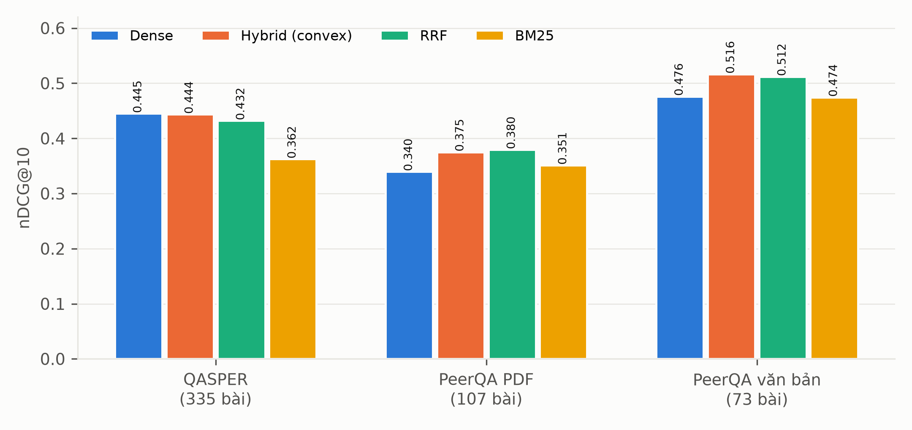

*Hình 5.5: nDCG@10 của các chiến lược truy xuất trên QASPER và PeerQA (hierarchical + e5; BM25 dùng bộ tách từ biểu thức chính quy).*

**Kết quả.**
- **Trên QASPER, thứ tự là dense (0,445) ≈ hybrid (0,444) > RRF (0,432) > BM25 (0,362).** Dense tốt hơn BM25 như kỳ vọng, nhưng hybrid không vượt dense.
- **Trên PeerQA, hybrid tốt nhất.** Trên bộ PDF: hybrid 0,375, RRF 0,380, so với dense 0,340 và BM25 0,351. Trên bộ văn bản: hybrid 0,516 so với dense 0,476.

Để hiểu vì sao hybrid không vượt dense trên QASPER, Hình 5.6 so sánh từng câu hỏi xem dense và BM25 có đưa được bằng chứng vào ngữ cảnh hay không.

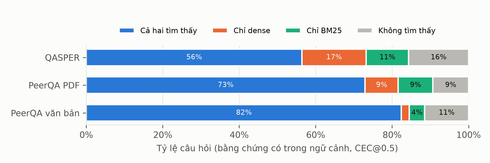

*Hình 5.6: Tỷ lệ câu hỏi mà bằng chứng được đưa vào ngữ cảnh bởi cả hai, chỉ dense, chỉ BM25, hoặc không bởi phương pháp nào.*

**Hai phương pháp thực sự bổ sung cho nhau trên QASPER.** BM25 tìm được bằng chứng cho 11% câu hỏi mà dense bỏ sót, và dense tìm được cho 17% câu hỏi mà BM25 bỏ sót. Tuy nhiên, phép kết hợp cứu được 42 câu hỏi nhưng làm mất 37 câu hỏi mà dense đã trả về đúng, nên tổng thể gần như không thay đổi. Trên PeerQA, nơi câu hỏi của người phản biện dùng nhiều từ ngữ của bài báo hơn, số câu được cứu nhiều hơn số câu bị mất.

**Trọng số kết hợp được kiểm tra lại.** Trọng số α = 0,7 ban đầu là giá trị cố định, chưa từng được tinh chỉnh. Hình 5.7 quét α trên 150 bài báo Train cho bốn đường ống dùng trong thực nghiệm kết hợp.

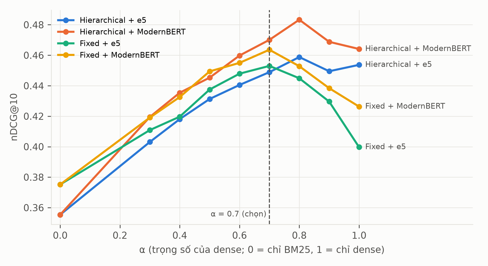

*Hình 5.7: nDCG@10 theo trọng số α của phép kết hợp hybrid (α = 0: chỉ BM25; α = 1: chỉ dense; 150 bài báo Train, 249 câu hỏi).*

Vùng tốt nhất là α = 0,7–0,8; giá trị trung bình tại 0,7 và 0,8 gần như bằng nhau (0,459 và 0,460), nên α = 0,7 được giữ nguyên. Các bài báo Dev và Test không được dùng cho lựa chọn này.

**Hiệu quả của hybrid phụ thuộc vào phần còn lại của đường ống.** Hình 5.8 lấy từ lưới thử nghiệm trước đó (150 bài, 3 chiến lược phân mảnh × 5 mô hình nhúng):
- với hierarchical + e5 hoặc hierarchical + ModernBERT, hybrid gần như không thay đổi kết quả (−0,005 và +0,006);
- với phân mảnh phẳng hoặc mô hình nhúng yếu hơn, hybrid cải thiện +0,03 đến +0,07.

Nói cách khác, BM25 có ích nhất ở nơi dense yếu. Thực nghiệm chiến lược truy xuất được chạy đúng ở cấu hình mạnh nhất của dense, nên không thấy lợi ích.

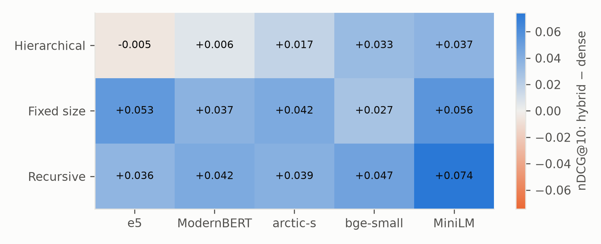

*Hình 5.8: Chênh lệch nDCG@10 (hybrid − dense) theo chiến lược phân mảnh và mô hình nhúng (150 bài, PyMuPDF Layout).*

**Xếp hạng lại (Hình 5.9).**
- Cross-encoder `ms-marco-MiniLM-L6` tăng nhẹ nDCG@10 (0,457 so với 0,445) nhưng thêm khoảng 1 giây mỗi câu hỏi.
- `bge-reranker-base` làm kết quả kém đi rõ rệt (0,355) và thêm khoảng 6 giây. Mô hình đã được kiểm tra hoạt động đúng: nạp không có cảnh báo, và trên ví dụ của nhà phát triển, điểm của đoạn liên quan cao hơn hẳn đoạn không liên quan. Vì vậy đây là kết quả thực của thiết lập này. Nguyên nhân chưa được xác định; khác biệt giữa dữ liệu huấn luyện của mô hình và cặp câu hỏi – đoạn văn khoa học là một khả năng chưa được kiểm chứng.

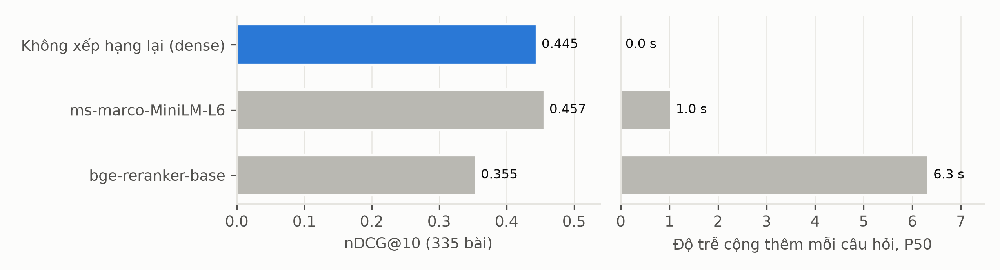

*Hình 5.9: nDCG@10 và độ trễ cộng thêm của hai mô hình xếp hạng lại (335 bài, 567 câu hỏi; xếp hạng lại 30 đoạn đầu của dense).*

**Lựa chọn.**
- **Chọn:** dense (tốt nhất trên QASPER, đơn giản nhất) và hybrid kết hợp lồi với α = 0,7 (tốt trên PeerQA, giúp các đường ống yếu hơn).
- **Không chọn:** RRF và BM25 tách từ theo khoảng trắng, vì không cho kết quả cao hơn ở thiết lập nào; xếp hạng lại, vì lợi ích nhỏ không tương xứng với độ trễ trong ứng dụng tương tác.

---

## 5.6. Sinh câu trả lời

**Thiết lập.** Năm mô hình chạy cục bộ qua Ollama nhận **bằng chứng chuẩn** làm ngữ cảnh, nên thực nghiệm này chỉ đo khâu sinh, không đo khâu truy xuất. Các thiết lập: nhiệt độ 0, tối đa 256 token đầu ra, và lời nhắc yêu cầu từ chối khi ngữ cảnh không đủ thông tin.

**Kỳ vọng theo lý thuyết.** Mô hình lớn hơn được kỳ vọng tuân thủ chỉ dẫn và bám ngữ cảnh tốt hơn. Mô hình nhỏ nhanh hơn nhưng dễ thêm thông tin không có căn cứ.


*Hình 5.10: Token F1, tỷ lệ từ chối và độ trễ của năm mô hình sinh (500 câu hỏi, 250 bài báo, ngữ cảnh là bằng chứng chuẩn).*

| Mô hình | Token F1 | Tỷ lệ từ chối | Độ trễ P50 |
| :--- | :---: | :---: | :---: |
| **qwen2.5:1.5b** | **0,240** | 29,2% | 4,0 s |
| phi4-mini | 0,233 | 50,0% | 6,0 s |
| qwen2.5:0.5b | 0,232 | 10,0% | 3,9 s |
| **llama3.2:3b** | 0,203 | 48,6% | 6,5 s |
| llama3.2:1b | 0,135 | 58,8% | 5,1 s |

*Bảng 5.5: Kết quả sinh câu trả lời với bằng chứng chuẩn.*

Một đánh giá thủ công nhỏ (cùng 20 câu hỏi cho cả năm mô hình, một người đánh giá, ẩn danh mô hình, hai đợt) xem xét câu trả lời có căn cứ trong ngữ cảnh hay không (Hình 5.11). Ở đợt 2, bảy nhãn được điều chỉnh để thống nhất với quyết định của đợt 1 trên cùng câu hỏi (ví dụ cùng một câu trả lời hoặc cùng một câu từ chối phải nhận cùng nhãn).


*Hình 5.11: Phân bố nhãn đánh giá thủ công (20 câu trả lời mỗi mô hình, năm mô hình, một người đánh giá; chỉ mang tính minh họa).*

**Đối chiếu.**
- **Lý thuyết chỉ đúng một phần.** Mô hình 3B tốt hơn mô hình 1B, nhưng có Token F1 thấp hơn hai mô hình qwen nhỏ hơn.
- **Phần lớn khoảng cách đến từ việc từ chối.** `llama3.2:3b` từ chối khoảng một nửa số câu hỏi, và mỗi lần từ chối nhận điểm 0.
- **Đánh giá thủ công cho thấy chiều ngược lại.** `qwen2.5:0.5b` gần như không từ chối nhưng có 7/20 câu trả lời không có căn cứ hoặc mâu thuẫn với ngữ cảnh, so với 1/20 của `llama3.2:3b`.
- **Cần đọc các chỉ số cùng nhau.** Token F1 đo mức trùng từ với đáp án, không đo tính đúng sự thật. Token F1, tỷ lệ từ chối và đánh giá thủ công là ba phép đo khác nhau; không chỉ số nào đủ để xếp hạng mô hình một mình.
- **Câu hỏi Có/Không khó với mọi mô hình.** Độ chính xác của `llama3.2:3b` chỉ 25%, vì câu trả lời thường không bắt đầu bằng "có" hoặc "không" rõ ràng.
- **Token F1 cao không đi kèm ít câu trả lời không căn cứ.** `qwen2.5:1.5b` có Token F1 cao nhất trên 500 câu nhưng có 5/20 câu trả lời không có căn cứ hoặc mâu thuẫn (3 trong số đó mâu thuẫn với ngữ cảnh); `phi4-mini` có 2/20, `llama3.2:1b` 3/20. Cả hai mô hình mới đều từ chối 8/20 câu, khoảng một nửa số đó là từ chối không cần thiết.
- **Phạm vi:** 20 câu hỏi và một người đánh giá là quá ít để xếp hạng chắc chắn; chênh lệch một hoặc hai câu giữa các mô hình không nên được diễn giải.

**Lựa chọn.** `llama3.2:3b` (mô hình mặc định; ít câu trả lời không có căn cứ nhất trong đánh giá thủ công) và `qwen2.5:1.5b` (Token F1 cao nhất, nhanh, ít bộ nhớ hơn). Đây là hai nguồn bằng chứng bổ sung cho nhau, không phải một bảng xếp hạng: không mô hình nào được khẳng định là tốt hơn mô hình kia. Đánh giá thủ công cho thấy `qwen2.5:1.5b` có nhiều câu trả lời không căn cứ hơn `llama3.2:3b`, nên cặp này cũng thể hiện sự đánh đổi giữa mức trùng từ với đáp án và độ bám ngữ cảnh; thực nghiệm kết hợp sẽ cho thấy sự đánh đổi này trong đường ống đầy đủ.

---

## 5.7. Tổng hợp lựa chọn cho thực nghiệm kết hợp

| Thành phần | Phương pháp 1 | Phương pháp 2 | Lý do lựa chọn |
| :--- | :--- | :--- | :--- |
| Trích xuất | PyMuPDF Layout (cố định) | – | Độ phủ bằng chứng cao, giữ đề mục, nhanh; GROBID nằm ngoài phạm vi thực hiện (Mục 5.2) |
| Phân mảnh (chunking) | `hierarchical` (con 200 / chồng lấp 40, mở rộng sang đoạn cha) | `fixed_size` (400) | `hierarchical` dẫn đầu thực nghiệm phân mảnh (nDCG@10 0,445 so với 0,386; 335 bài báo, e5 + dense), phù hợp lý thuyết "small-to-big". `fixed_size` là mốc đơn giản, có độ bao phủ bằng chứng trong ngữ cảnh (CEC@0,5) cao hơn do lấp đầy ngân sách ngữ cảnh nhiều hơn (khoảng 1.580 so với 1.290 token). Hai kết quả đến từ các thiết lập khác nhau nên không so sánh trực tiếp. |
| Mô hình nhúng | `intfloat/e5-small-v2` | `nomic-ai/modernbert-embed-base` | ModernBERT cho nDCG@10 cao nhất (0,464 so với 0,454 của e5; 150 bài báo) và có cửa sổ ngữ cảnh dài, nhưng chậm hơn khoảng 4 lần (64 so với 17 ms/truy vấn) và tốn bộ nhớ hơn. Hai mô hình đại diện cho đánh đổi chất lượng – chi phí. |
| Truy xuất | dense | hybrid (kết hợp lồi: 0,7 × dense + 0,3 × BM25, chuẩn hóa min-max) | Trên QASPER hai phương pháp gần như bằng nhau (0,445 so với 0,444), còn trên PeerQA hybrid cao hơn khoảng 0,04. Theo lý thuyết, BM25 hữu ích khi câu hỏi dùng chung từ ngữ với văn bản; câu hỏi QASPER được viết từ phần tóm tắt nên ít trùng từ với bằng chứng. Giữ cả hai giúp kiểm tra tương tác này trong đường ống hoàn chỉnh. |
| Mô hình sinh | `llama3.2:3b` | `qwen2.5:1.5b` | `qwen2.5:1.5b` được đưa vào vì kết quả sinh với bằng chứng chuẩn (Token F1 0,240, nhanh hơn). `llama3.2:3b` là mô hình mặc định của hệ thống và ít câu trả lời không có căn cứ nhất trong đánh giá thủ công (1/20, so với 5/20 của `qwen2.5:1.5b`). Đây là hai nguồn bằng chứng bổ sung cho nhau, không phải một bảng xếp hạng so sánh trực tiếp. |

*Bảng 5.6: Hai phương pháp được chọn cho mỗi thành phần trong thực nghiệm kết hợp.*

Mỗi lựa chọn dựa trên thực nghiệm thành phần tương ứng, và các thực nghiệm này dùng những tập dữ liệu và thiết lập khác nhau. Kết hợp các phương pháp tốt nhất của từng thành phần không bảo đảm cho đường ống tốt nhất: chẳng hạn, lợi ích của hybrid phụ thuộc vào chiến lược phân mảnh và mô hình nhúng (Hình 5.8). Đây là lý do cần thực nghiệm kết hợp.

---

## 5.8. Thực nghiệm kết hợp 16 cấu hình

**Trạng thái: đã chuẩn bị xong, chưa chạy toàn bộ. Chưa có kết quả kết hợp nào được báo cáo.** Thiết kế được trình bày tại Mục 3.3.6. Các bước đã hoàn thành:
- **Tập dữ liệu kết hợp:** 1.142 bài báo, 3.122 câu hỏi, gồm cả Train, Dev và Test, dùng PDF phiên bản mới nhất.
- **Tập sinh câu trả lời:** 300 câu hỏi cố định (100 câu mỗi tập, mỗi bài báo tối đa một câu, phân tầng theo loại câu trả lời).
- **Chạy thử:** 3 câu hỏi qua cả 16 cấu hình, xác nhận mọi cấu hình nhận cùng câu hỏi và hai mô hình sinh nhận đúng cùng một ngữ cảnh.
- **Đo chi phí trên 10 bài báo:**
  - Với ngữ cảnh truy xuất dài 1.300–1.600 token, `llama3.2:3b` mất khoảng 32 giây cho mỗi câu trả lời, so với 6,5 giây khi dùng bằng chứng chuẩn ngắn. `qwen2.5:1.5b` mất khoảng 14 giây.
  - Trong lúc sinh câu trả lời, Ollama dùng 4,5–6,9 GB bộ nhớ, làm bộ nhớ trống của máy (16 GB) giảm xuống gần 0.
  - Chi phí này là một phát hiện thực tế quan trọng: thời gian trả lời trong ứng dụng thực tế dài hơn nhiều so với thực nghiệm dùng bằng chứng chuẩn.
- **Thời gian chạy ước tính:** khoảng 32–43 giờ, tùy theo số câu hỏi dùng để tính các chỉ số truy xuất.

Khi có kết quả, mục này sẽ trình bày:
- kết quả theo từng tầng: truy xuất, ghép ngữ cảnh, sinh câu trả lời, độ bám ngữ cảnh và chi phí, không gộp thành một điểm tổng hợp;
- kết quả theo từng tập Train, Dev, Test và theo loại câu trả lời;
- so sánh cấu hình tốt nhất ở mỗi tầng với cấu hình ghép từ các phương pháp tốt nhất của từng thành phần.

---

## 5.9. Hạn chế

- **Chọn và đánh giá trên cùng dữ liệu.** Các phương pháp được chọn và đánh giá trên cùng các bài báo QASPER, nên kết quả không phải phép kiểm tra độc lập.
- **Một miền dữ liệu.** QASPER chỉ gồm bài báo NLP/ML; PeerQA chỉ là phép kiểm tra nhỏ trên miền khác và chỉ cho khâu truy xuất.
- **Các chỉ số tự động là xấp xỉ.** Độ liên quan và CEC dựa trên mức trùng từ, không phải đánh giá của con người. Token F1 đo mức trùng từ với đáp án, không đo tính đúng sự thật.
- **Đánh giá thủ công nhỏ.** Chỉ có một người đánh giá; kết quả chỉ mang tính minh họa.
- **Khác biệt thiết lập giữa các thực nghiệm thành phần** (335 bài, 150 bài, bằng chứng chuẩn), nên các con số không tạo thành một bảng xếp hạng chung.
- **Phiên bản PDF.** Thực nghiệm kết hợp dùng PDF phiên bản mới nhất, không kiểm tra với văn bản được chú thích; một số PDF có thể là phiên bản mới hơn văn bản gốc của QASPER.
- **Phần cứng.** Độ trễ và bộ nhớ đo trên một máy cụ thể (Mục 3.2.2).
- **Khả năng nhiễm dữ liệu huấn luyện.** Các mô hình ngôn ngữ có thể đã gặp các bài báo công khai này trong quá trình huấn luyện.

---

## 5.10. Tổng kết chương

Các thực nghiệm thành phần cho thấy kết quả phần lớn phù hợp với lý thuyết:
- trích xuất có phân tích bố cục giúp truy xuất phía sau;
- phân mảnh small-to-big hiệu quả khi ngữ cảnh được ghép đúng cách;
- mô hình nhúng lớn hơn chính xác hơn nhưng tốn chi phí hơn.

Những điểm khác lý thuyết đều có giải thích dựa trên dữ liệu đo được:
- hybrid không vượt dense trên QASPER, vì phép kết hợp mất gần bằng số câu nó cứu được, và lợi ích phụ thuộc vào đường ống;
- phân mảnh ngữ nghĩa kém hơn kỳ vọng dưới giới hạn số đơn vị ngữ cảnh;
- Token F1 xếp mô hình 3B dưới các mô hình nhỏ, vì mô hình 3B từ chối nhiều hơn nhưng ít trả lời không có căn cứ hơn.

Kết quả của bộ xếp hạng lại bge chưa được giải thích. Hai phương pháp tốt nhất của mỗi thành phần đã được chọn cho thực nghiệm kết hợp 16 cấu hình. Thực nghiệm này đã được chuẩn bị và đo chi phí, và kết quả sẽ được bổ sung khi chạy xong.

---

# CHƯƠNG 6. KẾT LUẬN VÀ HƯỚNG PHÁT TRIỂN

---

## 6.1. Kết quả đạt được

### 6.1.1. Về xây dựng phần mềm
Đề tài đã xây dựng một ứng dụng web quản lý tài liệu nghiên cứu theo phong cách Zotero:
- **Kiến trúc và giao diện:** kiến trúc Khối đơn mô-đun hóa (Django 5 + React 19); bố cục 3 cột; trình đọc PDF.js có bôi đậm và ghi chú.
- **Quản lý tài liệu:** 22 trường siêu dữ liệu; tra cứu DOI; chia sẻ theo quyền.
- **Trợ lý AI cục bộ:** đường ống RAG chạy hoàn toàn trên máy cá nhân:
  - PyMuPDF Layout → phân mảnh phân cấp → e5-small-v2 → Qdrant nhúng → truy xuất dense → `llama3.2:3b` qua Ollama;
  - ngưỡng từ chối khi ngữ cảnh không liên quan;
  - định vị trích dẫn trên trang PDF.
- **Kiểm thử:** bộ kiểm thử backend gồm 104 bài kiểm thử tự động đều vượt qua.

### 6.1.2. Về thực nghiệm
Đề tài đánh giá từng thành phần của đường ống RAG trên ngữ liệu QASPER, đối chiếu kết quả với lý thuyết và chọn hai phương pháp cho mỗi thành phần (Chương 5). Kết quả mỗi thành phần đo bằng nDCG@10, trừ khâu sinh câu trả lời:

| Thành phần | Kết quả chính | Lựa chọn |
| :--- | :--- | :--- |
| Trích xuất | Cùng độ phủ bằng chứng; PyMuPDF Layout giữ đề mục và cho truy xuất phía sau tốt nhất (0,454) | PyMuPDF Layout (cố định) |
| Phân mảnh | Hierarchical 0,445 > Fixed 0,386 ≈ Recursive 0,384 | Hierarchical, Fixed |
| Mô hình nhúng | ModernBERT 0,464 > e5 0,454 (nhanh hơn khoảng 4 lần) | e5, ModernBERT |
| Truy xuất | QASPER: dense 0,445 ≈ hybrid 0,444 > BM25 0,362; PeerQA: hybrid tốt hơn dense | Dense, Hybrid (α = 0,7) |
| Sinh câu trả lời | qwen2.5:1.5b có Token F1 cao nhất (0,240); llama3.2:3b ít câu trả lời không căn cứ nhất trong đánh giá thủ công | llama3.2:3b, qwen2.5:1.5b |

*Bảng 6.1: Tóm tắt kết quả các thực nghiệm thành phần.*

Các điểm kết quả khác với kỳ vọng lý thuyết đều được phân tích:
- **Hybrid chỉ có lợi ở nơi dense yếu,** vì phép kết hợp mất gần bằng số câu hỏi nó cứu được trên QASPER.
- **Phân mảnh ngữ nghĩa bị giới hạn bởi số đơn vị ngữ cảnh.**
- **Token F1 bất lợi cho mô hình hay từ chối.**

Thực nghiệm kết hợp 16 cấu hình đã được chuẩn bị đầy đủ (dữ liệu, công cụ, chạy thử, đo chi phí) nhưng chưa chạy toàn bộ.

---

## 6.2. Hạn chế

1. **Thực nghiệm kết hợp chưa có kết quả.** Kết luận về đường ống tốt nhất hiện chỉ dựa trên các thực nghiệm thành phần.
2. **Chọn và đánh giá trên cùng dữ liệu.** Các phương pháp được chọn và đánh giá trên cùng các bài báo QASPER (NLP/ML), nên kết quả không chứng minh khả năng tổng quát hóa.
3. **Chỉ số tự động dựa trên mức trùng từ,** và đánh giá thủ công chỉ có một người đánh giá với số câu nhỏ.
4. **Tốc độ sinh câu trả lời trên CPU chậm khi ngữ cảnh dài:** khoảng 30 giây mỗi câu với `llama3.2:3b`. Bộ nhớ của máy 16 GB gần đạt giới hạn khi chạy mô hình sinh.
5. **Một số kết quả chưa được giải thích đầy đủ:** bộ xếp hạng lại `bge-reranker-base`, và lợi thế của GROBID ở truy xuất phía sau.

---

## 6.3. Hướng phát triển

1. **Hoàn thành thực nghiệm kết hợp 16 cấu hình.** So sánh cấu hình tốt nhất ở từng tầng (truy xuất, ngữ cảnh, sinh câu trả lời, chi phí) với cấu hình ghép từ các phương pháp tốt nhất của từng thành phần, rồi chọn cấu hình cho ứng dụng.
2. **Cải thiện cách ghép ngữ cảnh** (biến thể "fill" đã cho thấy CEC tăng) và cân nhắc rút ngắn ngữ cảnh để giảm thời gian sinh câu trả lời trên CPU.
3. **Tìm hiểu nguyên nhân lợi thế của GROBID** bằng hai phép kiểm tra nhỏ đã được thiết kế.
4. **Mở rộng sang hỏi đáp trên nhiều tài liệu** trong cùng một thư mục, và hỗ trợ PDF dạng ảnh (OCR).
5. **Đóng gói thành ứng dụng máy tính cài đặt cục bộ:** một bộ cài Windows gọn nhẹ chứa ứng dụng, backend và cơ sở dữ liệu SQLite; Ollama, `llama3.2:3b` và mô hình nhúng được tự tải ở lần chạy đầu, để người dùng chỉ cần tải về và cài đặt (Mục 4.3.3).

---

## 6.4. Lời kết

Đề tài cho thấy một trợ lý AI dựa trên RAG có thể chạy hoàn toàn trên máy tính cá nhân để hỗ trợ đọc tài liệu khoa học. Đồng thời, việc lựa chọn phương pháp cho từng thành phần nên dựa trên cả kết quả đo, lý thuyết và chi phí, thay vì chỉ chọn phương pháp có điểm cao nhất.

---

# TÀI LIỆU THAM KHẢO

---

Baumgärtner, T., Briscoe, T., & Gurevych, I. (2025). PeerQA: A scientific question answering dataset from peer reviews. In *Proceedings of the 2025 Conference of the Nations of the Americas Chapter of the Association for Computational Linguistics: Human Language Technologies* (pp. 508–544). Association for Computational Linguistics. https://doi.org/10.18653/v1/2025.naacl-long.22

Artifex Software. (2024). *PyMuPDF documentation*. https://pymupdf.readthedocs.io/

Chen, T., Kornblith, S., Norouzi, M., & Hinton, G. (2020). A simple framework for contrastive learning of visual representations. In *Proceedings of the 37th International Conference on Machine Learning* (Vol. 119, pp. 1597–1607). PMLR.

Cormack, G. V., Clarke, C. L. A., & Büttcher, S. (2009). Reciprocal rank fusion outperforms Condorcet and individual rank learning methods. In *Proceedings of the 32nd International ACM SIGIR Conference on Research and Development in Information Retrieval* (pp. 758–759). ACM. https://doi.org/10.1145/1571941.1572114

Crossref. (2024). *Crossref REST API documentation*. https://api.crossref.org/

Dasigi, P., Lo, K., Beltagy, I., Cohan, A., Smith, N. A., & Gardner, M. (2021). A dataset of information-seeking questions and answers anchored in research papers. In *Proceedings of the 2021 Conference of the North American Chapter of the Association for Computational Linguistics: Human Language Technologies* (pp. 4599–4610). Association for Computational Linguistics. https://doi.org/10.18653/v1/2021.naacl-main.365

Devlin, J., Chang, M.-W., Lee, K., & Toutanova, K. (2019). BERT: Pre-training of deep bidirectional transformers for language understanding. In *Proceedings of the 2019 Conference of the North American Chapter of the Association for Computational Linguistics: Human Language Technologies* (pp. 4171–4186). Association for Computational Linguistics. https://doi.org/10.18653/v1/N19-1423

Järvelin, K., & Kekäläinen, J. (2002). Cumulated gain-based evaluation of IR techniques. *ACM Transactions on Information Systems, 20*(4), 422–446. https://doi.org/10.1145/582415.582418

Karpukhin, V., Oğuz, B., Min, S., Lewis, P., Wu, L., Edunov, S., Chen, D., & Yih, W. (2020). Dense passage retrieval for open-domain question answering. In *Proceedings of the 2020 Conference on Empirical Methods in Natural Language Processing* (pp. 6769–6781). Association for Computational Linguistics. https://doi.org/10.18653/v1/2020.emnlp-main.550

Lewis, P., Perez, E., Piktus, A., Petroni, F., Karpukhin, V., Goyal, N., Küttler, H., Lewis, M., Yih, W., Rocktäschel, T., Riedel, S., & Kiela, D. (2020). Retrieval-augmented generation for knowledge-intensive NLP tasks. *Advances in Neural Information Processing Systems, 33*, 9459–9474.

Liu, N. F., Lin, K., Hewitt, J., Paranjape, A., Bevilacqua, M., Petroni, F., & Liang, P. (2024). Lost in the middle: How language models use long contexts. *Transactions of the Association for Computational Linguistics, 12*, 157–173. https://doi.org/10.1162/tacl_a_00638

LlamaIndex. (n.d.). *Recursive retriever + node references* [Documentation]. Retrieved October 31, 2026, from https://developers.llamaindex.ai/python/framework/integrations/retrievers/recursive_retriever_nodes/

Manning, C. D., Raghavan, P., & Schütze, H. (2008). *Introduction to information retrieval*. Cambridge University Press.

Merrick, L., Xu, D., Nuti, G., & Campos, D. (2024). *Arctic-Embed: Scalable, efficient, and accurate text embedding models* (arXiv:2405.05374). arXiv. https://doi.org/10.48550/arXiv.2405.05374

Meta AI. (2024, September 25). *Llama 3.2: Revolutionizing edge AI and vision with open, customizable models*. https://ai.meta.com/blog/llama-3-2-connect-2024-vision-edge-mobile-devices/

Mixedbread AI. (2024). *mxbai-embed-large-v1* [Model card]. Hugging Face. https://huggingface.co/mixedbread-ai/mxbai-embed-large-v1

Mozilla. (2024). *PDF.js: A general-purpose, web standards-based platform for parsing and rendering PDFs*. https://mozilla.github.io/pdf.js/

Priem, J., Piwowar, H., & Orr, R. (2022). *OpenAlex: A fully-open index of scholarly works, authors, venues, institutions, and concepts* (arXiv:2205.01833). arXiv. https://doi.org/10.48550/arXiv.2205.01833

Qdrant. (2024). *Qdrant documentation*. https://qdrant.tech/documentation/

Qu, R., Tu, R., & Bao, F. S. (2025). Is semantic chunking worth the computational cost? In *Findings of the Association for Computational Linguistics: NAACL 2025* (pp. 2155–2177). Association for Computational Linguistics. https://doi.org/10.18653/v1/2025.findings-naacl.114

Rajpurkar, P., Zhang, J., Lopyrev, K., & Liang, P. (2016). SQuAD: 100,000+ questions for machine comprehension of text. In *Proceedings of the 2016 Conference on Empirical Methods in Natural Language Processing* (pp. 2383–2392). Association for Computational Linguistics. https://doi.org/10.18653/v1/D16-1264

Reimers, N., & Gurevych, I. (2019). Sentence-BERT: Sentence embeddings using Siamese BERT-networks. In *Proceedings of the 2019 Conference on Empirical Methods in Natural Language Processing and the 9th International Joint Conference on Natural Language Processing* (pp. 3982–3992). Association for Computational Linguistics. https://doi.org/10.18653/v1/D19-1410

Robertson, S., & Zaragoza, H. (2009). The probabilistic relevance framework: BM25 and beyond. *Foundations and Trends in Information Retrieval, 3*(4), 333–389. https://doi.org/10.1561/1500000019

Salton, G., Wong, A., & Yang, C. S. (1975). A vector space model for automatic indexing. *Communications of the ACM, 18*(11), 613–620. https://doi.org/10.1145/361219.361220

Su, J., Ahmed, M., Lu, Y., Pan, S., Bo, W., & Liu, Y. (2024). RoFormer: Enhanced transformer with rotary position embedding. *Neurocomputing, 568*, Article 127063. https://doi.org/10.1016/j.neucom.2023.127063

van den Oord, A., Li, Y., & Vinyals, O. (2018). *Representation learning with contrastive predictive coding* (arXiv:1807.03748). arXiv. https://doi.org/10.48550/arXiv.1807.03748

Vaswani, A., Shazeer, N., Parmar, N., Uszkoreit, J., Jones, L., Gomez, A. N., Kaiser, Ł., & Polosukhin, I. (2017). Attention is all you need. *Advances in Neural Information Processing Systems, 30*, 5998–6008.

Wang, L., Yang, N., Huang, X., Jiao, B., Yang, L., Jiang, D., Majumder, R., & Wei, F. (2022). *Text embeddings by weakly-supervised contrastive pre-training* (arXiv:2212.03533). arXiv. https://doi.org/10.48550/arXiv.2212.03533

Warner, B., Chaffin, A., Clavié, B., Weller, O., Hallström, O., Taghadouini, S., Gallagher, A., Biswas, R., Ladhak, F., Aarsen, T., Cooper, N., Adams, G., Howard, J., & Poli, I. (2024). *Smarter, better, faster, longer: A modern bidirectional encoder for fast, memory efficient, and long context finetuning and inference* (arXiv:2412.13663). arXiv. https://doi.org/10.48550/arXiv.2412.13663

Xiao, S., Liu, Z., Zhang, P., Muennighoff, N., Lian, D., & Nie, J.-Y. (2024). C-Pack: Packed resources for general Chinese embeddings. In *Proceedings of the 47th International ACM SIGIR Conference on Research and Development in Information Retrieval*. ACM. https://doi.org/10.1145/3626772.3657878

---

# PHỤ LỤC LUẬN VĂN: TÀI LIỆU KỸ THUẬT VÀ TỪ ĐIỂN DỮ LIỆU

---

## Phụ lục A. Danh mục 22 Trường Siêu Dữ liệu Học thuật (Bibliographic Metadata)

Hệ thống quản lý tài liệu khoa học áp dụng cơ chế quản lý siêu dữ liệu hướng cấu hình (Data-Driven Configuration) tại tệp mã nguồn `frontend/src/constants/metadataConfig.ts`. Toàn bộ 22 trường thông tin học thuật được định nghĩa chi tiết theo chuẩn thư mục quốc tế:

*Bảng A.1: Danh mục 22 Trường Siêu dữ liệu Học thuật và Kiểu Dữ liệu Giao diện.*

| STT | Khóa thuộc tính (Key) | Nhãn hiển thị (Label) | Kiểu nhập liệu (UI Type) | Bảng CSDL PostgreSQL | Mô tả ngữ nghĩa và Mục đích học thuật |
| :---: | :--- | :--- | :---: | :--- | :--- |
| 1 | `title` | Title | `text` (Primary) | `Document.title` | Tiêu đề đầy đủ của bài báo hoặc ấn phẩm khoa học. |
| 2 | `shortTitle` | Short Title | `text` | `DocumentMetadata.publication_title` | Tiêu đề rút gọn hoặc tiêu đề chạy đầu trang (running header). |
| 3 | `itemType` | Item Type | `text` / `dropdown` | `DocumentMetadata.item_type` | Loại hình ấn phẩm: Journal Article, Conference Paper, Book, Preprint, Thesis, Report. |
| 4 | `authors` | Authors | `authors` (Dynamic list) | `Author` & `DocumentAuthor` | Danh sách tác giả xếp theo thứ tự đóng góp (`order`), gồm Họ (`last_name`) và Tên (`first_name`). |
| 5 | `doi` | DOI | `text` (Interactive) | `Document.doi` | Định danh đối tượng số (Digital Object Identifier) chuẩn quốc tế; tích hợp nút tra cứu Crossref. |
| 6 | `url` | URL | `url` | `DocumentMetadata.extra` | Đường dẫn trực tiếp đến trang chủ bài báo hoặc kho lưu trữ mở. |
| 7 | `date` | Date | `text` / `date` | `DocumentMetadata.date` | Ngày hoặc năm xuất bản chính thức của công trình nghiên cứu. |
| 8 | `genre` | Genre | `text` | `DocumentMetadata.extra` | Thể loại bài viết học thuật (Research Article, Review, Short Communication, Survey). |
| 9 | `repository` | Repository | `text` | `DocumentMetadata.extra` | Kho lưu trữ dữ liệu số (arXiv, IEEE Xplore, PubMed, ACM Digital Library). |
| 10 | `archiveId` | Archive ID | `text` | `Document.arxiv_id` | Mã số định danh trong kho lưu trữ chuyên ngành (ví dụ: arXiv ID `1706.03762`). |
| 11 | `language` | Language | `text` / `dropdown` | `DocumentMetadata.language` | Ngôn ngữ chính của bài viết (tiếng Anh `en`, tiếng Việt `vi`, tiếng Pháp `fr`). |
| 12 | `license` | License | `text` | `DocumentMetadata.license` | Giấy phép bản quyền phân phối tài liệu (CC-BY 4.0, MIT, Closed Access). |
| 13 | `version` | Version | `text` | `DocumentMetadata.extra` | Phiên bản ấn phẩm (v1, v2, Author Accepted Manuscript, Final Published). |
| 14 | `citationKey` | Citation Key | `text` | `DocumentMetadata.extra` | Khóa trích dẫn BibTeX định danh duy nhất (ví dụ: `vaswani2017attention`). |
| 15 | `locationInArchive` | Location In Archive | `text` | `DocumentMetadata.extra` | Vị trí lưu trữ bài báo trong bộ sưu tập hoặc số thứ tự tệp vật lý. |
| 16 | `dateAdded` | Date Added | `text` (Readonly) | `Document.date_added` | Thời điểm tài liệu được nạp vào thư viện hệ thống (tạo tự động). |
| 17 | `dateModified` | Date Modified | `text` (Readonly) | `Document.updated_at` | Thời điểm chỉnh sửa thuộc tính tài liệu gần nhất (cập nhật tự động). |
| 18 | `extra` | Extra | `textarea` | `DocumentMetadata.extra` | Ghi chú văn bản tự do, lưu trữ các trường mở rộng hoặc trích dẫn tùy biến. |
| 19 | `tags` | Tags | `chips` (Multiselect) | `Tag` (M2M) | Thẻ từ khóa phân loại do người dùng gắn tự do (e.g. `self-attention`, `paper-to-review`). |
| 20 | `domains` | Domains | `chips` (Multiselect) | `Domain` (M2M) | Phân ngành khoa học chuẩn mực bao quát (e.g. `Computer Science`, `NLP`). |
| 21 | `documentGroups` | Document Groups | `chips` (Multiselect) | `DocumentGroup` (M2M) | Nhóm làm việc hoặc dự án nghiên cứu gán cho tài liệu. |
| 22 | `groupColor` | Group Color | `color` (Picker) | `DocumentMetadata.group_color` | Mã màu nhận diện trực quan trên bảng tài liệu (Hex code, ví dụ: `#3b82f6`). |

---

## Phụ lục B. Từ điển Dữ liệu Qdrant Hai Bộ sưu tập Song hành (Companion Vectorless Collections)

Nhằm tối ưu hóa triệt để mô hình phân mảnh phân cấp Small-to-Big trên môi trường máy trạm cá nhân, hệ thống loại bỏ sự trùng lặp văn bản bằng cách tách biệt kho lưu trữ vector con và kho lưu trữ văn bản đề mục cha trong Qdrant SQLite cục bộ:

### B.1. Bộ sưu tập Vector Đoạn con: `doc_{id}`
- **Cấu hình Vector:** `size = 384`, `distance = Cosine`, định dạng dấu phẩy động 32-bit (FP32).
- **Mã hóa Vector:** Mô hình `intfloat/e5-small-v2` với tiền tố bắt buộc `"passage: "`.
- **Khóa định danh (Point ID):** UUIDv5 tất định sinh từ chuỗi `f"doc_{id}::{doc_id}::{chunk_id}"`.

*Bảng A.2.1: Cấu trúc Payload của Vector Đoạn con trong Bộ sưu tập `doc_{id}`.*

| Tên trường Payload | Kiểu dữ liệu | Ý nghĩa kỹ thuật | Ví dụ giá trị |
| :--- | :---: | :--- | :--- |
| `document_id` | `integer` | Khóa chính ID của tài liệu trong bảng `Document` (PostgreSQL) | `12` |
| `chunk_id` | `integer` | Số thứ tự phân đoạn con trong tài liệu (bắt đầu từ 0) | `3` |
| `page_number` | `integer` | Trang vật lý thực tế trong tệp PDF nơi đoạn con xuất hiện | `4` |
| `section_title` | `string` | Tiêu đề đề mục học thuật cha bao chứa đoạn con | `"3. Methodology"` |
| `parent_id` | `string` | Định danh duy nhất của đề mục cha dùng để truy xuất mở rộng | `"sec_003"` |
| `char_start` | `integer` | Chỉ số ký tự bắt đầu của đoạn con trong toàn văn bài báo | `4120` |
| `char_end` | `integer` | Chỉ số ký tự kết thúc của đoạn con trong toàn văn bài báo | `4980` |
| `text` | `string` | Nội dung văn bản của đoạn con (tối đa ~200 token ước lượng ≈ 150 từ) phục vụ kiểm tra đối soát | `"The scaled dot-product attention..."` |

---

### B.2. Bộ sưu tập Phụ trợ Phi Vector (Vectorless Parent Store): `doc_{id}_parents`
- **Cấu hình Vector:** `vectors_config = {}` (Không tạo chỉ mục vector HNSW, tiết kiệm 100% dung lượng RAM chỉ mục).
- **Cơ chế truy xuất:** Đọc trực tiếp theo khóa băm $O(1)$ thông qua phương thức `client.retrieve(collection_name, ids=[parent_uuids])`.
- **Khóa định danh (Point ID):** UUIDv5 tất định sinh từ chuỗi `f"doc_{id}_parents::{parent_id}"`.

*Bảng A.2.2: Cấu trúc Payload của Đề mục Cha trong Bộ sưu tập `doc_{id}_parents`.*

| Tên trường Payload | Kiểu dữ liệu | Ý nghĩa kỹ thuật | Ví dụ giá trị |
| :--- | :---: | :--- | :--- |
| `section_id` | `string` | Mã định danh đề mục duy nhất khớp với `parent_id` của đoạn con | `"sec_003"` |
| `section_title` | `string` | Tên đề mục học thuật chuẩn | `"3. Methodology"` |
| `page_number` | `integer` | Trang PDF bắt đầu của đề mục | `4` |
| `text` | `string` | Toàn văn nội dung hoàn chỉnh của đề mục cha (từ 300 đến 1.500 từ) | `"Full uninterrupted text of Section 3..."` |
| `char_start` | `integer` | Chỉ số ký tự bắt đầu của toàn bộ đề mục cha | `3800` |
| `char_end` | `integer` | Chỉ số ký tự kết thúc của toàn bộ đề mục cha | `9200` |

---

## Phụ lục C. Danh mục Điểm cuối Giao diện Lập trình REST API (Backend API Reference)

Hệ thống cung cấp hệ thống điểm cuối RESTful API chuẩn mực tuân thủ kiến trúc phân quyền JWT và định dạng trao đổi dữ liệu JSON:

*Bảng A.3: Danh mục Điểm cuối RESTful API của Hệ thống.*

| Nhóm chức năng | Phương thức | Điểm cuối API (URI) | Quyền hạn yêu cầu | Mô tả chức năng nghiệp vụ |
| :--- | :---: | :--- | :---: | :--- |
| **Xác thực** | `POST` | `/api/v1/auth/register/` | Công khai | Đăng ký tài khoản người dùng mới |
| | `POST` | `/api/v1/auth/login/` | Công khai | Đăng nhập hệ thống, cấp cặp `access_token` và `refresh_token` |
| | `POST` | `/api/v1/auth/token/refresh/` | Công khai | Cấp lại `access_token` mới thông qua `refresh_token` |
| | `POST` | `/api/v1/auth/logout/` | Xác thực JWT | Đăng xuất, đưa `refresh_token` vào danh sách đen |
| | `GET` | `/api/v1/auth/me/` | Xác thực JWT | Lấy thông tin hồ sơ người dùng đang đăng nhập |
| **Thư mục** | `GET` | `/api/v1/collections/` | Xác thực JWT | Lấy danh sách thư mục phẳng của người dùng |
| | `GET` | `/api/v1/collections/tree/` | Xác thực JWT | Lấy toàn bộ cây thư mục phân cấp $O(N)$ trong 1 truy vấn |
| | `POST` | `/api/v1/collections/` | Xác thực JWT | Tạo một thư mục mới (hỗ trợ chỉ định thư mục cha `parent`) |
| | `PATCH` | `/api/v1/collections/{id}/` | Chủ sở hữu | Đổi tên hoặc di chuyển vị trí thư mục |
| | `DELETE` | `/api/v1/collections/{id}/` | Chủ sở hữu | Xóa thư mục khỏi hệ thống |
| **Tài liệu** | `GET` | `/api/v1/documents/` | Xác thực JWT | Lấy danh sách tài liệu (kèm lọc theo collection, tag, domain) |
| | `POST` | `/api/v1/documents/` | Xác thực JWT | Tải lên tệp PDF bài báo (multipart), kích hoạt RAG luồng ngầm |
| | `GET` | `/api/v1/documents/{id}/` | Người xem/Chủ | Xem chi tiết thông tin và 22 trường siêu dữ liệu của bài báo |
| | `PATCH` | `/api/v1/documents/{id}/` | Người sửa/Chủ | Cập nhật siêu dữ liệu học thuật của tài liệu |
| | `DELETE` | `/api/v1/documents/{id}/` | Chủ sở hữu | Xóa vĩnh viễn tài liệu, tệp PDF, bản ghi CSDL và kho vector Qdrant |
| | `GET` | `/api/v1/documents/{id}/chunks/` | Xác thực JWT | Lấy danh sách các phân đoạn văn bản phục vụ thanh tra |
| **Siêu dữ liệu**| `POST` | `/api/v1/metadata/extract-pdf/` | Xác thực JWT | Trích xuất nhanh tiêu đề, tác giả, DOI từ tệp PDF để xem trước |
| | `POST` | `/api/v1/metadata/lookup-doi/` | Xác thực JWT | Phân giải tự động 22 trường thông tin từ mã DOI qua Crossref API |
| **Chú thích** | `GET` | `/api/v1/annotations/?document={id}` | Xác thực JWT | Lấy danh sách toàn bộ chú thích bôi đậm và ghi chú trên Canvas |
| | `POST` | `/api/v1/annotations/` | Người sửa/Chủ | Tạo mới một chú thích hoặc ghi chú nổi trên trang tài liệu |
| | `DELETE` | `/api/v1/annotations/{id}/` | Chủ sở hữu | Xóa một chú thích khỏi trang tài liệu |
| **Trợ lý AI** | `POST` | `/api/v1/documents/{id}/chat/` | Xác thực JWT | Gửi câu hỏi kỹ thuật, nhận câu trả lời có tiếp đất và nguồn dẫn |
| | `POST` | `/api/v1/documents/{id}/summarize/` | Xác thực JWT | Kích hoạt tóm tắt nhanh tài liệu một chạm thông qua LLM |

---

## Phụ lục D. Bảng Phím tắt Trình duyệt trong Ứng dụng (Keyboard Shortcuts Reference)

Hệ thống được trang bị bộ điều khiển phím tắt tập trung (`frontend/src/hooks/useKeyboardShortcuts.ts`) nhằm tối ưu hóa thao tác nghiên cứu nhanh:

*Bảng A.4: Danh mục Phím tắt Trình duyệt được Hỗ trợ.*

| Phím tắt (Windows/Linux) | Phím tắt (macOS) | Phạm vi tác dụng | Chức năng nghiệp vụ |
| :---: | :---: | :--- | :--- |
| `Ctrl + 1` đến `Ctrl + 9` | `Cmd + 1` đến `Cmd + 9` | Toàn ứng dụng | Chuyển đổi nhanh giữa các Tab tài liệu đang mở (từ tab 1 đến 9). |
| `Ctrl + F` | `Cmd + F` | Màn hình thư viện | Tự động di chuyển con trỏ vào ô tìm kiếm nhanh trên thanh công cụ. |
| `Delete` hoặc `Backspace` | `Delete` | Bảng tài liệu | Xóa tài liệu đang được chọn (chỉ kích hoạt khi không ở trong ô nhập liệu văn bản). |
| `Ctrl + Cuộn chuột lên` | `Cmd + Cuộn chuột lên` | Trình đọc PDF | Phóng to trang tài liệu trên Canvas (Zoom In, tối đa 300%). |
| `Ctrl + Cuộn chuột xuống`| `Cmd + Cuộn chuột xuống`| Trình đọc PDF | Thu nhỏ trang tài liệu trên Canvas (Zoom Out, tối thiểu 50%). |
| `Escape` | `Escape` | Cửa sổ phụ (Modals) | Đóng nhanh hộp thoại đang mở (UploadModal, DoiModal, ChunkInspectorModal). |

---

## Phụ lục E. Mã nguồn và tệp kết quả thực nghiệm

Bảng dưới đây liệt kê tập lệnh và thư mục kết quả của từng thực nghiệm (đường dẫn tính từ `eval/phases/`). Mỗi thư mục kết quả chứa `summary.json` (tóm tắt) và `per_query.jsonl` (kết quả từng câu hỏi). Các biểu đồ ở Chương 5 được sinh lại bằng `eval/scripts/make_thesis_figures.py`.

| Thực nghiệm | Tập lệnh | Thư mục kết quả |
| :--- | :--- | :--- |
| Trích xuất | `phase_1_extraction/scripts/evaluate_extraction.py`, `evaluate_extraction_grobid.py` | `phase_1_extraction/artifacts/extraction/`, `extraction_grobid/` |
| Phân mảnh | `phase_2_chunking/scripts/evaluate_chunking.py` (+ `_semantic`, `_children`), `assembly_fill_check.py` | `phase_2_chunking/artifacts/chunking*/`, `assembly_fill_check/` |
| Mô hình nhúng | `phase_3_embedding/scripts/evaluate_embedding.py`, `evaluate_embedding_specter2.py` | `phase_3_embedding/artifacts/embedding/`, `embedding_specter2/` |
| Truy xuất | `phase_6_hybrid_retrieval/scripts/evaluate_retrieval_fusion.py`, `evaluate_reranking.py`, `tune_hybrid_alpha.py` | `phase_6_hybrid_retrieval/artifacts/retrieval_fusion/`, `reranking/`, `hybrid_alpha_sweep/` |
| Sinh câu trả lời | `phase_9_generation/scripts/evaluate_generation.py`, `evaluate_generation_extra_llms.py` | `phase_9_generation/artifacts/` |
| Lưới thử nghiệm ban đầu | `phase_12_combination/scripts/combo_stage1_grid.py` | `phase_12_combination/artifacts/stage1/` |
| Dữ liệu kết hợp | `phase_0_baseline/scripts/download_pdfs.py`, `extract_combination_pdfs.py`, `build_combination_set.py`, `sample_generation_questions.py` | `phase_0_baseline/artifacts/combination_set.json`, `generation_sample.json` |
| Thực nghiệm kết hợp | `phase_12_combination/scripts/run_combinations.py` | `phase_12_combination/artifacts/combinations/` |

*Bảng E.1: Tập lệnh và tệp kết quả của các thực nghiệm.*

Chạy thực nghiệm kết hợp (môi trường `backend/venv`):

```
python eval/phases/phase_12_combination/scripts/run_combinations.py --list      # liệt kê 16 cấu hình
python eval/phases/phase_12_combination/scripts/run_combinations.py --limit 3   # chạy thử
python eval/phases/phase_12_combination/scripts/run_combinations.py             # chạy đầy đủ (có thể tiếp tục khi bị dừng)
```