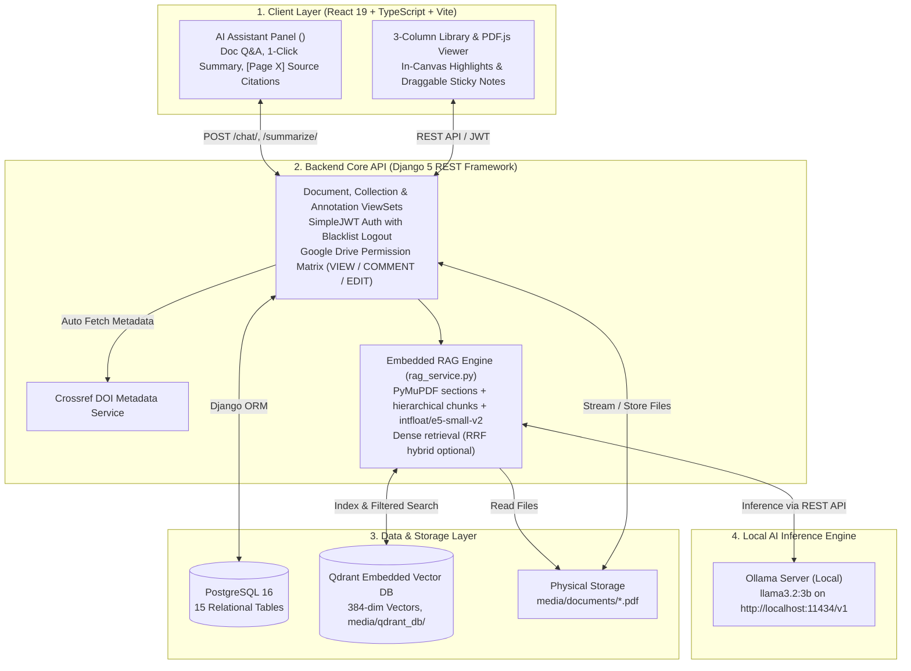

# Scientific Document Manager (Zotero Style with Local AI & Collaboration)

An advanced scientific document management system inspired by **Zotero**, designed for researchers, academics, and students. The platform integrates native PDF reading and in-canvas annotations, automated academic metadata extraction (Crossref DOI), Google Drive-style sharing permissions, and a locally hosted **Retrieval-Augmented Generation (RAG) AI Assistant** for grounded document Q&A and 1-click summarization.

---

## 0. Evaluation Overview & Scope

The project implements a Scientific Document Manager with a locally hosted RAG assistant and evaluates the main RAG components on the QASPER benchmark of NLP/ML papers. Each component is evaluated on its own, with the other components held at the production setting:

| Component experiment | Methods compared | Outcome |
| :--- | :--- | :--- |
| Document extraction | PyMuPDF (layout / plain), pypdf, pdfminer.six, pdfplumber; GROBID separately | PyMuPDF Layout kept: same evidence recovery as the best, the only one with heading detection, fast |
| Text chunking | hierarchical (small-to-big), fixed size, section overlap; semantic chunking and children-only separately | hierarchical leads on nDCG@10; fixed size kept as the simple alternative |
| Embedding model | e5-small-v2, MiniLM, arctic-embed-s, bge-small, ModernBERT-embed; SPECTER2 separately | ModernBERT most accurate, e5-small-v2 nearly as good at about a quarter of the latency |
| Retrieval strategy | dense, BM25, RRF and convex hybrids; cross-encoder rerankers separately | dense and hybrid-convex tie on QASPER; hybrid helps on PeerQA |
| Answer generation | llama3.2 (1B, 3B), qwen2.5 (0.5B, 1.5B), phi4-mini, given gold evidence | complementary strengths: higher Token F1 (qwen2.5:1.5b) vs fewer unsupported answers (llama3.2:3b) |
| Combination | 2 chunkers × 2 embedders × 2 retrieval modes × 2 LLMs = 16 pipelines | pending (design and runner ready) |

Methods, data, results and limitations are documented in [`eval/README.md`](eval/README.md). The thesis is [`DU_AN_CNTT_TOAN_VAN.md`](DU_AN_CNTT_TOAN_VAN.md).

### Scope & limitations
1. **Language:** English-only scientific literature (QASPER: NLP/ML arXiv papers).
2. **Component-level evaluation:** component results do not add up to an end-to-end quality figure; the generation experiment uses gold evidence, not retrieved context. The combination experiment measures complete pipelines.
3. **Hardware:** commodity desktop (CPU only, about 16 GB RAM, local Ollama).

---

## 1. Core Features

- 📚 **Zotero-style 3-Column Workspace**:
  - **Left Sidebar**: Hierarchical collection folders (nested trees), interactive tags list with hover counters, and default library filters (*Recently Read, My Publications, Duplicates, Trash*).
  - **Center Panel**: High-performance sortable document table, instant search (`Ctrl+F`), and filtering by tags, authors, domains, and color categories.
  - **Right Sidebar**: In-place editable panel managing 22 standardized academic metadata fields.
- ⚡ **Automated Metadata Extraction (DOI & PDF Lookup)**:
  - "Add from DOI" auto-fill via **Crossref REST API** with OpenAlex fallback (Title, Authors, Journal, Publication Year, Abstract).
  - Local PDF layout heuristic extractor on upload (title, authors, abstract, DOI/arXiv ID) for preview and editing; GROBID is optional (`USE_GROBID`, off by default).
- 📑 **Integrated PDF.js Reader & In-Canvas Annotations**:
  - Academic two-column text rendering with high-accuracy TextLayer.
  - In-canvas text highlighting and draggable, boundary-clamped sticky notes.
  - Smooth Ctrl+Scroll zoom, text search in PDF, and sidebar annotation management.
- 👥 **Google Drive-Style Collaboration & Sharing**:
  - User identity managed via JWT authentication (`djangorestframework-simplejwt`) with token rotation and blacklist logout.
  - Document-level and folder-level sharing inheritance with 3 permission tiers enforced by the API: `VIEW` (read, chat, summarize), `COMMENT` (+ annotations), `EDIT` (+ metadata edits); delete, trash, duplicate, reindex and share management are owner-only. There is no sharing UI yet (REST API only).
- 🤖 **Embedded Local RAG AI Assistant**:
  - **Layout-Aware PDF Ingestion**: `PyMuPDF` (`fitz`) section extraction with typographic heading detection and coordinate sorting.
  - **Hierarchical Chunking**: Small-to-Big children (~200 estimated tokens, overlap 40) linked to parent sections stored in a vectorless companion collection (`chunking_utils.py`, `CHUNKING_STRATEGY=hierarchical`).
  - **Dense Embeddings**: Champion model `intfloat/e5-small-v2` (384-dimensional dense vectors with asymmetric prefix support) & `SentenceTransformer`.
  - **Retrieval**: dense cosine search by default (`RAG_RETRIEVAL_MODE=dense`); the older hybrid mode (dense + `BM25Okapi` with Reciprocal Rank Fusion, $k=60$) remains selectable as `rrf_legacy`.
  - **Local Vector Store**: `Qdrant Embedded` (`media/qdrant_db/`) with document-scoped payload filtering.
  - **Refusal threshold**: if the best dense cosine score among the selected contexts is below `RAG_MIN_SIMILARITY_SCORE = 0.80`, the assistant refuses without calling the LLM.
  - **Local LLM**: `Ollama` running `llama3.2:3b` over local REST endpoints with grounded academic prompts; if Ollama is unreachable, the API returns the top retrieved snippets instead.
  - **Interactive Citations**: Answers cite `[Page X]` badges; clicking a badge smoothly scrolls the PDF viewer directly to the source page.

---

## 2. High-Level Architecture

For complete UML diagrams, sequence diagrams, 15-table relational ERD, and REST API specifications, refer to [ARCHITECTURE.md](ARCHITECTURE.md).



---

## 3. Development Roadmap & Status

| Phase | Milestone | Status | Key Deliverables |
| :--- | :--- | :---: | :--- |
| **Phase 1** | **Architecture & Specifications** | 🟢 **100% Done** | Requirements, ERD (15 tables), REST API specs, and Qdrant schema documented in [ARCHITECTURE.md](ARCHITECTURE.md). |
| **Phase 2** | **Backend Core & Crossref DOI** | 🟢 **100% Done** | Django 5 setup, 15 models, JWT authentication, Google Drive sharing permissions, Crossref service, Bruno API collection. |
| **Phase 3** | **Frontend UI & PDF Viewer** | 🟢 **100% Done** | React 19 3-column Zotero UI, PDF.js integration, in-canvas annotations, DOI preview modal, collection tree CRUD, and unified runner. |
| **Phase 3.5 - 3.8** | **Full Monorepo Audit & Refactoring** | 🟢 **100% Done** | Security fixes, JWT token blacklist logout, Axios refresh queue, N+1 query optimization, magic byte upload validation (`%PDF-`). |
| **Phase 4.1** | **Midterm Scope Audit & Alignment** | 🟢 **100% Done** | Scope reduction, dropped non-essential features, locked RAG stack (PyMuPDF, Qdrant, Ollama `llama3.2:3b`). |
| **Phase 4.2** | **Local RAG Pipeline Implementation** | 🟢 **100% Done** | Hierarchical indexing, dense retrieval (RRF hybrid optional), `/chat/` and `/summarize/` endpoints, `<AiChatPanel>` with page citations. |
| **Phase 5** | **Component Evaluation & Thesis** | 🟢 **Done** | Component experiments in `eval/phases/`, documented in [`eval/README.md`](eval/README.md); thesis in `DU_AN_CNTT_TOAN_VAN.md`. |
| **Phase 6** | **Combination Experiment (16 pipelines)** | 🟡 **In progress** | Runner `eval/phases/phase_12_combination/scripts/run_combinations.py`; results pending. |

---

## 4. Quick Start Guide

For comprehensive setup prerequisites, database configuration, environment variables, and troubleshooting, please read:  
👉 **[SETUP.md](SETUP.md)**

### Summary Commands:

#### 1. Backend Setup (Django REST API):
```bash
cd backend
python -m venv venv
.\venv\Scripts\activate          # Windows PowerShell (or source venv/bin/activate on macOS/Linux)
pip install -r requirements.txt
Copy-Item .env.example .env      # Configure DB_PASSWORD in .env
python manage.py migrate
python manage.py test apps.documents.tests apps.users.tests
python manage.py runserver
```
Backend runs at: `http://127.0.0.1:8000/`

#### 2. Frontend Setup (React 19 + Vite):
```bash
cd frontend
npm install
npm run build                    # Verify production build
npm run dev
```
Frontend runs at: `http://localhost:5173/`

#### 3. Run Everything with One Command:
```bash
# In the repository root:
npm start
```
