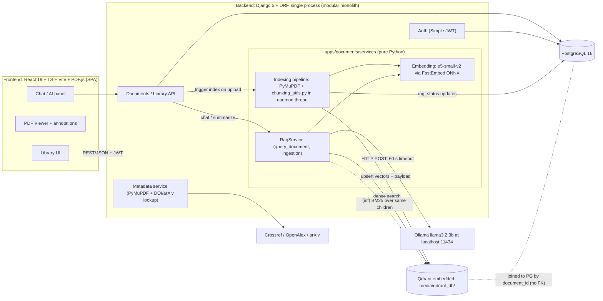
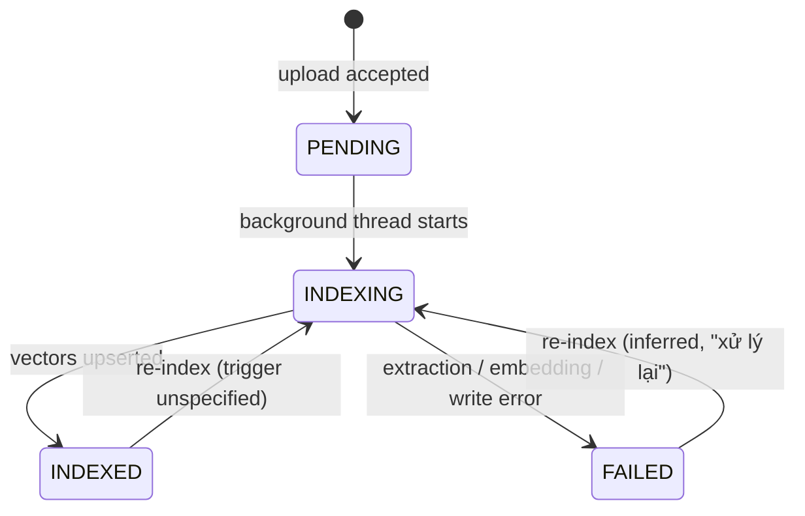
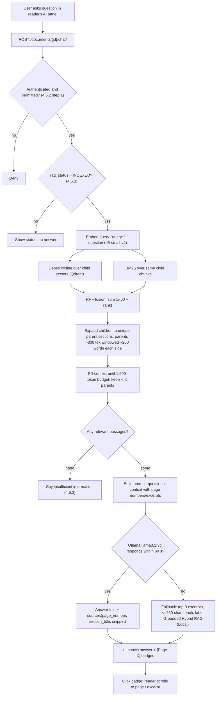
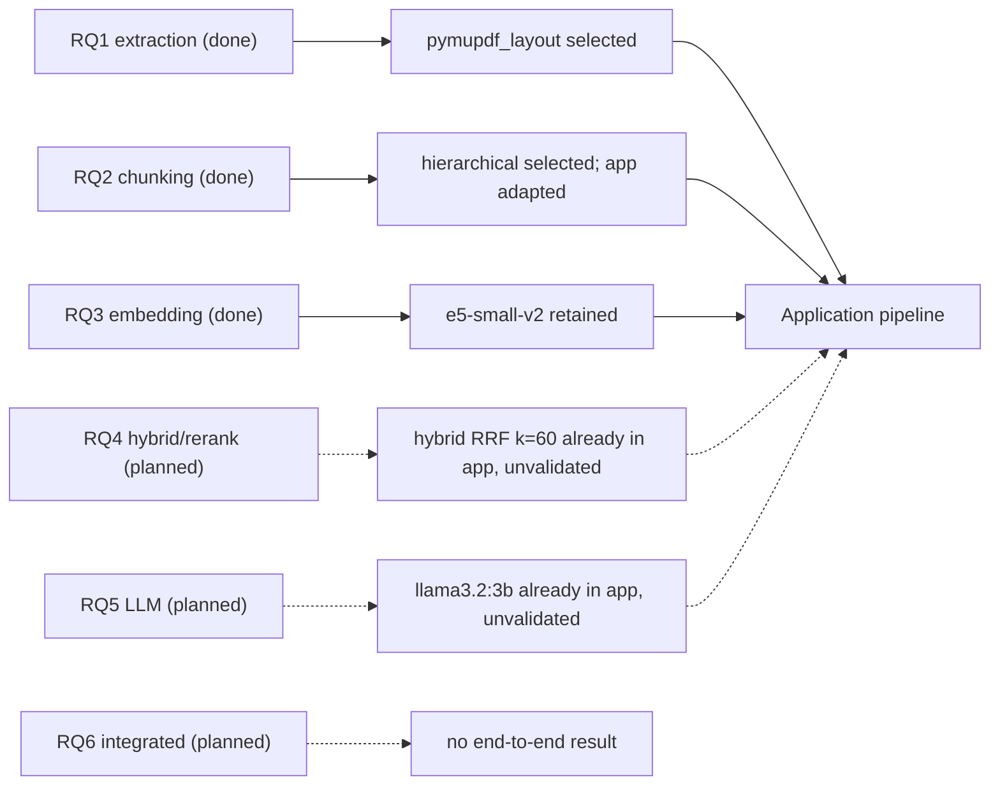

# Thesis-Derived System Specification — Research-Document Manager with RAG Assistant

> **Status note (2026-10-29 audit):** This specification was compiled from the midterm report. Its requirement and decision IDs (SYS-, ARCH-, DEC-) are still cited by the thesis, but its implementation and experiment status entries are outdated: RQ4 and RQ5 have since been completed and RQ6 has not been executed. See `DU_AN_CNTT_TOAN_VAN.md` and `reports/audit/` for the current state.

> **Source:** `DACNTT_GiuaKy.pdf` (81 PDF pages, Vietnamese, Google-Docs export, text layer present).
> **Purpose:** standalone, evidence-backed specification of what the thesis says the application *should be*, for a downstream coding auditor who has not read the PDF.
> **Scope guard:** no source code was inspected; nothing here asserts that any feature is actually implemented.

## How to read this report

- **Page citations** use the format `p.<printed> (PDF <index>)`. Body pages (Chapters 1–6, references) have printed number = PDF index − 12 (printed p.1 = PDF 13). Front matter (acknowledgements, abstract, TOC, lists) has its own printed numbering 1–10 at PDF 3–12, which collides with body numbers; front-matter cites are written `front p.N (PDF M)`.
- **Excerpts** are short transcriptions from the Vietnamese original, with an English gloss where helpful.
- **Status labels:** EXPLICIT · INFERRED · PROPOSED · SELECTED · REPORTED RESULT · UNRESOLVED · CONTRADICTORY.
- **Figures:** Fig 3.1, 4.2, 4.4 and 4.5 were rendered and inspected. Fig 4.4 (ingestion sequence diagram) has small print; the steps quoted were legible after extracting the embedded image at full resolution. Fig 4.1 (use case), 4.3 (class diagram), 4.6–4.9 (UI screenshots) and 5.1 (dataset stats) were **not** interpreted in detail; their content is taken from surrounding prose only.
- **Important framing from the thesis itself:** Fig 4.2 and Fig 4.4 depict an *earlier baseline* (MiniLM + `section_overlap`), not the current configuration (p.44, PDF 56, §4.8). Treat any figure-only parameter with that caveat.
- **"Status" columns in the thesis's own tables (e.g., "Hoàn thành")** are the authors' self-reports, not verified facts.

---

# Part 1 — Document Overview

| Item | Value |
|---|---|
| Title | *Xây dựng hệ thống quản lý tài liệu nghiên cứu khoa học tích hợp trợ lý AI sử dụng RAG* (Building a scientific-research-document management system integrated with a RAG-based AI assistant) |
| Type | "Dự án Công nghệ thông tin" (IT project), Computer Science |
| Authors | Đặng Hữu Gia Huân (52300105), Hồ Gia Kiện (52300122) |
| Advisor / institution | ThS. Dung Cẩm Quang — Ton Duc Thang University, Faculty of IT, HCMC, 2026 |
| Language of text | Vietnamese; evaluation corpus is English |

**Stated objectives (p.1–3, PDF 13–15, §1.2):** two linked goals — (1) analyse, design and build a web system for managing research papers with an integrated RAG Q&A assistant; (2) run staged experiments on how specific technical choices in the RAG pipeline affect evidence retrieval from scientific papers. The thesis repeatedly states it "does not presuppose" any configuration is optimal.

**Where things are located**

| Topic | Location |
|---|---|
| Motivation, objectives, scope | Ch.1, p.1–5 (PDF 13–17) |
| RAG background (indexing / query phases; BM25; metrics) | Ch.2, p.5–8 (PDF 17–20) |
| Research design, RQ1–RQ6, metrics, reproducibility, limits | Ch.3, p.8–22 (PDF 20–34); pipeline diagram Fig 3.1 p.9 (PDF 21) |
| Requirements (FR/NFR), actors, use cases | §4.1–4.2, p.22–29 (PDF 34–41) |
| Architecture, component table, data flows | §4.3, p.29–33 (PDF 41–45); Fig 4.2 p.30 (PDF 42) |
| Data model, Postgres↔Qdrant link, index lifecycle | §4.4, p.33–35 (PDF 45–47) |
| Ingestion & Q&A workflows, hybrid-retrieval detail, exceptions | §4.5, p.35–39 (PDF 47–51); Fig 4.4 p.36 (PDF 48); Fig 4.5 p.38 (PDF 50) |
| UI and feature implementation notes | §4.6–4.7, p.39–43 (PDF 51–55) |
| RAG integration status & system limitations | §4.8–4.9, p.43–45 (PDF 55–57) |
| Experiment results (RQ1–RQ3) and config decisions | Ch.5, p.45–66 (PDF 57–78); decision table Table 5.12 p.63 (PDF 75) |
| Conclusions / future work | Ch.6, p.66–68 (PDF 78–80) |

**Research status in one line:** RQ1–RQ3 (PDF extraction, chunking, embedding) are *completed component experiments*; RQ4–RQ6 (hybrid retrieval, LLM, integrated pipeline) are *planned / future* (p.64, PDF 76, §5.6) — yet the application already contains hybrid retrieval and an Ollama LLM (see AMB-003, AMB-012).

---

# Part 2 — Executive Specification

**What the application is.** A locally-run web application (React SPA + Django REST API, PostgreSQL, embedded Qdrant, local Ollama LLM) for individuals or small research groups to manage PDF papers (collections, tags, domains, DOI/PDF metadata extraction), read them in-browser with highlights and notes, and ask questions of a single document through a RAG assistant that returns an answer plus clickable `[Page X]` source badges that open the cited PDF page. Designed to run on a CPU-only workstation (reference: Ryzen 5 5600, 16 GB RAM, no GPU) with no cloud LLM, to avoid leaking unpublished manuscripts, hallucination and cost.

**RAG pipeline as currently described for the application** (p.24, p.32, p.38; PDF 36, 44, 50):

1. Upload PDF → validate (`.pdf`, ≤ 50 MB, first 4 bytes `%PDF`) → store file + Postgres record with `rag_status = PENDING`.
2. Background daemon thread: status `INDEXING` → extract text with section/heading structure and page numbers (PyMuPDF; `pymupdf_layout` selected) → **hierarchical chunking** (child ≈ 200 tokens, overlap 40, each child tied to a parent section) → embed children with `intfloat/e5-small-v2` (384-d, FastEmbed ONNX, `"passage: "` prefix) → upsert to Qdrant with payload (document_id, chunk_id, page_number, section_title, text) → `INDEXED` (or `FAILED`).
3. Question (per document, only if `INDEXED`): embed query (`"query: "` prefix) → dense cosine ranking over child vectors **+** BM25 over the same children → **RRF** fusion (score = Σ 1/(60 + rank)) → expand matched children to unique parent sections (parents > 800 tokens are windowed ≈ 200 words either side of the hit) → stop at **1,600-token budget**, keep **≤ 5 parents** → build prompt → `llama3.2:3b` via Ollama (60 s timeout) → return answer + sources (page_number, section_title, snippet); UI renders `[Page X]` badges. If Ollama is off/unresponsive: fallback returns up to 3 top excerpts (≤ 250 chars each) with source list, labelled "Grounded Hybrid RAG (Local)".

**What is evidence-based vs. not.** Experiments support: extractor choice (`pymupdf_layout`, chosen for heading metadata despite `pymupdf_plain` scoring higher downstream), hierarchical chunking (best of 8 on QASPER in the benchmark), and keeping `e5-small-v2` (second-best nDCG@10 behind ModernBERT but far cheaper). **Not** experimentally evaluated: hybrid retrieval/RRF vs. dense-only, reranking, the LLM, answer correctness/faithfulness, and end-to-end quality (explicitly stated, p.45, p.64–65; PDF 57, 76–77).

**Key caveats the auditor must carry forward:** (a) the deployed config is called a "baseline", not the final optimum (p.44); (b) benchmark-best chunking (200/40) "may differ" from the app's actual config (p.57); (c) the thesis contradicts itself on whether hybrid retrieval is implemented or still planned (AMB-003); (d) the prompt both restricts to retrieved context and permits synthesis beyond it (AMB-012); (e) citation badges show *what was retrieved*, not what the answer is *supported by* (p.45).

---

# Part 3 — Claims Register

Columns: **ID · Claim · Evidence location · Excerpt · Interpretation · Status · Conf. · Related**.
Conf. = H/M/L.

## 3.1 SYS — System purpose and scope

| ID | Claim | Evidence location | Excerpt | Interpretation | Status | Conf. | Related |
|---|---|---|---|---|---|---|---|
| SYS-001 | Problem: researchers must manually read/cross-check PDFs to answer content questions; reference managers (Zotero, Mendeley, EndNote) only organise/cite. | p.1 (PDF 13) §1.1; p.22 (PDF 34) §4.1.1 | "vẫn phải tự đọc để tìm chi tiết kỹ thuật nằm rải rác trong bài" | Motivates AI Q&A on top of a document manager. | EXPLICIT | H | SYS-003 |
| SYS-002 | Cloud-LLM barriers: leakage of unpublished manuscripts, hallucination, cost; large open models need costly GPUs. | p.22 (PDF 34) §4.1.1 | "rò rỉ bản thảo chưa công bố, ảo giác … và chi phí" | Justifies local-only LLM and local vector store. | EXPLICIT | H | ARCH-010, ARCH-018 |
| SYS-003 | The system is a web app combining a document manager with a RAG assistant, running entirely locally on an ordinary workstation (multi-core CPU, 16 GB RAM, GPU not required). | p.22 (PDF 34) §4.1.1 | "chạy hoàn toàn cục bộ trên máy trạm thông thường … không bắt buộc GPU" | Hard deployment constraint: no cloud dependency for AI. (External metadata APIs are still used — see ARCH-013.) | EXPLICIT | H | NFR via FUNC-014 |
| SYS-004 | Two linked objectives: build the system; experimentally survey RAG component choices for evidence retrieval from scientific papers. | p.1–2 (PDF 13–14) §1.2.1 | "hai mục tiêu có liên hệ với nhau" | Separates software deliverable from research deliverable. | EXPLICIT | H | EXP-001 |
| SYS-005 | Target users: researchers/lecturers (personal library, standard metadata, hierarchical folders, AI lookup without data exposure) and graduate/undergraduate students (read English papers, summarise, jump to evidence page). | p.22–23 (PDF 34–35) Table 4.1 | "tóm tắt, nhảy thẳng đến trang chứa bằng chứng" | Defines the two user personas. | EXPLICIT | H | FUNC-011 |
| SYS-006 | Application scope: personal library or small research group; organise, search, read, annotate PDFs; AI Q&A over document content. | p.4 (PDF 16) §1.3.B.3 | "cá nhân hoặc nhóm nghiên cứu quy mô nhỏ" | Not an enterprise/multi-tenant system. | EXPLICIT | H | UC-05 (FUNC-015) |
| SYS-007 | The application is the environment in which the chosen RAG configuration is integrated and evaluated. | p.4 (PDF 16) §1.3.B.3 | "môi trường ứng dụng cho việc tích hợp và đánh giá cấu hình RAG" | App and experiments are intended to be coupled, but see DEC-002 on divergence. | EXPLICIT | M | DEC-002 |
| SYS-008 | The thesis does not assume any method/configuration is optimal; claims must be traceable to experiments. | p.1–2 (PDF 13–14) §1.2.1; p.44 (PDF 56) §4.8 | "chưa phải cấu hình tối ưu cuối cùng" | Deployed config is a baseline; do not treat as final. | EXPLICIT | H | DEC-002..006 |
| SYS-009 | Experiments use English papers (QASPER mainly); applicability to other languages/sources is not confirmed. | p.21 (PDF 33) §3.6.3 | "khả năng áp dụng cho các nguồn tài liệu hoặc ngôn ngữ khác chưa được xác nhận" | No multilingual requirement is established. | EXPLICIT | H | EXP-002 |
| SYS-010 | Research plan has two phases: Phase 1 component screening ("Nhóm đang ở bước này"), Phase 2 combination evaluation. | p.8 (PDF 20) §3.1 | "Giai đoạn 1 – Sàng lọc thành phần … Giai đoạn 2 – Đánh giá tổ hợp" | Only Phase-1 RQ1–RQ3 have reported results. | EXPLICIT | H | EXP-001 |
| SYS-011 | Only experiments actually run may support conclusions in the final report. | p.21 (PDF 33) §3.6.2 | "Chỉ những thí nghiệm thực sự được triển khai mới được sử dụng làm căn cứ" | Plans (RQ4–RQ6) are not evidence. | EXPLICIT | H | EXP-001 |

## 3.2 ARCH — Architecture and components

| ID | Claim | Evidence location | Excerpt | Interpretation | Status | Conf. | Related |
|---|---|---|---|---|---|---|---|
| ARCH-001 | Architecture style is Modular Monolith: React SPA client + one layered Django server process; microservices/containers explicitly rejected for local use. | p.29–30 (PDF 41–42) §4.3.1 | "kiến trúc khối đơn mô-đun hóa (Modular Monolith)" | Single backend process; no service mesh. | EXPLICIT | H | ARCH-003 |
| ARCH-002 | Rationale: local deployment RAM/latency; ACID transactions of PostgreSQL in one process while triggering indexing; clear module boundaries. | p.29–30 (PDF 41–42) §4.3.1 | "tận dụng giao dịch ACID … đồng thời kích hoạt các tiến trình lập chỉ mục" | Design intent behind in-process indexing. | EXPLICIT | H | ARCH-001 |
| ARCH-003 | RAG and PDF extraction are plain Python service classes in `apps/documents/services/`, separate from API routing; RAG runs inside the Django process. | p.30 (PDF 42) §4.3.1 | "lớp dịch vụ Python thuần túy trong thư mục apps/documents/services/" | Expected code layout for the auditor. | EXPLICIT | H | ARCH-011 |
| ARCH-004 | Frontend: React 19, TypeScript, Vite, CSS Modules, PDF.js; 3-column UI; PDF viewer, annotation drawing, shortcuts, citation positioning; REST/JSON with JWT. | p.31 (PDF 43) Table 4.6 | "React 19, TypeScript, Vite, CSS Modules, PDF.js" | Frontend stack. | EXPLICIT | H | FUNC-014 |
| ARCH-005 | Backend: Django 5, DRF, Python 3.12; REST endpoints, JWT auth, data validation, transaction coordination, launches background indexing thread. | p.31 (PDF 43) Table 4.6 | "Django 5, DRF, Python 3.12" | Backend stack. | EXPLICIT | H | ARCH-007 |
| ARCH-006 | PostgreSQL 16 via Django ORM stores accounts, folder tree, documents + 22 metadata fields, notes, annotations, access permissions. | p.31 (PDF 43) Table 4.6 | "PostgreSQL 16 … cùng 22 trường metadata" | Relational store of record. | EXPLICIT | H | DATA-003 |
| ARCH-007 | PDF & indexing pipeline: PyMuPDF, `chunking_utils.py`, daemon thread; runs async in Django process; pushes vectors, updates `rag_status`. | p.31 (PDF 43) Table 4.6 | "PyMuPDF, chunking_utils.py, daemon thread" | Names the module expected to hold chunking logic. | EXPLICIT | H | RAG-003, RAG-009 |
| ARCH-008 | Embedding component: `intfloat/e5-small-v2` (384-d) via FastEmbed ONNX; `"passage: "` prefix for chunks, `"query: "` for queries; called directly from RagService. | p.31 (PDF 43) Table 4.6 | "FastEmbed ONNX … ("passage: ") … ("query: ")" | Runtime is ONNX (FastEmbed); experiments used PyTorch (see AMB-020). | EXPLICIT | H | RAG-007, DEC-003 |
| ARCH-009 | Vector DB: Qdrant in embedded local mode at `media/qdrant_db/`, accessed in-process via `qdrant-client`; stores vectors + payload (chunk_id, page_number, section_title). | p.31–32 (PDF 43–44) Table 4.6 | "Qdrant (Chế độ nhúng cục bộ tại media/qdrant_db/)" | No separate Qdrant server. | EXPLICIT | H | ARCH-016 |
| ARCH-010 | LLM component: Ollama running `llama3.2:3b` at `localhost:11434`, invoked by HTTP POST from RagService with ≤ 60 s timeout. | p.32 (PDF 44) Table 4.6 | "Ollama (mô hình llama3.2:3b tại localhost:11434) … tối đa 60 giây" | Generation backend. LLM not experimentally selected (see DEC-005). | EXPLICIT | H | RAG-017 |
| ARCH-011 | RAG logic is isolated in `RagService` so chunking strategy, embedding model or LLM can change without affecting other modules. | p.25 (PDF 37) NFR-05 | "logic RAG cô lập trong RagService" | Swappability requirement. | EXPLICIT | H | ARCH-003 |
| ARCH-012 | Indexing uses an in-process daemon thread, no Celery/Redis ("saves > 400 MB RAM"); indexing must not block HTTP. | Fig 4.4 note, p.36 (PDF 48); p.25 (PDF 37) NFR-02 | "Không dùng Celery/Redis, tiết kiệm hơn 400 MB RAM" (figure annotation) | Figure text from the baseline diagram; consistent with prose. | EXPLICIT | M | ARCH-007 |
| ARCH-013 | External systems: Crossref, OpenAlex, arXiv (metadata); Ollama (local background process). | p.26 (PDF 38) Table 4.4 | "Hệ thống ngoài, cung cấp metadata khi tra cứu DOI hoặc arXiv" | Only metadata lookup requires Internet. | EXPLICIT | H | FUNC-003 |
| ARCH-014 | Fig 4.2 shows: Frontend (Library UI, PDF Viewer, Chat UI, API Client); Backend (Auth, Library, Chat, Metadata services); RAG Module (Ingestion, Retriever, Embedding, Vector Store, Generator, Evaluator); PostgreSQL; Ollama, Crossref/arXiv; labels "MiniLM-L6-v2" and "Qdrant embedded". | Fig 4.2, p.30 (PDF 42) | (diagram) | Diagram = baseline per p.44 note; embedding label conflicts with current model. | EXPLICIT | M | AMB-001, ARCH-015 |
| ARCH-015 | An "Evaluator" component appears inside the RAG Module in Fig 4.2 but is never described in text. | Fig 4.2, p.30 (PDF 42) | (diagram only) | Role (offline evaluation harness? runtime check?) unknown. | UNRESOLVED | M | AMB-015 |
| ARCH-016 | PostgreSQL and Qdrant are decoupled and joined by deterministic identifiers, no FK; each Qdrant point = 384-d vector + payload `document_id, chunk_id, page_number, section_title, text`. | p.34 (PDF 46) §4.4.3 | "nối với nhau bằng định danh tất định, không cần thêm cột khóa ngoại" | Payload schema to verify. Parent-text storage is not in this list (AMB-005). | EXPLICIT | H | DATA-010, DATA-011 |
| ARCH-017 | Hierarchical index keeps child vectors in the main collection and parent sections in a companion collection without vectors (47 papers → 2,618 child vectors, 907 parents). | p.59 (PDF 71) §5.3.5 | "907 mục cha lưu trong collection đi kèm, không có vector" | Two-collection layout in the benchmark's app-parity harness; not stated for the product schema. | REPORTED RESULT | M | AMB-005 |
| ARCH-018 | All data, vectors and AI conversations are stored locally. | p.25 (PDF 37) NFR-04 | "toàn bộ dữ liệu, vector và hội thoại AI lưu cục bộ" | Chat history persistence implied, but no chat-history entity appears in the data model (AMB-016). | EXPLICIT | M | SYS-002 |

## 3.3 DATA — Data model, metadata, state

| ID | Claim | Evidence location | Excerpt | Interpretation | Status | Conf. | Related |
|---|---|---|---|---|---|---|---|
| DATA-001 | `documents.rag_status` ∈ {PENDING, INDEXING, INDEXED, FAILED}. | p.34 (PDF 46) §4.4.2 pt 2; p.24 (PDF 36) FR-08 | "PENDING, INDEXING, INDEXED, FAILED" | Closed enum. | EXPLICIT | H | DATA-002 |
| DATA-002 | State transitions: upload → PENDING; background thread start → INDEXING (Fig 4.4 step 24); success → INDEXED; extraction/embedding/vector-write error → FAILED. UI polls document and shows badge. | p.35 (PDF 47) Table 4.8; Fig 4.4 p.36 (PDF 48) | "Tạo bản ghi PENDING; … đặt INDEXED (lỗi thì FAILED)" | Lifecycle machine. No FAILED→retry transition is described besides "re-index". | EXPLICIT | H | DATA-001 |
| DATA-003 | Core tables: users, documents, collections, authors, tags, domains, document_groups, annotations, notes. | p.34 (PDF 46) Table 4.7 | "documents là trung tâm; có chỉ mục (index) trên doi" | `document_groups` has no described behaviour. | EXPLICIT | H | FUNC-006 |
| DATA-004 | M:N link tables: document_authors (with `author_order`), document_tags, document_domains, document_collections. A document may belong to multiple collections. | p.34 (PDF 46) Table 4.7; p.43 (PDF 55) §4.7.3 | "document_authors có author_order" | — | EXPLICIT | H | FUNC-006 |
| DATA-005 | Collaboration tables document_shares, collection_shares, related_documents have models and migrations; only the permission part is tested in the backend. | p.34 (PDF 46) Table 4.7 | "Đã có model và migration; chỉ phần phân quyền được kiểm thử" | `related_documents` purpose undescribed. | EXPLICIT | H | FUNC-015 |
| DATA-006 | Folder tree: `collections.parent_id` self-reference; NULL = root. | p.34 (PDF 46) §4.4.2 pt 1 | "parent_id = NULL là thư mục gốc" | — | EXPLICIT | H | FUNC-006 |
| DATA-007 | `annotations.rects` = JSON array of pixel-coordinate rectangles (percent-normalisation planned); `selected_text` stored for sidebar display without opening the PDF. | p.34 (PDF 46) §4.4.2 pt 3; p.43 (PDF 55) §4.7.4 | "lưu tọa độ pixel … (dự kiến chuẩn hóa theo phần trăm …)" | Known defect: misplacement on zoom/resize. | EXPLICIT | H | FUNC-008 |
| DATA-008 | Ownership by owner FK; sharing at VIEW / COMMENT / EDIT levels, enforced by `IsOwnerOrCollaborator`. | p.34–35 (PDF 46–47) §4.4.2 pt 4 | "3 mức VIEW, COMMENT, EDIT" | Backend authz exists; no UI. | EXPLICIT | H | FUNC-015 |
| DATA-009 | `doi` is indexed for lookup and duplicate detection; a "Trùng lặp" (duplicates) filter exists. | p.34 (PDF 46) Table 4.7; p.23 (PDF 35) FR-05 | "chỉ mục (index) trên doi để tra cứu và phát hiện trùng" | Duplicate logic beyond DOI is unspecified. | EXPLICIT | M | FUNC-006 |
| DATA-010 | Qdrant lifecycle: upload → background write; re-index → upsert of recomputed vectors; permanent delete → remove file in `media/documents/`, delete points by `document_id`, delete Postgres row with CASCADE to annotations, notes, author links. | p.35 (PDF 47) Table 4.8 | "Re-index: Ghi đè (upsert) vector của tài liệu bằng vector tính lại" | Whether stale chunks from a prior chunking are purged on re-index is not stated. | EXPLICIT | H | RAG-023 |
| DATA-011 | Qdrant point IDs are `uuid5(NAMESPACE_DNS, "collection::doc_id::chunk_id")`. | Fig 4.4 step 28, p.36 (PDF 48) | "point_id = uuid5(NAMESPACE_DNS, "collection::doc_id::chunk_id")" | Deterministic IDs make upsert idempotent. From a baseline diagram. | EXPLICIT | M | DATA-010 |
| DATA-012 | Documents have 22 bibliographic metadata fields, editable inline. The fields are not enumerated. | p.23 (PDF 35) FR-04 | "22 trường thư mục học thuật" | Field list is unresolved. | UNRESOLVED | H | AMB-018 |
| DATA-013 | Soft delete to trash and permanent delete both exist. | p.23 (PDF 35) FR-02, FR-05 | "xóa vào thùng rác hoặc xóa vĩnh viễn" | — | EXPLICIT | H | DATA-010 |
| DATA-014 | JWT: access token 60 min, refresh token 7 days, blacklist on logout; Axios interceptor auto-refreshes. | p.25 (PDF 37) NFR-04; p.42–43 (PDF 54–55) §4.7.1 | "Access Token 60 phút, Refresh Token 7 ngày" | Consistent in both places. | EXPLICIT | H | FUNC-001 |
| DATA-015 | Chunk payload must retain link to source document, page number and section title (when available) so sources can be traced. | p.35–36 (PDF 47–48) §4.5.1 steps 3–4 | "số trang và tiêu đề mục nếu có" | Section title may be absent for some PDFs. | EXPLICIT | H | RAG-008 |

---

## 3.4 FUNC — User-facing functionality

| ID | Claim | Evidence location | Excerpt | Interpretation | Status | Conf. | Related |
|---|---|---|---|---|---|---|---|
| FUNC-001 | FR-01 Auth: register, log in (by username **or** email), JWT access + refresh tokens, silent refresh, token blacklist on logout. Six automated auth tests reported. | p.23 (PDF 35) FR-01; p.42–43 (PDF 54–55) §4.7.1 | "tự làm mới bằng Refresh Token, vô hiệu hóa token khi đăng xuất" | Expired/blacklisted refresh token → rejected, re-login (UC-01). | EXPLICIT | H | DATA-014 |
| FUNC-002 | FR-02 Upload: validate extension, size ≤ 50 MB and first 4 bytes `%PDF`; invalid → HTTP 400 + UI warning; > 50 MB rejected. | p.23 (PDF 35) FR-02; UC-02 p.28 (PDF 40) | "dung lượng ≤ 50 MB và 4 byte đầu %PDF" | Validation is server-side (`validate_file()` in Fig 4.4 step 12). | EXPLICIT | H | RAG-002 |
| FUNC-003 | FR-03 Metadata: extract title, authors, arXiv ID, DOI from the PDF; look up via Crossref and OpenAlex; **preview and edit before saving**. Upload flow = `POST /metadata/extract-pdf/` (preview) → user edits/confirms → `POST /documents/` (save, status PENDING, trigger indexing, return 201). | p.23 (PDF 35) FR-03; UC-02 p.28 (PDF 40); §4.7.2 p.43 (PDF 55) | "xem trước và chỉnh sửa trước khi lưu" | Two-step upload. §4.7.2 says PyMuPDF extracts title/author/year and lookup uses Crossref, arXiv and OpenAlex (minor mismatch: AMB-018). | EXPLICIT | H | RAG-002 |
| FUNC-004 | UC-03 DOI import: `POST /metadata/lookup-doi/`; Crossref first, OpenAlex fallback; preview; confirm creates a record **without a PDF**. Both failing → "DOI not found or invalid format". | p.28 (PDF 40) UC-03 | "lỗi thì chuyển sang OpenAlex … (không cần tệp PDF)" | PDF-less documents exist; they cannot be RAG-indexed (INFERRED, since indexing needs a file). | EXPLICIT / INFERRED | H/M | FUNC-003 |
| FUNC-005 | FR-04: view/edit 22 bibliographic fields inline. | p.23 (PDF 35) FR-04 | "Xem và sửa tại chỗ (inline) 22 trường" | Fields unlisted (DATA-012). | EXPLICIT | H | DATA-012 |
| FUNC-006 | FR-05 Organise/filter: nested folder tree, tags, domains; search by title/author/DOI; filters Recent reading, My publications, Duplicates, Trash. Tree built O(N) from one SQL query. Search/filter are mostly **client-side**; no server-side full-text search or pagination. | p.23 (PDF 35) FR-05; p.25 (PDF 37) NFR-02; p.43 (PDF 55) §4.7.3; p.44 (PDF 56) §4.9 | "chưa có tìm kiếm toàn văn hoặc phân trang phía máy chủ" | Searching document *content* is only via RAG, not keyword search. | EXPLICIT | H | DATA-004 |
| FUNC-007 | FR-06 PDF reader: PDF.js, canvas + TextLayer, zoom, page navigation, text selection for two-column papers. | p.24 (PDF 36) FR-06; §4.7.4 p.43 (PDF 55) | "PDF.js, phóng to/thu nhỏ, chuyển trang, TextLayer" | — | EXPLICIT | H | FUNC-011 |
| FUNC-008 | FR-07 Annotation: 4-colour highlights, draggable sticky notes, synced to DB and sidebar. Pixel coordinates can drift on zoom/resize. | p.24 (PDF 36) FR-07; p.43 (PDF 55); p.44 (PDF 56) §4.9 | "Highlight 4 màu; sticky note kéo thả" | Known limitation, planned fix: percent coordinates (6.2.1). | EXPLICIT | H | DATA-007 |
| FUNC-009 | FR-08 RAG indexing on upload (hierarchical chunks, e5-small-v2, Qdrant, status badges). | p.24 (PDF 36) FR-08 | "Lập chỉ mục RAG … PENDING, INDEXING, INDEXED, FAILED" | See RAG-005…RAG-009. | EXPLICIT | H | RAG-005 |
| FUNC-010 | FR-09 Q&A and summarisation: hybrid retrieval → Ollama answer; `[Page X]` badges; click opens PDF at page + excerpt; fallback excerpts; "tóm tắt một chạm" (one-touch summary). | p.24 (PDF 36) FR-09 | "tóm tắt một chạm" | Summarisation pipeline is not described anywhere (AMB-017). | EXPLICIT | H | AMB-017 |
| FUNC-011 | Citation/source display: each source carries `page_number`, `section_title`, `snippet`; badges are generated from the **metadata of retrieved sections**; click scrolls the PDF to that page. | p.25 (PDF 37) NFR-03; p.24 (PDF 36) FR-09; Fig 4.5 step 6 p.38 (PDF 50) | "huy hiệu trang [Page X] được tạo từ siêu dữ liệu của các mục đã truy xuất" | Navigation is page-level only; exact-region highlighting is future work (6.2.1). | EXPLICIT | H | AMB-025 |
| FUNC-012 | Q&A endpoint: `POST /documents/{id}/chat/`; preconditions: doc `INDEXED` and Ollama running; Ollama off or > 60 s → fallback: top 3 excerpts (≤ 250 chars each) + source list, labelled "Grounded Hybrid RAG (Local)". | p.28–29 (PDF 40–41) UC-06; p.24 (PDF 36) FR-09 | "trả 3 trích đoạn điểm cao nhất, nhãn Grounded Hybrid RAG (Local)" | Q&A is scoped to **one document**. | EXPLICIT | H | RAG-018, AMB-027 |
| FUNC-013 | Q&A gating: documents not fully indexed → show status, do not answer from unready data. | p.39 (PDF 51) §4.5.3 | "không thực hiện hỏi đáp dựa trên dữ liệu chưa sẵn sàng" | — | EXPLICIT | H | DATA-002 |
| FUNC-014 | UI: Zotero-style 3-column layout (Library mode: categories / list+search+add / details; Reading mode: PDF centre + annotation/AI panel); auto-collapsing sidebar; shortcuts (Ctrl/Cmd+1..9, Ctrl/Cmd+F, Delete); index-status badges. | p.25 (PDF 37) NFR-01; p.39–41 (PDF 51–53) §4.6 | "Bố cục 3 cột kiểu Zotero" | Screens Fig 4.6–4.9 not interpreted here. | EXPLICIT | H | FUNC-007 |
| FUNC-015 | UC-05 Sharing: permission model and backend checks exist; **no sharing UI**, so end-to-end flow is incomplete. | p.29 (PDF 41) UC-05; p.44 (PDF 56) §4.9 | "Chưa có giao diện chia sẻ, nên luồng người dùng cuối chưa hoàn chỉnh" | Not a delivered user-facing feature. | EXPLICIT | H | DATA-005, DATA-008 |
| FUNC-016 | Exception handling to support: invalid/oversize PDF; extraction/index failure (record error state for retry); doc not indexed; no relevant chunk (say insufficient information rather than assert); LLM error (error message or fallback "if implemented and tested"); insufficient permission (deny). | p.38–39 (PDF 50–51) §4.5.3 | "thay vì khẳng định một câu trả lời không có căn cứ" | Mix of requirements and conditionals — see AMB-013. | EXPLICIT | M | RAG-018, RAG-020 |
| FUNC-017 | Known unfinished: password reset (API/email/UI), server-side search & pagination, sharing UI, pixel-based annotations. | p.44 (PDF 56) §4.9; p.66 (PDF 78) §6.1.1 | "Đặt lại mật khẩu: Chưa hoàn thiện" | Not requirements met today. | EXPLICIT | H | FUNC-006, FUNC-015 |
| FUNC-018 | Planned: precise highlighting of cited regions in the PDF; frontend sharing/collaboration; server-side full-text search & pagination; email service for password reset; percent-based annotation coordinates; Ollama load-balancing / flexible fallbacks. | p.67 (PDF 79) §6.2.1 | "tô sáng chính xác các vùng văn bản tham chiếu" | Future work — not current requirements. | PROPOSED | H | FUNC-011 |

## 3.5 RAG — Pipeline requirements and methods

| ID | Claim | Evidence location | Excerpt | Interpretation | Status | Conf. | Related |
|---|---|---|---|---|---|---|---|
| RAG-001 | Fig 3.1 research pipeline: parsing → chunking → dense embedding → (dense ANN cosine ∥ sparse BM25) → fusion (RRF, top-k) → reranking (cross-encoder) → generation (LLM + context). | Fig 3.1, p.9 (PDF 21) | "Dense vector search (ANN, cosine similarity) / Sparse search (BM25) / Hybrid fusion, RRF, top-k / Reranking, cross-encoder" | Research-level pipeline. Reranking appears here but nowhere in the application workflows. | EXPLICIT (diagram) | H | RAG-021, AMB-004 |
| RAG-002 | Ingestion step 1: frontend sends PDF, backend validates format and size, stores file and creates Postgres record with initial "pending" status. | p.35 (PDF 47) §4.5.1 steps 1–2 | "Backend kiểm tra định dạng và giới hạn kích thước" | — | EXPLICIT | H | FUNC-002 |
| RAG-003 | Extraction: PDF pipeline reads text and collects source info (page numbers, section titles if present); library is PyMuPDF; extraction is "theo cấu hình đề mục" (heading-aware). | p.35–36 (PDF 47–48) §4.5.1 step 3; p.31 (PDF 43) Table 4.6; p.32 (PDF 44) | "trích xuất văn bản theo cấu trúc đề mục" | Heading-aware extraction feeds section-based parents. Baseline function name `extract_sections_from_pdf()` (Fig 4.4 step 25). | EXPLICIT | H | RAG-004 |
| RAG-004 | Extractor selected: `pymupdf_layout`, chosen **despite** not having the best downstream nDCG@10, because it outputs heading info needed for section and hierarchical chunking. | p.50 (PDF 62) §5.2.4; p.63 (PDF 75) Table 5.12; p.66–67 (PDF 78–79) §6.1.2 | "Pipeline hiện tại sử dụng pymupdf_layout … cung cấp thông tin tiêu đề" | Selection rationale = structure over raw retrieval score. | SELECTED | H | DEC-001, EXP-007 |
| RAG-005 | Chunking in the app: hierarchical — child ≈ 200 tokens, overlap 40 tokens, each child linked to its parent section (`parent_text`). | p.24 (PDF 36) FR-08; p.32 (PDF 44) data flow 1 | "đoạn con khoảng 200 token, chồng lấp 40 token, mỗi đoạn con gắn với mục cha (parent_text)" | Parent = section. "Approximately" 200 tokens; tokenizer not named (AMB-021). | EXPLICIT | H | DEC-002, AMB-002 |
| RAG-006 | Intended hierarchical design: store parent ID + child ID; split long sections into embeddable children; retrieve/rank children; expand to parent (or size-bounded part of it) before generation; keep metadata to trace back; re-evaluate the real implementation afterwards. | p.57 (PDF 69) §5.3.4 "Quyết định kỹ thuật" | "Mở rộng các đoạn con được truy xuất sang ngữ cảnh cha, hoặc một phần ngữ cảnh cha có giới hạn kích thước" | Written as "kiến trúc dự kiến"; later text says it was implemented (p.63). | PROPOSED → later reported implemented | M | RAG-014, AMB-005 |
| RAG-007 | Embedding: `intfloat/e5-small-v2`, 384-d, `"passage: "` for chunks, `"query: "` for queries; runtime FastEmbed ONNX. Experiments L2-normalise vectors and use cosine. | p.31 (PDF 43) Table 4.6; p.13 (PDF 25) §3.3.2; p.15 (PDF 27) §3.3.3 | "Điểm tương đồng cosine được tính trên các vector đã chuẩn hóa" | Whether the app normalises vectors / uses cosine distance in Qdrant is not stated for the app. | EXPLICIT | H | DEC-003, AMB-020 |
| RAG-008 | Vector write: child vectors + payload (`document_id, chunk_id, page_number, section_title, text`) upserted to Qdrant; point id deterministic. | p.34 (PDF 46) §4.4.3; Fig 4.4 steps 28–29 | "vector 384 chiều và payload document_id, chunk_id, page_number, section_title, text" | — | EXPLICIT | H | ARCH-016, DATA-011 |
| RAG-009 | Indexing runs in a background daemon thread: `INDEXING` → extract → chunk → embed → upsert → `INDEXED`; errors → `FAILED`. | p.32 (PDF 44) data flow 1; Fig 4.4 steps 23–32 p.36 (PDF 48) | "luồng nền (daemon thread) … trạng thái … INDEXED" | HTTP request returns immediately with 201. | EXPLICIT | H | DATA-002 |
| RAG-010 | Query processing: backend authenticates + checks access to the document, calls `query_document(question, document_id)` in RagService; query is converted into the representation matching the retrieval method (embedding with `"query: "`). | p.37 (PDF 49) §4.5.2 steps 1–2; Fig 4.5 p.38 (PDF 50); Table 4.6 | "query_document(question, document_id)" | `"query: "` prefix is inferred from Table 4.6 for the query encoder. | EXPLICIT / INFERRED | H/M | RAG-007 |
| RAG-011 | Hybrid retrieval (4 steps): (1) cosine between query vector and child vectors (e5-small-v2); (2) BM25 scores over the same child set; (3) fuse two rankings with RRF, per-chunk score = Σ 1/(60 + rank_dense) + 1/(60 + rank_BM25); (4) expand matched children to unique parent sections (dedupe). | p.38 (PDF 50) §4.5.2 | "điểm của mỗi đoạn là tổng 1/(60 + hạng_dense) và 1/(60 + hạng_BM25)" | This is the most specific retrieval statement. Candidate depth/top-N per ranker is not stated (AMB-029). | EXPLICIT | H | DEC-004, AMB-003 |
| RAG-012 | RRF smoothing constant k = 60. | p.17 (PDF 29) §3.3.4; p.24 (PDF 36) FR-09; p.38 (PDF 50) | "hằng số làm mịn k = 60" | Consistent in 3 places. | EXPLICIT | H | RAG-011 |
| RAG-013 | BM25 is "trên cùng tập đoạn" (same child chunk set). BM25 library/index storage for the app is not stated (benchmark used `rank_bm25`). | p.38 (PDF 50); Table 5.11 p.61 (PDF 73) | "tính điểm BM25 trên cùng tập đoạn" | Where the BM25 index lives (memory vs persisted) is unspecified. | EXPLICIT / UNRESOLVED | M | AMB-007 |
| RAG-014 | Context construction: matched children expanded to unique parent sections; parents longer than **800 tokens** are windowed ≈ **200 words each side** of the matching child; stop when total length exceeds **1,600 tokens**; keep **≤ 5 parents** for the prompt. | p.38 (PDF 50) §4.5.2; p.32 (PDF 44) data flow 2 | "mục cha dài hơn 800 token được cắt cửa sổ khoảng 200 từ mỗi bên" | Units differ (800 tokens vs 200 words) — as written. Order = fusion rank. | EXPLICIT | H | DEC-007, AMB-006 |
| RAG-015 | Elsewhere the number is phrased as "Top-5 chunk" / "Chọn Top-5 chunks" (parents vs chunks differ). | p.28–29 (PDF 40–41) UC-06; Fig 4.5 §3 p.38 (PDF 50) | "RagService truy xuất Top-5 chunk" | See AMB-006. | CONTRADICTORY (mild) | M | RAG-014 |
| RAG-016 | Prompt: question + context built from selected passages with page number and excerpt; LLM instructed to use only retrieved context, but prompt also lets it synthesise the most relevant information when context has no direct answer. Prompt text is not given. | Fig 4.5 §3 p.38 (PDF 50); p.45 (PDF 57) §4.9 | "prompt cũng cho phép tổng hợp thông tin liên quan nhất" | Grounding is therefore not guaranteed (thesis admits). | EXPLICIT | H | AMB-012, AMB-030 |
| RAG-017 | Generation: Ollama `llama3.2:3b`, HTTP POST, timeout 60 s. LLM generation parameters not given. | p.32 (PDF 44) Table 4.6; UC-06 p.29 (PDF 41) | "llama3.2:3b … tối đa 60 giây" | — | EXPLICIT | H | DEC-005 |
| RAG-018 | Fallback when Ollama is off/slow: no LLM text; return top-3 excerpts (≤ 250 chars each) + sources + label. | p.24 (PDF 36) FR-09; p.29 (PDF 41) UC-06 | "tối đa ba đoạn trích đầu tiên (mỗi đoạn tối đa 250 ký tự)" | §4.5.3 words fallback as conditional "nếu … đã được triển khai và kiểm thử". | EXPLICIT | M | AMB-013 |
| RAG-019 | Response: answer + `sources` (page, section title, snippet); frontend shows answer and citations; click navigates reader to page. | p.37–38 (PDF 49–50) §4.5.2 step 6; Fig 4.5 §5–6 | "Backend trả về câu trả lời cùng thông tin nguồn của các đoạn được sử dụng" | Sources = retrieved passages used in context, not verified support (p.45). | EXPLICIT | H | FUNC-011 |
| RAG-020 | If no suitable passages are found: reply that the system lacks sufficient relevant information instead of asserting an ungrounded answer. | p.39 (PDF 51) §4.5.3 | "chưa tìm được đủ thông tin liên quan" | Stated as an exception-handling item; implementation and thresholds unspecified (no similarity threshold is given anywhere). | EXPLICIT | M | AMB-012 |
| RAG-021 | Reranking (cross-encoder) is part of the research pipeline but is only "to be considered if suitable"; future work proposes cross-encoder reranker + shortlisting before the LLM. Not in the application Q&A flow. | p.16 (PDF 28) §3.3.4; p.67–68 (PDF 79–80) §6.2.2; Fig 3.1 | "Bước tái xếp hạng bằng Cross-Encoder sẽ được xem xét nếu phù hợp" | Do not treat as an app requirement. | PROPOSED | H | AMB-004 |
| RAG-022 | Hybrid retrieval evaluation (RQ4), LLM evaluation (RQ5), integrated evaluation (RQ6) are planned, not done. | p.16–19 (PDF 28–31) §3.3.4–3.3.6; p.64 (PDF 76) §5.6 | "chưa phải thí nghiệm chính thức đã hoàn thành" | Hybrid/LLM choices in the app are unvalidated by the thesis's own experiments. | PROPOSED | H | EXP-001 |
| RAG-023 | Re-index = upsert recomputed vectors for the document; permanent delete removes vectors by `document_id`. Re-index trigger/UX and stale-point cleanup are unspecified. | p.35 (PDF 47) Table 4.8 | "Ghi đè (upsert) vector của tài liệu" | — | EXPLICIT / UNRESOLVED | M | AMB-026 |
| RAG-024 | Hybrid-retrieval performance target < 100 ms over 30–80 chunks; reported measurement P50 = 31.8 ms, P95 = 43.4 ms. | p.25 (PDF 37) NFR-02 | "mục tiêu truy xuất lai < 100 ms trên 30–80 chunk [… P50 = 31,8 ms, P95 = 43,4 ms]" | "30–80 chunks" implies retrieval is over one document's chunks. Numbers don't map cleanly to Table 5.9 (AMB-022). | EXPLICIT | M | AMB-022 |
| RAG-025 | The current app config is the *initial baseline*; Fig 4.2 and 4.4 show the earlier MiniLM + `section_overlap` setup, before upgrade to e5-small-v2 + hierarchical. Specific tech/parameters "will be formally determined after evaluation". | p.44 (PDF 56) §4.8 | "Hình 4.2 và Hình 4.4 minh họa cấu hình baseline ban đầu" | Resolves part of AMB-001. | EXPLICIT | H | AMB-001 |
| RAG-026 | Retrieval is performed with `document_id` scope; no cross-document or collection-level Q&A is described. | UC-06 p.28–29; Fig 4.5 step 1 | "Gửi câu hỏi và document_id" | INFERRED from endpoint & diagram; absence not explicitly stated. | INFERRED | M | AMB-027 |
| RAG-027 | Answer faithfulness has not been quantitatively evaluated; badges don't confirm support. | p.45 (PDF 57) §4.9 | "Độ trung thực của câu trả lời chưa được đánh giá định lượng" | Hallucination mitigation is a design intent, not a measured outcome. | EXPLICIT | H | RAG-016 |

---

## 3.6 EXP — Research experiments and evaluation

| ID | Claim | Evidence location | Excerpt | Interpretation | Status | Conf. | Related |
|---|---|---|---|---|---|---|---|
| EXP-001 | RQ1 (PDF extraction), RQ2 (chunking), RQ3 (embedding vs BM25) are completed component experiments. RQ4 (hybrid/RRF/reranking), RQ5 (LLM; Ollama + Llama 3.2 3B "a planned option"), RQ6 (integrated configs) are planned/future with no reported results. | p.11 (PDF 23) §3.3; p.16–19 (PDF 28–31) §3.3.4–3.3.6; p.64 (PDF 76) §5.6 | "RQ4–RQ6 được xem là công việc tương lai" | Evidence base for the app covers only extraction, chunking, embedding. | EXPLICIT | H | RAG-022 |
| EXP-002 | QASPER v0.3: 1,585 papers / 5,049 questions (Train 888/2,593; Dev 281/1,005; Test 416/1,451). Question types: extractive 2,878 (57.00%), abstractive 1,011 (20.02%), yes/no 710 (14.06%), unanswerable 450 (8.91%). | p.45–46 (PDF 57–58) Tables 5.1–5.2 | "QASPER v0.3 gồm 1.585 bài báo và 5.049 câu hỏi" | Benchmark characteristics. | REPORTED RESULT | H | EXP-003 |
| EXP-003 | EDA: mean paper 3,575 words (median 3,401; P95 6,707); 13.83 sections/paper, mean section 258.5 words (P95 706); questions 8.14 words vs evidence ≈175.5 words; mean Jaccard question–evidence 1.61% (2.59% on text-evidence questions); 43.95% (1,891/4,303) of questions have multi-passage evidence. Used to motivate chunking, BM25-vs-dense comparison and hierarchical expansion. | p.46–47 (PDF 58–59) §5.1.1–5.1.2 | "Một tỷ lệ đáng kể câu hỏi có bằng chứng trải trên nhiều đoạn" | Design rationale for hierarchical/parent expansion and hybrid. | REPORTED RESULT | H | DEC-002, DEC-004 |
| EXP-004 | Subsets: RQ1 = 47 Dev papers with local PDFs + 4 technical papers (Attention Is All You Need, ResNet, LoRA, RAG), 127 answerable questions (132 − 2 no-PDF − 3 unanswerable). RQ2 = same 47 papers / 127 questions. RQ3 = 207 papers (48 Dev + 159 "held-out"), 615 answerable questions, 5,207 chunks, built from QASPER structured text (not PDFs). | p.10 (PDF 22) §3.2.1; p.48 (PDF 60) Table 5.3 + note | "RQ3 không trích xuất từ PDF mà dùng văn bản có cấu trúc của QASPER" | RQ3 isolates embedding quality from extraction errors. | REPORTED RESULT | H | AMB-024 |
| EXP-005 | FiQA (BEIR) is described for chunking (57,600 passages) and embedding/retrieval (6,650 queries vs 57,600 passages), but only a 3-strategy chunking pre-survey on FiQA is reported; no FiQA embedding results appear. | p.10–11 (PDF 22–23) §3.2.1.b; Table 5.6 p.52 (PDF 64) | "Tập thử nghiệm gồm 6.650 câu hỏi … đối chiếu với 57.600 đoạn" | Design described but results absent. | UNRESOLVED | H | AMB-011 |
| EXP-006 | Environment: AMD Ryzen 5 5600 (6c/12t), 16 GB DDR4, Windows 11, Python, Qdrant embedded, Ollama local; PyTorch threads = 4; random seed 42. | p.11 (PDF 23) §3.2.2 | "Qdrant, sử dụng ở chế độ embedded" | Reference hardware for NFR-02 claims. | EXPLICIT | H | NFR-02 |
| EXP-007 | Analysis is descriptive only: no hypothesis tests, p-values or CIs; differences are "observed", not statistically significant. | p.12 (PDF 24) §3.3; p.20 (PDF 32) §3.5 | "không thực hiện kiểm định giả thuyết thống kê" | Do not read results as significance claims. | EXPLICIT | H | all REPORTED RESULTs |
| EXP-008 | Metrics: RQ1 — Char-Match, Heading F1, Reading Order, Evidence Coverage, time, Process Peak RSS, downstream nDCG@10. RQ2 — nDCG@10, nDCG@4, Recall@20, MRR@10, Truncation Rate, Context-Budget Coverage. RQ3 — nDCG@10/@4, Recall@20, MRR@10, query latency P50/P95, indexing throughput, Peak RSS. Relevance threshold τ: RQ2 0.50 (sensitivity 0.30); RQ3 and RQ1-downstream 0.55; RQ1 Evidence Coverage counts a hit if verbatim or ≥ 75% vocabulary overlap. RQ2 and RQ3 scores not directly comparable. | p.12–16 (PDF 24–28) §3.3.1–3.3.3; p.19–20 (PDF 31–32) §3.4 | "Vì vậy điểm của RQ2 và RQ3 không so sánh trực tiếp với nhau" | Relevance = lexical coverage of evidence by chunk (stopwords removed). | EXPLICIT | H | EXP-016 |
| EXP-009 | RQ1 setup: 5 local extractors (`pymupdf_plain` baseline, `pymupdf_layout`, `pypdf`, `pdfminer.six`, `pdfplumber`); GROBID in the original design but **unavailable** (server not responding) → recorded as "not available", not zero. Downstream embedding fixed at e5-small-v2. | p.12 (PDF 24) §3.3.1; p.48–49 (PDF 60–61) §5.2.1 | "GROBID … không khả dụng chứ không phải là phương pháp đạt điểm bằng 0" | GROBID is not a candidate with evidence. | REPORTED RESULT | H | RAG-004 |
| EXP-010 | RQ1 results (EvidCov / HeadF1 / ReadOrder / ms-per-page / downstream nDCG@10): plain 37.59% / 0.00% / 0.9894 / 10.19 / 0.5274; layout 33.16% / 48.01% / 0.9894 / 26.16 / 0.5100; pypdf 29.61% / 0.00% / 0.9787 / 61.72 / 0.5174; pdfminer.six 35.82% / 0.00% / 0.9713 / 107.10 / 0.5131; pdfplumber 9.86% / 0.00% / 0.5319 / 195.36 / 0.3769. Peak RSS 1,164.9–1,286.2 MB for all. | p.49–50 (PDF 61–62) Table 5.4, §5.2.3 | "pymupdf_plain có nDCG@10 hạ nguồn cao nhất (0,5274)" | Top four are within ≈ 0.51–0.53 nDCG@10. | REPORTED RESULT | H | DEC-001 |
| EXP-011 | RQ1 caveats: only `pymupdf_layout` has non-zero Heading F1 because other adapters don't output headings (not proof libraries can't); Evidence Coverage is affected by formulae/citations/special chars and "should not be read as content loss". | p.50 (PDF 62) §5.2.3 | "phản ánh việc các adapter hiện tại không xuất thông tin tiêu đề" | — | EXPLICIT | H | EXP-010 |
| EXP-012 | RQ2 pre-survey (Fixed Size 550 chars/150 overlap; Recursive 500/50; Semantic percentile 85) at k=5. QASPER nDCG@5: Fixed 0.109, Recursive 0.111, Semantic 0.106. FiQA nDCG@5: Fixed 0.423, Recursive 0.382, Semantic 0.368. Authors call it exploratory; configuration documentation insufficient for controlled comparison. | p.50–52 (PDF 62–64) §5.3.1, Tables 5.5–5.6; p.64 (PDF 76) §5.7 | "chỉ mang tính thăm dò" | See AMB-009 for how the thesis summarises this. | REPORTED RESULT | H | AMB-009 |
| EXP-013 | RQ2 extended setup: 47 papers, 127 questions, text from `pymupdf_layout`, e5-small-v2, exact cosine (NumPy FP32), context budget 1,600 tokens; 8 strategies: fixed_size (400, 0), fixed_size_overlap (400/80), semantic (sentence-level, ≤ 400), section (1 section = 1 chunk, unbounded), section_token (~400 tokens ≈ 1,600 chars), section_overlap (≤ 400 / 80), hierarchical (child 200/40 → expand to parent), hierarchical_child (same children, no expansion). | p.13–15 (PDF 25–27) §3.3.2; p.53–54 (PDF 65–66) §5.3.2 | "hierarchical: truy xuất các đoạn con 200 token (chồng lấp 40 token), sau đó mở rộng sang mục cha" | Strategies share extractor, embedder, questions, relevance rule and budget. | EXPLICIT | H | DEC-002 |
| EXP-014 | RQ2 main result (τ = 0.50; nDCG@10 / nDCG@4 / Recall@20 / MRR@10 / truncation): hierarchical 0.6880 / 0.5933 / 0.9873 / 0.6468 / 0.00%; section 0.5795 / 0.4473 / 0.9753 / 0.5456 / 23.70%; fixed_size 0.5654 / 0.4443 / 0.9586 / 0.5310 / 0.00%; section_overlap 0.5409 / 0.4569 / 0.9255 / 0.5737 / 0.63%; fixed_size_overlap 0.5385 / 0.4336 / 0.9452 / 0.5269 / 0.00%; section_token 0.5359 / 0.4475 / 0.9234 / 0.5520 / 0.73%; semantic 0.4856 / 0.3904 / 0.8680 / 0.4983 / 0.21%; hierarchical_child 0.4473 / 0.3791 / 0.7781 / 0.4816 / 0.00%. | p.54 (PDF 66) Table 5.7 | "hierarchical có giá trị quan sát cao nhất ở cả bốn chỉ số truy xuất" | Parent expansion contributes a large share of the score (hierarchical vs hierarchical_child). | REPORTED RESULT | H | DEC-002 |
| EXP-015 | Sensitivity τ = 0.30: hierarchical still top (nDCG@10 0.7340), hierarchical_child still lowest (0.4617); mid-table order changes. Prose says fixed_size_overlap (0.5801) > section_overlap (0.5440) and section_token (0.5486) > section_overlap (0.5440), but Table 5.8 lists different values (0.6123 / 0.6155 / 0.6081). | p.55 (PDF 67) Table 5.8; §5.3.3 text p.55 and §5.3.4 p.56 (PDF 68) | "chỉ có thể nói vị trí đầu và cuối bảng ổn định" | Prose/table mismatch (AMB-010). Only top/bottom ranks are claimed stable. | REPORTED RESULT / CONTRADICTORY | M | AMB-010 |
| EXP-016 | Relevance caveat: labels = lexical coverage of evidence; a long parent has more chance to contain evidence, so hierarchical's score may partly reflect metric/expansion interaction; answer accuracy/faithfulness remain unevaluated. | p.56 (PDF 68) §5.3.4; p.65 (PDF 77) §5.7 | "điểm số cao của hierarchical có thể phản ánh một phần cách thức mà thước đo tương tác với việc mở rộng ngữ cảnh" | Weakens the causal link between benchmark and answer quality. | EXPLICIT | H | DEC-002 |
| EXP-017 | App-parity regression (47 papers, 127 q, 1,600-token budget, τ 0.50): section_overlap nDCG@10 0.4743 / nDCG@4 0.4569 / Recall@20 0.5473 / MRR@10 0.5543, P50 31.74 ms / P95 43.40 ms, 1,591 vectors; hierarchical 0.5049 / 0.5139 / 0.5840 / 0.5641, P50 31.76 / P95 42.67, 2,618 child vectors + 907 parents. Numbers are on a budget-truncated list (avg 7.43 chunks / 5.89 parents) and not comparable with Table 5.7; the gap vs RQ2 is "not explained". | p.57–59 (PDF 69–71) §5.3.5, Table 5.9 | "chỉ nên so sánh giữa hai cấu hình trong cùng bảng" | Supports direction (hierarchical > section_overlap) in the app harness; does not validate absolute scores. | REPORTED RESULT | H | AMB-014 |
| EXP-018 | RQ3 setup: BM25 + 10 dense models on 207 papers / 615 questions / 5,207 chunks; chunks made with `section_overlap` **350 tokens, overlap 70**; τ = 0.55; exact FP32 cosine; 4 threads; control = all-MiniLM-L6-v2; "in use" = e5-small-v2. Different chunk config from RQ2. | p.59–60 (PDF 71–72) §5.4.1 | "Cấu hình chia đoạn của RQ3 khác với RQ2" | — | REPORTED RESULT | H | AMB-002 |
| EXP-019 | RQ3 ranking by nDCG@10 (nDCG@10 / nDCG@4 / Recall@20 / MRR@10): modernbert-embed-base 0.5872 / 0.4937 / 0.9642 / 0.5438; **e5-small-v2 0.5522 / 0.4588 / 0.9623 / 0.5046**; snowflake-arctic-embed-m-v1.5 0.5472; snowflake-arctic-embed-s 0.5417; bge-small-en-v1.5 0.5209; nomic-embed-text-v1.5 0.5133; mxbai-embed-large-v1 0.5064; all-MiniLM-L6-v2 0.5026; snowflake-arctic-embed-m-v2.0 0.4809; BM25 0.4805; gte-small 0.4659. | p.60 (PDF 72) Table 5.10 | "ModernBERT-Embed đạt nDCG@10 quan sát cao nhất (0,5872)" | Table header in PDF text is garbled ("nDCG@1 0"); title says ranked by nDCG@10. | REPORTED RESULT | H | DEC-003 |
| EXP-020 | RQ3 cost: ModernBERT P50 103.39 ms, 1.8 chunks/s, RSS 1,161.7 MB; e5-small-v2 P50 30.26 ms (P95 40.81), 6.5 chunks/s, RSS 659.8 MB, 33.4 M params, 384-d, MIT; MiniLM P50 19.30 ms, 19.0 chunks/s; BM25 P50 0.10 ms, 14,673.3 chunks/s, RSS 477.9 MB. | p.61–62 (PDF 73–74) Table 5.11, §5.4.3 | "E5-Small-v2 … cân bằng thực tế giữa chất lượng truy xuất và chi phí CPU" | Basis for keeping e5-small-v2. | REPORTED RESULT | H | DEC-003 |
| EXP-021 | RQ3 caveats: arctic-embed-m-v2.0 was run with the v1.5-style long query prefix instead of the recommended `query:` prefix; some Dev papers reused from earlier experiments (not blind); latency/memory valid only for this hardware; BM25 vs some dense gaps are not significance claims. | p.62 (PDF 74) §5.4.3 | "Đây là hạn chế về cấu hình" | Rank of arctic-v2.0 may be underestimated; not quantified. | EXPLICIT | H | AMB-024 |
| EXP-022 | Stated limits: single dataset family (CS/NLP), partial PDF availability (61 files), undocumented pre-survey, metric differences, lexical relevance labels, corpus overlap, single hardware, no inferential stats, **no end-to-end answer-quality evaluation**, hierarchical regression not fully explained; no time/memory measured for chunking strategies. | p.64–65 (PDF 76–77) §5.7 | "Chưa có đánh giá chất lượng câu trả lời đầu cuối" | Bounds all conclusions. | EXPLICIT | H | RAG-027 |

## 3.7 DEC — Technical decisions and selected configurations

| ID | Claim | Evidence location | Excerpt | Interpretation | Status | Conf. | Related |
|---|---|---|---|---|---|---|---|
| DEC-001 | PDF extraction: `pymupdf_layout`. | p.50 (PDF 62) §5.2.4; p.63 (PDF 75) Table 5.12; p.66–67 (PDF 78–79) | "Dùng pymupdf_layout để hỗ trợ cấu trúc tài liệu" | Selected on structure grounds, with a deliberate trade-off against `pymupdf_plain`. Table 4.6 and Fig 4.4 name only "PyMuPDF". | SELECTED | H | RAG-004, AMB-019 |
| DEC-002 | Chunking: hierarchical (child 200 tokens/overlap 40, expand to parent section). Table 5.12: "Điều chỉnh ứng dụng để hỗ trợ truy xuất phân cấp và mở rộng ngữ cảnh cha"; app config "có thể khác" from benchmark-best; later text says it is implemented and regression-tested. | p.57 (PDF 69) §5.3.4; p.63 (PDF 75) §5.5; FR-08 p.24 (PDF 36) | "Cấu hình triển khai thực tế của ứng dụng có thể khác" | Selection is explicit; exact final parameters are stated in FR-08 (200/40) but hedged at p.57. | SELECTED (params partly UNRESOLVED) | M | RAG-005, AMB-002 |
| DEC-003 | Embedding: keep `intfloat/e5-small-v2` — "lựa chọn hiện tại" (current choice). §6.1.2 says selection is "chính thức hoàn tất"; §6.2.2 plans re-comparison with newer models. | p.62–63 (PDF 74–75) §5.4.4; p.63 Table 5.12; p.66–67 (PDF 78–79) §6.1.2; p.68 (PDF 80) §6.2.2 | "tiếp tục dùng intfloat/e5-small-v2 vì … cân bằng giữa chất lượng … và chi phí CPU" | ModernBERT is best on quality but rejected on cost. | SELECTED (finality contested) | H | AMB-008 |
| DEC-004 | Retrieval: dense + BM25 hybrid fused with RRF (k = 60), "installed and running in the app", experimental comparison vs dense-only deferred. Table 5.12 says BM25 "xem xét trong RQ4". | p.17 (PDF 29) §3.3.4; p.24 (PDF 36) FR-09; p.63 (PDF 75) Table 5.12 | "đã được cài đặt và đang chạy trong ứng dụng" | Specified for the app, unvalidated by thesis experiments. | EXPLICIT (implementation) / UNRESOLVED (validation) | M | AMB-003 |
| DEC-005 | LLM: Ollama `llama3.2:3b` (local). RQ5 only lists "Ollama with Llama 3.2 3B" as a planned option; no LLM comparison exists. | p.32 (PDF 44) Table 4.6; p.17 (PDF 29) §3.3.5 | "Ollama với mô hình Llama 3.2 3B là một phương án dự kiến" | Deployed technology, not an experiment-based selection. | EXPLICIT / UNRESOLVED | H | AMB-023 |
| DEC-006 | Reranking: undecided; cross-encoder "will be considered". | p.16 (PDF 28); p.67–68 (PDF 79–80) | "sẽ được xem xét nếu phù hợp" | — | UNRESOLVED | H | RAG-021 |
| DEC-007 | Context budget 1,600 tokens (evaluation framework and app) with ≤ 5 parent sections in the app prompt. | p.14–15 (PDF 26–27) §3.3.2; p.32 (PDF 44); p.38 (PDF 50) | "ngân sách tối đa 1.600 token và không quá 5 mục cha" | — | EXPLICIT | H | RAG-014 |
| DEC-008 | Parent trimming: > 800 tokens → ≈ 200-word window each side of the hit. | p.38 (PDF 50) §4.5.2 | "mục cha dài hơn 800 token được cắt cửa sổ" | Rationale/experiment for 800 / 200 not given. | EXPLICIT | H | RAG-014 |
| DEC-009 | Intended pipeline direction: `pymupdf_layout → hierarchical chunking → intfloat/e5-small-v2 → child retrieval + parent expansion → subsequent retrieval/LLM steps`. Parent expansion "implemented in the app and regression-tested"; hybrid retrieval and answer generation "still being refined"; end-to-end experiment not done. | p.63–64 (PDF 75–76) §5.5 | "các khâu truy xuất kết hợp và sinh câu trả lời tối ưu vẫn đang hoàn thiện" | Authoritative summary of status. | EXPLICIT | H | DEC-001..005 |
| DEC-010 | The earlier baseline (all-MiniLM-L6-v2 + `section_overlap`) was upgraded to e5-small-v2 + hierarchical. | p.44 (PDF 56) §4.8 | "trước khi hệ thống được nâng cấp lên mô hình e5-small-v2 và chiến lược chia đoạn phân cấp" | Explains figure/text discrepancies. | EXPLICIT | H | AMB-001 |
| DEC-011 | BM25's role: lexical baseline (benchmark library `rank_bm25`); candidate for hybrid (RQ4). | p.62 (PDF 74) §5.4.3; Table 5.11 | "BM25 phù hợp làm đường cơ sở … thành phần tiềm năng cho truy xuất kết hợp ở RQ4" | — | EXPLICIT | H | RAG-013 |
| DEC-012 | Infra choices: modular monolith, embedded Qdrant, in-process daemon thread, no Celery/Redis, JWT. | §4.3.1 p.29–30; Table 4.6; NFR-02/04 | see ARCH-001, ARCH-009, ARCH-012 | Design decisions justified by local deployment, not experiments. | EXPLICIT | H | ARCH-* |

---

# Part 4 — Architecture and Workflow Reconstruction

## 4.1 Architecture (supported by ARCH-001…018)

Solid arrows = stated in thesis (Table 4.6, Fig 4.2, §4.3.2). Dashed arrows = inferred from prose; flagged with `(inf)`.



Notes:
- Fig 4.2 additionally shows an **Evaluator** inside the RAG module and labels the embedder "MiniLM-L6-v2"; both are baseline-era / undefined (ARCH-014, ARCH-015, AMB-001).
- Where BM25 reads its corpus from is not stated (AMB-007), hence the dashed edge.

## 4.2 Document lifecycle — ingestion & indexing (FUNC-002/003, RAG-002…009, DATA-001/002)

```mermaid
sequenceDiagram
  actor U as Researcher
  participant FE as React SPA
  participant API as Django API
  participant PG as PostgreSQL
  participant T as Daemon thread (RAG engine)
  participant Q as Qdrant (embedded)

  U->>FE: select / drag PDF
  FE->>API: POST /metadata/extract-pdf/
  API-->>FE: metadata preview (title, authors, DOI, arXiv ID...)
  U->>FE: edit and confirm
  FE->>API: POST /documents/ (multipart)
  API->>API: validate .pdf, <=50 MB, first 4 bytes = %PDF
  alt invalid
    API-->>FE: 400 Bad Request
  else valid
    API->>API: save file to media/documents/
    API->>PG: INSERT document (rag_status = PENDING) + authors/tags/domains
    API->>T: trigger_rag_ingestion(...) (non-blocking)
    API-->>FE: 201 Created (PENDING)
  end
  T->>PG: rag_status = INDEXING
  T->>T: extract sections + page numbers (PyMuPDF; pymupdf_layout selected)
  T->>T: hierarchical chunking (child ~200 tok, overlap 40, parent = section)
  T->>T: embed children (e5-small-v2, "passage: ")
  alt success
    T->>Q: upsert points (vector + payload)
    T->>PG: rag_status = INDEXED
  else error
    T->>PG: rag_status = FAILED
  end
  FE->>API: GET /documents/{id}/ (refresh)
  API-->>FE: rag_status badge
```

Sources: Fig 4.4 steps 10–37 (baseline figure; steps 25–27 name `section_overlap 400/80`, superseded per p.44), Table 4.8, §4.5.1, FR-08, UC-02.
Inferred/unspecified: where parent text is written (AMB-005); retry path for FAILED (AMB-026).

State machine for `documents.rag_status` (DATA-001/002):


The two re-index edges are INFERRED from Table 4.8 ("Re-index") and §4.5.3 ("hỗ trợ kiểm tra và xử lý lại"); the thesis shows no explicit transition diagram.

## 4.3 Question-answering workflow (FUNC-010…013, RAG-010…020)



Sources: §4.5.2 (6 steps + 4-step hybrid detail), Fig 4.5, UC-06, FR-09, §4.5.3. The "none → insufficient information" branch is a requirement-style statement without a threshold (RAG-020). Fig 4.5 itself shows a simpler loop (Select Top-5 chunks → send to LLM → fallback if unavailable).

## 4.4 Research ↔ application relationship


Dashed = deployed in the app per FR-08/09 and Table 4.6 but not supported by a completed experiment.

---

# Part 5 — Detailed RAG Pipeline Specification

"UNRESOLVED/UNSPECIFIED" = the thesis gives no value. "(baseline)" = value appears only in Fig 4.2/4.4, which p.44 says depict the earlier baseline.

| Stage | Intended operation | Input | Output | Specified method or technology | Parameters | Claim IDs | Unresolved issues |
|---|---|---|---|---|---|---|---|
| 1. Upload & validation | Accept PDF, validate type/size/signature, store file, create DB record, set PENDING | PDF file + user-confirmed metadata | File in `media/documents/`; `documents` row (`rag_status = PENDING`) | Django/DRF `validate_file()` (baseline fig); two-step upload (preview → save) | ext `.pdf`; size ≤ 50 MB; first 4 bytes `%PDF` | FUNC-002, FUNC-003, RAG-002, DATA-001 | None for validation rules |
| 2. Background trigger | Start non-blocking indexing | Document id, file path, title, owner id | Daemon thread running; HTTP 201 returned | `threading.Thread(daemon=True)`; no Celery/Redis | – | RAG-009, ARCH-012 | Concurrency limits, restart-recovery for crashed threads: UNSPECIFIED |
| 3. Text extraction | Extract text with section structure & page numbers | PDF file | Sections with heading titles, page numbers | PyMuPDF; **`pymupdf_layout` selected** (RQ1) | – (no parameters stated) | RAG-003, RAG-004, DEC-001 | Exact library/API behind "pymupdf_layout" in the app (AMB-019); fallback for PDFs w/o headings: UNSPECIFIED |
| 4. Preprocessing / normalisation | (Evaluation-only) normalise whitespace, hyphens, character forms before comparing text | – | – | Only described for evaluation, not for ingestion | – | EXP-008 | Ingestion-time cleaning: **absent / UNSPECIFIED** |
| 5. Chunking | Split sections into small child chunks linked to parent sections | Sections + page/section metadata | Child chunks (with parent link `parent_text`/parent ID) + parent sections | **Hierarchical** (small-to-big) | child ≈ **200 tokens**, overlap **40 tokens**; parent = section | RAG-005, RAG-006, DEC-002 | Tokenizer; how a short section is handled; app vs benchmark parameters "may differ" (AMB-002, AMB-021); parent storage location (AMB-005) |
| 6. Embedding | Encode child chunks into dense vectors | Child text | 384-d vectors | `intfloat/e5-small-v2` via FastEmbed ONNX | prefix `"passage: "`; dim 384 | RAG-007, ARCH-008, DEC-003 | Normalisation in app; batch size; ONNX vs PyTorch equivalence (AMB-020) |
| 7. Vector storage | Upsert points to Qdrant | Vector + payload | Qdrant points | Qdrant embedded (`media/qdrant_db/`), `qdrant-client` | point id = `uuid5(NAMESPACE_DNS, "collection::doc_id::chunk_id")` (baseline fig); payload `document_id, chunk_id, page_number, section_title, text` | RAG-008, ARCH-009, ARCH-016, DATA-011 | Distance metric configured in collection; HNSW/ANN vs exact (AMB-007); parent fields in payload (AMB-005); collection name(s) |
| 8. Metadata storage / filtering | Keep source info for traceability; filter by document | Payload; `document_id` | Retrieval scoped to one document | Payload fields + `document_id` | – | DATA-015, RAG-026 | Any metadata filters beyond `document_id`: none described |
| 9. Status update | Mark INDEXED / FAILED | Outcome of stages 3–7 | `rag_status` | PostgreSQL | enum PENDING/INDEXING/INDEXED/FAILED | DATA-002 | Error detail storage; retry path (AMB-026) |
| 10. Query intake & authz | Authenticate, check document permission | question, document_id, JWT | Authorised call to `query_document` | DRF permissions (`IsOwnerOrCollaborator` exists) | – | RAG-010, DATA-008 | Whether collaborator roles (VIEW/COMMENT/EDIT) all permit Q&A: UNSPECIFIED |
| 11. Query embedding | Encode the question | question text | 384-d query vector | e5-small-v2 | prefix `"query: "` (inferred) | RAG-010, ARCH-008 | – |
| 12. Dense retrieval | Rank child chunks by similarity | Query vector | Ranked child list (dense) | Cosine similarity (Qdrant) | Candidate depth/top-N: UNSPECIFIED | RAG-011, RAG-001 | ANN vs exact; N (AMB-029) |
| 13. Sparse retrieval | Rank same child chunks by BM25 | Question text, child corpus | Ranked child list (BM25) | BM25 (library unspecified for app) | BM25 k1/b: UNSPECIFIED | RAG-011, RAG-013 | Library, index location, tokenisation (AMB-007) |
| 14. Fusion | Merge two rankings | Two ranked lists | Single ranked child list | **RRF** | **k = 60**; score = Σ 1/(60 + rank) | RAG-011, RAG-012, DEC-004 | Not experimentally evaluated (AMB-003); weights: none (plain RRF) |
| 15. Reranking | (Research pipeline only) cross-encoder rerank | Fused list | – | Cross-encoder "to be considered" | – | RAG-021, DEC-006 | **Absent from app flow; unresolved** (AMB-004) |
| 16. Parent expansion & context construction | Expand children to unique parents; window long parents; fill budget | Ranked children | Ordered context passages with page/section metadata | Small-to-big expansion with dedupe | parent > **800 tok** → ≈ **200 words each side**; stop at **1,600 tokens**; **≤ 5 parents** | RAG-014, DEC-007, DEC-008 | "Top-5 chunk" wording (AMB-006); relevance/min-score threshold: none stated |
| 17. Prompt construction | Combine question + context | Question, context passages (page + excerpt) | Prompt | Prompt template not given | Instructions: use only retrieved context, but may synthesise when no direct answer | RAG-016 | Exact prompt, system message, language handling (AMB-012, AMB-030) |
| 18. Generation | Produce answer | Prompt | Answer text | Ollama `llama3.2:3b`, HTTP POST | timeout **60 s**; temperature, ctx window, max tokens: UNSPECIFIED | RAG-017, ARCH-010, DEC-005 | LLM not experimentally selected (AMB-023) |
| 19. Fallback | Return excerpts if LLM unavailable | Retrieved context | Up to 3 excerpts + sources + label | Rule-based | ≤ 3 excerpts, ≤ 250 chars each; label "Grounded Hybrid RAG (Local)" | RAG-018, FUNC-012 | "if implemented and tested" hedge (AMB-013) |
| 20. Citation / source attribution | Attach sources to answer | Retrieved/selected passages' metadata | `sources[]` with page_number, section_title, snippet | Built from retrieval metadata (not from LLM output) | – | RAG-019, FUNC-011 | No verification that answer is supported (AMB-025) |
| 21. Presentation | Render answer and `[Page X]` badges; click navigates PDF | Answer + sources | UI badges; PDF scrolls to page | React + PDF.js | page-level navigation only | FUNC-011, FUNC-018 | Exact-region highlight is future work |
| 22. Summarisation | "Tóm tắt một chạm" (one-touch summary) | Document (unspecified) | Summary (unspecified) | Ollama (inferred) | UNSPECIFIED | FUNC-010 | Entire mechanism (AMB-017) |
| 23. Re-index / delete | Recompute vectors; delete vectors on permanent delete | Document id | Upserted / deleted points | Qdrant upsert / delete-by-`document_id`; PG CASCADE | – | DATA-010, RAG-023 | Trigger, stale-point purge (AMB-026) |
| 24. Evaluation influencing pipeline | RQ1–RQ3 benchmarks chose extractor/chunker/embedder | QASPER subsets | Config decisions | See Part 7 | τ 0.50/0.55; budget 1,600 | EXP-001…022, DEC-001…003 | RQ4–RQ6 pending |

---

# Part 6 — Functional Requirements

Implementation status words are the thesis's self-reports.

| # | Feature | Intended behaviour | Restrictions / stated limits | Claim IDs | Thesis status |
|---|---|---|---|---|---|
| F1 | Registration, login, session | Register; log in via username or email; JWT access (60 min) + refresh (7 d); auto-refresh; logout blacklists refresh token | Password reset incomplete | FUNC-001, DATA-014, FUNC-017 | FR-01 "Hoàn thành" |
| F2 | PDF upload | Pick/drag PDF, validation, preview of extracted metadata, user edit/confirm, save | `.pdf`, ≤ 50 MB, `%PDF` signature; 400 on invalid | FUNC-002, FUNC-003 | FR-02/03 "Hoàn thành" |
| F3 | Metadata auto-extraction | Title/authors/arXiv ID/DOI from PDF; Crossref + OpenAlex lookup (arXiv also mentioned in §4.7.2) | Editable before save | FUNC-003 | FR-03 "Hoàn thành" |
| F4 | DOI import | `POST /metadata/lookup-doi/`; Crossref → OpenAlex fallback; record without PDF | Needs Internet; error "DOI not found or invalid format" | FUNC-004 | UC-03 |
| F5 | Bibliographic fields | View/edit 22 fields inline | Field list unspecified | FUNC-005, DATA-012 | FR-04 "Hoàn thành" |
| F6 | Organisation | Nested collections, tags, domains; multi-collection membership; search title/author/DOI/tags/domains; filters Recent, My publications, Duplicates, Trash; sort | Client-side only; no server-side full-text/pagination | FUNC-006, DATA-004, DATA-006 | FR-05 "Hoàn thành" |
| F7 | Delete | Trash or permanent delete (file + Qdrant points + DB row CASCADE) | – | DATA-010, DATA-013 | FR-02 |
| F8 | PDF reader | PDF.js canvas + TextLayer; zoom; page nav; text selection | – | FUNC-007 | FR-06 "Hoàn thành" |
| F9 | Annotations | 4-colour highlights; draggable sticky notes; DB sync; sidebar | Pixel coordinates drift on zoom/resize | FUNC-008, DATA-007 | FR-07 "Hoàn thành" |
| F10 | RAG indexing | Automatic on upload; status badges PENDING/INDEXING/INDEXED/FAILED | Background thread; non-blocking | FUNC-009, RAG-005…009 | FR-08 "Hoàn thành" |
| F11 | Document Q&A | Ask a question on the open document; hybrid retrieval; local LLM answer; sources with page badges | Requires INDEXED + Ollama; 60 s timeout; single-document scope (inferred) | FUNC-010…013, FUNC-016 | FR-09 "Hoàn thành" |
| F12 | Citation navigation | Click `[Page X]` → reader scrolls to page and shows excerpt | Page-level; badges ≠ proof of support | FUNC-011 | FR-09 / NFR-03 |
| F13 | Fallback answer | Top-3 excerpts (≤ 250 chars) + sources when Ollama off/slow | Not a substitute for synthesis | FUNC-012, RAG-018 | FR-09 |
| F14 | One-touch summary | Summarise document | Mechanism unspecified | FUNC-010, AMB-017 | FR-09 |
| F15 | Sharing / collaboration | VIEW/COMMENT/EDIT permission model on documents & collections | Backend only, no UI | FUNC-015, DATA-005, DATA-008 | UC-05 incomplete |
| F16 | UI | 3-column layout (Library / Reading modes); shortcuts; auto-collapsing sidebar; index badges | – | FUNC-014 | NFR-01 |
| F17 | Non-functional | CPU-only, 16 GB RAM; hybrid retrieval < 100 ms on 30–80 chunks; no data leaves the machine for AI; maintainability via RagService | Latency measurements are on reference PC | RAG-024, ARCH-011, ARCH-018 | NFR-02…05 |

Not stated anywhere (do not assume): user roles beyond owner/collaborator, admin console, cross-document Q&A, OCR for scanned PDFs, multilingual retrieval, chat-history UI, rate limits.

---

# Part 7 — Research and Configuration Decisions

## 7.1 Classification matrix

Categories: **P** proposed for investigation · **E** actually evaluated (results reported) · **S** reported as selected from findings · **A** explicitly specified for the application · **U** unresolved.

| Pipeline element | P (proposed) | E (evaluated) | S (selected) | A (specified for app) | U (unresolved) | Evidence |
|---|---|---|---|---|---|---|
| PDF extraction | pymupdf_plain, pymupdf_layout, pypdf, pdfminer.six, pdfplumber, GROBID | First five (47 papers); GROBID **not run** (service unavailable) | `pymupdf_layout` | "PyMuPDF", heading-aware extraction | GROBID; exact app library call (AMB-019) | EXP-009/010/011; DEC-001; p.12, 49–50, 63 |
| Chunking | 3 strategies (pre-survey); 8 strategies (extended) | Both (pre-survey undocumented; extended controlled) | `hierarchical` | Child ≈ 200 tok / overlap 40 + parent section | Whether app params equal benchmark; tokenizer (AMB-002, 021) | EXP-012…017; DEC-002; p.24, 32, 55–59 |
| Embedding | 10 dense models + BM25 | All (207 papers) | `intfloat/e5-small-v2` kept | e5-small-v2, 384-d, FastEmbed ONNX | Whether "final" (AMB-008) | EXP-018…021; DEC-003; p.59–63, 66–68 |
| Dense retrieval | cosine (exact in experiments); ANN in Fig 3.1 | Exact cosine only inside RQ2/RQ3 | – | Cosine on child vectors in Qdrant | ANN vs exact in app (AMB-007) | p.15, 38 |
| Sparse retrieval | BM25 | BM25 as baseline in RQ3 (nDCG@10 0.4805) | – | BM25 over same child set (app) | Library, storage (AMB-007) | EXP-019; RAG-013 |
| Hybrid fusion | RRF (RQ4) | **Not evaluated** | – | RRF k = 60 "installed and running" | Validation vs dense-only (AMB-003) | p.16–17, 24, 38, 63–64 |
| Reranking | Cross-encoder (RQ4; future) | **Not evaluated** | – | Not in app flow | Everything (AMB-004) | p.16, 67–68 |
| Parent expansion | Hierarchical expansion | Yes (hierarchical vs hierarchical_child; app-parity run) | Yes (part of hierarchical) | ≤ 5 parents, 1,600-token budget, 800/±200-word trim | Origin of 800/200 values (no experiment) | EXP-014/017; DEC-007/008 |
| LLM | Llama 3.2 3B via Ollama "as a planned option" (RQ5) | **Not evaluated** | – | `llama3.2:3b` via Ollama, 60 s timeout | Selection rationale, params (AMB-023, 030) | p.17, 32 |
| Integrated config | RQ6 | **Not evaluated** | – | – | All end-to-end quality | p.18–19, 64 |
| Answer quality metrics | Correctness, faithfulness, citation accuracy, latency (RQ5/6 plans) | **None reported** | – | – | All | p.17–18, 45, 65 |

## 7.2 Which findings are *intended* to determine the final configuration

- **Direct decision basis (stated):** RQ1 → extractor; RQ2 → chunking; RQ3 → embedding (Table 5.12, p.63).
- **Provisional:** the thesis calls the deployed setup a "baseline", not final (p.44), and says selected components are not proven globally optimal for end-to-end answers (p.63–64).
- **Pending decision basis:** RQ4 (hybrid/rerank), RQ5 (LLM), RQ6 (integration) will "determine" later choices (p.16–19) but have no results.

## 7.3 Transcribed headline results (values only; no recalculation)

**RQ2 extended — QASPER, 47 papers / 127 questions, τ = 0.50, 1,600-token budget (Table 5.7, p.54, PDF 66)**

| Strategy | #chunks | Truncation | nDCG@10 | nDCG@4 | Recall@20 | MRR@10 | Budget coverage % |
|---|---|---|---|---|---|---|---|
| fixed_size | 893 | 0.00% | 0.5654 | 0.4443 | 0.9586 | 0.5310 | 78.74 |
| fixed_size_overlap | 1,109 | 0.00% | 0.5385 | 0.4336 | 0.9452 | 0.5269 | 81.10 |
| semantic | 1,907 | 0.21% | 0.4856 | 0.3904 | 0.8680 | 0.4983 | 80.31 |
| section | 907 | 23.70% | 0.5795 | 0.4473 | 0.9753 | 0.5456 | 74.80 |
| section_token | 1,498 | 0.73% | 0.5359 | 0.4475 | 0.9234 | 0.5520 | 80.31 |
| section_overlap | 1,591 | 0.63% | 0.5409 | 0.4569 | 0.9255 | 0.5737 | 76.38 |
| **hierarchical** | 2,618 | 0.00% | **0.6880** | **0.5933** | **0.9873** | **0.6468** | 81.10 |
| hierarchical_child | 2,618 | 0.00% | 0.4473 | 0.3791 | 0.7781 | 0.4816 | 80.31 |

**App-parity regression (Table 5.9, p.58, PDF 70)** — not comparable to the table above.

| Strategy | nDCG@10 | nDCG@4 | Recall@20 | MRR@10 | P50 ms | P95 ms | child vectors | parents |
|---|---|---|---|---|---|---|---|---|
| section_overlap | 0.4743 | 0.4569 | 0.5473 | 0.5543 | 31.74 | 43.40 | 1,591 | 0 |
| hierarchical | 0.5049 | 0.5139 | 0.5840 | 0.5641 | 31.76 | 42.67 | 2,618 | 907 |

**RQ3 embeddings, τ = 0.55, 207 papers / 615 questions / 5,207 chunks (Tables 5.10–5.11, p.60–61, PDF 72–73)**

| Rank | Model | nDCG@10 | nDCG@4 | Recall@20 | MRR@10 | Params (M) | Dim | P50 ms | Chunks/s | RSS MB |
|---|---|---|---|---|---|---|---|---|---|---|
| 1 | modernbert-embed-base | 0.5872 | 0.4937 | 0.9642 | 0.5438 | 149.0 | 768 | 103.39 | 1.8 | 1,161.7 |
| 2 | **e5-small-v2 (in use)** | 0.5522 | 0.4588 | 0.9623 | 0.5046 | 33.4 | 384 | 30.26 | 6.5 | 659.8 |
| 3 | snowflake-arctic-embed-m-v1.5 | 0.5472 | 0.4531 | 0.9433 | 0.5000 | 108.9 | 768 | 74.44 | 2.4 | 956.0 |
| 4 | snowflake-arctic-embed-s | 0.5417 | 0.4453 | 0.9523 | 0.4927 | 33.2 | 384 | 30.45 | 7.0 | 672.1 |
| 5 | bge-small-en-v1.5 | 0.5209 | 0.4214 | 0.9542 | 0.4671 | 33.4 | 384 | 34.14 | 6.5 | 672.3 |
| 6 | nomic-embed-text-v1.5 | 0.5133 | 0.4219 | 0.9553 | 0.4665 | 137.0 | 768 | 110.19 | 1.6 | 1,128.1 |
| 7 | mxbai-embed-large-v1 | 0.5064 | 0.4177 | 0.9469 | 0.4611 | 335.1 | 1024 | 275.34 | 0.6 | 1,292.0 |
| 8 | all-MiniLM-L6-v2 (control) | 0.5026 | 0.3938 | 0.9483 | 0.4417 | 22.7 | 384 | 19.30 | 19.0 | 593.1 |
| 9 | snowflake-arctic-embed-m-v2.0 | 0.4809 | 0.3742 | 0.9481 | 0.4203 | 305.0 | 768 | 114.49 | 2.2 | 1,399.5 |
| 10 | BM25 | 0.4805 | 0.3779 | 0.9363 | 0.4197 | – | – | 0.10 | 14,673.3 | 477.9 |
| 11 | gte-small | 0.4659 | 0.3585 | 0.9329 | 0.4171 | 33.4 | 384 | 29.42 | 6.3 | 684.0 |

The thesis's own interpretation limits: descriptive stats only; scores are dataset/hardware-specific; RQ2 and RQ3 scores use different τ and chunk configs.

---

# Part 8 — Ambiguities and Contradictions

Columns: **ID · Conflicting / incomplete claims and exact locations · Possible interpretations · Why it matters · Resolvable from thesis? / clarification needed.**

| ID | Conflicting / incomplete claims & locations | Possible interpretations | Why it matters for implementation | Resolvable? / clarification |
|---|---|---|---|---|
| AMB-001 | Fig 4.2 (p.30, PDF 42) labels embedder "MiniLM-L6-v2"; Fig 4.4 steps 25–27 (p.36, PDF 48) show `section_overlap` max_tokens=400, overlap=80 and `extract_sections_from_pdf()`; text FR-08 (p.24) / Table 4.6 (p.31) say e5-small-v2 + hierarchical 200/40. | (a) Figures are stale baseline, as thesis states (p.44, PDF 56). (b) Some baseline parts still live in code. | An auditor finding MiniLM or `section_overlap` code could be seeing legacy-but-valid paths or true drift. | **Partly resolved** by p.44 note. Not stated which *other* figure details (Evaluator, "Top-5 chunks", in-figure parameters) are also stale. Need updated diagrams. |
| AMB-002 | Chunking parameters: FR-08 & §4.3.2 give child ≈ 200 / overlap 40 (p.24, 32); §5.3.4 says best benchmark config is 200/40 "but the app's actual config **may differ**" (p.57, PDF 69); RQ2 baseline used 400/80 (p.53); RQ3 used 350/70 `section_overlap` (p.59); prelim used chars (500/550). | (a) App uses 200/40 (most direct statements). (b) App uses something else not documented. | Core RAG parameter; chunk size drives retrieval, embedding truncation and parent linkage. | **Not fully resolvable.** FR-08 is explicit but the hedge at p.57 remains. Ask authors for actual constants and tokenizer. |
| AMB-003 | Hybrid retrieval status: RQ4 "dự kiến" (planned) (p.16, PDF 28; p.64, PDF 76 "công việc tương lai"); but "đã được cài đặt và đang chạy trong ứng dụng" (p.17, PDF 29); FR-09 "Hoàn thành" with RRF k=60 (p.24); §4.5.2 four-step description (p.38); Table 5.12 "BM25 … Xem xét trong RQ4" (p.63); §5.5 "truy xuất kết hợp … vẫn đang hoàn thiện" (p.63–64); §6.2.2 lists hybrid BM25+dense as **future** integration (p.67, PDF 79); Abstract (front p.3, PDF 5) lists hybrid search among evaluated stages whose optimal components "được lựa chọn". | (a) Hybrid exists in app but is unevaluated (most consistent with p.17, p.24, p.38). (b) Hybrid is incomplete/partial. (c) Abstract/§6.2.2 overstate or describe a further upgrade. | Auditor must decide whether absence of BM25/RRF in code is a gap or whether presence is "extra". | **Not resolved.** Treat as CONTRADICTORY. Ask: is RRF hybrid in production code today? |
| AMB-004 | Reranking appears in Fig 3.1 (p.9) and §1.3 research object, "to be considered" in RQ4 (p.16), future in §6.2.2 (p.67–68); absent from §4.5.2 workflow, Fig 4.5, Table 4.6 and Fig 4.2. | (a) Not part of app. (b) Planned for later. | Do not flag missing reranker as discrepancy unless the thesis later commits to it. | Resolved enough: not an app requirement; still undecided as research item. |
| AMB-005 | Parent storage: FR-08 says each child "gắn với mục cha (parent_text)" (p.24); §4.4.3 payload list = document_id, chunk_id, page_number, section_title, text (no parent field) (p.34); §5.3.5 says 907 parents live in a **companion collection without vectors** (p.59, PDF 71); §4.5.2 says parent expansion performed at query time (p.38). | (a) `parent_text` stored in child payload. (b) Parents stored in a second Qdrant collection keyed by parent id. (c) Parents re-derived at query time. | Schema and storage-size verification; re-index/delete must touch the right store. | **Not resolved.** Ask where parent text lives and how parent IDs are keyed. |
| AMB-006 | "Top-5 chunk" (UC-06 p.28–29; Fig 4.5 step 3 p.38) vs "≤ 5 parent sections within 1,600 tokens" (§4.3.2 p.32; §4.5.2 p.38). | (a) Top-5 refers to parents after expansion. (b) Separate top-5 children before expansion. | Different context sizes & which items become `sources`. | **Probably (a)** by the more detailed §4.5.2 (INFERRED), not certain. |
| AMB-007 | Fig 3.1 says dense search = "ANN, cosine similarity"; experiments use exact cosine "không phụ thuộc vào sai số của thuật toán tìm kiếm gần đúng" (p.15); §4.5.2 step (1) just says cosine between query and child vectors (p.38). BM25 "trên cùng tập đoạn" but library, index location and tokenisation unspecified for app (benchmark used `rank_bm25`, p.61). | Dense: Qdrant HNSW vs brute-force/exact. BM25: in-memory per-request build, persisted index, or other. | Latency (NFR-02), memory, per-document scope, rebuild cost on re-index. | **Not resolved.** |
| AMB-008 | Embedding finality: §5.4.4 "tiếp tục dùng" (p.62–63) and Table 5.12 "lựa chọn hiện tại" (p.63); §6.1.2 "đã chính thức hoàn tất" (p.67, PDF 79); §4.8 "sẽ được xác định chính thức sau khi hoàn thành đánh giá" (p.44); §6.2.2 plans comparison with newer models (p.68, PDF 80). | (a) Final for this report. (b) Provisional until RQ6. | Whether swapping the model would be a deviation. | **Not resolved**; ModernBERT's higher score is acknowledged but not chosen. |
| AMB-009 | Pre-survey summary vs its tables: §5.3.4 (p.56, PDF 68) and §5.8 (p.65) say Fixed Size led among three methods "on FiQA and QASPER"; Table 5.5 (QASPER, p.51) shows Recursive highest nDCG@5/Recall@5 and §5.3.1 (p.52) says Recursive "vươn lên đứng đầu"; Fixed Size led only on FiQA (Table 5.6). | (a) Summaries are imprecise. (b) Different metrics intended. | Affects only the narrative of why an extended experiment was run; not an app parameter. | **Tables + §5.3.1 prose agree**, summaries disagree — report as inconsistency. |
| AMB-010 | Table 5.8 (p.55) τ=0.30 nDCG@10: fixed_size_overlap 0.6123, section_overlap 0.6155, section_token 0.6081; prose (p.55 after table) cites 0.5801, 0.5440, 0.5486 and claims fixed_size_overlap and section_token overtake section_overlap. | Typo/stale numbers in prose; or table not updated. | Mid-table ranking claims unreliable; thesis already says only top/bottom ranks are stable. | **Not resolved**; do not cite mid-table order. |
| AMB-011 | FiQA described for embedding/retrieval (6,650 queries vs 57,600 passages, p.10–11) but no FiQA embedding result appears; RQ3 uses QASPER only (p.59–61). | Planned but dropped, or results omitted. | Cannot treat FiQA as evidence for embedding choice. | Not resolved; low impact on app. |
| AMB-012 | Grounding policy: NFR-03 "Câu trả lời chỉ dựa trên chunk truy xuất" (p.25, PDF 37) and §4.9 "được hướng dẫn chỉ dùng ngữ cảnh" vs same paragraph: "prompt cũng cho phép tổng hợp thông tin liên quan nhất khi ngữ cảnh không chứa câu trả lời trực tiếp" (p.45, PDF 57); §4.5.3 says no-match → refuse (p.39). No similarity threshold given. | (a) Soft grounding with fallback synthesis. (b) Strict grounding only when evidence exists. | Directly changes expected prompt content and refusal behaviour. | **Not resolved**; thesis admits answers aren't guaranteed grounded. Need prompt text. |
| AMB-013 | Fallback: FR-09/UC-06 describe it as delivered (≤ 3 excerpts, ≤ 250 chars, label) (p.24, 29); §4.5.3 says "use fallback **if** implemented and tested" (p.39); Fig 4.5 shows "Tạo phản hồi dự phòng". Trigger: "Ollama tắt hoặc quá 60 s" (UC-06) vs "không trả lời". | Implemented as described vs optional. | Behaviour to test when Ollama is down/slow. | Mostly resolved in favour of "implemented" (more specific statements); hedge remains. |
| AMB-014 | Table 5.9 absolute scores (e.g., Recall@20 0.5473/0.5840) differ greatly from Table 5.7 (0.9255/0.9873); thesis: "chưa được lý giải" (p.59). Explanations offered: different evaluation harness, list truncated by 1,600-token budget (avg 7.43 / 5.89 items) (p.58–59). | Truncated candidate list vs different tooling. | App-level retrieval metrics can't be reproduced from RQ2 numbers. | Acknowledged unresolved by authors. |
| AMB-015 | Fig 4.2 shows an **Evaluator** in the RAG module; text never defines it. | Offline eval harness; runtime scorer; placeholder. | Auditor may or may not expect such a module. | Not resolved. |
| AMB-016 | NFR-04 says AI conversations are stored locally (p.25) but Table 4.7 lists no chat/conversation table and no endpoint to retrieve history is described. | History persisted (unlisted entity) or only client state. | Data-model verification. | Not resolved. |
| AMB-017 | "Tóm tắt một chạm" (FR-09) is the only description of summarisation; no retrieval/prompt/chunk-selection logic given. | Whole-document map-reduce, top-k generic query, first sections… | Cannot audit summarisation against the thesis. | Not resolved. |
| AMB-018 | Metadata: 22 fields not enumerated (FR-04). Lookup sources: FR-03 = Crossref + OpenAlex (p.23); §4.7.2 = Crossref, arXiv, OpenAlex (p.43); Fig 4.2 = "Crossref / arXiv" (p.30); UC-03 = Crossref then OpenAlex (p.28). | arXiv used for arXiv-ID lookups only. | Field list and lookup chain to verify. | Not resolved. |
| AMB-019 | `pymupdf_layout` is named as selected (p.50, 63, 66) but Table 4.6 and Fig 4.4 name only "PyMuPDF" / `extract_sections_from_pdf()`; heading detection method in the app is not described. | Same library with layout-aware mode; separate package/adapter. | Verifies RQ1 decision reached the code. | Not resolved. |
| AMB-020 | Experiments use PyTorch/NumPy FP32 exact cosine on L2-normalised vectors (p.11, 15, 53); app uses FastEmbed ONNX (p.31). Equivalence of embeddings and normalisation in app not discussed. | Numerically near-identical; or differences untested. | Benchmark results may not transfer exactly. | Not resolved. |
| AMB-021 | "Token" unit never tied to a tokenizer (200/40 child; 800-token parent trim; 1,600-token budget); `section_token` was implemented with ≈ 1,600 characters (p.53); pre-survey used characters (p.51). | e5 tokenizer, whitespace words, or character approximation. | Parameter checks are meaningless without the unit. | Not resolved. |
| AMB-022 | NFR-02 reports P50 = 31.8 ms and P95 = 43.4 ms (p.25). Table 5.9: section_overlap P50 31.74 / P95 43.40; hierarchical P50 31.76 / P95 42.67 (p.58). Table 5.11: e5 query-encoding P50 30.26 / P95 40.81 (p.61). | NFR-02 mixes the two rows, or a different run. | Which configuration the NFR figure describes. | Minor; not resolved. |
| AMB-023 | LLM `llama3.2:3b` is deployed (Table 4.6) while RQ5 lists it only as "phương án dự kiến" (p.17, PDF 29); Abstract (front p.3) says optimal components were chosen "dựa trên kết quả đo lường định lượng". | Deployed by convenience/resources, not by experiment. | The LLM is a baseline, not a research-supported choice. | Resolved as unvalidated; rationale unknown. |
| AMB-024 | RQ3 corpus described as 48 Dev + 159 "held-out" (p.59) yet Table 5.3 note says 159 come from QASPER **Train** (p.48, PDF 60); §5.4.3 admits partial reuse of Dev papers (p.62). | "Held-out" = not used in earlier chunk/extraction experiments (but some overlap exists). | Interpretation of RQ3 generalisation. | Not resolved; low impact on app. |
| AMB-025 | Citations: `[Page X]` badges come from retrieved-section metadata, not from LLM-emitted citations; thesis says they don't confirm support (p.45). Future: precise highlights (p.67); planned Citation Accuracy metric (p.18). Click behaviour described as "scroll to page" and as "open the exact page **and excerpt**" (FR-09, p.24). | Page-level navigation + snippet shown in panel. | Defines what "citation" means to audit. | Mostly resolved: page-level; excerpt display detail unspecified. |
| AMB-026 | Re-index trigger/UX, purge of stale chunks on re-index, handling of PDF file replacement, retry of FAILED not described (Table 4.8; §4.5.3). | Manual endpoint; automatic on edit; none. | Index consistency. | Not resolved. |
| AMB-027 | Q&A endpoint is per-document (`/documents/{id}/chat/`, Fig 4.5 passes `document_id`); cross-document or collection-level Q&A neither described nor excluded. | Single-document only. | Expected API/scope. | **Likely single-document (INFERRED)**; confirm. |
| AMB-028 | Status "Hoàn thành" for FR-01…09 (p.23–24) sits beside known gaps: client-side-only search (FR-05 vs §4.9), hybrid vs RQ4 (AMB-003), sharing UI (UC-05). | "Completed" = core implemented with documented limitations. | Don't treat "Hoàn thành" as verification. | Authors' self-report. |
| AMB-029 | Candidate depth (top-N per ranker before RRF), fusion list length, and any score threshold are not given. | Unknown. | Retrieval results and latency depend on them. | Not resolved. |
| AMB-030 | Prompt text, system message, language handling (English papers, possibly Vietnamese questions), temperature/context window for Ollama, and conversation/history handling are not provided. | Unknown. | Prime driver of answer quality; cannot audit. | Not resolved. |
| AMB-031 | **Extraction limits (this report):** Fig 4.1 (use case), 4.3 (class diagram), 4.6–4.9 (UI), 5.1 (EDA chart) were not interpreted in detail; Fig 4.4 text partly small though key steps were legible. | – | Features visible only in those figures could be missed. | Auditor should view those figures if needed. |

---

# Part 9 — Consolidated Intended Specification

Status tags: **[E]** explicit · **[I]** inferred · **[U]** unresolved. Claim IDs in brackets.

## 9.1 What a developer must build (explicit requirements)

**Platform & architecture**
1. Web app: React 19 + TypeScript + Vite SPA with PDF.js, talking REST/JSON + JWT to a Django 5 / DRF / Python 3.12 backend, as a **single-process modular monolith** [E] [ARCH-001, 004, 005].
2. PostgreSQL 16 as relational store; Qdrant in **embedded** mode at `media/qdrant_db/`; Ollama on `localhost:11434` [E] [ARCH-006, 009, 010].
3. RAG and PDF extraction as pure-Python services under `apps/documents/services/`, with RAG isolated in `RagService` so chunker/embedder/LLM are swappable [E] [ARCH-003, 011].
4. Runs locally on CPU-only hardware (reference: 6-core Ryzen 5 5600, 16 GB RAM); indexing in a background daemon thread (no Celery/Redis) so HTTP isn't blocked [E] [SYS-003, ARCH-012, NFR-02].
5. All user data, vectors and AI conversations stay local; only metadata lookups go to Crossref/OpenAlex/arXiv [E/I] [SYS-002, ARCH-013, ARCH-018].

**Document management**
6. Auth: register/login (username or email), JWT access 60 min + refresh 7 d with auto-refresh and refresh-token blacklist on logout [E] [FUNC-001, DATA-014].
7. Upload PDF: validate extension, ≤ 50 MB, `%PDF` signature; preview extracted metadata (title, authors, DOI, arXiv ID, year), allow edit, then save; creating the record sets `rag_status = PENDING` and triggers indexing; respond 201 [E] [FUNC-002, FUNC-003].
8. DOI import without PDF (Crossref → OpenAlex fallback; error message "DOI not found or invalid format") [E] [FUNC-004].
9. 22 bibliographic fields editable inline [E; fields **U**] [FUNC-005, DATA-012].
10. Nested collections (self-referencing `parent_id`), tags, domains, multi-collection membership, trash + permanent delete, filters (Recent, My publications, Duplicates, Trash), search by title/author/DOI/tags/domains (client-side) [E] [FUNC-006, DATA-004, DATA-006, DATA-013].
11. PDF reader with highlights (4 colours), sticky notes, DB-synced annotations with `selected_text` and `rects` JSON [E] [FUNC-007, FUNC-008, DATA-007].
12. Three-column Zotero-like UI, shortcuts, index-status badges [E] [FUNC-014].

**RAG indexing (document → searchable)**
13. On upload, background thread: `rag_status` PENDING → INDEXING → INDEXED (or FAILED) [E] [DATA-002, RAG-009].
14. Extract text with section/heading structure and page numbers using PyMuPDF; `pymupdf_layout` selected for heading info [E/SELECTED] [RAG-003, RAG-004].
15. Hierarchical chunking: child ≈ 200 tokens, overlap 40, linked to parent section; keep page_number and section_title [E] [RAG-005, DATA-015]. Parent storage mechanism [U] [AMB-005].
16. Embed children with `intfloat/e5-small-v2` (384-d), FastEmbed ONNX, prefix `"passage: "` [E] [RAG-007].
17. Upsert to Qdrant with payload `document_id, chunk_id, page_number, section_title, text`; deterministic point IDs; no FK between Postgres and Qdrant [E] [RAG-008, ARCH-016, DATA-011].
18. Permanent delete removes file, Qdrant points by `document_id`, and Postgres row (CASCADE); re-index upserts recomputed vectors [E] [DATA-010].

**RAG answering (question → grounded answer)**
19. Endpoint `POST /documents/{id}/chat/`; require auth + document permission; require `INDEXED`; Ollama available [E] [FUNC-012, FUNC-013, RAG-010].
20. Embed query (`"query: "` prefix) [I] [RAG-010].
21. Hybrid retrieval: dense cosine over child vectors + BM25 over same children; fuse with RRF k = 60 (score = Σ 1/(60 + rank)) [E] [RAG-011, RAG-012] — *validation vs dense-only is not provided* [U] [AMB-003].
22. Expand to unique parent sections; trim parents > 800 tokens to ≈ 200 words each side of the hit; fill context to 1,600 tokens; keep ≤ 5 parents [E] [RAG-014] ("Top-5 chunk" wording: [AMB-006]).
23. Build prompt (question + context with page numbers/excerpts); generate with `llama3.2:3b` via Ollama, 60 s timeout [E] [RAG-016, RAG-017]; prompt text and generation parameters [U] [AMB-030].
24. Return `answer` + `sources[]` (`page_number`, `section_title`, `snippet`); UI shows `[Page X]` badges; click scrolls the reader to the page [E] [RAG-019, FUNC-011].
25. Fallback when Ollama is off/unresponsive: top-3 excerpts (≤ 250 chars) + sources; label "Grounded Hybrid RAG (Local)" [E, hedged] [RAG-018, AMB-013].
26. No relevant passages → say insufficient information instead of inventing [E, mechanism **U**] [RAG-020].
27. Retrieval-latency target < 100 ms for hybrid retrieval over 30–80 chunks [E] [RAG-024].
28. One-touch summarisation exists [E; mechanism **U**] [FUNC-010, AMB-017].

## 9.2 Reasonably inferred (not stated outright)

- Q&A is limited to a single document at a time [I] [RAG-026, AMB-027].
- DOI-only records without a file cannot be indexed [I] [FUNC-004].
- Re-index can be applied to FAILED or INDEXED documents [I] [DATA-002, AMB-026].
- Query embedding uses the e5 `"query: "` prefix [I] [RAG-010].
- BM25 runs per document over its child chunks, not corpus-wide [I] [RAG-013, RAG-024].

## 9.3 Not required / not established (do not audit as requirements)

- Reranking / cross-encoder [PROPOSED] [RAG-021].
- GROBID [not evaluated; unavailable] [EXP-009].
- ModernBERT or other embedders [not selected] [DEC-003].
- Sharing UI, server-side full-text search, pagination, password-reset email, percent-based annotations, exact-region highlighting, Ollama load balancing [future/incomplete] [FUNC-015, FUNC-017, FUNC-018].
- RQ4/RQ5/RQ6 outcomes; any end-to-end answer correctness/faithfulness [none exist] [EXP-001, EXP-022].
- Multilingual retrieval; OCR for scanned PDFs [not mentioned].

## 9.4 What a developer would still need to ask the authors

1. Exact chunk size/overlap/tokenizer used in the app and where parent text is stored (AMB-002, 005, 021).
2. Whether hybrid RRF is in production code and how candidates/thresholds are set (AMB-003, 029).
3. How BM25 is built and stored; dense search ANN vs exact (AMB-007).
4. The full prompt, system message, generation parameters, and no-evidence behaviour (AMB-012, 030).
5. Summarisation algorithm (AMB-017).
6. The 22 metadata fields; chat-history persistence (AMB-016, 018).
7. What `pymupdf_layout` is in code, and ingestion preprocessing (AMB-019).
8. Re-index triggers and stale-vector handling (AMB-026).
9. Meaning/role of the Evaluator component (AMB-015).

---

# Part 10 — Handoff Notes for the Coding Auditor

## 10.1 Highest-priority cross-checks (cite IDs in your findings)

| Priority | Check | IDs |
|---|---|---|
| P1 | Architecture: single Django process; React 19/TS/Vite/PDF.js; PostgreSQL 16; Qdrant embedded at `media/qdrant_db/`; Ollama `llama3.2:3b`; no Celery/Redis | ARCH-001…010, ARCH-012 |
| P1 | Upload validation: ext, ≤ 50 MB, `%PDF` signature, HTTP 400 on invalid; two-step upload (`/metadata/extract-pdf/` then `/documents/`); status PENDING + background thread + 201 | FUNC-002, FUNC-003, RAG-002, RAG-009 |
| P1 | `rag_status` enum and transitions incl. FAILED on error | DATA-001, DATA-002 |
| P1 | Extractor: PyMuPDF with heading/section awareness (`pymupdf_layout` per thesis) and page numbers | RAG-003, RAG-004, DEC-001 |
| P1 | Chunking: hierarchical, child ≈ 200 / overlap 40, parent linkage (`parent_text`/parent id) | RAG-005, DEC-002 |
| P1 | Embedding: `intfloat/e5-small-v2`, 384-d, FastEmbed ONNX, `"passage: "` / `"query: "` prefixes | RAG-007, ARCH-008, DEC-003 |
| P1 | Qdrant payload fields; deterministic point IDs; delete-by-`document_id`; upsert on re-index | RAG-008, ARCH-016, DATA-010, DATA-011 |
| P1 | Retrieval: dense + BM25 + RRF **k = 60**; parent expansion; 800-token parent trim (≈ 200 words each side); 1,600-token budget; ≤ 5 parents | RAG-011…014, DEC-004, DEC-007, DEC-008 |
| P1 | LLM call: Ollama POST, 60 s timeout; fallback ≤ 3 excerpts × ≤ 250 chars + label "Grounded Hybrid RAG (Local)" | RAG-017, RAG-018, FUNC-012 |
| P1 | Sources returned with `page_number`, `section_title`, `snippet`; `[Page X]` badge navigates PDF page | RAG-019, FUNC-011, NFR-03 |
| P2 | Q&A gated on INDEXED status and on document permission | FUNC-013, RAG-010 |
| P2 | JWT 60 min / 7 days, blacklist on logout | DATA-014 |
| P2 | DOI import flow (Crossref → OpenAlex) | FUNC-004 |
| P2 | Annotation model (`rects` pixel JSON, `selected_text`) | DATA-007 |
| P2 | Sharing: models/migrations/permission class only (no UI expected) | DATA-005, DATA-008, FUNC-015 |
| P3 | Hybrid retrieval < 100 ms on 30–80 chunks (reference P50 ≈ 31.8 ms, P95 ≈ 43.4 ms on Ryzen 5 5600) | RAG-024, AMB-022 |

## 10.2 Expected workflows (use Part 4 diagrams)

- **Ingestion:** upload → validate → metadata preview/confirm → save (PENDING) → daemon thread (INDEXING) → extract sections → hierarchical chunks → e5 embeddings → Qdrant upsert → INDEXED/FAILED → UI badge.
- **Q&A:** question → authz → INDEXED check → query embedding → dense + BM25 → RRF(60) → parent expansion/trim → ≤ 1,600 tokens, ≤ 5 parents → prompt → Ollama (60 s) → answer + sources (or fallback) → `[Page X]` badges.

## 10.3 Values to verify in code or config

`MAX_FILE_SIZE = 50 MB` · `%PDF` magic bytes · child tokens `200` · overlap `40` · RRF `k = 60` · parent trim threshold `800` tokens / `≈200` words each side · context budget `1600` tokens · max parents `5` · Ollama timeout `60 s` · Ollama model `llama3.2:3b` @ `11434` · embedding dim `384` · prefixes `"passage: "` / `"query: "` · fallback `3` excerpts × `250` chars · JWT `60 min` / `7 d` · Qdrant path `media/qdrant_db/` · `rag_status` values · index on `documents.doi`.

## 10.4 Research decisions that affect the final app

- Extractor choice is a **structure-over-score** trade-off (pymupdf_plain scored higher downstream) [EXP-010, RAG-004].
- Hierarchical > section_overlap in both benchmark and app-parity run; absolute scores differ and are unexplained [EXP-014, EXP-017, AMB-014].
- e5-small-v2 retained for cost reasons although ModernBERT scored higher [EXP-019, EXP-020, DEC-003].
- Hybrid, reranking, LLM, end-to-end quality: **no experimental support** [EXP-001, EXP-022].

## 10.5 Ambiguities to preserve (do not resolve by guessing)

AMB-001, 002, 003, 005, 006, 007, 008, 012, 013, 015, 016, 017, 018, 019, 020, 021, 025, 026, 027, 029, 030 — report code behaviour factually against **all** plausible readings. Where thesis text conflicts internally (AMB-003, 009, 010, 012, 022), cite both sides and avoid declaring one "the requirement".

## 10.6 Claims not to treat as confirmed requirements

- Anything tagged PROPOSED: reranking (RAG-021), RQ4–RQ6 plans (RAG-022), future UI/search/sharing work (FUNC-018).
- "Hoàn thành" statuses in Table 4.2 (self-reported).
- Fig 4.2 / Fig 4.4 parameters (MiniLM, `section_overlap 400/80`, Evaluator) — baseline-era per p.44 (AMB-001).
- Benchmark metrics as proof of answer quality (explicitly disclaimed, EXP-016, EXP-022).
- 800-token / 200-word trimming and 1,600-token budget as *experimentally optimised* — only the 1,600 budget has benchmark use; the 800/200 values have no stated experiment (DEC-007, DEC-008).
- Fallback and no-evidence refusal as *tested* behaviours (AMB-013).

## 10.7 Page-number cheat sheet

| Topic | Printed p. | PDF idx |
|---|---|---|
| Research pipeline diagram (Fig 3.1) | 9 | 21 |
| Functional requirements FR-01…05 / FR-06…09 | 23 / 24 | 35 / 36 |
| NFRs | 25 | 37 |
| Use cases (UC-02…UC-06) | 28–29 | 40–41 |
| Component diagram / Table 4.6 | 30 / 31–32 | 42 / 43–44 |
| Data tables, PG↔Qdrant, Qdrant lifecycle | 34–35 | 46–47 |
| Ingestion workflow & Fig 4.4 | 35–36 | 47–48 |
| Q&A workflow, hybrid details, Fig 4.5 | 37–38 | 49–50 |
| Exceptions | 38–39 | 50–51 |
| RAG integration note (baseline caveat) | 43–44 | 55–56 |
| System limitations incl. prompt caveat | 44–45 | 56–57 |
| RQ1 results & decision | 49–50 | 61–62 |
| RQ2 results, decision, app parity | 54–59 | 66–71 |
| RQ3 results & decision | 60–63 | 72–75 |
| Decision summary (Table 5.12) | 63 | 75 |
| Conclusions & future work | 66–68 | 78–80 |

*End of report.*
