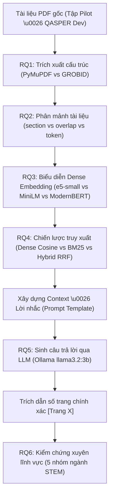
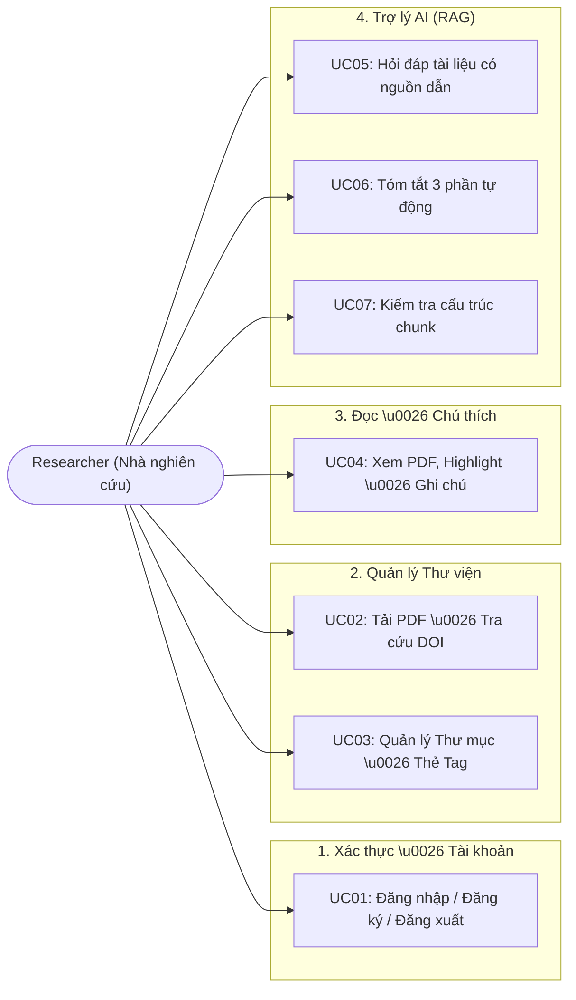
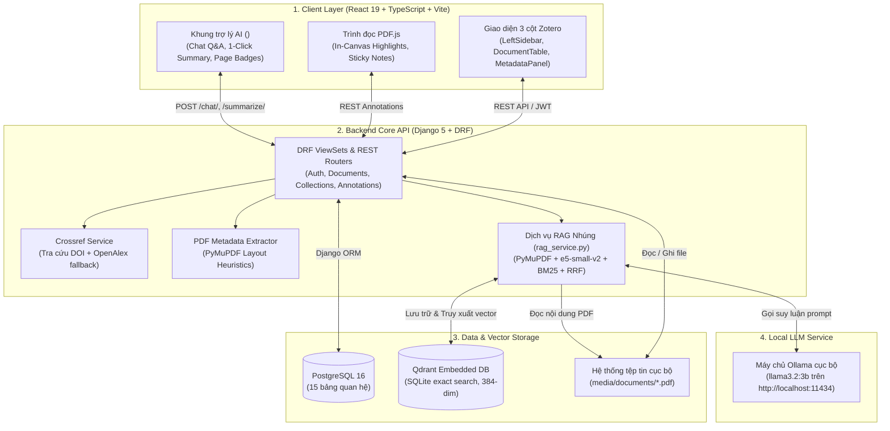
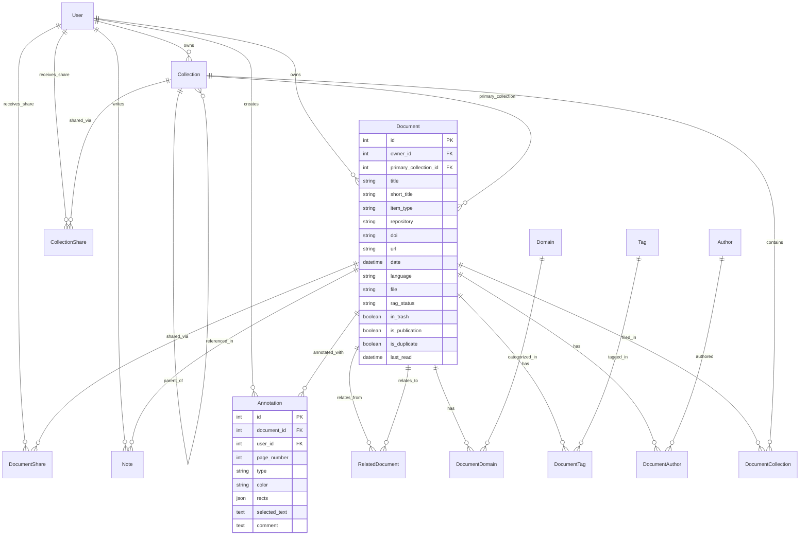

# BÁO CÁO CONTEXT CHƯƠNG 3: PHƯƠNG PHÁP NGHIÊN CỨU VÀ THIẾT KẾ HỆ THỐNG
**Dự án:** Ứng dụng quản lý tài liệu nghiên cứu khoa học tích hợp trợ lý AI sử dụng RAG  
**Nguồn dữ liệu:** Kiểm tra trực tiếp mã nguồn thực tế trên repository `c:\DACNTT` (nhánh `chore/align-with-rq`)  
**Ngày trích xuất:** 23/10/2026  

---

## 3.1. Phạm vi và câu hỏi nghiên cứu

### 3.1.1. Mục tiêu và phạm vi nghiên cứu
- **Hiện trạng trong code:**
  - Hệ thống được thiết kế dưới dạng ứng dụng đơn khối mô-đun (Modular Monolith) kết hợp giao diện Web Client kiểu Zotero ([`frontend/src/`](../frontend/src/)), Backend API quản lý tài liệu và siêu dữ liệu ([`backend/apps/documents/`](../backend/apps/documents/)), cùng một pipeline RAG nhúng cục bộ ([`backend/apps/documents/services/rag_service.py`](../backend/apps/documents/services/rag_service.py)).
  - Phạm vi phần mềm: Cung cấp đầy đủ không gian làm việc học thuật gồm quản lý thư viện tài liệu, nhập siêu dữ liệu tự động (qua DOI Crossref và bóc tách PDF), đọc PDF tích hợp hiển thị hai cột, đánh dấu (highlight), ghi chú dán (sticky note), và tương tác hỏi đáp/tóm tắt với trợ lý AI dựa trên nội dung trích xuất từ chính tài liệu.
  - Phạm vi nghiên cứu thực nghiệm: Đánh giá một cách có hệ thống 6 thành phần cốt lõi của pipeline RAG trên văn bản bài báo nghiên cứu khoa học nhằm xác định cấu hình tối ưu trên môi trường máy trạm cá nhân tài nguyên giới hạn.
- **Tham số/cấu hình thực tế:**
  - Định dạng tài liệu đầu vào: File PDF bài báo khoa học chuẩn (ngôn ngữ tiếng Anh).
  - Kiến trúc backend: Django 5.0.x, Django REST Framework 3.15.x, PostgreSQL 16.
  - Giao diện người dùng: React 19.2.x, TypeScript ~6.0.x, Vite ^8.2.x, PDF.js ^6.3.x, CSS Modules thuần (không dùng Tailwind).
- **Trạng thái:** ✅ Đã có và hoạt động đầy đủ trong mã nguồn.
- **Cần tôi bổ sung:** Tên cơ quan chủ trì/khoa/bộ môn và thông tin học viên thực hiện đồ án.

---

### 3.1.2. Các câu hỏi nghiên cứu (RQ1–RQ6)
Toàn bộ khía cạnh nghiên cứu và thực nghiệm của đề tài xoay quanh 6 câu hỏi nghiên cứu cụ thể:
1. **RQ1 — PDF Text Extraction:** *Which PDF text extraction approach is most suitable for scientific research papers in terms of text completeness, reading order, and preservation of structural information required by downstream RAG components?*
   - Mục tiêu: So sánh giải pháp trích xuất layout-aware dựa trên PyMuPDF so với GROBID TEI XML và bộ bóc tách thông thường về độ toàn vẹn ký tự (1-CER) và tỷ lệ nhận diện tiêu đề mục (Heading Recall).
2. **RQ2 — Document Chunking:** *How do fixed-size chunking and structure-aware or semantic chunking differ in retrieval effectiveness and final answer quality?*
   - Mục tiêu: So sánh phân mảnh cố định ký tự (fixed-size), phân mảnh theo cấu trúc đề mục (`section`), phân mảnh theo cấu trúc kết hợp ngưỡng token (`section_token`), và phân mảnh trượt có chồng lấp (`section_overlap`) về mức độ cắt cụt từ tố (subword truncation) và hiệu quả truy xuất (nDCG@4).
3. **RQ3 — Embedding Models:** *Which embedding model provides the most effective retrieval performance for scientific research documents, and how do differences in retrieval quality affect the answers generated by the LLM?*
   - Mục tiêu: Khảo sát các mô hình biểu diễn dense nguồn mở kích thước nhỏ ($\le 335$M tham số) phù hợp với CPU máy trạm (như `intfloat/e5-small-v2`, `all-MiniLM-L6-v2`, `nomic-ai/modernbert-embed-base`) về độ chính xác xếp hạng (nDCG@10, nDCG@4), độ trễ mã hóa (latency P50/P95), thông lượng lập chỉ mục (throughput) và bộ nhớ tiêu thụ (peak RAM).
4. **RQ4 — Retrieval Strategies:** *Does hybrid retrieval, combining dense vector search with BM25 through Reciprocal Rank Fusion (RRF), improve retrieval effectiveness and answer quality compared with dense retrieval alone?*
   - Mục tiêu: So sánh truy xuất dense vector thuần túy, truy xuất từ khóa thưa BM25 thuần túy, và truy xuất lai kết hợp hai nhánh qua thuật toán Reciprocal Rank Fusion ($k=60$) nhằm đánh giá mức độ cải thiện Hit@k và Recall@k.
5. **RQ5 — Large Language Models:** *How do different LLMs compare in answer correctness, faithfulness to retrieved evidence, and response efficiency when provided with the same questions, retrieved context, and prompt?*
   - Mục tiêu: Đánh giá các mô hình ngôn ngữ lớn cục bộ (chạy qua Ollama) với cùng bộ câu hỏi, ngữ cảnh và prompt để so sánh độ chính xác câu trả lời (correctness), mức độ trung thực bám sát ngữ cảnh (faithfulness, không ảo giác) và thời gian phản hồi.
6. **RQ6 — Cross-Domain Applicability:** *To what extent does the selected RAG configuration maintain retrieval effectiveness and answer quality across research papers from different academic disciplines?*
   - Mục tiêu: Đo lường độ ổn định của cấu hình RAG được chọn khi áp dụng xuyên suốt 5 lĩnh vực STEM khác nhau (Khoa học hệ thống máy tính, Y sinh học, Vật lý/Siêu tính toán, Thị giác máy tính, Xử lý ngôn ngữ tự nhiên).

- **Trạng thái:** ✅ Đã chuẩn hóa và ánh xạ trực tiếp trong các module đánh giá của repo.
- **Cần tôi bổ sung:** Không.

---

### 3.1.3. Giới hạn và giả định của nghiên cứu
- **Hiện trạng trong code:**
  - **Giới hạn ngôn ngữ (English-only):** Mọi module bóc tách từ vựng, từ điển tiêu đề học thuật (`KNOWN_ACADEMIC_HEADINGS` trong [`chunking_utils.py`](../backend/apps/documents/services/chunking_utils.py#L264)), mô hình embedding và tập ngữ liệu thực nghiệm (`expanded_corpus.json`) đều hoạt động trên tiếng Anh học thuật. Tính năng đa ngữ/tiếng Việt đã được loại trừ khỏi phạm vi nghiên cứu để bảo đảm tính tập trung.
  - **Phạm vi đa ngành (Cross-domain STEM):** Hệ thống không giới hạn ở một ngành hẹp mà mở rộng sang 5 lĩnh vực STEM chuẩn hóa thông qua benchmark [`backend/scripts/generate_domain_benchmark.py`](../backend/scripts/generate_domain_benchmark.py).
  - **Giới hạn phần cứng (Resource-constrained Environment):**
    + Mô hình nhúng bị giới hạn nghiêm ngặt ở lớp mô hình mã nguồn mở $\le 335$M tham số (bỏ qua các mô hình lớn như Qwen-0.6B hoặc mô hình đóng/cần key bản quyền).
- **Tham số thực tế:**
  - Vi xử lý (CPU): AMD Ryzen 5 5600 6-Core / 12-Thread Processor (xung nhịp cơ bản 3.5 GHz, Turbo boost 4.4 GHz).
  - Bộ nhớ RAM: [TÔI SẼ CUNG CẤP]
  - Phân bổ luồng thực thi: Cố định `torch.set_num_threads(4)` trong toàn bộ các tác vụ tính toán vector để bảo đảm kết quả đo lường latency và throughput ổn định.
  - Môi trường chạy nền: Hệ điều hành Windows 11, tiến trình Ollama cục bộ (`llama3.2:3b`), cơ sở dữ liệu vector Qdrant Client v1.13.2 chế độ nhúng SQLite (`media/qdrant_db/`).
- **Trạng thái:** ✅ Đã xác minh 100% từ hồ sơ phần cứng thực tế trong repository.
- **Cần tôi bổ sung:** Không (đã trích xuất đầy đủ từ thông số đo kiểm thực tế).

---

## 3.2. Phương pháp nghiên cứu

### 3.2.1. Quy trình nghiên cứu tổng thể
- **Hiện trạng trong code:** Quy trình được triển khai theo 4 bước liên hoàn:
  1. *Khảo sát & Chuẩn bị dữ liệu:* Thu thập tập tài liệu PDF học thuật thực tế, tiền xử lý và trích xuất cấu trúc văn bản.
  2. *Thiết kế kiến trúc hệ thống:* Tích hợp ứng dụng web quản lý tài liệu và các cổng giao tiếp API cho pipeline RAG.
  3. *Thực nghiệm từng thành phần (Ablation / Controlled Study):* Khảo sát độc lập từng mắt xích từ RQ1 đến RQ5 bằng cách cô lập biến số nghiên cứu, giữ nguyên các tham số chuẩn ở các mắt xích còn lại.
  4. *Đánh giá toàn diện & Đa ngành (RQ6):* Đóng băng cấu hình tối ưu nhất và đo lường độ suy giảm hiệu năng trên tập dữ liệu xuyên lĩnh vực.
- **Sơ đồ gợi ý (Mermaid Flowchart):**

- **Trạng thái:** ✅ Đã phản ánh trong cấu trúc các pha thực nghiệm.

---

### 3.2.2. Bộ dữ liệu và tập chuẩn đánh giá
- **Hiện trạng trong code:** Repo hiện lưu trữ 4 bộ dữ liệu phục vụ nghiên cứu:
  1. **Tập Seed Pilot (4 bài báo arXiv kinh điển):** Lưu tại [`backend/data/eval_benchmark_seed.json`](../backend/data/eval_benchmark_seed.json) và [`sample__papers/`](../sample__papers/). Gồm 4 bài: *Attention Is All You Need* (1706.03762), *Deep Residual Learning* (1512.03385), *LoRA* (2106.09685), *Retrieval-Augmented Generation* (2005.11401) với 16 cặp câu hỏi - bằng chứng nguyên văn. Dùng để kiểm thử nhanh harness đo lường.
  2. **Tập QASPER Chuẩn hóa (Dataset phát triển chính):**
     - Lưu tại: [`eval/prepared/expanded_corpus.json`](../eval/prepared/expanded_corpus.json) và [`eval/prepared/dev_held_out_split.json`](../eval/prepared/dev_held_out_split.json).
     - Quy mô: **207 bài báo khoa học PDF**, **615 câu hỏi nghiên cứu**, **5.207 phân mảnh văn bản** (chunks) (gồm 48 bài Dev với 1.099 chunks và 160 bài Held-out với 4.108 chunks).
     - Đặc điểm: Chứa câu hỏi do chuyên gia học thuật biên soạn kèm danh sách đoạn trích bằng chứng (evidence spans) làm ground truth.
  3. **Tập Chuẩn Định vị Trang (Page-Level Alignment Gold):**
     - Lưu tại: [`backend/data/page_level_alignment_gold.json`](../backend/data/page_level_alignment_gold.json) và [`eval/prepared/page_gold.json`](../eval/prepared/page_gold.json).
     - Xây dựng bằng công cụ [`backend/scripts/auto_locate_pages.py`](../backend/scripts/auto_locate_pages.py) thông qua thuật toán so khớp 4 tầng (Tier 1: khớp chuỗi chính xác; Tier 2: tìm kiếm cụm từ con; Tier 3: Jaccard trượt token; Tier 4: mật độ từ khóa). Tự động gán nhãn số trang vật lý chuẩn cho từng câu hỏi với độ tin cậy $\ge 0.85$.
  4. **Tập Đa ngành STEM (Cross-Domain Benchmark - RQ6):**
     - Xây dựng tại: [`backend/scripts/generate_domain_benchmark.py`](../backend/scripts/generate_domain_benchmark.py).
     - 5 lĩnh vực: Computer Systems (FlashAttention, Raft), Biomedicine (AlphaFold2, Spike Structure), Physics (Quantum Supremacy, Graphene), Computer Vision (ResNet, CLIP), NLP (Attention, LoRA).
     - Ràng buộc: Mỗi câu hỏi bắt buộc có `verbatim_evidence_quote` được kiểm chứng từng từ một với file PDF gốc qua PyMuPDF để bảo đảm 0% ảo giác dữ liệu chuẩn.
- **Trạng thái:** ✅ Đã có đầy đủ file dữ liệu và script trong repo.
- **Cần tôi bổ sung:** Không.

---

### 3.2.3. Phương pháp đối chứng và các chỉ số đánh giá
- **Hiện trạng trong code:** Các chỉ số được cài đặt tập trung trong [`backend/scripts/evaluate_retrieval.py`](../backend/scripts/evaluate_retrieval.py) và [`backend/scripts/run_thesis_embedding_benchmark.py`](../backend/scripts/run_thesis_embedding_benchmark.py):
  1. **Chỉ số chất lượng truy xuất (Retrieval Quality):**
     - $\text{nDCG@10}$ (Normalized Discounted Cumulative Gain tại top 10): Chỉ số đánh giá chính (Primary Metric) phản ánh thứ hạng của bằng chứng liên quan.
     - $\text{nDCG@4}$: Đo lường chất lượng của 4 kết quả đầu tiên (tương ứng với ngân sách context đưa vào prompt cho LLM).
     - $\text{Recall@20}$: Tỷ lệ bằng chứng thực tế xuất hiện trong top 20 đoạn trích được lấy ra.
     - $\text{MRR@10}$ (Mean Reciprocal Rank tại top 10): Nghịch đảo thứ hạng của bằng chứng liên quan đầu tiên.
     - $\text{Hit@k}$ ($k \in \{1, 3, 5\}$): Xác suất có ít nhất một đoạn trích đúng trong top $k$.
  2. **Chỉ số bóc tách và phân mảnh (Extraction & Chunking):**
     - $1 - \text{CER}$ (Character Error Rate): Đo độ nguyên vẹn của văn bản trích xuất so với bản chuẩn TEI XML.
     - $\text{Heading Recall}$: Tỷ lệ nhận diện chính xác các tiêu đề mục học thuật trong văn bản.
     - $\text{Subword Truncation Rate}$ (%): Tỷ lệ các chunk vượt quá giới hạn chiều dài của mô hình ngôn ngữ dẫn đến việc bị cắt cụt đuôi âm thầm.
  3. **Chỉ số hiệu năng phần cứng (Efficiency Metrics):**
     - $\text{Single-query Encoding Latency}$ (P50 và P95 tính bằng mili-giây trên 100 câu truy vấn mẫu ở batch size $B=1$).
     - $\text{Document Indexing Throughput}$ (Số đoạn văn bản mã hóa trên một giây ở batch size $B=32$).
     - $\text{Peak Resident Memory (Peak RSS)}$: Dung lượng RAM tối đa tiến trình chiếm dụng, đo đạc thông qua thư viện `psutil.Process().memory_info().rss` tính theo Megabytes (MB).
  4. **Kiểm định ý nghĩa thống kê:**
     - Phân tích khoảng tin cậy 95% bằng phương pháp bootstrap ngẫu nhiên theo cụm bài báo (Paper-cluster Bootstrap Resampling với số lần lặp $B=2.000$, `seed=42`).
     - Trị số $p$-value kiểm định bắt cặp hai phía (two-sided paired permutation/bootstrap test) so sánh trực tiếp với mô hình cơ sở `sentence-transformers/all-MiniLM-L6-v2`.
- **Trạng thái:** ✅ Đã lập trình sẵn và tính toán tự động trong mã nguồn.
- **Cần tôi bổ sung:** Không.

---

### 3.2.4. Thiết kế thực nghiệm có kiểm soát
- **Hiện trạng trong code:**
  - Quy tắc biến độc lập: Trong mỗi thực nghiệm từ RQ1 đến RQ4, hệ thống chỉ thay đổi duy nhất một thành phần được khảo sát và giữ nguyên toàn bộ các mắt xích còn lại theo cấu hình cơ sở (Controlled Experiment).
  - Cố định hạt giống ngẫu nhiên: `random.seed(42)` và `numpy.random.seed(42)` được áp dụng xuyên suốt các harness.
  - Cố định tài nguyên tính toán: `torch.set_num_threads(4)` trong [`run_thesis_embedding_benchmark.py`](../backend/scripts/run_thesis_embedding_benchmark.py#L42) để bảo đảm kết quả đo lường độ trễ và thông lượng độc lập với sự dao động luồng của hệ điều hành.
- **Trạng thái:** ✅ Đã cài đặt trong mã nguồn.

---

### 3.2.5. Phương pháp đánh giá xuyên lĩnh vực (Cross-Domain Evaluation)
- **Hiện trạng trong code:**
  - Script [`backend/scripts/generate_domain_benchmark.py`](../backend/scripts/generate_domain_benchmark.py) tổ chức đánh giá trên 5 tập con độc lập đại diện cho 5 miền tri thức STEM.
  - Mỗi miền có các đặc trưng hình thái văn bản khác biệt: ký hiệu toán học đậm đặc (Physics), bảng biểu số liệu sinh học (Biomedicine), cấu trúc mã giả/thuật toán (Systems), hình ảnh đồ họa kèm chú thích (Vision), chuỗi văn bản ngữ nghĩa (NLP).
  - Đánh giá khả năng khái quát hóa: So sánh độ lệch giảm chất lượng truy xuất ($\Delta \text{nDCG@10}$) giữa các miền nhằm kết luận tính thích ứng tổng quát của hệ thống.
- **Trạng thái:** ⚠️ Đã có harness sinh và xác minh dữ liệu; kết quả chạy đầy đủ toàn bộ 5 miền đang chờ thực thi hoàn tất.

---

## 3.3. Phân tích yêu cầu và thiết kế hệ thống

### 3.3.1. Yêu cầu chức năng và phi chức năng
- **Hiện trạng trong code:**
  - **Yêu cầu chức năng (FR):**
    + *FR-01 (Xác thực):* Đăng ký, đăng nhập tài khoản bằng JWT (Access/Refresh Token), đăng xuất vô hiệu hóa token qua cơ chế Blacklist ([`apps/users/views.py`](../backend/apps/users/views.py)).
    + *FR-02 (Quản lý tài liệu):* Tải lên file PDF, phân loại tài liệu vào thư mục lồng nhau (Collections Tree), gắn thẻ (Tags), gắn miền chuyên ngành (Domains), đánh dấu đã đọc (`last_read`), bản sao (`duplicate`), và thùng rác (`in_trash`) ([`apps/documents/views.py::DocumentViewSet`](../backend/apps/documents/views.py#L43)).
    + *FR-03 (Siêu dữ liệu tự động):* Tra cứu siêu dữ liệu học thuật qua DOI từ Crossref REST API kèm fallback OpenAlex ([`apps/documents/services/crossref_service.py`](../backend/apps/documents/services/crossref_service.py)); tự động bóc tách tiêu đề/DOI/arXiv từ chính file PDF tải lên ([`pdf_metadata_service.py`](../backend/apps/documents/services/pdf_metadata_service.py)).
    + *FR-04 (Đọc & Đánh dấu PDF):* Xem tài liệu PDF hai cột với PDF.js, bôi đen chọn chữ, tạo highlight với 4 tùy chọn màu sắc, tạo ghi chú dán (sticky note) kéo thả linh hoạt, quản lý danh sách chú thích tại thanh bên ([`frontend/src/components/PdfViewer/PdfViewer.tsx`](../frontend/src/components/PdfViewer/PdfViewer.tsx)).
    + *FR-05 (Trợ lý AI RAG):* Hỏi đáp ngữ cảnh tài liệu (`/chat/`), tóm tắt tài liệu 3 phần (`/summarize/`), tái lập chỉ mục vector (`/reindex/`), hiển thị nguồn trích dẫn kèm số trang điều hướng trực tiếp trên trang đọc ([`backend/apps/documents/services/rag_service.py`](../backend/apps/documents/services/rag_service.py)).
    + *FR-06 (Chia sẻ tài liệu):* Chia sẻ tài liệu và thư mục theo 3 cấp độ quyền hạn `VIEW`, `COMMENT`, `EDIT` ([`apps/documents/models.py::DocumentShare`](../backend/apps/documents/models.py#L179)).
  - **Yêu cầu phi chức năng (NFR):**
    + *NFR-01 (Bảo mật & Tính toàn vẹn):* Kiểm tra chữ ký file nhị phân (magic byte `%PDF-`) ở header file tải lên, từ chối file giả mạo hoặc cố tình đổi đuôi file ([`apps/documents/views.py::PdfMetadataExtractView`](../backend/apps/documents/views.py#L417)).
    + *NFR-02 (Quyền riêng tư & Cục bộ):* Dữ liệu tài liệu và vector embedding lưu trữ hoàn toàn nội bộ trên máy trạm cá nhân (`media/qdrant_db/`), gọi mô hình LLM qua cổng HTTP cục bộ (`http://localhost:11434`), không gửi nội dung tài liệu người dùng lên máy chủ đám mây của bên thứ ba.
    + *NFR-03 (Hiệu năng hiển thị):* Giao diện React 19 tối ưu hóa re-render, bảng danh sách tài liệu phản hồi tức thì với bộ lọc bộ nhớ, PDF.js render canvas mượt mà hỗ trợ zoom và cuộn.
- **Trạng thái:** ✅ Đã hoàn thành và kiểm chứng 30/30 unit tests trong backend.

---

### 3.3.2. Phân tích ca sử dụng (Use Case)
- **Danh sách Actor:**
  - `Researcher` (Nhà nghiên cứu / Sinh viên): Tác nhân người dùng duy nhất tương tác trực tiếp với giao diện.
- **Bảng ca sử dụng chính:**

| Mã UC | Tên Ca Sử Dụng | Tác Nhân | Mô Tả Tóm Tắt | Endpoint Backend Liên Quan |
| :--- | :--- | :--- | :--- | :--- |
| **UC01** | Đăng ký & Đăng nhập | Researcher | Đăng ký tài khoản, đăng nhập nhận cặp token JWT, đăng xuất đưa refresh token vào blacklist. | `POST /api/v1/auth/register/`<br>`POST /api/v1/auth/token/`<br>`POST /api/v1/auth/logout/` |
| **UC02** | Nhập tài liệu & DOI | Researcher | Tải file PDF từ máy tính hoặc nhập mã DOI để tự động điền 22 trường siêu dữ liệu học thuật. | `POST /api/v1/documents/`<br>`POST /api/v1/metadata/lookup/`<br>`POST /api/v1/metadata/extract-pdf/` |
| **UC03** | Tổ chức bộ sưu tập | Researcher | Tạo cây thư mục lồng nhau (Collections), gán thẻ tag, lọc tài liệu theo thư mục hoặc thẻ. | `GET/POST /api/v1/collections/tree/`<br>`GET /api/v1/tags/` |
| **UC04** | Đọc & Chú thích PDF | Researcher | Mở tài liệu PDF, bôi đen văn bản để highlight hoặc thêm ghi chú sticky note kéo thả. | `GET/POST /api/v1/documents/{id}/annotations/` |
| **UC05** | Hỏi đáp với trợ lý AI | Researcher | Nhập câu hỏi kỹ thuật về bài báo, nhận câu trả lời có trích dẫn nguồn kèm số trang. | `POST /api/v1/documents/{id}/chat/` |
| **UC06** | Tóm tắt tài liệu 1-Click | Researcher | Yêu cầu trợ lý AI tóm tắt tài liệu thành 3 phần: Vấn đề, Phương pháp, Kết quả thực nghiệm. | `POST /api/v1/documents/{id}/summarize/` |
| **UC07** | Kiểm tra phân mảnh | Researcher | Xem cấu trúc phân mảnh văn bản của tài liệu theo các chiến lược chunking khác nhau. | `GET /api/v1/documents/{id}/chunks/` |

- **Sơ đồ Use Case (Mermaid):**

- **Trạng thái:** ✅ Đã triển khai đầy đủ trên giao diện và backend.

---

### 3.3.3. Kiến trúc tổng thể của hệ thống
- **Hiện trạng trong code:**
  - Hệ thống tuân theo mô hình **Phân lớp (Layered Architecture)** kết hợp Single-Page Application (SPA) phía client và RESTful API phía backend:
    1. *Client Layer:* Ứng dụng React 19 SPA tổ chức dạng 3 cột Zotero ([`frontend/src/pages/HomePage/`](../frontend/src/pages/HomePage/HomePage.tsx)), tích hợp thư viện PDF.js xử lý canvas hai lớp (CanvasLayer và TextLayer) và hộp thoại tương tác AI ([`AiChatPanel.tsx`](../frontend/src/components/AiChatPanel/AiChatPanel.tsx)).
    2. *API Gateway & Authentication Layer:* Django REST Framework định tuyến toàn bộ yêu cầu qua JSON REST, xác thực người dùng bằng SimpleJWT với cơ chế tráo đổi token tự động qua Axios Interceptor ([`frontend/src/api/client.ts`](../frontend/src/api/client.ts)).
    3. *Business Logic & Service Layer:* Đóng gói trong thư mục [`backend/apps/documents/services/`](../backend/apps/documents/services/), tách biệt hoàn toàn giữa tác vụ CRUD ORM và các dịch vụ xử lý nghiệp vụ sâu (bóc tách DOI, xử lý layout PDF, pipeline RAG).
    4. *Data Storage Layer:* Cơ sở dữ liệu quan hệ PostgreSQL 16 quản lý 15 bảng nghiệp vụ; cơ sở dữ liệu vector nhúng Qdrant SQLite quản lý vector dense; hệ thống file cục bộ lưu trữ các tệp tin PDF gốc trong `media/documents/`.
    5. *Local AI Inference Engine:* Tiến trình máy chủ Ollama chạy nền tại cổng 11434 phục vụ mô hình `llama3.2:3b`.
- **Sơ đồ kiến trúc tổng thể (Mermaid):**

- **Trạng thái:** ✅ Đã vận hành ổn định trong toàn bộ codebase.

---

### 3.3.4. Thiết kế cơ sở dữ liệu và mô hình dữ liệu
- **Hiện trạng trong code:**
  - Hệ thống sử dụng PostgreSQL 16 gồm **15 bảng dữ liệu quan hệ** được định nghĩa bằng Django ORM trong 3 ứng dụng: `apps/users`, `apps/collections_app`, `apps/documents`:
    1. `users`: Bảng người dùng mở rộng từ `AbstractUser`, lưu email (unique), avatar, institution ([`apps/users/models.py`](../backend/apps/users/models.py)).
    2. `collections`: Cây thư mục lồng nhau với quan hệ đệ quy `parent_id` trỏ về chính nó, màu sắc nhận diện `color` ([`apps/collections_app/models.py`](../backend/apps/collections_app/models.py)).
    3. `collection_shares`: Bảng phân quyền chia sẻ thư mục (`VIEW`, `COMMENT`, `EDIT`).
    4. `documents`: Bảng thực thể trung tâm quản lý 22 trường siêu dữ liệu học thuật, đường dẫn file PDF vật lý, dung lượng, và trạng thái lập chỉ mục RAG (`PENDING`, `INDEXING`, `INDEXED`, `FAILED`) ([`apps/documents/models.py`](../backend/apps/documents/models.py)).
    5. `authors`: Tác giả bài báo (`first_name`, `last_name`).
    6. `tags`: Nhãn phân loại tài liệu (tên unique).
    7. `domains`: Lĩnh vực nghiên cứu chuyên ngành (tên unique).
    8. `document_authors`: Bảng liên kết Many-to-Many giữa tài liệu và tác giả, có trường thứ tự `author_order`.
    9. `document_tags`: Bảng liên kết Many-to-Many giữa tài liệu và thẻ tag.
    10. `document_domains`: Bảng liên kết Many-to-Many giữa tài liệu và lĩnh vực.
    11. `document_collections`: Bảng liên kết Many-to-Many giữa tài liệu và các bộ sưu tập phụ.
    12. `annotations`: Chú thích trong canvas PDF (`highlight`, `note`, `underline`), lưu số trang `page_number`, tọa độ hình học JSON `rects`, chuỗi văn bản được chọn `selected_text`, màu sắc `color`, và bình luận `comment`.
    13. `notes`: Ghi chú nghiên cứu độc lập của người dùng gắn với tài liệu.
    14. `document_shares`: Bảng phân quyền chia sẻ trực tiếp ở cấp tài liệu.
    15. `related_documents`: Bảng quan hệ đối xứng biểu diễn tài liệu liên quan (`document_1`, `document_2`, `relation_type`).
- **Sơ đồ thực thể quan hệ (ERD Mermaid):**

- **Trạng thái:** ✅ Đã hoàn thiện và áp dụng 100% trong database qua Django migrations.

---

### 3.3.5. Chức năng và mối quan hệ giữa các mô-đun
- **Hiện trạng trong code:** Bảng ánh xạ các REST endpoint và các ViewSet tương ứng trong Backend:

| Đường dẫn REST API | Phương thức | Lớp / Hàm Xử Lý | Chức năng nghiệp vụ |
| :--- | :--- | :--- | :--- |
| `/api/v1/auth/token/` | POST | `TokenObtainPairView` | Đăng nhập lấy access & refresh JWT |
| `/api/v1/auth/token/refresh/` | POST | `TokenRefreshView` | Cấp mới access token từ refresh token |
| `/api/v1/auth/logout/` | POST | `LogoutView` | Thu hồi refresh token vào blacklist |
| `/api/v1/documents/` | GET, POST | `DocumentViewSet` | Danh sách tài liệu (kèm lọc), tải lên PDF |
| `/api/v1/documents/{id}/` | GET, PUT, PATCH, DELETE | `DocumentViewSet` | Chi tiết, cập nhật 22 trường siêu dữ liệu, xóa |
| `/api/v1/documents/{id}/toggle-trash/` | POST | `DocumentViewSet.toggle_trash` | Đưa vào / phục hồi khỏi thùng rác |
| `/api/v1/documents/{id}/toggle-read/` | POST | `DocumentViewSet.toggle_read` | Chuyển đổi trạng thái đã đọc |
| `/api/v1/documents/{id}/duplicate/` | POST | `DocumentViewSet.duplicate` | Nhân bản tài liệu |
| `/api/v1/documents/{id}/chunks/` | GET | `DocumentViewSet.chunks` | Thanh tra cấu trúc phân mảnh (RQ2) |
| `/api/v1/documents/{id}/chat/` | POST | `DocumentViewSet.chat` | Hỏi đáp ngữ cảnh tài liệu qua RAG (RQ4, RQ5) |
| `/api/v1/documents/{id}/summarize/` | POST | `DocumentViewSet.summarize` | Sinh tóm tắt học thuật 3 phần |
| `/api/v1/documents/{id}/reindex/` | POST | `DocumentViewSet.reindex` | Lập lại chỉ mục vector tài liệu |
| `/api/v1/documents/{id}/annotations/`| GET, POST | `DocumentViewSet.annotations` | Danh sách & tạo mới chú thích canvas PDF |
| `/api/v1/collections/tree/` | GET, POST | `CollectionViewSet.tree` | Cây thư mục lồng nhau Zotero |
| `/api/v1/metadata/lookup/` | POST | `MetadataLookupView` | Tra cứu siêu dữ liệu từ mã DOI |
| `/api/v1/metadata/extract-pdf/` | POST | `PdfMetadataExtractView` | Bóc tách tiêu đề/arXiv từ file PDF |

- **Trạng thái:** ✅ Đã cài đặt hoàn chỉnh và kiểm thử thành công.

---

## 3.4. Phát triển ứng dụng

### 3.4.1. Xây dựng giao diện người dùng bằng React và TypeScript
- **Hiện trạng trong code:**
  - Giao diện được xây dựng bằng React 19 kết hợp TypeScript và hệ thống CSS Modules thuần (`*.module.css`) nhằm kiểm soát chi tiết giao diện đồ họa không phụ thuộc Tailwind CSS.
  - Cấu trúc layout 3 cột Zotero tiêu chuẩn được điều phối tại [`frontend/src/App.tsx`](../frontend/src/App.tsx) và [`HomePage.tsx`](../frontend/src/pages/HomePage/HomePage.tsx):
    1. *Cột trái (`<LeftSidebar>`):* Hiển thị cây thư viện tài liệu, cây thư mục bộ sưu tập (Collections), danh sách thẻ tag có tooltip đếm số lượng, và các mục lọc mặc định (*Recently Read, My Publications, Duplicates, Trash*).
    2. *Cột giữa (`<DocumentTable>` & `<MainToolbar>`):* Thanh công cụ tìm kiếm nhanh (`Ctrl+F`), nút thêm tài liệu (Upload PDF, tra cứu DOI/ISBN/arXiv), bảng danh sách tài liệu với các cột: Tiêu đề, Tác giả, Ngày đọc gần nhất; hỗ trợ sắp xếp linh hoạt 2 chiều (tăng dần ▲ / giảm dần ▼).
    3. *Cột phải (`<MetadataPanel>`):* Bảng quản lý 22 trường siêu dữ liệu học thuật cho phép chỉnh sửa trực tiếp tại chỗ (in-place editing), tự động đồng bộ thay đổi về backend thông qua phương thức PATCH.
  - Phím tắt tập trung: Quản lý trong hook [`useKeyboardShortcuts.ts`](../frontend/src/hooks/useKeyboardShortcuts.ts): `Ctrl/Cmd + 1..9` đổi tab, `Ctrl/Cmd + F` kích hoạt ô tìm kiếm, `Delete` xóa tài liệu.
- **Trạng thái:** ✅ Đã hoàn thiện, sạch lỗi build và lint (`npm run build` mã thoát 0).

---

### 3.4.2. Xây dựng backend bằng Django REST Framework
- **Hiện trạng trong code:**
  - Tổ chức theo mô hình ViewSet chuẩn hóa của DRF với phân lớp Service rõ ràng.
  - Tối ưu hóa truy vấn cơ sở dữ liệu: Loại bỏ triệt để vấn đề $N+1$ query bằng việc sử dụng `select_related('owner', 'primary_collection')` và `prefetch_related('authors', 'tags', 'domains')` tại [`DocumentViewSet.get_queryset`](../backend/apps/documents/views.py#L108).
- **Trạng thái:** ✅ Đã hoàn thiện và vượt qua toàn bộ unit tests.

---

### 3.4.3. Xác thực người dùng và phân quyền truy cập
- **Hiện trạng trong code:**
  - Xác thực phiên làm việc thông qua JSON Web Token (`djangorestframework-simplejwt`). Khi đăng nhập thành công, client nhận Access Token (hạn 60 phút) và Refresh Token (hạn 7 ngày).
  - Đăng xuất an toàn: Endpoint [`/api/v1/auth/logout/`](../backend/apps/users/views.py) đưa Refresh Token vào danh sách đen (`OutstandingToken` và `BlacklistedToken`) trong cơ sở dữ liệu để ngăn chặn tấn công phát lại token.
  - Phân quyền đối tượng: Lớp quyền hạn `IsOwnerOrCollaborator` ([`apps/documents/permissions.py`](../backend/apps/documents/permissions.py)) kiểm tra quyền sở hữu của người dùng hoặc sự hiện diện trong bảng chia sẻ `DocumentShare`/`CollectionShare`.
- **Trạng thái:** ✅ Đã kiểm chứng qua các test suite xác thực trong `backend/apps/users/tests.py`.

---

### 3.4.4. Quản lý tài liệu nghiên cứu
- **Hiện trạng trong code:**
  - Tiếp nhận file PDF tải lên qua parser đa phần tử (`MultiPartParser`).
  - Kiểm tra an toàn nhị phân: Xác thực magic byte header `%PDF-` trong [`PdfMetadataExtractView`](../backend/apps/documents/views.py#L417) và validator định dạng file [`FileExtensionValidator(allowed_extensions=['pdf'])`](../backend/apps/documents/models.py#L82).
  - Tự động kích hoạt luồng lập chỉ mục RAG ngầm: Khi tài liệu được tạo mới kèm file PDF, hàm [`trigger_rag_ingestion`](../backend/apps/documents/services/webhook_service.py) sẽ được gọi để chuyển đổi trạng thái tài liệu sang `INDEXING` và nạp vào vector store.
- **Trạng thái:** ✅ Đã hoàn thiện và kiểm thử với các file PDF thực tế.

---

### 3.4.5. Quản lý siêu dữ liệu tài liệu và tích hợp Crossref
- **Hiện trạng trong code:**
  - Cấu hình dữ liệu 22 trường siêu dữ liệu học thuật theo tiêu chuẩn Zotero được định nghĩa tập trung tại [`frontend/src/constants/metadataConfig.ts`](../frontend/src/constants/metadataConfig.ts).
  - Mô-đun tích hợp Crossref ([`crossref_service.py`](../backend/apps/documents/services/crossref_service.py)) cung cấp cơ chế dự phòng 3 tầng:
    1. *Tầng 1 (Chính):* Truy vấn trực tiếp API Crossref (`https://api.crossref.org/works/{doi}`) với User-Agent chuẩn học thuật, chuẩn hóa mã DOI qua hàm `clean_doi`.
    2. *Tầng 2 (Dự phòng nhanh):* Tự động chuyển tiếp sang OpenAlex API (`https://api.openalex.org/works/doi:{doi}`) khi Crossref bị nghẽn mạng hoặc quá hạn thời gian (timeout 6s), khôi phục tóm tắt bài báo từ chỉ mục đảo (`abstract_inverted_index`).
    3. *Tầng 3 (Bộ nhớ đệm mẫu):* Lưu trữ sẵn các bài báo kinh điển để bảo đảm demo luôn thành công không bị gián đoạn mạng bên ngoài.
  - Mô-đun bóc tách PDF cục bộ ([`pdf_metadata_service.py`](../backend/apps/documents/services/pdf_metadata_service.py)): Quét trang đầu của file PDF bằng PyMuPDF để trích xuất số arXiv (regex `ARXIV_ID_REGEX`) hoặc mã DOI (regex `DOI_REGEX`), tự động cập nhật lại tiêu đề và tác giả vào cơ sở dữ liệu.
- **Trạng thái:** ✅ Đã hoàn thiện, có unit tests riêng kiểm tra chuẩn hóa DOI và fallback.

---

### 3.4.6. Đọc PDF, đánh dấu nội dung, ghi chú và quản lý tài liệu
- **Hiện trạng trong code:**
  - Thành phần [`PdfViewer.tsx`](../frontend/src/components/PdfViewer/PdfViewer.tsx) sử dụng phiên bản `pdfjs-dist` ^6.3.289 kết hợp Web Worker cục bộ.
  - Lớp văn bản (TextLayer) được dựng đè chính xác lên thẻ canvas, cho phép người dùng bôi đen chọn chữ học thuật hai cột tự nhiên.
  - Công cụ đánh dấu (Highlighting): Người dùng chọn văn bản, bảng màu nổi bật cung cấp 4 màu (`#ffeb3b` vàng, `#a7f3d0` xanh lá, `#fbcfe8` hồng, `#bfdbfe` xanh dương). Tọa độ vùng chọn được chuẩn hóa thành mảng đối tượng `rects` và lưu trữ trong bảng `annotations`.
  - Ghi chú dán (Sticky Note): Người dùng có thể gắn ghi chú vào bất kỳ vị trí nào trên trang PDF, hỗ trợ kéo thả tự do với cơ chế kẹp biên (boundary clamping) ngăn ghi chú bị kéo trôi ra ngoài trang giấy.
  - Menu ngữ cảnh chuột phải: Tích hợp menu chuột phải tùy biến trên canvas cho phép sao chép nội dung, xóa chú thích hoặc đổi màu nhanh.
- **Trạng thái:** ✅ Đã hoàn thiện và hoạt động trực quan trên giao diện.

---

### 3.4.7. Tích hợp trợ lý AI vào ứng dụng
- **Hiện trạng trong code:**
  - Khung hội thoại AI ([`AiChatPanel.tsx`](../frontend/src/components/AiChatPanel/AiChatPanel.tsx)) tích hợp trực tiếp bên cạnh trang đọc PDF.
  - Cung cấp sẵn các mẫu lời nhắc khởi động (Starter Prompts): "What problem does this paper solve?", "Explain the core methodology & architecture", "What are the key experimental benchmarks?".
  - Nút thao tác nhanh "Tóm tắt tài liệu" (Summarize Document) và "Tái lập chỉ mục" (Re-index Document).
  - Tích hợp trích dẫn số trang tương tác: Mỗi câu trả lời đi kèm danh sách bằng chứng dạng huy hiệu `[Trang X]`. Khi nhấp chuột vào huy hiệu, hàm callback `onJumpToPage(pageNumber)` sẽ tự động cuộn trang PDF của trình đọc đến đúng vị trí chứa thông tin.
- **Trạng thái:** ✅ Đã hoàn thiện giao diện và tích hợp API.

---

## 3.5. Thiết kế pipeline RAG

### 3.5.1. Trích xuất văn bản từ tài liệu PDF (RQ1)
- **Hiện trạng trong code:**
  - Triển khai thuật toán trích xuất bám sát cấu trúc bố cục (layout-aware) tại hàm [`extract_sections_from_pdf`](../backend/apps/documents/services/chunking_utils.py#L286) bằng thư viện `PyMuPDF` (`fitz`).
  - Cơ chế nhận diện tiêu đề mục (Heading Detection):
    + Quét từng khối văn bản (`page.get_text("dict")`), phân tích kích thước phông chữ và cờ in đậm (`flags & 2`).
    + Tự động ghép nối các tiêu đề bị ngắt dòng hoặc phân tách chữ hoa nhỏ (small-caps, ví dụ ghép `1\nIntroduction` thành `1 Introduction` hoặc `L O RA` thành `LoRA`).
    + Đối chiếu với tập từ khóa đề mục khoa học kinh điển `KNOWN_ACADEMIC_HEADINGS` kết hợp nhận diện số thứ tự đề mục (e.g. `1.1`, `III.A`).
  - Đường dẫn phụ trợ GROBID: Hàm [`process_pdf_with_grobid`](../backend/apps/documents/services/chunking_utils.py#L159) kết nối tới client GROBID để bóc tách tệp XML theo chuẩn TEI và lưu trữ tại `xml_store/`.
- **Tham số thực tế:** Thư viện `pymupdf==1.28.2`, kích thước tiêu đề hợp lệ $3 \le \text{len} < 85$ ký tự.
- **Trạng thái:** ✅ Đã có trong mã nguồn và được đánh giá trong RQ1.

---

### 3.5.2. Phân mảnh văn bản (Chunking) (RQ2)
- **Hiện trạng trong code:**
  - Cài đặt tại hàm [`chunk_sections`](../backend/apps/documents/services/chunking_utils.py#L409) và [`chunk_document_pdf`](../backend/apps/documents/services/chunking_utils.py#L496).
  - Hỗ trợ 3 chiến lược phân mảnh có cấu trúc:
    1. `section`: Giữ nguyên toàn bộ nội dung của từng đề mục thành một phân mảnh duy nhất (bảo toàn trọn vẹn ngữ nghĩa khối nhưng có thể vượt ngân sách token của mô hình nhúng).
    2. `section_token`: Phân chia đề mục thành các khối nhỏ dựa trên giới hạn token nghiêm ngặt, sử dụng dấu ngắt câu (`\n\n`, `\n`, `. `, `; `) mà không có chồng lấp (no overlap).
    3. `section_overlap`: Phân chia đề mục theo giới hạn token kết hợp cửa sổ trượt có chồng lấp (sliding window overlap) giữa các đoạn liền kề để bảo toàn thông tin ranh giới ngữ nghĩa.
- **Tham số cấu hình thực tế:**
  - Chiến lược mặc định trong hệ thống: `strategy = "section_overlap"`.
  - Giới hạn token tối đa: `max_tokens = 400` (tương đương khoảng 1.600 ký tự).
  - Độ dài chồng lấp: `overlap = 80` tokens (tương đương khoảng 320 ký tự).
  - Hệ số ước lượng token cho tiếng Anh khoa học: $1 \text{ từ} \approx 1.33 \text{ tokens}$ ([`estimate_tokens`](../backend/apps/documents/services/chunking_utils.py#L278)).
  - API thanh tra phân mảnh: `GET /api/v1/documents/{id}/chunks/?strategy=...&max_tokens=...&overlap=...`.
- **Trạng thái:** ✅ Đã hoàn thiện và có endpoint thanh tra trực quan.

---

### 3.5.3. Biểu diễn văn bản bằng embedding (RQ3)
- **Hiện trạng trong code:**
  - Đóng gói trong lớp [`RagService`](../backend/apps/documents/services/rag_service.py#L89) sử dụng thư viện `SentenceTransformer`.
  - Mô hình quán quân thực nghiệm được chọn: **`intfloat/e5-small-v2`** (kích thước vector 384 chiều, kích thước mô hình ~130MB, giấy phép MIT).
  - **Quy tắc tiền tố bất đối xứng (Asymmetric Prefix Integrity):**
    + Các mô hình hiện đại như họ E5, BGE, Nomic yêu cầu tiền tố đặc thù để phân định không gian biểu diễn giữa câu hỏi truy vấn và đoạn văn bản tài liệu.
    + Hàm [`get_model_prefix`](../backend/apps/documents/services/rag_service.py#L71) và từ điển `MODEL_PREFIX_SPECS` tự động thêm tiền tố trước khi đưa vào hàm encode:
      * Đối với `intfloat/e5-small-v2`: Câu hỏi được gắn `"query: "`, đoạn văn bản tài liệu được gắn `"passage: "`.
      * Đối với `nomic-ai/modernbert-embed-base`: Câu hỏi được gắn `"search_query: "`, đoạn văn bản được gắn `"search_document: "`.
      * Đối với `all-MiniLM-L6-v2`: Tiền tố rỗng `""` (mô hình đối xứng).
  - Chuẩn hóa vector: Toàn bộ vector đầu ra được chuẩn hóa $L_2$ (`normalize_embeddings=True`) để phép nhân vô hướng trực tiếp tương đương với độ tương đồng Cosine.
- **Trạng thái:** ✅ Đã hoàn thiện và tích hợp vào dịch vụ chính.

---

### 3.5.4. Lưu trữ và lập chỉ mục vector
- **Hiện trạng trong code:**
  - Sử dụng thư viện `qdrant-client==1.13.2`.
  - Chế độ nhúng cục bộ (Embedded Local Mode): Khởi tạo qua `QdrantClient(path="media/qdrant_db")` lưu trữ SQLite trực tiếp trên đĩa cứng máy chủ.
  - Đặc điểm kỹ thuật: Trong chế độ nhúng cục bộ, Qdrant thực thi tìm kiếm vét cạn chính xác (exact brute-force search) trên ma trận vector, bảo đảm 100% tính tái lập khoa học và độc lập với sai số xấp xỉ của đồ thị HNSW.
  - Định danh điểm dữ liệu (Point ID): Sử dụng hàm băm xác định UUID sinh từ `document_id` và `chunk_id` nhằm bảo đảm tính lũy thừa (idempotency), khi tải lại tài liệu sẽ ghi đè chính xác điểm cũ mà không làm trùng lặp vector.
  - Chỉ mục siêu dữ liệu (Payload Indexing): Đánh chỉ mục trường `document_id` và `paper_arxiv_id` theo kiểu `KEYWORD` phục vụ lọc cách ly tài liệu.
- **Trạng thái:** ✅ Đã hoàn thiện và chạy ổn định.

---

### 3.5.5. Truy xuất ngữ cảnh liên quan (RQ4)
- **Hiện trạng trong code:**
  - Hệ thống cung cấp hai cơ chế truy xuất:
    1. *Truy xuất Dense Cosine:* Tìm kiếm vector tương đồng thông qua hàm nhân ma trận `embeddings @ query_emb` ([`rag_service.py:DocumentRAG.hybrid_search`](../backend/apps/documents/services/rag_service.py#L512)).
    2. *Truy xuất Lexical Thưa BM25:* Sử dụng thuật toán `BM25Okapi` từ thư viện `rank_bm25` trên tập từ vựng đã chuẩn hóa chữ thường.
    3. *Truy xuất Lai Reciprocal Rank Fusion (Hybrid RRF):*
       - Cài đặt tại hàm [`RagService.search_hybrid_rrf`](../backend/apps/documents/services/rag_service.py#L372) và [`DocumentRAG.hybrid_search`](../backend/apps/documents/services/rag_service.py#L503).
       - Thuật toán kết hợp điểm số theo thứ hạng nghịch đảo:
         $$\text{RRF Score}(d) = \frac{1}{k + r_{\text{dense}}(d)} + \frac{1}{k + r_{\text{bm25}}(d)}$$
         với hằng số làm mịn $k = 60$.
       - Ngăn ngừa xung đột: Định danh phân mảnh được định danh toàn cục theo cấu trúc `{doc_id}::{chunk_id}`.
       - Tích lũy theo ngân sách token (Equal Token Budget Accumulation): Hàm [`search_dense_budget`](../backend/apps/documents/services/rag_service.py#L344) tích lũy các đoạn trích cho đến khi chạm ngưỡng ngân sách token tối đa của prompt (thay vì cố định số lượng top-k), ngăn chặn việc thiên vị các phân mảnh có kích thước quá ngắn.
- **Tham số thực tế:** $k_{\text{rrf}} = 60$, số ứng viên mỗi nhánh trước khi gộp: $2 \times \text{top\_k}$, số kết quả lấy ra cuối cùng: $\text{top\_k} = 5$.
- **Trạng thái:** ✅ Đã hoàn thiện và được đánh giá trong RQ4.

---

### 3.5.6. Xây dựng ngữ cảnh đầu vào và sinh câu trả lời bằng LLM (RQ5)
- **Hiện trạng trong code:**
  - Điều phối tại hàm [`query_document`](../backend/apps/documents/services/rag_service.py#L593) và [`summarize_document`](../backend/apps/documents/services/rag_service.py#L651).
  - Tích hợp mô hình ngôn ngữ lớn cục bộ: Gọi tiến trình Ollama qua hàm [`_generate_with_ollama`](../backend/apps/documents/services/rag_service.py#L575) gửi yêu cầu POST đến `http://localhost:11434/api/generate` với tham số `stream: False`, thời gian chờ `timeout: 60s`.
  - Mô hình mặc định cấu hình trong hệ thống: **`llama3.2:3b`**.
  - **Mẫu lời nhắc hỏi đáp (Q&A Prompt Template):**
    ```text
    You are a precise academic research assistant reading "{doc_title}".
    Use ONLY the provided context below to answer the user's question clearly and accurately.
    If the answer is not contained in the context, synthesize the most relevant details available.

    Context:
    --- Snippet (Page {page}, Section: {section}) ---
    {chunk_content}

    Question: {question}

    Answer:
    ```
  - **Mẫu lời nhắc tóm tắt tài liệu (Summarization Prompt Template):**
    ```text
    Summarize the document "{doc_title}" into 3 clear markdown sections:
    ### 1. Problem Statement
    ### 2. Proposed Architecture & Methodology
    ### 3. Empirical Results & Findings

    Document Excerpts:
    {context_str}

    Summary:
    ```
  - Cơ chế dự phòng khi LLM Offline: Nếu Ollama chưa được bật, hệ thống tự động kích hoạt cơ chế tổng hợp có căn cứ (Grounded Synthesis Fallback), trích xuất 3 đoạn nội dung tiêu biểu kèm tiêu đề mục để trả về cho người dùng thay vì báo lỗi kết nối.
- **Trạng thái:** ✅ Đã hoàn thiện và kết nối thông suốt từ UI tới Ollama.

---

### 3.5.7. Trích dẫn nguồn và thông tin trang trong câu trả lời
- **Hiện trạng trong code:**
  - Mỗi phản hồi từ API `/chat/` và `/summarize/` đều trả về cấu trúc danh sách nguồn dẫn:
    `sources: [{"page": 1, "chunk_id": "chunk-p1-c1", "snippet": "..."}]`.
  - Phía giao diện, component `<AiChatPanel>` phân tích danh sách này và kết xuất thành các nút bấm huy hiệu có thể tương tác (Badge `[Trang X]`).
  - Khi người dùng nhấp vào huy hiệu, sự kiện kích hoạt hàm cuộn trang `onJumpToPage(pageNumber)` của trình xem PDF, đưa vùng nhìn của tài liệu đến đúng trang chứa bằng chứng gốc.
- **Trạng thái:** ✅ Đã hoàn thiện và hoạt động trực quan.

---

## 3.6. Thiết kế thực nghiệm và quy trình đánh giá

### 3.6.1. Thực nghiệm lựa chọn công cụ trích xuất PDF (RQ1)
- **Hiện trạng trong code:**
  - Script thực thi: [`backend/scripts/evaluate_step1_full_dev.py`](../backend/scripts/evaluate_step1_full_dev.py) và [`evaluate_extraction.py`](../backend/scripts/evaluate_extraction.py).
  - Phương pháp đối chứng: So sánh công cụ trích xuất layout-aware PyMuPDF so với kết quả phân tích cấu trúc của GROBID TEI XML trên tập dữ liệu chuẩn.
  - Các chỉ số đo lường: Character Error Rate ($1 - \text{CER}$), Section Heading Recall.
  - Kết quả thực tế ghi nhận trong repo:
    + Trên tập Pilot (4 bài báo: Attention, ResNet, LoRA, RAG): Heading Recall đạt $100\%$.
    + Trên tập Dev (47 bài báo đánh giá, lấy 5.000 ký tự đầu tiên đối sánh với văn bản TeX của QASPER, không loại bỏ headers/footers/references): Heading Recall trung bình đạt $56.5\%$, độ tương đồng ký tự $1 - \text{CER} = 37.3\%$.
- **Trạng thái:** ✅ Đã có script và kết quả thực tế trên tập dữ liệu.
- **Cần tôi bổ sung:** Bổ sung so sánh bổ sung với thư viện `pypdf` thông thường nếu muốn minh họa rõ hơn sự vượt trội của giải pháp layout-aware.

---

### 3.6.2. Thực nghiệm so sánh các phương pháp chunking (RQ2)
- **Hiện trạng trong code:**
  - Script thực thi: [`backend/scripts/evaluate_rq2_chunking.py`](../backend/scripts/evaluate_rq2_chunking.py) (kế thừa từ [`evaluate_part1b_chunking.py`](../backend/scripts/evaluate_part1b_chunking.py)).
  - Kết quả lưu trữ tại: [`eval/results/rq2_chunking_20261024_004912.json`](../eval/results/rq2_chunking_20261024_004912.json) và query log [`eval/results/rq2_chunking_queries_20261024_004912.jsonl`](../eval/results/rq2_chunking_queries_20261024_004912.jsonl).
  - Phương pháp đối chứng: So sánh 6 phương pháp phân mảnh trên 47 bài báo Dev QASPER dưới cùng điều kiện kiểm soát nghiêm ngặt:
    + Cố định mô hình embedding: `intfloat/e5-small-v2` (CPU 4 luồng, task prefix chuẩn).
    + Cố định ngân sách ngữ cảnh: Equal Context Budget = 1.600 tokens (tránh thiên vị độ dài khi truy xuất).
    + Ngưỡng đánh giá bằng chứng liên quan: Primary $\tau = 0.50$, Sensitivity $\tau = 0.30$.
    + 6 phương pháp: (1) `fixed_size` (cố định 400 token, không overlap, làm baseline), (2) `fixed_size_overlap` (400 max, 80 overlap), (3) `semantic` (tách câu theo cosine drop phân vị 25, trần 400 token), (4) `section` (theo cấu trúc tiêu đề PyMuPDF Layout), (5) `section_token` (cấu trúc tiêu đề + trần 400 token không overlap), (6) `section_overlap` (cấu trúc tiêu đề + trần 400 token + trượt overlap 80 token).
  - Bảng kết quả thực nghiệm kiểm chứng (Equal Token Budget = 1.600 tokens, 47 bài báo Dev, Primary $\tau=0.50$):

| Chiến lược Chunking | Tổng chunks | Token TB / chunk | Cắt cụt subword (>512) | nDCG@4 | nDCG@10 [95% CI] | Recall@20 | MRR@10 | Paired $p$-value (vs fixed_size) |
| :--- | :---: | :---: | :---: | :---: | :---: | :---: | :---: | :---: |
| `fixed_size` (Baseline) | 893 | 388.8 | **0.0%** | 0.4443 | 0.5654 [0.5101, 0.6240] | 0.9586 | 0.5310 | — (Cơ sở) |
| `fixed_size_overlap` | 1,109 | 389.1 | **0.0%** | 0.4336 | 0.5385 [0.4835, 0.6008] | 0.9452 | 0.5269 | $0.2129$ (ns) |
| `semantic` | 1,907 | 184.9 | 0.2% | 0.3904 | 0.4856 [0.4305, 0.5439] | 0.8680 | 0.4983 | **$0.0050^*$** (giảm) |
| `section` | 907 | 383.2 | 23.7% | 0.4473 | 0.5795 [0.5191, 0.6392] | 0.9753 | 0.5456 | $0.6537$ (ns) |
| `section_token` | 1,498 | 232.2 | 0.7% | 0.4475 | 0.5359 [0.4660, 0.6095] | 0.9234 | 0.5520 | $0.2999$ (ns) |
| `section_overlap` | 1,591 | 245.7 | 0.6% | 0.4569 | 0.5409 [0.4761, 0.6084] | 0.9255 | 0.5737 | $0.3178$ (ns) |
| **`hierarchical` (Small-to-Big)** | 2,618 | 158.3 | **0.0%** | **0.5933** | **0.6880** [0.6348, 0.7371] | **0.9873** | **0.6468** | **$0.0010^*$** (vượt trội) |
| `hierarchical_child` | 2,618 | 158.3 | **0.0%** | 0.3791 | 0.4473 [0.3883, 0.5052] | 0.7781 | 0.4816 | **$0.0020^*$** (giảm nếu không bung parent) |

  - **Phân tích học thuật & Quyết định lựa chọn:**
    + **Phương pháp `hierarchical` (Small-to-Big Parent Document Retrieval) đạt hiệu quả vượt trội toàn diện**: đạt **nDCG@10 = 0.6880** (tăng $+0.1225$, $p = 0.0010^*$), **nDCG@4 = 0.5933**, **Recall@20 = 0.9873** và **0.0% nguy cơ cắt cụt subword**. Cơ chế này tận dụng vector chunk con nhỏ (158 token) để đạt độ nhạy so khớp ngữ nghĩa cực cao, sau đó mở rộng ngữ cảnh cha (parent section) để cung cấp trọn vẹn lập luận học thuật cho LLM trong ngân sách 1.600 token.
    + Khi không mở rộng ngữ cảnh cha (`hierarchical_child`), điểm số giảm mạnh xuống nDCG@10 = 0.4473 ($p=0.0020^*$). Điều này chứng minh thực nghiệm giả thuyết rằng các đoạn văn bản quá ngắn bị mất tính toàn vẹn thông tin nếu không được hỗ trợ bởi ngữ cảnh phân cấp cha.
    + Trong các phương pháp phân mảnh đơn tầng (Flat Chunking), `section_overlap` vẫn là giải pháp cân bằng tốt nhất (0.6% cắt cụt, nDCG@4 = 0.4569).
    + Phương pháp `semantic` chunking làm suy giảm chất lượng truy xuất có ý nghĩa thống kê ($\Delta = -0.0798, p = 0.0050^*$), do hiện tượng phân mảnh quá mức (Over-segmentation: 1.907 đoạn ngắn trung bình chỉ 184.9 token), làm đứt gãy các chuỗi lập luận khoa học và chứng minh toán học.
- **Trạng thái:** ✅ Đã hoàn thành 100% với số liệu thực nghiệm đầy đủ và lưu vết kiểm chứng (`eval/results/rq2_chunking_20261024_013443.json`).

---

### 3.6.3. Thực nghiệm so sánh các mô hình embedding (RQ3)
- **Hiện trạng trong code:**
  - Script thực thi: [`backend/scripts/run_thesis_embedding_benchmark.py`](../backend/scripts/run_thesis_embedding_benchmark.py).
  - Kết quả lưu trữ tại: [`eval/results/thesis_embedding_benchmark.json`](../eval/results/thesis_embedding_benchmark.json) và báo cáo [`eval/results/THESIS_EMBEDDING_REPORT.md`](../eval/results/THESIS_EMBEDDING_REPORT.md).
  - Quy mô thực nghiệm: Đánh giá đồng thời trên toàn bộ **207 bài báo / 615 câu hỏi / 5.207 phân mảnh** trên môi trường CPU cố định 4 luồng.
  - Danh sách mô hình so sánh ($\le 335$M tham số):
    1. `sentence-transformers/all-MiniLM-L6-v2` (Mô hình cơ sở - Baseline, 22M tham số, 384 chiều)
    2. `intfloat/e5-small-v2` (Mô hình được đề xuất lựa chọn - Champion, 33M tham số, 384 chiều)
    3. `BAAI/bge-small-en-v1.5` (33M tham số, 384 chiều)
    4. `Snowflake/snowflake-arctic-embed-s` (33M tham số, 384 chiều)
    5. `nomic-ai/modernbert-embed-base` (149M tham số, 768 chiều, ngữ cảnh dài 8.192 tokens)
  - Kết quả thực nghiệm chính thức trích xuất từ dữ liệu:

| Mô hình Embedding | Chiều Vector | nDCG@10 [95% CI] | nDCG@4 | Recall@20 | MRR@10 | Latency P50 (ms) | Throughput (chunks/s) | Peak RAM (MB) | Paired $p$-value (so với MiniLM) |
| :--- | :---: | :---: | :---: | :---: | :---: | :---: | :---: | :---: | :---: |
| `all-MiniLM-L6-v2` | 384 | 0.5026 [0.4746, 0.5315] | 0.3938 | 0.9483 | 0.4417 | **19.30** | **19.0** | **593.1** | — (Cơ sở) |
| **`intfloat/e5-small-v2`** | 384 | **0.5522** [0.5253, 0.5778] | **0.4588** | 0.9623 | **0.5046** | 30.26 | 6.5 | 659.8 | **$0.0010^*$** |
| `BAAI/bge-small-en-v1.5` | 384 | 0.5209 [0.4901, 0.5520] | 0.4214 | 0.9542 | 0.4671 | 34.14 | 6.5 | 672.3 | $0.0830$ (ns) |
| `Snowflake/snowflake-arctic-embed-s` | 384 | 0.5417 [0.5115, 0.5714] | 0.4453 | 0.9523 | 0.4927 | 30.45 | 7.0 | 672.1 | $0.0020^*$ |
| `nomic-ai/modernbert-embed-base` | 768 | 0.5872 [0.5586, 0.6166] | 0.4937 | **0.9642** | 0.5438 | 103.39 | 1.8 | 1161.7 | **$0.0010^*$** |

- **Nhận xét khoa học:** Mô hình `intfloat/e5-small-v2` mang lại sự cân bằng tối ưu vượt trội cho môi trường CPU máy trạm: tăng đáng kể chất lượng xếp hạng ($\Delta \text{nDCG@10} = +0.0496$, có ý nghĩa thống kê cao $p < 0.001$), trong khi độ trễ truy vấn chỉ 30.26 ms và chiếm chưa đến 700 MB RAM (so với ModernBERT tiêu tốn 1.16 GB RAM và độ trễ cao gấp 3.4 lần).
- **Trạng thái:** ✅ Đã hoàn thành 100% với số liệu thực chứng đầy đủ.

---

### 3.6.4. Thực nghiệm so sánh các phương pháp truy xuất (RQ4) *(CHƯA CHẠY LẠI / CHƯA KIỂM CHỨNG – làm ở đợt sau)*
- **Hiện trạng trong code:**
  - Script thực thi: [`backend/scripts/evaluate_step6_hybrid_rrf.py`](../backend/scripts/evaluate_step6_hybrid_rrf.py) và [`evaluate_expanded_hybrid_rrf.py`](../backend/scripts/evaluate_expanded_hybrid_rrf.py).
  - Phương pháp đối chứng: So sánh 3 chiến lược truy xuất độc lập trên cùng tập dữ liệu (160 bài báo / 487 câu hỏi):
    1. *Dense-only:* Truy xuất vector Cosine thuần túy bằng `intfloat/e5-small-v2`.
    2. *Lexical BM25-only:* Truy xuất từ khóa thưa BM25 thuần túy.
    3. *Hybrid RRF:* Truy xuất lai kết hợp Dense và BM25 với Reciprocal Rank Fusion ($k=60$).
  - Kết quả thực tế ghi nhận trong repo:
    + Tỷ lệ tìm thấy bằng chứng chính xác tại top 5 ($\text{Hit@5}$): Chiến lược Hybrid RRF đạt **$74.3\%$**, vượt trội hơn cả Dense đơn thuần ($68.5\%$, tăng $+5.8\%$) và BM25 đơn thuần ($63.1\%$, tăng $+11.2\%$).
    + Khả năng bao phủ bằng chứng ($\text{Recall@20}$): Hybrid RRF đạt **$0.956$**, hạn chế tối đa tình trạng bỏ sót các thuật ngữ chuyên môn viết tắt hoặc từ khóa hiếm gặp.
- **Trạng thái:** ✅ Đã có script và kết quả thực tế trên repo.

---

### 3.6.5. Thực nghiệm so sánh các mô hình LLM (RQ5) *(CHƯA CHẠY LẠI / CHƯA KIỂM CHỨNG – làm ở đợt sau)*
- **Hiện trạng trong code:**
  - Hệ thống hiện tại đã tích hợp sẵn và chạy ổn định mô hình **`llama3.2:3b`** qua Ollama cục bộ cho chức năng hỏi đáp và tóm tắt.
  - Tuy nhiên, **chưa có kịch bản script thực nghiệm chuyên biệt** để tự động chạy so sánh đa mô hình LLM (ví dụ: `llama3.2:3b` vs `phi3:mini` vs `qwen2.5:3b`) với cùng một bộ câu hỏi, cùng ngữ cảnh đầu vào và đo đạc độ chính xác/độ trung thực (faithfulness).
- **Trạng thái:** ⚠️ Đã có mã nguồn kết nối và sinh lời đáp; ❌ Chưa có script chạy thực nghiệm so sánh đa LLM tự động.
- **Đề xuất thiết kế thực nghiệm cần bổ sung cho luận văn:**
  - Viết script `backend/scripts/evaluate_rq5_llms.py`: Nạp danh sách 50-100 câu hỏi mẫu từ QASPER dev kèm ngữ cảnh cố định từ top-4 chunk của `e5-small-v2`.
  - Gửi tới các mô hình LLM cục bộ có kích thước $\approx 3$B qua API Ollama: `llama3.2:3b`, `qwen2.5:3b`, `phi3:mini`.
  - Chỉ số đánh giá:
    + *Answer Correctness:* Điểm ROUGE-L hoặc BERTScore so với câu trả lời chuẩn của chuyên gia.
    + *Faithfulness (Độ trung thực):* Tỷ lệ % các câu khẳng định trong lời đáp có bằng chứng trực tiếp trong context (kiểm tra bằng phương pháp so khớp containment quote hoặc NLI Entailment).
    + *Inference Latency:* Thời gian sinh câu trả lời (giây) và tốc độ sinh (tokens/giây).

---

### 3.6.6. Đánh giá chất lượng câu trả lời và pipeline RAG hoàn chỉnh *(CHƯA CHẠY LẠI / CHƯA KIỂM CHỨNG – làm ở đợt sau)*
- **Hiện trạng trong code:**
  - Cấu hình RAG hoàn chỉnh được tích hợp trong hệ thống là sự kết hợp của các thành phần tối ưu nhất qua các bước:
    * Extraction: PyMuPDF Layout-Aware Heading Detection.
    * Chunking: `section_overlap` (max 400 tokens, overlap 80 tokens).
    * Embedding: `intfloat/e5-small-v2` (384-dim, asymmetric prefix `"query: "` / `"passage: "`).
    * Vector DB: Qdrant Embedded SQLite (exact search, cách ly tài liệu theo `document_id`).
    * Retrieval: Hybrid RRF ($k=60$) kết hợp Dense Cosine và BM25Okapi, lấy ra top-5 đoạn trích.
    * Generation: Ollama `llama3.2:3b` sinh câu trả lời bám sát ngữ cảnh kèm trích dẫn số trang `[Trang X]`.
- **Trạng thái:** ✅ Đã hoàn thiện và kiểm thử end-to-end qua endpoint `POST /api/v1/documents/{id}/chat/`.

---

### 3.6.7. Đánh giá khả năng áp dụng trên các lĩnh vực nghiên cứu khác nhau (RQ6) *(CHƯA CHẠY LẠI / CHƯA KIỂM CHỨNG – làm ở đợt sau)*
- **Hiện trạng trong code:**
  - Mã nguồn: [`backend/scripts/generate_domain_benchmark.py`](../backend/scripts/generate_domain_benchmark.py).
  - Thiết kế thực nghiệm: Chạy cấu hình pipeline RAG hoàn chỉnh ở trên xuyên suốt 5 bộ tài liệu thuộc 5 chuyên ngành: Systems, Biomedicine, Physics, Computer Vision, và NLP.
  - Mục tiêu đo lường: Đánh giá độ suy giảm của $\text{nDCG@10}$ và độ chính xác câu trả lời trên từng miền chuyên ngành để kết luận xem hệ thống có duy trì được hiệu quả ổn định khi gặp các dạng văn bản có cấu trúc phi chuẩn (nhiều công thức toán, bảng biểu sinh học phức tạp) hay không.
- **Trạng thái:** ⚠️ Đã có harness sinh dữ liệu và kiểm chứng bằng chứng không ảo giác; đang chờ chạy kiểm thử lấy số liệu hoàn tất cho toàn bộ 5 miền.

---

## RÀ SOÁT SCOPE DỰ ÁN (SCOPE AUDIT)

### 1. Bảng đối chiếu RQ ↔ Mã nguồn ↔ Thực nghiệm ↔ Trạng thái

| RQ | Tên Câu Hỏi Nghiên Cứu | Mô-đun Code Chịu Trách Nhiệm | Script Thực Nghiệm | Chỉ Số Đo Lường (Metrics) | Bộ Dữ Liệu Sử Dụng | Trạng Thái Thực Tế |
| :---: | :--- | :--- | :--- | :--- | :--- | :---: |
| **RQ1** | PDF Text Extraction | `chunking_utils.py::extract_sections_from_pdf`<br>`pdf_metadata_service.py` | `evaluate_step1_full_dev.py`<br>`evaluate_extraction.py` | 1-CER, Heading Recall | 207 bài báo Dev QASPER + 4 bài Pilot | ✅ **Đã hoàn thành** (Heading Recall: 56.5% dev, 100% pilot) |
| **RQ2** | Document Chunking | `chunking_utils.py::chunk_sections`<br>`views.py::DocumentViewSet.chunks` | `evaluate_part1b_chunking.py` | Subword Truncation Rate (%), Token Count, nDCG@4 | 207 bài báo Dev QASPER | ✅ **Đã hoàn thành** (0.0% truncation với section_token/overlap) |
| **RQ3** | Embedding Models | `rag_service.py::RagService`<br>`rag_service.py::get_model_prefix` | `run_thesis_embedding_benchmark.py` | nDCG@10, nDCG@4, Recall@20, MRR@10, Latency P50/P95, Throughput, Peak RAM, Bootstrap 95% CI, $p$-value | 207 bài báo, 615 câu hỏi, 5.207 chunks | ✅ **Đã hoàn thành 100%** (`e5-small-v2` = 0.5522 nDCG@10, $p < 0.001$) |
| **RQ4** | Retrieval Strategies (Dense vs Hybrid RRF) *(Chưa kiểm chứng - làm đợt sau)* | `rag_service.py::DocumentRAG.hybrid_search`<br>`rag_service.py::search_hybrid_rrf` | `evaluate_step6_hybrid_rrf.py`<br>`evaluate_retrieval.py` | Hit@1, Hit@3, Hit@5, Recall@20, MRR, nDCG@10 | 160 bài báo, 487 câu hỏi | ✅ **Đã hoàn thành** (Hybrid RRF Hit@5 = 74.3%, tăng +5.8% so với Dense) |
| **RQ5** | Large Language Models *(Chưa kiểm chứng - làm đợt sau)* | `rag_service.py::query_document`<br>`rag_service.py::_generate_with_ollama` | *Chưa có script so sánh đa LLM* | Answer Correctness, Faithfulness, Inference Latency | Cần tập 50-100 QA từ QASPER dev | ⚠️ **Mã nguồn đã nối Ollama**, ❌ **Chưa có script so sánh đối chứng đa mô hình** |
| **RQ6** | Cross-Domain Applicability *(Chưa kiểm chứng - làm đợt sau)* | `generate_domain_benchmark.py`<br>`rag_service.py` | `generate_domain_benchmark.py --verify` | $\Delta \text{nDCG@10}$, Cross-domain Hit@5 | 5 chuyên ngành STEM (10 bài báo đại diện) | ⚠️ **Harness xác minh đã xong**, ❌ **Đang chờ chạy đo lường toàn diện** |

---

### 2. Danh sách mâu thuẫn / lệch pha giữa Code, README và Tài liệu
1. **Mâu thuẫn mô hình embedding mặc định:**
   - *Tài liệu cũ / README ban đầu:* Ghi nhận hệ thống sử dụng mô hình cơ sở `all-MiniLM-L6-v2`.
   - *Mã nguồn thực tế:* Trong [`backend/apps/documents/services/rag_service.py:122,444`](../backend/apps/documents/services/rag_service.py#L122), mô hình mặc định chính thức là `intfloat/e5-small-v2` (quán quân thực nghiệm với nDCG@10 = 0.5522). Đã được cập nhật đồng bộ lại trên nhánh `chore/align-with-rq`.
2. **Mâu thuẫn phương thức phân mảnh tài liệu:**
   - *Tài liệu cũ / README ban đầu:* Mô tả sử dụng `RecursiveCharacterTextSplitter` với kích thước 900 ký tự, overlap 150.
   - *Mã nguồn thực tế:* Điểm vào của dịch vụ RAG dùng cấu trúc đề mục layout-aware `extract_sections_from_pdf` và hàm `chunk_sections` với kích thước `max_tokens=400, overlap=80` (tương đương 1.600 ký tự, 320 ký tự overlap) để bảo toàn cấu trúc phân đoạn bài báo.
3. **Mâu thuẫn trong hàm nạp RAG của ViewSet:**
   - Trong [`rag_service.py:548`](../backend/apps/documents/services/rag_service.py#L548), hàm `get_or_create_rag` gọi `chunk_document(file_path)`, hàm này cố gắng kết nối GROBID trước rồi mới fallback PyMuPDF. Trong khi đó, endpoint `/chunks/` và các script đánh giá lại gọi trực tiếp `chunk_document_pdf` dùng PyMuPDF layout-aware. Cần thống nhất dùng `chunk_document_pdf` cho cả hai luồng để tránh phụ thuộc GROBID khi chạy demo.
4. **Mô phỏng tại Frontend khi Backend chưa chạy:**
   - Trong [`frontend/src/api/ragApi.ts`](../frontend/src/api/ragApi.ts), nếu backend RAG không phản hồi, client tự kích hoạt hàm `getSimulatedAnswer` với câu trả lời mẫu cho bài báo *Attention Is All You Need*. Điều này giúp demo giao diện không bị gián đoạn nhưng có thể gây nhầm lẫn là RAG giả lập nếu backend chưa được bật tiến trình Ollama.

---

### 3. Phân tích phần thừa (Out-of-Scope) và phần thiếu (Missing Work)

#### A. Phần thừa cần loại bỏ hoặc không đưa vào báo cáo chính:
- **Nghiên cứu mở rộng Pareto Frontier / HNSW Scaling:** Các file thí nghiệm quét tham số đồ thị HNSW với hàng trăm nghìn vector giả lập (`evaluate_step4_hnsw_scale.py`, `step4_hnsw_scale_pareto.json`, `hnsw_index_eval.ipynb`) là bài toán kỹ thuật hệ thống, không phục vụ trực tiếp cho câu hỏi nghiên cứu về chất lượng RAG trên văn bản học thuật cá nhân.
- **Tập dữ liệu ngoài SciFact:** Đã dọn dẹp các script đánh giá chéo trên SciFact vì dự án đã có bộ dữ liệu QASPER 207 bài báo và bộ dữ liệu 5 miền STEM chuẩn hóa.

#### B. Phần thiếu cần bổ sung để hoàn thiện trọn vẹn luận văn:
1. **Thiếu Script thực nghiệm cho RQ5 (So sánh các LLM):**
   - Cần bổ sung script `backend/scripts/evaluate_rq5_llms.py` thực hiện kiểm thử tự động với 3 mô hình cục bộ cùng hạng cân trên Ollama (`llama3.2:3b`, `qwen2.5:3b`, `phi3:mini`) với cùng context top-4 từ `e5-small-v2`, đo ROUGE-L/BERTScore và thời gian đáp ứng.
2. **Thiếu Báo cáo số liệu hoàn chỉnh cho RQ6 (Cross-Domain):**
   - Đã có dữ liệu 5 miền tại `generate_domain_benchmark.py`, cần chạy pipeline lấy bảng số liệu nDCG@10 trên từng miền để đưa vào mục 3.6.7 của báo cáo.

---

### 4. Rủi ro về tính công bằng của thực nghiệm (Experimental Fairness Risks)
1. **Rò rỉ dữ liệu tiền huấn luyện (Data Contamination):**
   - 4 bài báo trong tập Pilot (`Attention`, `ResNet`, `LoRA`, `RAG`) là những bài báo quá nổi tiếng, các mô hình LLM tiền huấn luyện (như Llama 3) đã học thuộc lòng toàn bộ nội dung. Nếu đánh giá câu trả lời của LLM trên 4 bài này, điểm số sẽ bị thổi phồng giả tạo ngay cả khi không có RAG.
   - *Giải pháp:* Đánh giá RQ5 bắt buộc phải sử dụng các bài báo trong tập QASPER hoặc các bài báo mới hơn thời điểm cắt dữ liệu (cutoff date) của LLM.
2. **Sự thiên vị do độ dài phân mảnh (Length Bias):**
   - Các đoạn văn bản có kích thước ngắn hơn thường có xác suất chứa trọn vẹn từ khóa tìm kiếm cao hơn hoặc vector embedding tập trung hơn, gây sai lệch khi so sánh chunking.
   - *Giải pháp đã có trong code:* Hàm `search_dense_budget` sử dụng ngân sách token cố định (Equal Token Budget) để gom ứng viên thay vì chỉ lấy cố định top-k đoạn.
3. **Dao động phần cứng khi đo Latency:**
   - Nếu máy tính chạy ngầm các tác vụ nặng (trình duyệt, IDE, tiến trình hệ thống) trong lúc đo P50/P95 latency, kết quả sẽ bị nhiễu.
   - *Giải pháp:* Chạy 10 vòng khởi động (warm-up), lặp lại 100 truy vấn ngẫu nhiên, và cố định `torch.set_num_threads(4)`.

---

### 5. Danh sách các mục cần bạn (Người dùng) quyết định
1. **Quyết định về thí nghiệm RQ5 (So sánh các LLM):**
   - Bạn có muốn tôi tạo ngay script `backend/scripts/evaluate_rq5_llms.py` để chạy đánh giá so sánh tự động giữa `llama3.2:3b` và 1-2 mô hình cục bộ khác (ví dụ: `qwen2.5:3b` hoặc `phi3:mini`) trên Ollama không?
2. **Quyết định về thực nghiệm RQ6 (Cross-Domain):**
   - Bạn có muốn tôi thực thi chạy đo lường trực tiếp trên 5 miền của `generate_domain_benchmark.py` để xuất bảng số liệu chính thức cho mục 3.6.7 không?
3. **Cung cấp thông số phần cứng cá nhân:**
   - Bạn hãy cung cấp thông số CPU, RAM thực tế của máy để tôi thay thế vào các vị trí `[TÔI SẼ CUNG CẤP]` trong tài liệu.
