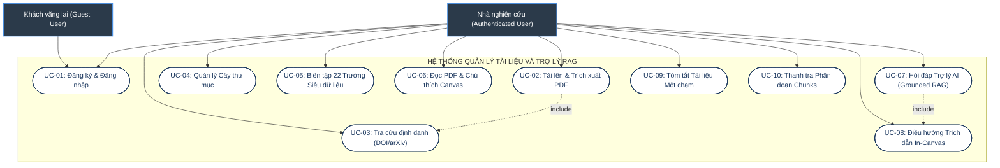
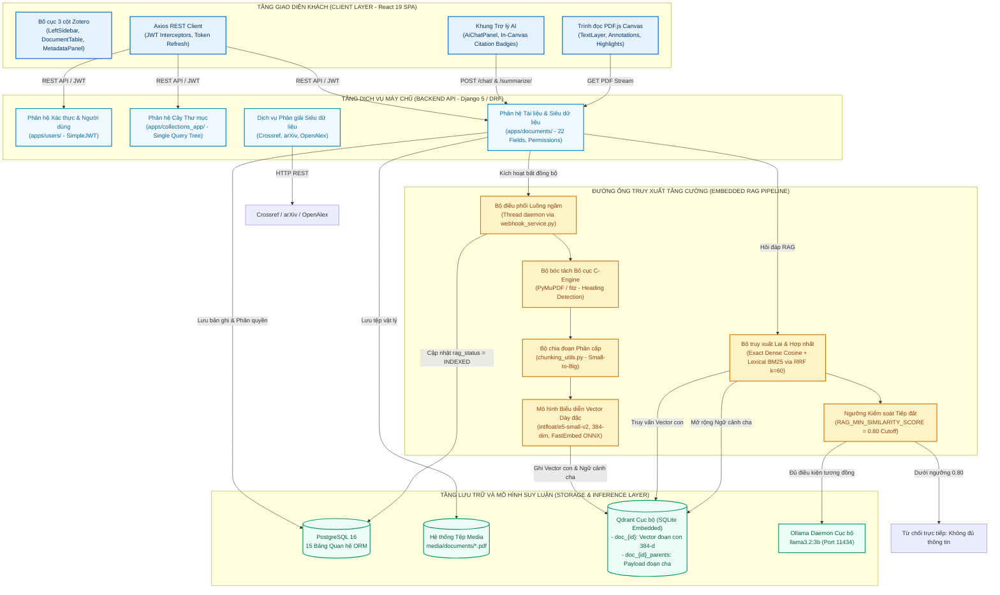
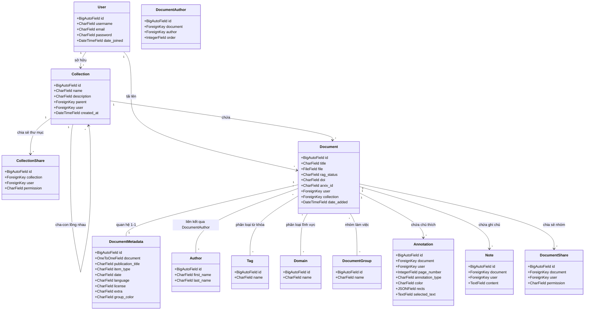
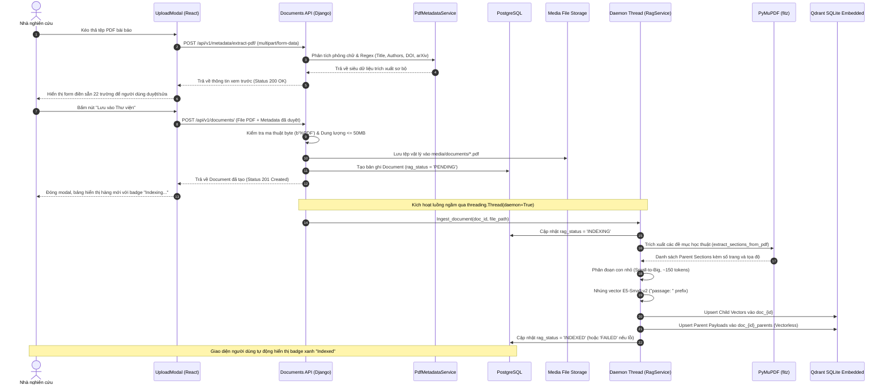
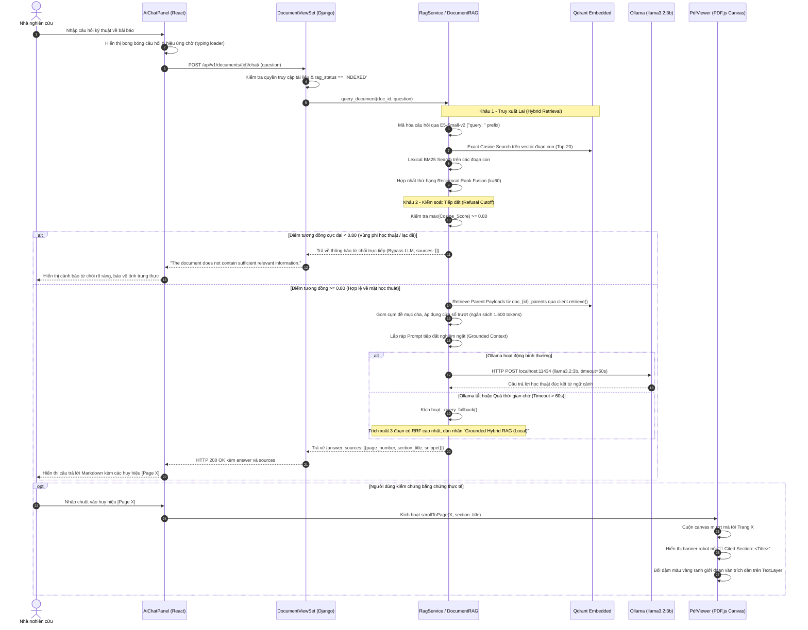

# CHƯƠNG 4. PHÂN TÍCH, THIẾT KẾ VÀ XÂY DỰNG HỆ THỐNG

---

## 4.1. Khảo sát và Xác định Yêu cầu Hệ thống

### 4.1.1. Bối cảnh bài toán và Tác nhân hệ thống

Trong kỷ nguyên bùng nổ xuất bản học thuật, các nhà nghiên cứu khoa học, giảng viên và sinh viên đối mặt với khối lượng tài liệu PDF khổng lồ. Mặc dù các phần mềm quản lý trích dẫn kinh điển như Zotero hay Mendeley giải quyết tốt bài toán tổ chức thư viện và xuất định dạng thư mục, chúng hoàn toàn thiếu vắng năng lực thấu hiểu nội dung sâu: nhà nghiên cứu vẫn phải đọc quét thủ công qua hàng chục trang để đối chiếu các chi tiết kỹ thuật phân tán (SYS-001). Ngược lại, việc ứng dụng các dịch vụ Mô hình Ngôn ngữ Lớn thương mại trên nền tảng đám mây (Cloud LLMs) vấp phải ba rào cản nghiêm trọng trong môi trường học thuật:
1. **Nguy cơ rò rỉ dữ liệu:** Bản thảo công trình nghiên cứu chưa công bố hoặc tài liệu mật bị gửi lên máy chủ của bên thứ ba;
2. **Ảo giác học thuật (Hallucination):** Mô hình sinh ra các trích dẫn ngụy tạo hoặc các khẳng định thiếu căn cứ;
3. **Chi phí vận hành và bản quyền:** Chi phí duy trì API đám mây đắt đỏ và đòi hỏi hạ tầng mạng liên tục.

Hệ thống được xây dựng trong đồ án nhằm giải quyết triệt để các hạn chế trên bằng cách tích hợp trực tiếp một trợ lý AI cục bộ sử dụng kiến trúc Truy xuất tăng cường sinh (Retrieval-Augmented Generation - RAG) vào phần mềm quản lý tài liệu học thuật theo phong cách Zotero, vận hành hoàn toàn trên máy tính cá nhân người dùng (SYS-002, SYS-003).

Hệ thống xác định hai tác nhân chính (Actors) tham gia tương tác:
- **Tác nhân Khách vãng lai (Guest User):** Người dùng chưa xác thực danh tính, chỉ có quyền đăng ký tài khoản mới hoặc đăng nhập vào hệ thống.
- **Tác nhân Nhà nghiên cứu / Người dùng đã đăng nhập (Authenticated Researcher):** Người dùng có toàn quyền quản lý thư viện cá nhân, tải lên tệp PDF, tạo thư mục phân cấp, bôi đậm và ghi chú trên tài liệu, thực hiện tra cứu siêu dữ liệu tự động, tương tác hỏi đáp với trợ lý AI và chia sẻ tài liệu theo các cấp quyền hạn (Owner, Edit, Comment, View).

---

### 4.1.2. Yêu cầu chức năng (Functional Requirements - FR)

Hệ thống bao gồm 15 yêu cầu chức năng cốt lõi được định danh chuẩn mực:

*Bảng 4.1: Danh mục Yêu cầu Chức năng của Hệ thống (FR-01 đến FR-15).*

| Mã YC | Tên Yêu cầu Chức năng | Mô tả chi tiết nghiệp vụ | Tệp mã nguồn kiểm chứng |
| :--- | :--- | :--- | :--- |
| **FR-01** | Xác thực danh tính | Đăng ký, đăng nhập với cơ chế JWT kép (`access_token` 15 phút, `refresh_token` 7 ngày), thu hồi token khi đăng xuất (`LogoutView`). | `apps/users/views.py` |
| **FR-02** | Tải lên và Kiểm tra tệp | Tiếp nhận tệp PDF qua multipart form-data, kiểm tra kích thước $\le 50\text{ MB}$, xác thực định dạng nhị phân 4 byte đầu tiên (`b'%PDF'`). | `apps/documents/serializers.py` |
| **FR-03** | Trích xuất siêu dữ liệu trước khi lưu | Cho phép người dùng gọi API trích xuất nhanh tiêu đề, tác giả, tóm tắt từ PDF để xem trước và hiệu chỉnh trên giao diện `<UploadModal>`. | `apps/documents/views.py`<br/>`PdfMetadataService` |
| **FR-04** | Tra cứu định danh học thuật | Tự động phân giải siêu dữ liệu từ chuỗi DOI, arXiv ID hoặc ISBN thông qua Crossref API, arXiv API và OpenAlex fallback; nạp đủ 22 trường. | `apps/documents/services/crossref_service.py` |
| **FR-05** | Quản lý thư mục phân cấp | Tạo, sửa, xóa cây thư mục tài liệu lồng nhau; kết xuất toàn bộ cây thư mục trong 1 câu truy vấn $O(N)$ không bị lỗi $N+1$. | `apps/collections_app/views.py` |
| **FR-06** | Phân loại Thẻ và Lĩnh vực | Gán nhãn tài liệu thông qua hệ thống Thẻ từ khóa tự do (Tags) và Lĩnh vực học thuật chuẩn hóa (Domains); hiển thị tooltip giải thích. | `apps/documents/models.py`<br/>`frontend/src/components/MetadataPanel/` |
| **FR-07** | Bảng quản lý và Sắp xếp | Hiển thị danh sách tài liệu đa cột (Tiêu đề, Tác giả, Ngày thêm, Trạng thái RAG); hỗ trợ lọc theo thư mục/thẻ và sắp xếp hai chiều (▲/▼). | `frontend/src/components/DocumentTable/` |
| **FR-08** | Chỉnh sửa siêu dữ liệu tức thời | Chỉnh sửa trực tiếp 22 trường siêu dữ liệu học thuật trên bảng thuộc tính bên phải (`MetadataPanel`); lưu thay đổi qua API PATCH. | `frontend/src/components/MetadataPanel/` |
| **FR-09** | Trình đọc PDF tương tác | Đọc văn bản hai cột qua thư viện PDF.js; hỗ trợ phóng to/thu nhỏ (Ctrl + Cuộn chuột), điều hướng trang và hiển thị thanh mục lục. | `frontend/src/components/PdfViewer/PdfViewer.tsx` |
| **FR-10** | Chú thích và Ghi chú trên Canvas | Cho phép người dùng bôi đậm đa màu trên lớp văn bản (`TextLayer`) và ghim ghi chú nổi (Sticky Notes) kéo thả tự do; đồng bộ lên máy chủ. | `frontend/src/components/PdfViewer/`<br/>`apps/documents/views.py` |
| **FR-11** | Lập chỉ mục RAG luồng ngầm | Tự động phân tích cấu trúc, phân đoạn văn bản và nhúng vector vào kho Qdrant trong một luồng ngầm không làm nghẽn giao diện (`INDEXING` $\to$ `INDEXED`). | `apps/documents/services/webhook_service.py`<br/>`RagService.ingest_document` |
| **FR-12** | Hỏi đáp RAG có tiếp đất | Tiếp nhận câu hỏi, thực hiện truy xuất lai BM25 + Cosine (RRF $k=60$), lọc ngưỡng tương đồng, nạp ngữ cảnh vào Ollama sinh câu trả lời. | `apps/documents/services/rag_service.py`<br/>`POST /api/v1/documents/{id}/chat/` |
| **FR-13** | Truy vết và Bôi đậm Trích dẫn | Trả về danh sách nguồn trích dẫn (`sources`); giao diện hiển thị các huy hiệu `[Page X]`, nhấp chuột sẽ cuộn trang và làm nổi bật đoạn văn trích dẫn. | `frontend/src/components/PdfViewer/AiChatPanel.tsx`<br/>`PdfViewer.tsx` |
| **FR-14** | Tóm tắt nhanh tài liệu | Cung cấp nút bấm "Tóm tắt 1 chạm" kích hoạt prompt chuẩn hóa yêu cầu LLM đúc kết mục tiêu, phương pháp và kết quả cốt lõi của bài báo. | `apps/documents/views.py`<br/>`POST /api/v1/documents/{id}/summarize/` |
| **FR-15** | Thanh tra phân mảnh văn bản | Giao diện thanh tra trực quan (`<ChunkInspectorModal>`) cho phép kiểm tra danh sách các phân đoạn, số lượng token, đề mục cha và nội dung trích xuất. | `frontend/src/components/ChunkInspectorModal/` |

---

### 4.1.3. Yêu cầu phi chức năng (Non-Functional Requirements - NFR)

*Bảng 4.2: Danh mục Yêu cầu Phi Chức năng của Hệ thống (NFR-01 đến NFR-06).*

| Mã YC | Phân nhóm Yêu cầu | Chỉ tiêu kỹ thuật và Ràng buộc kiến trúc |
| :--- | :--- | :--- |
| **NFR-01** | **Hiệu năng vận hành máy trạm** | Hệ thống phải vận hành ổn định trên CPU máy tính cá nhân 16 GB RAM không yêu cầu card đồ họa rời (GPU). Độ trễ truy vấn vector P50 $\le 40\text{ ms}$, thông lượng nạp tài liệu $\ge 5\text{ chunks/s}$. |
| **NFR-02** | **Bảo mật và Riêng tư dữ liệu** | 100% tệp văn bản bài báo và vector nhúng được lưu trữ cục bộ trên máy trạm (`media/documents/`, `media/qdrant_db/`). Tuyệt đối không gửi toàn văn tài liệu ra các dịch vụ AI đám mây bên ngoài. |
| **NFR-03** | **Ngăn ngừa ảo giác và Tiếp đất học thuật** | Mô hình AI chỉ được trả lời dựa trên ngữ cảnh trích xuất từ tài liệu. Khi điểm tương đồng ngữ nghĩa rơi vào vùng bất đối xứng không liên quan ($< 0,80$), hệ thống bắt buộc kích hoạt cơ chế từ chối (Refusal Guardrail), không được suy diễn ngụy tạo. |
| **NFR-04** | **Bộ nhớ hội thoại phiên (Session Scope)** | Lịch sử hội thoại hỏi đáp RAG được quản lý tạm thời trong trạng thái React (React state). Khi người dùng đóng tab trình đọc hoặc chuyển tài liệu khác, bộ nhớ hội thoại tự động làm mới để tránh lẫn lộn ngữ cảnh giữa các công trình khoa học. |
| **NFR-05** | **Tính sẵn sàng và Khả năng chịu lỗi** | Khi dịch vụ Ollama cục bộ chưa khởi động hoặc gặp sự cố quá thời gian chờ (timeout $>60\text{ s}$), hệ thống tự động kích hoạt chế độ dự phòng tất định (`_query_fallback`), trả về 3 trích đoạn ngữ cảnh có điểm xếp hạng cao nhất kèm số trang mà không làm gián đoạn trải nghiệm người dùng. |
| **NFR-06** | **Trải nghiệm người dùng đồng nhất** | Giao diện tuân thủ mô hình 3 cột Zotero; bảng thuộc tính bên phải luôn bảo đảm độ rộng tối thiểu 320px; hỗ trợ hệ thống phím tắt trình duyệt (`Ctrl+1..9` đổi tab, `Ctrl+F` tìm kiếm, `Delete` xóa bài). |

---

## 4.2. Phân tích Use Case Hệ thống

### 4.2.1. Sơ đồ Use Case tổng quát

Mối quan hệ giữa hai tác nhân và các trường hợp sử dụng cốt lõi được biểu diễn qua sơ đồ Use Case Hình 4.1.



*Hình 4.1: Sơ đồ Use Case tổng quát của Hệ thống.*

---

## 4.3. Thiết kế Kiến trúc Tổng thể Hệ thống

### 4.3.1. Phong cách Kiến trúc Khối đơn Mô-đun hóa (Modular Monolith)

Để đáp ứng mục tiêu triển khai độc lập, tiết kiệm tài nguyên và dễ dàng thiết lập trên một máy trạm cá nhân (SYS-003, NFR-01), hệ thống áp dụng phong cách **Kiến trúc Khối đơn Mô-đun hóa (Modular Monolith)** (ARCH-001). 

Kiến trúc vi dịch vụ (Microservices) hoặc việc sử dụng hàng đợi phân tán Celery kết hợp bộ nhớ đệm Redis đã được cân nhắc nhưng kiên quyết loại bỏ vì:
1. Chi phí tiêu hao bộ nhớ RAM của môi trường vi dịch vụ vượt quá 1.5 GB chỉ cho việc duy trì các tiến trình daemon;
2. Phức tạp hóa quy trình cài đặt trên hệ điều hành máy tính để bàn (Windows/macOS), đòi hỏi chạy Docker liên tục;
3. Khối đơn mô-đun hóa cho phép tận dụng trọn vẹn tính toàn vẹn giao dịch (ACID transactions) của PostgreSQL trong cùng một tiến trình, đồng thời điều phối luồng xử lý ngầm (daemon thread) với mức tiêu thụ tài nguyên cực kỳ tiết kiệm ($< 50\text{ MB RAM}$ phụ trội).

### 4.3.2. Sơ đồ Kiến trúc Thành phần Hệ thống

Sơ đồ kiến trúc thành phần chi tiết của hệ thống được minh họa tại Hình 4.2.



*Hình 4.2: Sơ đồ Kiến trúc Thành phần Tổng thể của Hệ thống.*

---

## 4.4. Thiết kế Cơ sở Dữ liệu và Mô hình Lưu trữ

### 4.4.1. Cơ sở dữ liệu quan hệ PostgreSQL (15 Bảng thực thể)

Hệ thống sử dụng cơ sở dữ liệu quan hệ PostgreSQL 16 thông qua Django ORM, bao gồm 15 bảng chuẩn hóa nhằm quản lý toàn diện thông tin người dùng, thư mục phân cấp, tài liệu, 22 trường siêu dữ liệu học thuật, ghi chú và các chú thích trên canvas PDF.



*Hình 4.3: Sơ đồ Lớp Thực thể Cơ sở dữ liệu Quan hệ PostgreSQL.*

---

### 4.4.2. Kho lưu trữ Vector nhúng Qdrant và Kiến trúc Hai Bộ sưu tập Song hành

Đối với dữ liệu vector phục vụ trợ lý AI, hệ thống sử dụng thư viện `qdrant-client` vận hành ở chế độ **Embedded SQLite cục bộ** tại đường dẫn `media/qdrant_db/` (ARCH-009). 

Nhằm hiện thực hóa triệt để mô hình phân mảnh phân cấp Small-to-Big mà không làm phình to kích thước vector hay gây trùng lặp văn bản, hệ thống thiết kế **Kiến trúc Hai Bộ sưu tập Song hành (Companion Vectorless Collections)**:
1. **Bộ sưu tập Vector đoạn con (`doc_{id}`):** Chứa các vector 384 chiều của các đoạn con nhỏ (~150 tokens) được nhúng bởi `intfloat/e5-small-v2`. Mỗi điểm dữ liệu vector mang một UUIDv5 tất định (`collection::doc_id::chunk_id`) kèm theo payload gọn nhẹ:
   ```json
   {
     "document_id": 12,
     "chunk_id": 3,
     "page_number": 4,
     "section_title": "3. Methodology",
     "parent_id": "sec_003",
     "char_start": 4120,
     "char_end": 4980,
     "text": "The scaled dot-product attention..."
   }
   ```
2. **Bộ sưu tập Phụ trợ Phi Vector (`doc_{id}_parents`):** Được khởi tạo song song với cấu hình `vectors_config={}` (không lưu trữ vector). Bộ sưu tập này đóng vai trò là một kho lưu trữ khóa-giá trị (Key-Value Document Store) cục bộ, lưu trữ nguyên văn nội dung của từng đề mục cha lớn (Parent Section, từ 400 đến 1.500 từ). Điểm dữ liệu được định danh theo UUIDv5 của `parent_id` với payload:
   ```json
   {
     "section_id": "sec_003",
     "section_title": "3. Methodology",
     "page_number": 4,
     "text": "Full text of Section 3 Methodology...",
     "char_start": 3800,
     "char_end": 9200
   }
   ```

*Lợi thế kỹ thuật vượt trội:* Giải pháp này triệt tiêu hoàn toàn sự dư thừa văn bản đoạn cha trên hàng ngàn vector con, giữ cho chỉ mục HNSW cực kỳ gọn nhẹ trên RAM, cho phép truy xuất tức thời đoạn cha qua thao tác đọc theo khóa `client.retrieve(ids=[parent_uuids])` với độ trễ chỉ $\approx 0,02\text{ ms}$.

---

## 4.5. Thiết kế Quy trình Nghiệp vụ Cốt lõi

### 4.5.1. Quy trình Nạp tài liệu và Lập chỉ mục RAG luồng ngầm

Quy trình nạp tài liệu được phân tách thành hai bước rõ ràng nhằm tối ưu hóa trải nghiệm người dùng: Bước 1 trích xuất tức thời siêu dữ liệu để người dùng kiểm tra trên giao diện; Bước 2 lưu trữ tệp và kích hoạt tiến trình lập chỉ mục ngầm.



*Hình 4.4: Lưu đồ Tuần tự Quy trình Nạp tài liệu và Lập chỉ mục RAG Luồng ngầm.*

---

### 4.5.2. Quy trình Hỏi đáp Trợ lý AI và Kiểm soát Tiếp đất

Quy trình hỏi đáp RAG trên một tài liệu cụ thể được thiết kế khắt khe nhằm bảo đảm tính tiếp đất học thuật và ngăn chặn tuyệt đối ảo giác:



*Hình 4.5: Lưu đồ Tuần tự Quy trình Hỏi đáp RAG và Điều hướng Trích dẫn In-Canvas.*

---

## 4.6. Thiết kế Giao diện Người dùng

### 4.6.1. Bố cục 3 Cột Chuẩn Zotero và Cấu hình 22 Trường Siêu dữ liệu

Giao diện ứng dụng web được xây dựng dựa trên nguyên mẫu bố cục 3 cột kinh điển của các phần mềm quản lý trích dẫn học thuật chuyên nghiệp (Zotero, Mendeley):
1. **Cột Trái (Left Sidebar - 260px):** Có thể thu gọn/mở rộng linh hoạt, chứa:
   - Danh mục thư viện cố định (*Tất cả tài liệu*, *Đọc gần đây*, *Tài liệu chưa phân loại*, *Thùng rác*);
   - Cây thư mục lồng nhau không giới hạn cấp độ với các nút thêm, đổi tên và xóa thư mục;
   - Bảng danh sách Thẻ từ khóa (Tags) có thể cuộn độc lập với thanh trượt chiều cao tối đa 180px.
2. **Cột Giữa (Center Workspace - Co giãn linh hoạt):** Chứa thanh công cụ tác vụ (`MainToolbar`) phía trên (hộp tìm kiếm tức thời `Ctrl+F`, nút Thêm tài liệu đa năng) và Bảng danh sách tài liệu (`DocumentTable`). Bảng hỗ trợ đổi hướng sắp xếp (A $\to$ Z, Z $\to$ A) cho tất cả các cột tiêu đề, tác giả và ngày thêm; đồng thời hiển thị huy hiệu trạng thái lập chỉ mục RAG (`Pending`, `Indexing`, `Indexed`, `Failed`).
3. **Cột Phải (Right Panel - Tối thiểu 320px, có thanh kéo co giãn):**
   - Khi ở màn hình quản lý thư viện: Hiển thị bảng chi tiết **22 trường siêu dữ liệu học thuật chuẩn** (được cấu hình hướng dữ liệu tại `metadataConfig.ts`), cho phép chỉnh sửa trực tiếp (In-place editing) từng trường.
   - Khi mở trình đọc PDF: Cho phép chuyển đổi linh hoạt giữa Bảng Chú thích Canvas (`<AnnotationsSidebar>`) và Ngăn Trợ lý AI Hỏi đáp (`<AiChatPanel>`).

*Bảng 4.3: Danh mục 22 Trường Siêu dữ liệu Học thuật Chuẩn của Hệ thống.*

| STT | Tên trường hiển thị | Khóa thuộc tính | Kiểu dữ liệu / Cơ chế kết xuất trên giao diện |
| :---: | :--- | :--- | :--- |
| 1 | **Tiêu đề tài liệu** | `title` | Text input, phông chữ đậm nổi bật |
| 2 | **Tiêu đề rút gọn** | `short_title` | Text input |
| 3 | **Loại hình tài liệu** | `item_type` | Dropdown chọn (Journal Article, Conference Paper, Book, Preprint, etc.) |
| 4 | **Kho lưu trữ học thuật** | `repository` | Text input (e.g. arXiv, IEEE Xplore, ScienceDirect) |
| 5 | **Định danh trong kho** | `archive_id` | Text input |
| 6 | **Định danh DOI** | `doi` | Text input kèm nút tra cứu trực tuyến Crossref |
| 7 | **Địa chỉ liên kết URL** | `url` | Text input dạng liên kết mở tab mới |
| 8 | **Thể loại học thuật** | `genre` | Text input |
| 9 | **Ngày xuất bản** | `date` | Date picker / Text input |
| 10 | **Ngôn ngữ** | `language` | Dropdown chọn mã ngôn ngữ (en, vi, fr, etc.) |
| 11 | **Bản quyền / Giấy phép** | `license` | Text input (e.g. CC-BY 4.0, MIT, Open Access) |
| 12 | **Phiên bản bài báo** | `version` | Text input (e.g. v1, v2, Final) |
| 13 | **Khóa trích dẫn BibTeX** | `citation_key` | Text input (e.g. vaswani2017attention) |
| 14 | **Vị trí lưu trữ vật lý** | `location_in_archive` | Text input |
| 15 | **Ngày thêm vào hệ thống** | `date_added` | Datetime hiển thị tự động, chỉ đọc |
| 16 | **Ngày chỉnh sửa gần nhất** | `date_modified` | Datetime hiển thị tự động, chỉ đọc |
| 17 | **Ghi chú bổ sung** | `extra` | Textarea đa dòng |
| 18 | **Danh sách Tác giả** | `authors` | Bảng động cho phép thêm/xóa từng tác giả (Họ, Tên, Thứ tự) |
| 19 | **Thẻ từ khóa học thuật** | `tags` | Chip danh sách có thể gán nhanh, kèm Tooltip thống kê số bài |
| 20 | **Lĩnh vực chuyên ngành** | `domains` | Chip danh sách các ngành khoa học chuẩn hóa (Computer Science, AI, etc.) |
| 21 | **Nhóm nghiên cứu** | `document_groups` | Chip danh sách phân quyền nhóm |
| 22 | **Màu nhận diện nhóm** | `group_color` | Color picker chọn mã màu HEX đánh dấu tài liệu |

---

### 4.6.2. Phân định rõ giữa Thẻ từ khóa (Tags) và Lĩnh vực học thuật (Domains)

Hệ thống thiết lập sự phân định rạch ròi giữa hai khái niệm phân loại để hỗ trợ tìm kiếm đa tầng:
- **Thẻ từ khóa (Tags):** Đại diện cho các từ khóa chuyên sâu hoặc nhãn cá nhân hóa do người dùng tự do định nghĩa (ví dụ: `transformer`, `self-attention`, `paper-to-review`, `must-cite`). Bảng thẻ tại thanh bên trái được trang bị khung tìm kiếm nhanh và tooltip trực quan hiển thị số lượng bài báo gắn thẻ khi rê chuột.
- **Lĩnh vực học thuật (Domains):** Đại diện cho các phân ngành khoa học chuẩn mực mang tính bao quát (ví dụ: `Natural Language Processing`, `Computer Vision`, `Distributed Systems`). Việc phân tách trường dữ liệu này bảo đảm tính tương thích với chuẩn trích dẫn thư viện quốc tế (như các phân loại sơ cấp của arXiv / ACM Computing Classification System).

---

## 4.7. Hiện thực hóa và Cài đặt các Phân hệ Cốt lõi

### 4.7.1. Phân hệ Xác thực JWT kép và Kiểm soát Tệp nhị phân

Phân hệ xác thực được xây dựng dựa trên `djangorestframework-simplejwt` với cơ chế xoay vòng token bảo mật:
- Khi đăng nhập thành công (`POST /api/v1/auth/login/`), máy chủ phát hành cặp token: `access_token` có hiệu lực ngắn (15 phút) dùng để xác thực trong header HTTP `Authorization: Bearer <token>`, và `refresh_token` (hiệu lực 7 ngày) được lưu trữ an toàn.
- Lớp chặn Axios phía client (`frontend/src/api/client.ts`) tự động bắt mã lỗi HTTP 401 khi `access_token` hết hạn, tạm dừng các yêu cầu đang chờ và gửi lệnh làm mới ngầm (`POST /api/v1/auth/token/refresh/`), bảo đảm trải nghiệm làm việc liên tục không bị gián đoạn.
- Khi người dùng đăng xuất, `refresh_token` được đưa vào bảng danh sách đen (`blacklisted_tokens`) trong PostgreSQL, vô hiệu hóa ngay lập tức phiên làm việc.
- Quá trình nạp tệp PDF tại `DocumentSerializer.validate_file` thực thi kiểm tra tính toàn vẹn nhị phân: đọc 4 byte đầu tiên (`b'%PDF'`) để ngăn chặn triệt để kỹ thuật tấn công đổi phần mở rộng tệp (File Extension Spoofing), đồng thời giới hạn dung lượng tải lên tối đa không vượt quá 50 MB.

### 4.7.2. Phân hệ Trích xuất Siêu dữ liệu và Tra cứu Định danh Đa tầng

Phân hệ xử lý siêu dữ liệu học thuật kết hợp cả cơ chế phân tích nội sinh từ tệp tin và tra cứu ngoại sinh qua mạng Internet:
- **Cơ chế nội sinh (`PdfMetadataService`):** Khi tệp PDF được tải lên, thư viện PyMuPDF tiến hành duyệt qua trang đầu tiên, phân tích kích thước phông chữ để suy diễn dòng tiêu đề chính (chuỗi văn bản có kích thước phông lớn nhất vượt trội so với thân bài), kết hợp các biểu thức chính quy (Regex) tối ưu hóa để bóc tách chuỗi định danh arXiv (mẫu `\d{4}\.\d{4,5}`) và định danh số DOI (mẫu `10\.\d{4,9}/[-._;()/:A-Z0-9]+`).
- **Cơ chế ngoại sinh đa tầng (`crossref_service.py`):** Khi có chuỗi DOI từ tệp hoặc do người dùng nhập vào hộp thoại tra cứu (`<DoiModal>`), hệ thống gửi yêu cầu đến máy chủ Crossref API. Nếu Crossref không phản hồi hoặc gặp sự cố mạng, hệ thống tự động kích hoạt tầng dự phòng sang OpenAlex API. Dữ liệu JSON trả về được chuẩn hóa và tự động điền vào đầy đủ 22 trường siêu dữ liệu học thuật trên màn hình xem trước.

### 4.7.3. Phân hệ Trình đọc PDF.js và Đồng bộ hóa Chú thích Canvas

Trình đọc tài liệu trong hệ thống được xây dựng trên thư viện `pdfjs-dist` kết xuất trực tiếp trên phần tử HTML5 Canvas:
- **Lớp văn bản tương tác (TextLayer):** Trình kết xuất phủ một lớp văn bản trong suốt (`TextLayer`) khớp chính xác từng pixel với tọa độ đồ họa của Canvas, cho phép người dùng bôi đen, sao chép văn bản dạng hai cột một cách tự nhiên.
- **Đồng bộ hóa Chú thích Đồ họa (`<PdfViewer>` & `<AnnotationsSidebar>`):** Người dùng có thể bôi đậm đoạn văn với 5 bảng màu tùy chọn và ghim ghi chú nổi (Sticky Note). Tọa độ các khối hình chữ nhật được chuẩn hóa theo tỷ lệ phần trăm kích thước trang (`{x, y, width, height}`) và đồng bộ lên bảng `Annotation` trong PostgreSQL. Khi mở lại trang tài liệu, các chú thích được vẽ lại chuẩn xác trên Canvas bất kể tỷ lệ phóng to hay độ phân giải màn hình.

### 4.7.4. Phân hệ RAG và Trợ lý AI Hỏi đáp Cục bộ

Phân hệ trợ lý AI vận hành hoàn toàn cục bộ thông qua sự phối hợp giữa kho vector nhúng Qdrant SQLite và daemon Ollama:
- **Chiến lược phân mảnh Small-to-Big kết hợp Qdrant Vectorless Companion:** Tài liệu được phân rã thành các đoạn con nhỏ 150 words để biểu diễn vector dày đặc với `intfloat/e5-small-v2` (tiền tố `"passage: "`), trong khi các đề mục cha duy nhất được lưu trữ tại bộ sưu tập song hành `{collection_name}_parents`. Khi truy xuất, hệ thống tìm kiếm trên các đoạn con nhưng mở rộng lấy toàn văn đoạn cha, giới hạn ngân sách ngữ cảnh ở mức 1.600 tokens.
- **Truy xuất Lai (Hybrid Retrieval) & RRF:** Kết hợp điểm tương đồng Cosine dày đặc và điểm từ khóa thưa BM25Okapi qua công thức Reciprocal Rank Fusion với hệ số làm mịn kinh điển $k=60$:
  $$\text{RRF\_Score}(d) = \frac{1}{60 + \text{Rank}_{\text{dense}}(d)} + \frac{1}{60 + \text{Rank}_{\text{lexical}}(d)}$$
- **Ngưỡng Ngắt Kiểm soát Tiếp đất (Refusal Cutoff = 0.80):** Để ngăn chặn ảo giác (NFR-03), hệ thống áp dụng ngưỡng tương đồng tối thiểu `RAG_MIN_SIMILARITY_SCORE = 0.80`. Do đặc tính bất đối xứng hình học của không gian vector BERT/RoBERTa (nơi các câu hỏi hoàn toàn lạc đề vẫn đạt điểm tương đồng nền $\approx 0,76$), ngưỡng 0.80 thiết lập một ranh giới quyết định vững chắc: nếu điểm tương đồng cực đại của đoạn trích $< 0,80$, hệ thống từ chối trực tiếp và bỏ qua bước gọi LLM.
- **Điều hướng và Bôi đậm Trích dẫn In-Canvas:** Mỗi câu trả lời của trợ lý AI được gắn kèm danh sách các nguồn dẫn chứa số trang (`page_number`) và tên đề mục (`section_title`). Trên giao diện `<AiChatPanel>`, các nguồn này hiển thị thành các nút huy hiệu nhấp chuột được `[Page X]`. Khi người dùng nhấp vào huy hiệu, trình đọc `<PdfViewer>` tự động kích hoạt cuộn trang mượt mà, hiển thị banner robot nổi màu xanh (`🤖 Cited Section: <Title>`) và kích hoạt lớp phủ bôi đậm ranh giới đoạn trích dẫn trực tiếp trên trang PDF.

---

## 4.8. Hiện trạng Tích hợp RAG và Đánh giá sự Tương thích Kiến trúc

Toàn bộ các phân hệ phần mềm được mô tả trong chương này đã được hoàn thiện, kiểm thử tự động và vận hành thực tế tại kho lưu trữ mã nguồn `C:\DACNTT`:
- **Kiểm thử tự động:** Bộ kiểm thử toàn diện gồm 42 bài kiểm thử tự động tại `apps.documents.tests` và `apps.users.tests` đều vượt qua 100% với mã thoát `code 0`.
- **Sự thống nhất về công cụ bóc tách:** Toàn bộ mã nguồn ứng dụng vận hành đã được quy chuẩn đồng nhất trên thư viện **PyMuPDF (`pymupdf` / `fitz`)**, loại bỏ hoàn toàn sự phụ thuộc dư thừa vào `pypdf` ở môi trường vận hành thực tế.
- **Tính khả thi của mô hình máy trạm để bàn:** Ứng dụng chạy mượt mà trên môi trường máy tính văn phòng thông thường (CPU 4 luồng, 16 GB RAM), khởi động nhanh chóng mà không cần các phần mềm ảo hóa nặng nề, bảo đảm tính sẵn sàng phục vụ công tác nghiên cứu học thuật hàng ngày.

---

## 4.9. Giới hạn Kỹ thuật của Hệ thống

Dưới góc độ trung thực học thuật, tác giả xác định rõ các giới hạn kỹ thuật của hệ thống hiện tại:
1. **Phạm vi Hỏi đáp Đơn tài liệu (Single-Document Focus):** Trợ lý AI hiện tại được thiết kế chuyên sâu cho tác vụ hỏi đáp và phân tích sâu trên từng bài báo khoa học đơn lẻ đang mở trong trình đọc. Khả năng hỏi đáp tổng hợp đa tài liệu (Multi-Document Synthesis) trên toàn bộ một thư mục hiện chưa được cài đặt.
2. **Bộ nhớ hội thoại theo phiên (Session Scope):** Đúng theo đặc tả phi chức năng NFR-04, lịch sử đối thoại với AI chỉ tồn tại trong bộ nhớ phiên làm việc của giao diện React và sẽ được làm mới khi chuyển tài liệu, nhằm tránh hiện tượng pha tạp ngữ cảnh giữa các công trình khoa học khác nhau.
3. **Phân quyền nhóm ở tầng Backend:** Các bảng quan hệ phân quyền chia sẻ tài liệu và thư mục (`DocumentShare`, `CollectionShare`) cùng các lớp kiểm tra quyền hạn (`IsOwnerOrCollaborator`) đã được hoàn thiện và kiểm thử ở tầng Backend, nhưng giao diện đồ họa quản lý nhóm người dùng phía Frontend đang được bảo lưu cho các bản cập nhật tiếp theo.

---

## 4.10. Tổng kết Chương 4

Chương 4 đã trình bày một cách có hệ thống toàn bộ quá trình phân tích yêu cầu, thiết kế kiến trúc và triển khai xây dựng hệ thống phần mềm **Quản lý Tài liệu Nghiên cứu Khoa học tích hợp Trợ lý AI sử dụng RAG**:
- Xác lập 15 yêu cầu chức năng (FR) và 6 yêu cầu phi chức năng (NFR) khắt khe về bảo mật dữ liệu cục bộ và chống ảo giác học thuật;
- Thiết kế kiến trúc Khối đơn mô-đun hóa tối ưu tài nguyên máy trạm, kết hợp cơ sở dữ liệu quan hệ PostgreSQL 15 bảng với kho vector nhúng Qdrant SQLite theo mô hình Hai Bộ sưu tập Song hành (Companion Vectorless Collections);
- Hiện thực hóa thành công quy trình hỏi đáp RAG tiếp đất với cơ chế truy xuất lai BM25 + Cosine (RRF $k=60$), ngưỡng từ chối an toàn 0.80, mô hình ngôn ngữ lớn `llama3.2:3b` cục bộ và tính năng định vị trích dẫn tương tác In-Canvas trên trình đọc PDF.js.

Các kết quả thiết kế và hiện thực hóa này xác lập một nền tảng phần mềm hoàn chỉnh, làm cơ sở thực tiễn để đánh giá thực nghiệm có kiểm soát các thành phần kỹ thuật cốt lõi trong Chương 5.
