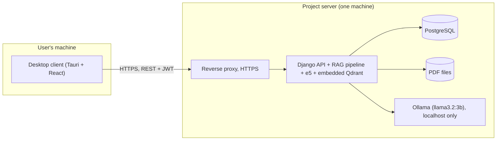

# Deployment plan: desktop client + project-hosted server (proof of concept)

> **Deferred until after the graduation project (decided 2026-11-05).** Hosting a server and building the client is too heavy and costly for the remaining project time. For the thesis, the system is a proof of concept that runs locally on one machine, and this client/server model appears only as a future extension (thesis §4.3.2 "Hướng mở rộng" and §6.3 item 5). The thesis does not mention the deferral itself. The plan below is kept for later.

**Scope.** The app is a **proof of concept**. Users install a small desktop client on their own machine. The client calls a REST API on **one server hosted by the project team**, which runs the backend, the database, the PDF and vector storage, the embedding model and the LLM (Ollama). No third-party AI service is used.

**Not scalable as is.** The server design is the single-machine design that was evaluated. It is meant to demonstrate the system to a handful of users, not to serve real traffic. Section 4 lists exactly why, and what would have to change.

**Status.** Deferred (see the note above). Today the app runs from source on one machine (`npm start`: Vite dev server, Django on :8000, a local PostgreSQL and a separately installed Ollama).

---

## 1. What runs where

| Part | Today | Planned deployment |
|---|---|---|
| Window / UI | React app in a browser (Vite dev server) | **Desktop client (user's machine).** A **Tauri 2** window (WebView2) showing the built React app (`frontend/dist`); NSIS `.exe` installer, a few tens of MB |
| Backend API | `python manage.py runserver` | **Project server.** Django behind a production WSGI server (gunicorn/waitress) and a reverse proxy with HTTPS (Caddy or nginx) |
| Database | PostgreSQL 16 on the dev machine | **Project server.** PostgreSQL 16 (unchanged) |
| PDF files | `backend/media/` | **Project server** disk. Before any outside user, files must be served behind permission checks (`FILE_STORAGE_PLAN.md`) |
| Vector store | Embedded Qdrant (`media/qdrant_db/`) | **Project server**, same embedded mode (one process) |
| Embedding model | `intfloat/e5-small-v2` in the Django process | **Project server**, same |
| LLM | Ollama installed by the user | **Project server.** Ollama + `llama3.2:3b`, reachable only from the backend (not exposed to the internet) |

The client contains no models and no backend; it needs a network connection to the project server for everything except showing the login screen.

## 2. Runtime flow

1. The user installs the client and opens it. The server address is set at build time (with an override in a `config.json`).
2. The user registers or logs in; the client stores the JWT pair and refreshes the access token as today.
3. Uploads, library management, the PDF viewer, Q&A and summaries all go through the existing REST API. Indexing runs on the server in the existing background thread.
4. If the server cannot be reached, the client shows a connection error (the demo data fallback is disabled in release builds).

Accounts are real server accounts, so the existing sharing permissions (owner, EDIT, COMMENT, VIEW) apply across users.

## 3. Work items

| # | Task | Notes | Effort |
|---|---|---|---|
| 1 | **Production settings** | `DEBUG=False`, `ALLOWED_HOSTS`, CORS for the client origin, secrets from env, gunicorn/waitress instead of `runserver` | 0.5 day |
| 2 | **Server setup** | One Linux VM (≥ 8 vCPU, ≥ 16 GB RAM, no GPU, as evaluated): PostgreSQL, Ollama bound to localhost, reverse proxy with a TLS certificate, firewall allowing only 443 | 1 day |
| 3 | **Protected PDF access** | At minimum: stop serving `/media/` publicly and stream PDFs through a permission-checked endpoint (smallest part of `FILE_STORAGE_PLAN.md`) | 0.5–1 day |
| 4 | **Frontend API URL** | Read the server URL from build config / `config.json` instead of `VITE_API_URL`; disable the offline demo fallback in release builds | 0.5 day |
| 5 | **Tauri client** | `tauri init`, window, icon, version; NSIS installer | 1 day |
| 6 | **Basic protection** | Per-user rate limit on `/chat/` and `/summarize/` (DRF throttling), upload size limit (exists), request timeouts | 0.5 day |
| 7 | **Backups** | Nightly `pg_dump` and a copy of `media/`; Qdrant is rebuildable from the PDFs | 0.5 day |
| 8 | **Test** | Install the client on a clean Windows machine; register, upload, index, ask, summarise, share with a second account; restart the server and check recovery of stuck indexing jobs | 1 day |
| 9 | **Docs and licences** | User guide (install, server address, expected ~30 s answers); licence notices: Llama 3.2 Community Licence, Ollama (MIT), e5 (MIT), PyMuPDF (AGPL, network use: source must be available) | 0.5 day |

**Total: about 6–7 working days for one person.**

## 4. Why this does not scale, and what would be needed

The measured costs come from the evaluation machine (8-core CPU, 16 GB RAM).

| Limit | Cause in the current design | Effect | What a scalable version would need |
|---|---|---|---|
| **One answer at a time** | Ollama on CPU, ~30 s per answer with retrieved contexts; requests queue | With N users asking at once, the last waits about N × 30 s; HTTP timeouts (60 s) trigger the fallback answer | GPU inference server (e.g. vLLM), several replicas, a request queue with streaming responses |
| **Memory** | Ollama uses 4.5–6.9 GB, the embedder and Django the rest of a 16 GB machine | No headroom for more models or workers | Separate LLM, embedding and API machines |
| **Single process** | Embedded Qdrant (local mode) allows one process; embedding model lives in that process | Cannot run several API workers or machines | Qdrant as a separate service; embedding as a service |
| **Indexing in threads** | Background thread inside the web process | Jobs lost on restart (only stuck rows are recovered), no retries, competes with requests for CPU | Job queue (Celery/RQ + Redis) and separate workers |
| **Vector search** | Local-mode Qdrant does exact (brute-force) search per document collection | Fine per document, but grows with corpus size; no cross-document index | Qdrant server with HNSW indexes |
| **Storage** | PDFs on one disk | No redundancy; disk size caps the library | Object storage (S3/MinIO, `FILE_STORAGE_PLAN.md`) |
| **One machine** | Everything on one VM | Single point of failure; no rolling updates | Load balancer, multiple app instances, managed database |
| **No operations tooling** | No monitoring, alerting or load testing | Capacity is unknown beyond the single-user measurements | Metrics, logs, load tests before any real launch |
| **Security review** | Not done beyond JWT, permissions and the question filter | Not suitable for confidential documents of real users | Security review, encryption at rest, data-retention policy |

**Privacy note.** Documents leave the user's machine and are stored on the project server. They are not sent to any third-party AI provider, but users must trust the project server's operator.

## 5. Order and timing

Not before the graduation project is finished. Order: production settings and server (1, 2), protected PDFs (3), client (4, 5), protection and backups (6, 7), test and docs (8, 9).
