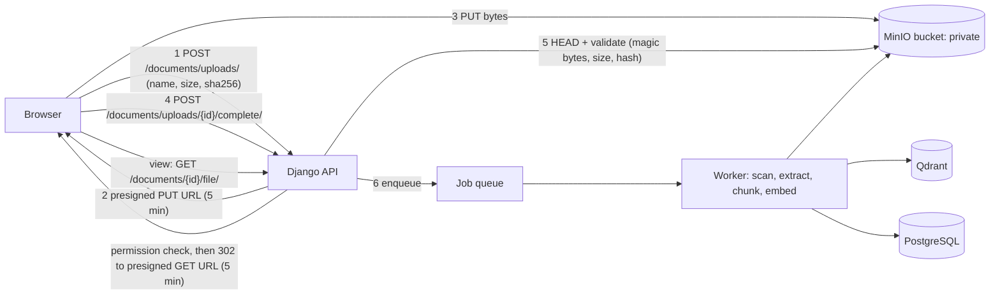

# File Storage Plan: Production-Style PDF Storage

**Status:** planned follow-up, **not started**. It runs after RQ6 (the confirmatory end-to-end evaluation), because it changes the upload and ingestion path the experiments rely on.
**Recorded:** 2026-10-31.
**Origin:** the user asked how a real website would save the PDFs. This is the agreed sketch for this project.

## 1. Current state (verified 2026-10-31)

| Aspect | Today | Problem |
|---|---|---|
| Where PDFs live | Server disk, `backend/media/documents/` (`Document.file = FileField(upload_to='documents/')`, `MEDIA_ROOT = BASE_DIR / 'media'`) | Tied to one machine; app servers are not disposable; no versioning |
| How they're served | `core/urls.py`: `static(settings.MEDIA_URL, document_root=MEDIA_ROOT)` when `DEBUG` | **No permission check.** Anyone with the URL can download any user's PDF. File names are the original upload names, so URLs are guessable |
| What the API returns | `FileUrlMixin.get_file_url` → absolute `/media/documents/<name>.pdf` | A permanent public link |
| Metadata stored | `file` path, `file_size` | No content hash, no MIME type, no upload state |
| Duplicates | `duplicate` copies the file; delete keeps files still referenced (fixed 2026-10-29) | Each copy stores the bytes again |
| Validation | `.pdf` extension, `%PDF-` magic bytes, 50 MB limit (`serializers.py`) | No virus scan, no per-user quota |
| Processing | Indexing in an in-process worker thread (`webhook_service.py`, single queue since 2026-10-30) | Lost on restart, apart from the startup recovery of stuck INDEXING rows |
| Derived data | Qdrant embedded store, `backend/media/qdrant_db/` | Fine: rebuildable from the PDFs |
| Tests | Upload tests write into the real `media/documents/` | Left 269 fake stub files behind (deleted 2026-10-30, list in `reports/audit/deleted_orphan_media_files.json`) |

## 2. Target design (kept on the local machine, behaving like production)

### Components
- **Object storage:** MinIO in Docker (`docker-compose.storage.yml`, a persistent volume, one private bucket `documents`). It speaks the S3 API, so moving to AWS S3, GCS or Azure later needs only a settings change.
- **Django integration:** `django-storages[s3]` + `boto3`, configured in `STORAGES["default"]`. `FileField` keeps working. Keys look like `documents/<sha256[:2]>/<sha256>.pdf` (content-addressed, not guessable, deduplicated).
- **Database changes** (one migration):
  - New model `StoredFile`: `sha256` (unique), `size`, `mime_type`, `storage_key`, `status` (UPLOADING / QUARANTINED / AVAILABLE / REJECTED), `created_at`, `ref_count`, or reference counting by query.
  - `Document.file` → `Document.stored_file = ForeignKey(StoredFile, null=True)`.
  - Duplicates share one `StoredFile`. The bytes are deleted only when no document references them.
- **Upload flow:** presigned PUT, then a `complete` call, then server-side validation. Validation checks: the `%PDF-` magic bytes, size ≤ 50 MB, a hash matching the client's claim, and a per-user quota.
  - **Virus scan:** ClamAV (`clamd` container) scans the file before it is marked AVAILABLE. Files stay QUARANTINED until then.
  - **Fallback:** keep a direct multipart upload endpoint for tests and offline use, writing through the same storage backend.
- **Download flow:** `GET /documents/{id}/file/` checks `IsOwnerOrCollaborator` (VIEW and above), then redirects to a presigned GET URL valid for a few minutes. **Remove the public `/media/` route** for documents. The serializer's `file_url` points to this endpoint instead of `/media/...`.
- **The frontend viewer:** pdf.js loads the `/file/` URL with the JWT, or the redirect target, and never a permanent public link.
- **Background processing:** Celery + Redis (or RQ), replacing the in-process thread. Jobs: scan → extract → chunk → embed → index. They are retried, survive restarts, and keep the existing PENDING → INDEXING → INDEXED/FAILED status values.
- **Deletion and recovery:**
  - Soft delete: `Document.deleted_at`, purged after 30 days.
  - Bucket versioning on, so overwrites and deletes can be recovered.
  - Account deletion purges the user's unreferenced files (privacy).
- **Backups:**
  - PostgreSQL: `pg_dump`, daily.
  - Bucket: MinIO mirror or S3 replication.
  - Qdrant: no backup needed; rebuild with `manage.py reindex_documents`.
  - Test a restore once.
- **Environments:**
  - Tests use `override_settings(STORAGES=...)` with an in-memory storage or a temporary directory, never the real bucket or `media/`.
  - Dev and prod use separate buckets.

## 3. Migration of existing data
1. Back up `backend/media/documents/` and the database.
2. Run a management command `migrate_files_to_storage`. For each Document with a file:
   - hash it, then upload it to the bucket if that hash is new;
   - create or reuse a `StoredFile` and link it.
3. Verify every document resolves through `/file/`, and that the hashes match the old files.
4. Keep `media/documents/` read-only for one release, then remove it.
5. The 10 test-stub documents (ids 1–10: 30–47 byte fake PDFs, kept by the user on 2026-10-30) fail validation. Decide at that point whether to delete them or mark them REJECTED.

## 4. Order of work and effort (rough)
| Step | Effort |
|---|---|
| MinIO compose + django-storages config + private bucket | 0.5 day |
| `StoredFile` model, migration, dedup and ref counting, data migration command | 1 day |
| Presigned upload/complete endpoints + validation + quota | 1 day |
| `/file/` download endpoint, remove the public `/media/` route, update the serializer, update the frontend viewer and upload | 1 day |
| Celery/RQ worker replacing the in-process queue | 0.5–1 day |
| ClamAV scan + quarantine status | 0.5 day |
| Tests (isolated storage), soft delete, backup and restore notes | 1 day |

## 5. Constraints and notes
- **Not before RQ6.** RQ6 ingests PDFs through `rag_service.ingest_document` reading local files from `eval/pdfs/`, so it doesn't depend on `media/`. Even so, changing the app's ingestion path during the evaluation window is avoided.
- **Prefer the smallest step if time is short:** steps 1–4 of the table close the security hole (public, guessable PDF URLs) and give dedup and hashes. Celery and ClamAV are optional for a thesis demo.
- **Teammate's branch:** `origin/main` (hyperded) moved `backend/scripts/` and rewrote `chunkers.py`. Rebase this work on the merged main after RQ6.
