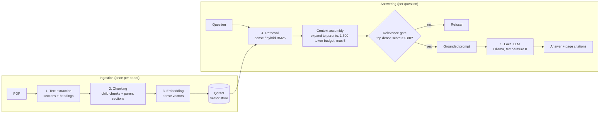
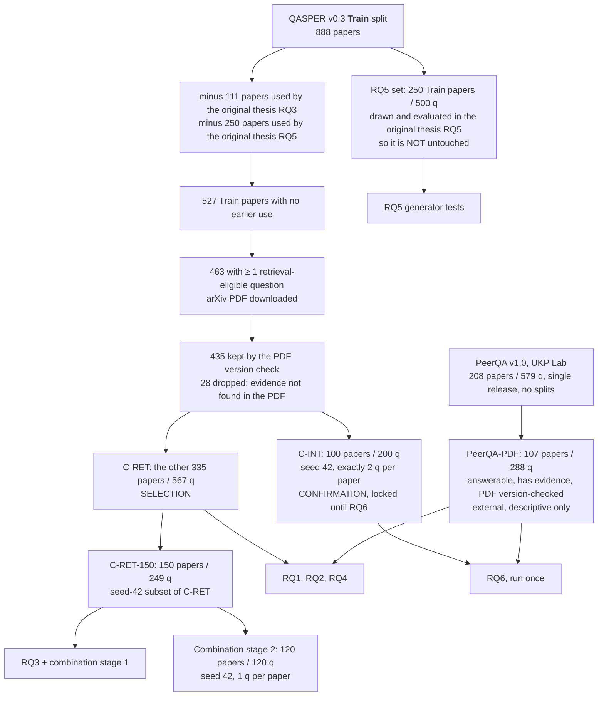

# Progress Report: Experimental Evaluation of the Local RAG Pipeline

*Scientific Document Manager: a Zotero-style app with grounded Q&A over a single paper*
**Last updated:** 2026-10-30. This file is updated after every experiment; see the changelog at the end.

---

## 1. The system we are evaluating

A user opens one paper in the app and asks a question. The app answers using only that paper and cites the passages it used. Everything runs locally on a CPU-only laptop: Ryzen 7 7735HS, 13.7 GB RAM, no GPU.

**Production configuration today:**
- **Extraction:** `pymupdf_layout`.
- **Chunking:** hierarchical (200-token children with 40 overlap, expanded to parent sections).
- **Embedder:** `intfloat/e5-small-v2`.
- **Retrieval:** dense (changed from RRF hybrid after RQ4).
- **LLM:** `llama3.2:3b`.

---

## 2. Zoom-in: the five components we experiment on

| # | Component | What it does | Candidates tested | How it is measured |
|---|---|---|---|---|
| 1 | **Extraction** | PDF → text with section structure | `pymupdf_layout`, `pymupdf_plain`, `pypdf`, `pdfminer.six`, `pdfplumber`, GROBID (add-on) | Evidence recall (is the gold evidence text recovered?), heading F1, ms/page, memory, downstream retrieval |
| 2 | **Chunking** | Splits text into retrievable units | `fixed_size` (400), `section_overlap` (400/80), `hierarchical` (small-to-big, 200/40 → parents), children-only control, semantic (2 versions, extension) | Context evidence coverage (CEC), budgeted nDCG@10, context size |
| 3 | **Embedding** | Turns chunks and questions into vectors | MiniLM-L6, e5-small-v2, arctic-embed-s, bge-small, ModernBERT-embed, SPECTER2 (extension) | Budgeted nDCG@10, CEC, query latency, indexing throughput, RAM |
| 4 | **Retrieval** | Ranks chunks for a question | dense, BM25, RRF hybrid (production and fixed tokenizer), convex hybrid, + cross-encoder reranking (extension) | Budgeted nDCG@10, CEC, added latency |
| 5 | **Generation (LLM)** | Writes the answer from the context | llama3.2:1b/3b, qwen2.5:0.5b/1.5b, phi4-mini | Token F1, refusal rate, Boolean accuracy, human faithfulness review, latency, RAM, rerun stability |

**Key terms:**
- **Budgeted** means every metric is computed on exactly the context the LLM would receive: at most 1,600 estimated tokens and 5 units.
- **CEC (context evidence coverage)** means the assembled context contains ≥ 50% of the content words of at least one gold evidence paragraph. It is a new metric we validate below.

---

## 3. Study design: three parts

| Part | Role | Question it answers |
|---|---|---|
| **RQ1–RQ5** | Component analysis (one factor at a time) | What does each component contribute, at what cost, and why? |
| **Combination test (2 stages)** | Interaction analysis and final selection | Do components interact? Which full pipeline + LLM is best? |
| **RQ6** | Confirmation on untouched papers | Does the chosen system hold up, and how much does retrieval cost vs gold evidence? |

**Why all three parts are needed:**
- **RQ1–RQ5** explain *why*. They measure each stage with its own metric:
  - extraction losses (RQ1);
  - the generator's ceiling on perfect evidence (RQ5);
  - the cost of each component.

  They also decide which candidates are worth combining.
- **The combination test** answers the professor's point: stage-wise winners are not automatically the best *pipeline*. It brute-forces the combinations and picks the final system. Interpreting it relies on RQ1–RQ5.
- **RQ6** is needed because picking the best of many combinations is partly luck (the "winner's curse"). The winner is tested once on papers no selection step has seen.

### Data flow: selection vs confirmation

**How each set was made:**
- **All QASPER cohorts come from the Train split.** The Dev and Test splits were already used by the original thesis (RQ1–RQ4), so none of their papers are reused here.
- **C-RET and C-INT** are the 435 Train papers that no earlier experiment touched and whose downloaded PDF contains the annotated evidence. C-INT took 100 of them (seed 42, two questions each); C-RET is all the rest. The two share no papers.
- **The RQ5 set** is also from Train, but it is the 250-paper, 500-question sample that the original thesis already evaluated in its RQ5. It shares no papers with C-RET or C-INT. Because it has been used before, its results count as selection evidence, not confirmation.
- **PeerQA** is a separate dataset with a single release and no train/dev/test split. 110 of its 208 papers have an answerable question with evidence sentences; 107 of those passed the PDF version check.

### Statistical conventions (fixed before any results)
- **Bootstrap:** paired, resampling **papers** rather than questions (questions from one paper are correlated). B = 10,000, seed 42, 95% intervals.
- **Multiple comparisons:** Holm correction within each pre-declared family.
- **Adoption rule:** a challenger replaces production only if it beats it by a pre-set margin (SESOI), the CI lower bound is > 0, and its costs stay within limits. Otherwise production stays. "Not significant" is never reported as "equal".
- **Pre-registration:** every protocol, script and decision rule was SHA-256-hashed into an append-only registry before it ran (`eval/experiment_provenance_registry.json`). Deviations are recorded, never silently fixed.

---

## 4. Data: rough EDA

The source is **QASPER v0.3** (NLP papers from arXiv):
- Questions were written by NLP practitioners who had read only the title and abstract.
- Answers and evidence paragraphs were written by others who read the full paper.
- Our new cohorts (C-RET, C-RET-150, C-INT) use only **Train-split** papers that no earlier experiment touched, with a PDF that downloads and whose text contains the annotated evidence (version check ≥ 70%). The RQ5 set is a Train-split sample the original thesis already evaluated.

The external check is **PeerQA** (UKP 2025, CC BY-NC-SA): reviewer questions with author answers, on OpenReview ML papers plus a few EGU geoscience papers.

| | C-RET (selection) | C-RET-150 | C-INT (confirmation) | PeerQA-PDF (external) | RQ5 500q |
|---|---|---|---|---|---|
| Source | QASPER v0.3 Train, unused before | subset of C-RET | QASPER v0.3 Train, unused before | PeerQA v1.0 (single release) | QASPER v0.3 Train, evaluated in the original RQ5 |
| Papers / questions | 335 / 567 | 150 / 249 | 100 / 200 | 107 / 288 | 250 / 500 |
| Questions per paper | 1 for 212 papers; up to 6 | 1 for 96 papers; up to 6 | exactly 2 | mean 2.7 (1–9) | 2 |
| Extractive / abstractive / yes-no | 60% / 25% / 15% | 60% / 26% / 14% | 61% / 25% / 15% | free-form (181 with an answer, 107 without) | 64% / 22% / 14% |
| Question length (words, median) | 8 | 8 | 8 | 15 | — |
| Evidence per question | 1.7 paragraphs, median 126 words | 1.8 paragraphs, 130 words | 1.7 paragraphs, 120 words | 4.0 sentences | 121 words |
| Question–evidence word overlap (Jaccard) | 0.043 | 0.043 | 0.038 | 0.095 | — |
| Paper length (words, median / P95) | 3,495 / 7,106 | 3,495 / 7,106 | 3,662 / 6,681 | — | — |
| Sections per paper (median) | 13 | 13 | 13 | — | — |
| PDF pages (median / P95) | 10 / 22 | 10 / 22 | 10 / 18 | 21 / 43 | — |

**What the EDA tells us:**
1. **Questions share almost no words with their evidence** (Jaccard ≈ 0.04). Keyword search (BM25) has little to match on, which motivates dense retrieval and explains why BM25-only does badly (RQ4).
2. **The evidence is short:** about 130 words in 1–2 paragraphs, inside papers of about 3,500 words. Finding it is a needle-in-a-haystack problem, and the 1,600-token context budget covers roughly a third of a paper.
3. **The three QASPER cohorts look alike** (same type mix, lengths and overlap), so selection results should transfer to the confirmation set.
4. **PeerQA is a different regime:**
   - questions are twice as long, with more word overlap;
   - papers are twice as long;
   - 107 of 288 questions have no free-form answer, so they can be used for retrieval but not for scoring generated answers.

Source: `reports/revalidation/presentation/eda_cohorts.json`.

---

## 5. Component analysis (RQ1–RQ5): methods and results

### RQ1: Extraction
- **Method:** C-RET (QASPER Train, 335 papers). 5 extractors (plus GROBID as a separate add-on).
  - Primary metric: **evidence recall**, the share of gold evidence paragraphs found (≥ 80% content-word containment) in the extracted text.
  - Rule: a challenger must win by ≥ 0.03.

| Extractor | Evidence recall | Δ vs production [95% CI] | ms/page | Peak RAM | Downstream CEC@0.5 |
|---|---|---|---|---|---|
| **pymupdf_layout** (production) | 0.985 | — | 12.3 | 446 MB | **0.739** |
| pymupdf_plain | 0.985 | +0.000 | 7.2 | 448 MB | 0.699 |
| pypdf | 0.982 | −0.003 | 48.2 | 598 MB | 0.659 |
| pdfminer.six | 0.985 | +0.000 | 94.4 | 978 MB | 0.687 |
| pdfplumber (layout mode) | 0.558 | −0.427 | 185.1 | 1,627 MB | 0.651 |
| GROBID (add-on) | Δ −0.004 [−0.013, +0.004] | — | — | 4 GB container | **0.823** |

**Findings:**
- **Text recovery is a solved problem.** Every sensibly configured extractor recovers about 98.5% of the evidence. pdfplumber's loss comes from its two-column layout mode, not from the tool itself.
- **Structure matters more than text.** Heading detection gives better sections and better retrieval: `pymupdf_layout` beats pypdf by 0.08 CEC. GROBID's even better downstream coverage (+0.084) is probably because it drops the reference list. This is a lead, to be tested after RQ6.
- **Decision:** keep `pymupdf_layout`. It is also the fastest extractor that detects headings and has the smallest memory footprint.

### RQ2: Chunking
- **Method:** C-RET (QASPER Train), 335 papers / 567 questions. 3 strategies with e5 dense retrieval under the production budget.
- **Primary metric:** CEC was planned as primary. Its human check agreed on only 67% of cases (< 80%), so the pre-registered fallback made **budgeted nDCG@10 primary**.

| Strategy | nDCG@10 | CEC@0.5 | Context tokens | Index units per paper |
|---|---|---|---|---|
| **hierarchical** (production) | **0.445** | 0.732 | 1,318 | 66 children |
| fixed_size | 0.386 | 0.758 | 1,579 | 22 |
| section_overlap | 0.384 | 0.743 | 1,244 | 40 |
| *children only, no parent expansion (extension)* | — | 0.677 | 866 | 66 |

**Findings:**
- **No flat strategy beats hierarchical,** so it is kept.
- **But the +0.06 nDCG lead is partly an artefact.** Hierarchical units are bigger, so they count as "relevant" more easily. On CEC, which compares the same assembled text, the three strategies are statistically tied.
- **Parent expansion clearly helps.** Using the small children directly loses 0.055 CEC [−0.082, −0.027]. Small units are good for *ranking*, but must be expanded before *generation*.

**Semantic chunking (extension, running):**
- **Why:** RQ2-v2 left semantic chunking out because the original thesis had already found it worse (47 QASPER Dev papers, old protocol). Every other strategy was re-tested under the new rules, so semantic is now tested the same way.
- **Data:** C-RET (QASPER Train, 335 papers / 567 questions), same pipeline and metrics as above.
- **Two versions:**
  - `semantic_v1`: our branch's version, which joins all sections before splitting by sentence similarity;
  - `semantic_v2`: the teammate's rewrite, which stays inside each section, sets a minimum chunk size and smooths sentence embeddings. It is copied unchanged from their commit, and production code is not touched.
- **Rule (set before running):** replace hierarchical only if a semantic version beats it by ≥ 0.05 nDCG@10 with CI > 0 after Holm correction. Semantic also goes through the combination grid (section 6), and its entry into stage 2 is decided there.

**Metric validation (CEC):**
- 30 cases from 23 QASPER **Dev**-split papers (none in C-RET or C-INT) were labelled before the key was opened; agreement was 0.67 (κ 0.33).
- The labels were AI-pre-filled and partly resolved by a group member, so they are not an independent human judgment. CEC is therefore reported as secondary everywhere.

### RQ3: Embedding
- **Method:** C-RET-150 (QASPER Train subset of C-RET), 150 papers / 249 questions. 5 models ≤ 335M parameters with MIT/Apache licences, each with its correct query/passage prefixes.
- **Rule:** a challenger must gain ≥ 0.04 nDCG@10, with latency ≤ 1.5× e5's.

| Model | nDCG@10 | Δ vs e5 [95% CI] | Query P50 | Indexing | Peak RAM |
|---|---|---|---|---|---|
| ModernBERT-embed (149M) | 0.464 | +0.010 [−0.024, +0.044] | 64.5 ms | 3.0 chunks/s | 2,176 MB |
| **e5-small-v2** (33M, production) | 0.454 | — | 17.3 ms | 17.3 chunks/s | 1,310 MB |
| arctic-embed-s | 0.440 | −0.014 (n.s.) | — | — | — |
| bge-small | 0.412 | −0.042 (Holm p 0.12) | — | — | — |
| MiniLM-L6 | 0.383 | **−0.070** (Holm p 0.012) | — | — | — |
| SPECTER2, scientific domain (extension) | 0.281 | **−0.173** [−0.219, −0.128] | 48.9 ms | 4.9 | 1,963 MB |

**Findings:**
- **Keep e5.** ModernBERT is not detectably better and is 3.7× slower.
- **Being trained on scientific text did not help.** SPECTER2 was trained to compare whole papers, not to find passages inside one paper.

### RQ4: Retrieval
- **Method:** C-RET (QASPER Train), 335 papers / 567 questions; PeerQA-PDF as an external descriptive check. 7 arms on the same e5 vectors: dense, BM25, RRF and convex hybrids (each with the old whitespace tokenizer and a fixed tokenizer); cross-encoder reranking as an extension.
- **Rule:** a hybrid must gain ≥ 0.02.

| Arm | nDCG@10 | Δ vs dense [95% CI] |
|---|---|---|
| **dense** | **0.445** | — |
| convex_fix | 0.444 | −0.002 [−0.022, +0.018] |
| rrf_prod (old production) | 0.432 | −0.013 [−0.042, +0.016] |
| rrf_fix | 0.432 | −0.013 [−0.038, +0.012] |
| bm25_fix / bm25_prod | 0.362 / 0.319 | clearly worse |
| rerank MiniLM cross-encoder (extension) | 0.457 | +0.012 [−0.018, +0.041], **+1.4 s per query at P95** |
| rerank bge-reranker-base (extension) | 0.355 | −0.090 [−0.122, −0.058], +8.6 s |

**Findings:**
- **Hybrid search adds nothing on QASPER,** so production switched RRF → dense. The old mode stays selectable as `rrf_legacy`.
- **On PeerQA the hybrids do help** (+0.04, CI > 0), plausibly because its questions share more words with the evidence (EDA: Jaccard 0.095 vs 0.04). This is reported as a domain caveat, not used for selection.
- **Reranking is too slow for interactive CPU use,** whatever its quality.

### RQ5: Generation (LLM)
- **Method:** the RQ5 set: 250 QASPER Train papers / 500 questions, the same sample the original thesis evaluated in its RQ5 (frozen manifest `eval_sample_manifest_500q.json`). The LLM gets the **gold evidence** with the production-style prompt, so this measures the generator alone.
- **Measures:**
  - Token F1, refusal rate and Boolean accuracy;
  - a 60-answer human faithfulness review;
  - latency, memory and rerun stability, measured separately on 60 questions.

| Model | Token F1 | Refusal rate | Yes/no accuracy | Human: supported / unsupported or contradicted (of 20) | Warm latency P50 | Tokens/s |
|---|---|---|---|---|---|---|
| **llama3.2:3b** (production) | 0.203 (re-run 0.202) | 49% | 0.25 | 10 / **1** | 4.8–5.6 s | 13.5 |
| llama3.2:1b | 0.135 | 59% | 0.01 | 7 / 3 | 3.8 s | 21.2 |
| qwen2.5:0.5b | 0.232 | 10% | 0.18 | 10 / **7** | 3.0 s | 61.0 |
| phi4-mini (extension) | 0.233 (+0.031 [+0.009, +0.053]) | 50% | 0.15 | not reviewed | 6.0 s | 11.2 |
| qwen2.5:1.5b (extension) | 0.240 (+0.038 [+0.015, +0.061]) | 29% | 0.21 | not reviewed | 4.0 s | 26.5 |

**Findings:**
- **Token F1 rewards answering, not correctness.** A refusal scores 0 on these answerable questions, so qwen's F1 comes mostly from refusing less. Its answers are no better (answered-by-both: qwen2.5:1.5b −0.006), and in human review the small qwen produced far more unsupported answers (7/20 vs 1/20).
- **phi4-mini's gain comes from better answers** (+0.084 on questions both models answered). It enters RQ6 as an extra condition.
- **Memory is a deployment risk.** Ollama's prompt cache grows with every new question: 3b uses 2.5 GB after loading and 8.8 GB after 500 prompts, on a 13.7 GB laptop. It is now documented and monitored (`manage.py ollama_status`).
- **Temperature 0 is not fully reproducible:** 67–83% of answers were identical across two passes.

---

## 6. Combination test (in progress)

**Stage 1: full retrieval grid (brute force, no LLM).** Data: C-RET-150 (150 QASPER Train papers / 249 questions, a subset of C-RET).

| Factor | Levels |
|---|---|
| Extractor | pymupdf_layout, pypdf |
| Chunker | hierarchical, section_overlap, fixed_size |
| Embedder | MiniLM, e5, arctic, bge, ModernBERT |
| Retrieval | dense, rrf_fix, convex_fix, rrf (old production) |

- **Size:** 2 × 3 × 5 × 4 = **120 combinations**.
- **Outputs:** a ranking, main effects, and two-way interaction tables (e.g. does ModernBERT need different chunks?).
- **Excluded with evidence:** broken pdfplumber, SPECTER2, rerankers, BM25-only, and the near-identical extractors.
- **Semantic add-on (registered before the stage-1 results were analysed):**
  - grid: pymupdf_layout × {semantic_v1, semantic_v2} × 5 embedders × 4 retrieval modes = **40 more combinations** on the same C-RET-150 questions;
  - sentence split points always use e5, so the chunks are the same for every retrieval embedder (a stated limitation);
  - the top 2 semantic combinations join the stage-2 shortlist, the same rule as for every other chunker;
  - pypdf × semantic is left out: pypdf is already a grid factor, and it would add about 5 h of CPU.

**Stage 2: end to end with LLMs.**
- **Pipelines:** the top 2 per chunker (hierarchical, section_overlap, fixed_size, semantic) plus production (≤ 9 pipelines).
- **LLMs:** 3b, 1b, qwen0.5b, qwen1.5b, phi4-mini.
- **Data:** 120 questions from C-RET-150 (QASPER Train): 120 of its 150 papers drawn with seed 42, one eligible question each. These are selection data; C-INT is not used.
- **Cost savers:**
  - identical prompts are generated once;
  - successive halving stops pairs that are clearly worse after 40 questions.
- **Rule:** a pair replaces production only with Token F1 +0.03, CI lower bound > 0, and latency ≤ 1.5× production's.

**Stage 1 results (C-RET-150: 150 QASPER Train papers / 249 questions; 120 combinations, 0 failures):**

| Combination (extractor · chunker · embedder · retrieval) | nDCG@10 | CEC@0.5 | Context tokens |
|---|---|---|---|
| pymupdf_layout · hierarchical · modernbert · convex_fix | 0.470 | 0.755 | 1,276 |
| pymupdf_layout · fixed_size · arctic · convex_fix | 0.465 | 0.803 | 1,578 |
| pymupdf_layout · hierarchical · modernbert · dense | 0.464 | 0.743 | 1,303 |
| pymupdf_layout · fixed_size · modernbert · convex_fix | 0.464 | 0.819 | 1,587 |
| **production: pymupdf_layout · hierarchical · e5 · dense** | **0.454** | **0.739** | **1,291** |

- **Production holds up:**
  - within hierarchical, the best challenger is +0.016 nDCG [−0.021, +0.052], not significant;
  - on CEC only 1 of 119 combinations beats it after Holm (fixed_size · modernbert · rrf_fix, +0.092), and partly by using more context.
- **The interaction the grid found:** hybrid fusion helps flat chunkers and weaker embedders (+0.02 to +0.05), but not e5 + hierarchical (−0.005). So RQ4's "hybrid adds nothing" holds for the production pair, not in general.
- **Embedders:** ModernBERT ≥ e5 ≈ arctic > bge > MiniLM, with the same order under every chunker.
- **The cost of ModernBERT:** 89 ms per query against 30 ms for e5, 1–2 chunks/s for indexing, and a 13.8 GB peak memory in this run (2.2 GB in RQ3; cause not yet tested).
- **Shortlist for stage 2 (registered rule):** 6 combinations (top 2 per chunker) plus production, and the top 2 semantic combinations once the add-on finishes.
- Full report: `eval/phases/phase_12_combination/artifacts/stage1/REPORT.md`.

**Status (2026-10-31 11:30):**
- **Stage 1:** done.
- **Now running:** the semantic RQ2 extension (~2 h), then the semantic grid add-on (~4–5 h).
- **Stage 2:** 120 questions are drawn from C-RET-150 (QASPER Train; seed 42, one per paper; 70 extractive, 33 abstractive, 17 yes/no) and frozen in `stage2/questions.json`, registry version 10, and the script is ready. It starts after the semantic add-on, which completes the shortlist.
- **Models in stage 2:** llama3.2:1b and qwen2.5:1.5b were added at the group's request, making 5 LLMs.

**Teammate's chunker change:** a rewrite of the hierarchical chunker (it drops redundant tail chunks) is on the shared main branch. The group decided to keep the current chunker until RQ6 is done, then test the new one with a single paired comparison. That way none of the finished experiments needs re-running.

---

## 7. RQ6: confirmation (planned)

- **C-INT (QASPER Train, 100 papers / 200 questions, never used by any selection step):**
  - Configurations: NEW (combination winner) vs LEGACY (previous production) vs GOLD evidence.
  - LLMs: llama3.2:3b, qwen2.5:0.5b, phi4-mini.
  - Each paper is ingested through the **real production code** (`ingest_document` → `query_document`).
  - Primary questions:
    - (a) retrieval loss, NEW vs GOLD;
    - (b) improvement, NEW vs LEGACY.
- **PeerQA-PDF (PeerQA v1.0, 107 papers / 288 questions):** NEW and GOLD with all three LLMs (descriptive).
  - 107 of PeerQA's 288 questions have no author-written answer, so answer quality is scored on the 181 that do.
  - The dataset's own generated answers serve as a sensitivity check on all 288.
  - Retrieval measures use all 288.
- **ResearchQA (checked, not used):** the group member's copy is a different task: finding which of ~1,600–3,250 papers a research question cites, using title-and-metadata stubs. RQ6 tests Q&A within a single paper. Their results are also identical across chunking methods, because a stub chunks the same way under every method.
- **Human review:** 102 blinded answers (34 questions × 3 models), on three sheets completed in separate sittings; a second reviewer labels 20 of them.
- **Registration:** these changes are recorded in `rq6_amendment.json` (registry version 11). The final NEW system is filled in after combination stage 2.

---

## 7b. App improvements (in parallel; they don't change any experiment result)

- **Citation highlighting rebuilt:**
  - **Backend:** indexing now records each passage's real page and line rectangles. The extracted text is byte-identical on all 335 C-RET papers, so retrieval is unaffected.
  - **Validation (the first 40 C-RET papers by arXiv ID, QASPER Train; 3,005 passages):** every passage has a location. For 92.9% of passages, the recorded rectangles contain at least 90% of its words.
  - **The old bug:** 37.7% of passages used to point to the wrong page, because every passage carried the page where its section starts.
- **PDF viewer rewritten:**
  - text selection lines up at every zoom level;
  - highlights are saved in page coordinates, so they no longer move when you zoom;
  - continuous scrolling, find in document, clickable links;
  - no memory leaks and no reload on metadata edits;
  - no fake placeholder PDF.
- **App fixes:**
  - AI requests no longer time out after 15 seconds;
  - upload and metadata no longer get corrupted;
  - live indexing status;
  - safer delete;
  - chat history kept per document;
  - the fake demo login was removed (it made every request fail with 401);
  - backend error contract and ingestion queue.
- **Question scope guard (NFR-07):**
  - obscene questions and questions about the app itself (passwords, API keys, server or database details, other users' data, "ignore your instructions") are refused before retrieval;
  - a flagged word that the paper itself uses still passes, e.g. in a hate-speech or password-security paper;
  - it blocks 0 of the 5,428 evaluation questions (QASPER Train/Dev/Test minus C-INT, plus PeerQA), so no experiment result changes.
- **Planned after RQ6:**
  - private file storage with expiring links: PDFs are currently served from a public folder;
  - numbered citations in answers;
  - follow-up questions that use chat history;
  - a fuller NFR-07: the current word-list guard is limited, so a safety instruction in the LLM prompt (refuse anything too risky) and a labelled out-of-scope test set will follow;
  - **drop the reference list from the index, and always give broad questions the abstract.** Found in the app: "What problem does this paper solve?" retrieved two bibliography passages and no abstract. Reference titles share words like "retrieval" and "language model" with almost any question, and they pass the 0.80 relevance cutoff. This probably also explains GROBID's coverage gain in RQ1. It will be measured once, old vs new, on the RQ6 questions.

---

## 8. Limitations to state in the thesis
- **Domain:** QASPER is NLP-only. PeerQA adds a little ML and geoscience coverage, descriptively.
- **Answer metric:** Token F1 is a lexical proxy. Only the human reviews check faithfulness, and they are small.
- **CEC:** a new metric with only moderate validation (agreement 0.67).
- **Selection data:** the RQ5 set (250 QASPER Train papers / 500 questions) was evaluated in the original thesis, so its comparisons are selection-stage evidence only.
- **Hardware:** all timings and memory figures are for this laptop.
- **Pretraining contamination:** "never used in our experiments" does not mean the LLMs never saw these papers during pretraining.
- **Question style (to be checked):** QASPER questions are mostly specific, while app users ask broad ones ("what problem does this paper solve?"). Broad questions can retrieve the bibliography, a failure the benchmarks may rarely show.

---

## Changelog
- **2026-10-30:** first version. RQ1–RQ5 and their extensions are complete; the combination test is registered; RQ6 is planned.
- **2026-10-31:** combination stage 1 progress; stage-2 questions frozen; RQ6 amendment (phi4-mini, PeerQA scoring, 102-answer review); ResearchQA assessed and not used; app-improvements section added. Later the same day: reference-list retrieval found in the app; post-RQ6 fix planned (drop references, abstract for broad questions). Data-flow chart and all tables now name the dataset, split and sampling step behind every number. Semantic chunking extension registered (2 versions; registry version 12); it runs after stage 1. Semantic add-on to the combination grid (40 combinations; versions 13–15); it runs after the extension, and stage 2 waits for it. Stage 1 finished: production holds up; shortlist and report written.
